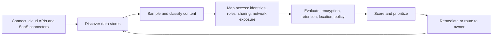

# Data security posture management (DSPM)

## Summary

Data security posture management finds where sensitive data lives across cloud and SaaS stores, classifies it, and combines that with who can reach it and how it is protected, so that the riskiest data exposures are fixed first. It is the data-centric member of the posture management family: [CSPM](../../../security-architecture-and-engineering/cloud-and-infrastructure-security/cloud-security-posture-management.md) asks whether the infrastructure is configured safely, DSPM asks what data is in it and whether that data is exposed. It exists because cloud data multiplies faster than anyone records it: copies, exports, test data and backups appear in places no inventory lists. DSPM tools usually sample content instead of scanning everything, which makes their findings probabilistic. This note explains the mechanism, shows the effect of sampling in a tested simulation, and states where DSPM overlaps with DLP, CSPM and classification programs.

## Prerequisites

- [Security posture management](../../../security-architecture-and-engineering/cloud-and-infrastructure-security/security-posture-management.md) and [CSPM](../../../security-architecture-and-engineering/cloud-and-infrastructure-security/cloud-security-posture-management.md).
- [Asset management](../../asset-management/README.md) and information classification.
- [DLP](../data-loss-prevention/README.md), because DSPM covers data at rest and DLP covers data in use and in motion.
- [CIA triad](../../../security-and-risk-management/foundations/cia-triad/README.md) and the [NIST Privacy Framework](../../privacy-and-data-protection/nist-privacy-framework.md).

## Core concepts

### Definition

*Data security posture management* is a category of tooling and practice that continuously discovers data stores (object storage, databases, data warehouses, SaaS), identifies and classifies sensitive data in them, maps access and exposure, and reports risk and policy violations. The term is used by vendors and analysts, and there is no standards body definition that I know of. The statements below come from vendor documentation and are labeled as such.

Microsoft's Defender for Cloud documentation (page updated 2026, vendor statement) describes data security posture management as helping to automatically discover sensitive data resources across multiple clouds, evaluate data sensitivity, exposure and data flows, uncover risks that might lead to data breaches, and detect suspicious activity affecting sensitive data. It says discovery finds "managed and shadow data resources", that results come from sampling and not from a full scan, and that a resource is considered sensitive when a sensitive information type is detected and configured as sensitive.

Amazon Macie is the AWS service in this area. Its documentation describes a data security service that discovers sensitive data using machine learning and pattern matching, keeps an inventory of S3 general purpose buckets, evaluates them for security and access control (for example a bucket that becomes publicly accessible) and generates findings of two kinds: policy findings about bucket security and sensitive data findings about objects (AWS documentation, checked 2026-10).

### Analogy

A building inspector who does not only check that doors lock (CSPM) but also opens a sample of rooms to see what is stored inside, notes which rooms hold valuables and checks who has keys and whether a window is open. The inspector does not open every drawer, so a drawer with a small valuable item can be missed. The analogy breaks because data moves: a copy made yesterday can appear in a new room before the next inspection.

### Why it exists

1. **Data sprawl.** Developers copy production data to test, analysts export tables, backups and snapshots persist, SaaS tools receive uploads. The inventory of data stores is less complete than the inventory of servers.
2. **Cloud made exposure easy.** A single permission change can make a store public or share it with another account.
3. **Compliance pressure.** Privacy laws require knowing where personal data is, see [privacy regulations](../../../security-and-risk-management/privacy-regulations/privacy-regulations-overview.md).
4. **Prioritization.** A misconfigured store with no sensitive data matters less than a modest misconfiguration on a store with personal records. Infrastructure posture tools cannot tell the difference without data context.
5. **AI pipelines.** Training and retrieval datasets pull data from many stores, see [adversarial AI](../../../security-architecture-and-engineering/ai-security/adversarial-machine-learning/README.md) for poisoning and leakage risks.

### Mechanism



1. **Connect.** Read-only roles and API connectors, usually agentless. The read permission to data is itself sensitive and must be scoped and audited.
2. **Discover.** Enumerate buckets, databases, warehouses, file shares and SaaS repositories. Find shadow stores (a database in an account nobody registered).
3. **Sample and classify.** The scanner reads part of the content and applies detectors (patterns with validation, dictionaries, machine learning classifiers, labels such as those from information protection systems). Microsoft states that its engine samples up to 20 MB for each file scanned within selected containers and, for databases, samples between 300 and 1,024 rows, and that the sampling is meant to identify sensitive resources "with high confidence without performing a full scan". Macie offers automated sensitive data discovery with sampling and separate discovery jobs with a depth the user defines (AWS documentation).
4. **Map access and exposure.** Who can read: roles, groups, service accounts, cross-account sharing, public links. Is the store reachable from the internet? Does the identity that can read it also have an internet-exposed workload? Microsoft describes attack paths such as internet-exposed virtual machines with access to sensitive data stores.
5. **Evaluate against policy.** Encryption (and who holds the keys), retention, residency, backup copies, logging, whether sensitive data appears in a store not approved for that class.
6. **Score, route, track.** Rank by combined risk, assign owners (from [asset management](../../asset-management/README.md)) and track fix time. Detect changes: new sensitive data appearing in a public store is an event.

### Relations to neighboring tools

| Tool | Question | Data state |
| --- | --- | --- |
| DSPM | Where is sensitive data and is it exposed? | At rest, across stores |
| DLP | Is sensitive data leaving through a channel? | In use and in motion, also at rest on endpoints |
| CSPM | Is the cloud infrastructure configured safely? | Configuration |
| CIEM | Which identities have excess permissions? | Identity |
| CASB | Which SaaS apps are in use, and what do they receive? | SaaS data and usage |
| Data catalog or governance | What data exists and what does it mean for the business? | Metadata |

Vendors combine these. In Microsoft's documentation DSPM capability sits in the Defender CSPM plan and in Defender for Storage. The [CSPM tools](../../../security-architecture-and-engineering/cloud-and-infrastructure-security/cspm-tools.md) note records which products list DSPM among their modules.

## Worked example

The script `scripts/dspm-sampling-risk.py` simulates the two core questions. Python 3.10, standard library only, fixed random seed, synthetic data. The output is real.

```bash
python3 scripts/dspm-sampling-risk.py
```

Output:

```text
1 probability that a sample finds at least one sensitive object (10,000 objects)
   sensitive=  5 sample=100 scattered -> 0.05
   sensitive=  5 sample=100 clustered -> 0.05
   sensitive=  5 sample=500 scattered -> 0.22
   sensitive=  5 sample=500 clustered -> 0.23
   sensitive= 50 sample=100 scattered -> 0.41
   sensitive= 50 sample=100 clustered -> 0.39
   sensitive= 50 sample=500 scattered -> 0.92
   sensitive= 50 sample=500 clustered -> 0.92
   sensitive=500 sample=100 scattered -> 0.99
   sensitive=500 sample=100 clustered -> 0.99
   sensitive=500 sample=500 scattered -> 1.00
   sensitive=500 sample=500 clustered -> 1.00
2 posture ranking (higher means look first)
   hr-exports        risk= 87.0 sensitivity=3 public=True  identities= 60 cmk=False stray_copy=True
   ml-training-set   risk= 50.0 sensitivity=2 public=False identities=300 cmk=True stray_copy=True
   orders-db         risk= 32.4 sensitivity=3 public=False identities= 12 cmk=True stray_copy=False
   logs-archive      risk= 16.8 sensitivity=1 public=False identities=  9 cmk=False stray_copy=False
   marketing-assets  risk=  7.2 sensitivity=0 public=True  identities=  4 cmk=False stray_copy=False
```

Part 1 shows the central property of sampling. A store of 10,000 objects with 5 sensitive ones is found by a random sample of 100 objects in about 5% of scans, and by a sample of 500 in about 22%. With 50 sensitive objects, a sample of 100 gives 41% and 500 gives 92%. With 500 sensitive objects even a sample of 100 gives 99%. So sampling finds that a store contains sensitive data when there is a lot of it, and misses rare occurrences. That is acceptable for the question "which stores should I worry about" and unacceptable for "prove that this store holds no card numbers". The numbers for clustered and scattered data are the same because the sample is uniform over objects. A scanner that samples per folder or container behaves differently, and so can be fooled by clustering. Ask a vendor how its sampling unit works.

Part 2 ranks five synthetic stores. `hr-exports` is first: sensitive, public, 60 identities, no customer-managed key and a stray copy. `ml-training-set` is second despite not being public, because 300 identities and a stray copy widen the exposure. `marketing-assets` is public but not sensitive, so it is scored low by this rule, and it needs a different review (is it meant to be public?). The weights are invented for illustration. The point is the structure: sensitivity multiplies exposure, and exposure comes from several independent factors.

## Trade offs and when to use it

**Where DSPM pays off.** Multi-cloud or SaaS-heavy environments with regulated data, data lakes and AI pipelines, mergers that bring unknown data stores, and audits that ask where personal data is.

**Costs and limits.**

- Sampling gives probabilistic findings (see the simulation). For legal certainty, a full scan of selected stores is needed.
- Scanning costs money (compute, API calls, data egress and vendor pricing based on volume). Macie bills by dimensions that include objects monitored and analyzed.
- Read access to data concentrates risk in the scanner. Use least privilege, in-account scanning where available and audit the scanner.
- Classification accuracy depends on the detectors: structured identifiers are good, free text and business context are weak. Expect false positives and negatives, as in the [DLP](../data-loss-prevention/README.md) example.
- Coverage: SaaS apps and on-premises stores need connectors that not every product has.
- Findings need owners. A list of exposed data without a route to the data owner stays a list.

**Alternatives.** Manual data inventories and data mapping for privacy (records of processing) are accurate but slow. Native tools such as Macie, Microsoft Purview, Google Sensitive Data Protection and similar services cover their own platforms. A data catalog gives meaning but not exposure. Reduce the problem first: retention and minimization remove data that attackers could reach.

## Common mistakes

| Mistake | Effect | Fix |
| --- | --- | --- |
| Reading "no sensitive data found" as proof | Rare sensitive records are missed | Treat as probability, run deeper scans where needed |
| Scanner with broad data read access, unmonitored | The tool becomes a high-value target | Scope, audit, separate accounts |
| Ranking by sensitivity only | Exposed vs protected stores look equal | Combine sensitivity with exposure and access |
| Ignoring stray copies, snapshots and exports | Sensitive data lives outside the governed store | Include backups, test data, analytics exports |
| No data owner mapping | Findings are not fixed | Tie stores to owners, see [asset management](../../asset-management/README.md) |
| Treating DSPM as a replacement for DLP | Leaks via channels stay unseen | Use both |
| Classification rules never reviewed | Drift and noise | Test detectors against labeled samples |
| Forgetting AI datasets | Training data leaks or poisoning | Include them in scope |

Detection and mitigation: alert on a store becoming public or shared externally, on new sensitive data appearing in an unapproved location, on a large read or copy of a sensitive store by an unusual identity, and feed those events to the [SIEM](../../../security-operations/defensive-operations/operations/siem.md). Mitigation: remove public access, encrypt with managed keys, reduce who can read, delete stray copies, apply retention.

## Practice

1. What question does DSPM answer that CSPM does not?
2. From the simulation: with 5 sensitive objects among 10,000, how many objects would you need to sample to reach roughly 50% detection? (Estimate with the formula.)
3. Why does the clustered versus scattered comparison show no difference, and when would it?
4. Give two reasons a public store with no sensitive data can still be a finding.
5. What access does a DSPM scanner need, and how do you limit the risk of that access?
6. Which CISSP sections apply?

**Answers and hints**

1. What data is in the store and whether it is sensitive, so the severity of a misconfiguration can be judged by its content.
2. The probability of missing all 5 with a sample of `n` is about `(1 - n/10000)^5`. For 50% detection solve `(1 - n/10000)^5 = 0.5`, which gives `n` of about 1,300.
3. Uniform sampling over objects makes every object equally likely to be picked, so the layout is irrelevant. Sampling by folder or container would depend on how data is grouped.
4. It may be unintended (a bucket meant to be private), and public write access allows an attacker to host content or tamper with files that others trust.
5. Read access to storage and metadata, and often to data content. Use a dedicated read-only role, restrict scope to approved stores, log all access and keep the scanner's findings sensitive.
6. 2.1 (classification), 2.4 (data lifecycle), 2.6 (data security controls) and 3.5 (cloud-based system vulnerabilities). See [CISSP security domains](../../../security-and-risk-management/reference/certifications/cissp-security-domains.md).

## Further reading

- Microsoft Learn, [Data security posture management in Defender for Cloud](https://learn.microsoft.com/en-us/azure/defender-for-cloud/concept-data-security-posture): discovery, smart sampling and attack paths with data context. Vendor documentation, read in full.
- AWS, [What is Amazon Macie?](https://docs.aws.amazon.com/macie/latest/user/what-is-macie.html): discovery, managed and custom data identifiers, bucket posture findings. Vendor documentation, read in full.
- [CSPM tools](../../../security-architecture-and-engineering/cloud-and-infrastructure-security/cspm-tools.md): which commercial platforms list DSPM among their modules.
- [Data loss prevention](../data-loss-prevention/README.md) and [security posture management](../../../security-architecture-and-engineering/cloud-and-infrastructure-security/security-posture-management.md) in this repository.
- I found no standard or NIST publication that defines DSPM. The category definition comes from vendors and analysts.
