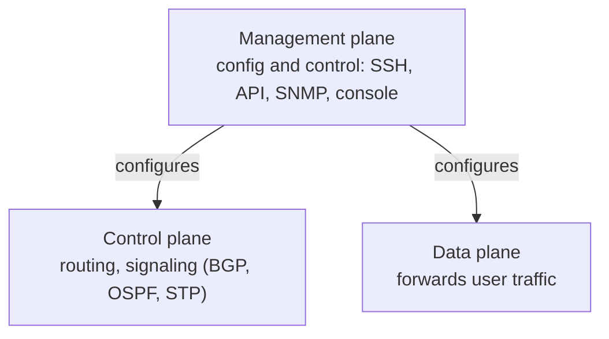

# Management plane security

## Summary

The management plane is how network devices and servers are configured and controlled: SSH and web consoles on routers, switches and firewalls, hypervisor and cloud management APIs, out-of-band console access, and the protocols (SNMP, NETCONF, RADIUS, syslog) that carry management traffic. Whoever controls the management plane controls the network, so it is the highest-value target and must be the most strongly protected and isolated. Management plane security means separating management traffic from user traffic, placing administrative access behind bastions and multi-factor authentication, using only encrypted management protocols, and ensuring out-of-band access for when the data plane fails. A flat network where anyone can reach a switch's admin interface has no meaningful security.

## Prerequisites

- [Network segmentation](network-segmentation.md) and [security zones and DMZ](security-zones-and-dmz.md).
- [SSH security](../secure-transport/ssh-security.md) and [insecure legacy protocols](../core-protocols/insecure-legacy-protocols.md).
- [Network threat model](../foundations/network-threat-model.md): the infrastructure insider.

## Core concepts

### Definition

The *management plane* is the set of interfaces, protocols and systems used to administer network devices and infrastructure, as distinct from the *data plane* (which forwards user traffic) and the *control plane* (which runs routing and signaling protocols). Management plane security is the protection and isolation of administrative access to infrastructure.

### Analogy

If a building's rooms are the data plane, the management plane is the master keys, the maintenance corridors and the control room that runs the locks, lights and elevators. You do not let the public walk the maintenance corridors or touch the control panel, because whoever controls them controls every room. You give master keys to few people, log their use, and keep a separate emergency entrance to the control room for when the main power fails.

The analogy holds closely; the only break is that network management "corridors" are often accidentally reachable from ordinary rooms unless deliberately separated, which is the central mistake this note addresses.

### The three planes

Separating them matters because an attack on one should not reach the others. The control plane has its own protections (authenticated routing, [BGP security](../core-protocols/bgp-security.md)); the management plane is protected by isolation, strong authentication and encrypted protocols.

### Core controls

- **Separate management network.** Management interfaces live on a dedicated network or VLAN, not reachable from the user or server data networks. Administrators reach it only through controlled paths.
- **Bastion / jump hosts.** Administrative access to devices goes through a hardened jump host that is heavily logged and MFA-protected, rather than directly from any workstation. This creates one monitored choke point.
- **Privileged Access Workstations (PAWs).** Administration is performed from dedicated, hardened workstations that are not used for email or web browsing, so that a phished laptop does not also hold the keys to the infrastructure.
- **Strong authentication and AAA.** Centralized authentication (TACACS+ or RADIUS), MFA, per-admin accounts (no shared logins), role-based command authorization, and full command accounting.
- **Encrypted management protocols only.** SSH not Telnet, HTTPS not HTTP, SNMPv3 not v1/v2c, NETCONF over SSH. See [insecure legacy protocols](../core-protocols/insecure-legacy-protocols.md).
- **Out-of-band (OOB) management.** A separate physical path (console servers, a dedicated OOB network) to reach devices when the production network is down or under attack, so recovery does not depend on the thing that failed.

### Out-of-band access

In-band management (administering a device over the same network it serves) fails exactly when you need it most: during an outage, a misconfiguration that cuts connectivity, or a DoS attack. Out-of-band management provides an independent path (serial console servers, a dedicated management network, sometimes cellular) so administrators can reach and recover devices regardless of the data plane's state. It is both an availability and a security control, since it avoids having to relax production controls to regain access in an emergency.

## Worked example

A network team hardens management access that currently allows SSH to switches from any workstation with a shared `admin` password:

1. **Isolate.** Move all device management interfaces to a dedicated management VLAN unreachable from user and server networks.
2. **Choke point.** Deploy a bastion host in the management network; devices accept management connections only from the bastion. Administrators connect to the bastion with their own account and MFA, then to devices.
3. **PAWs.** Administrators use dedicated hardened workstations for this, not their email laptops.
4. **AAA.** Devices authenticate admins against TACACS+ with per-user accounts, role-based command authorization, and command accounting to the SIEM. The shared `admin` account is removed.
5. **Protocols.** Telnet and HTTP are disabled on all devices; SSH (keys), HTTPS and SNMPv3 only.
6. **Out-of-band.** A console server on a separate network provides serial access to every device for emergencies.

Result: reaching a switch's configuration now requires a PAW, a personal MFA-authenticated login to the bastion, and authorized commands that are all logged; a compromised user laptop no longer has any path to device management; and an outage can be fixed over the out-of-band path without weakening controls. The previous design, a shared password reachable from anywhere, gave effective network control to anyone who phished one workstation.

## Trade offs and when to use it

- **Isolation vs convenience.** A separate management network and bastions add steps for administrators; the security gain (removing the most dangerous reachable target) is almost always worth it for infrastructure.
- **PAWs cost.** Dedicated admin workstations are extra hardware and process; reserve them for the most privileged roles if full coverage is impractical, but cover infrastructure and domain administration.
- **Out-of-band cost.** A separate OOB path is extra infrastructure, justified by the ability to recover during exactly the incidents when in-band access is gone.
- **Centralized AAA dependency.** TACACS+/RADIUS centralizes control but becomes critical; provide redundancy and a documented local fallback.

## Common mistakes

- **Management interfaces reachable from user networks.** The highest-value target left exposed. Fix: dedicated management network, access only via bastion.
- **Shared administrative accounts.** No accountability, easy credential reuse. Fix: per-admin accounts, MFA, AAA accounting.
- **Administering from general-purpose workstations.** A phished laptop compromises the infrastructure. Fix: PAWs.
- **Cleartext management (Telnet, HTTP, SNMPv1/2c).** Credentials sniffable. Fix: SSH, HTTPS, SNMPv3 only.
- **No out-of-band path.** Cannot recover during an outage without weakening controls. Fix: dedicated OOB access.
- **Internet-exposed device management or VPN appliance admin pages.** A direct path to control. Fix: never expose management to the internet; place behind the management network.

## Practice

1. Why is the management plane the highest-value target on a network?
2. What is the purpose of a bastion/jump host in management access?
3. Why administer infrastructure from a Privileged Access Workstation rather than a normal laptop?
4. Why is out-of-band management both a security and an availability control?
5. Name three cleartext management protocols and their secure replacements.

### Answers

1. Whoever controls the management plane can reconfigure the network's devices and therefore controls all traffic and separation, so compromising it is equivalent to compromising the whole network.
2. It is a single hardened, MFA-protected, heavily logged choke point through which all administrative access flows, so devices need accept management only from it and all admin activity is monitored in one place.
3. A PAW is not used for email or browsing, so it is far less likely to be compromised by phishing or web attacks; administering from a general laptop means a phished laptop also holds infrastructure control.
4. It provides an independent path to reach and recover devices when the production network is down or under attack, preserving availability of access without having to relax production security controls in the emergency.
5. Telnet to SSH, HTTP to HTTPS, SNMPv1/v2c to SNMPv3.

## Further reading

- NSA, Network Infrastructure Security Guide (2022), extensive management-plane guidance: https://media.defense.gov/2022/Jun/15/2003018261/-1/-1/0/CTR_NSA_NETWORK_INFRASTRUCTURE_SECURITY_GUIDE_20220615.PDF
- CISA, guidance on securing network infrastructure devices and out-of-band management.
- Microsoft, Privileged Access Workstations and the privileged access model.
- NIST SP 800-53 Rev. 5, controls AC-17 (Remote Access) and the SC family: https://csrc.nist.gov/pubs/sp/800/53/r5/upd1/final
