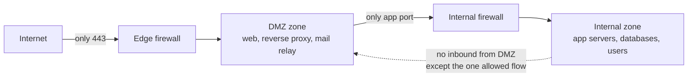

# Security zones and DMZ

## Summary

A security zone is a group of systems that share a trust level and are separated from other zones by a controlled boundary. The demilitarized zone (DMZ) is the classic example: a buffer network where internet-facing services live, separated from both the internet and the internal network, so that compromising a public server does not immediately give access to internal systems. Zones are the vocabulary of network architecture: you decide how many trust levels exist, place systems into them, and define what may cross each boundary. This note establishes the concepts that [segmentation](network-segmentation.md) then enforces and that [zero-trust networking](zero-trust-networking.md) later challenges.

## Prerequisites

- [Network segmentation](network-segmentation.md): the enforcement of zone boundaries.
- [Network threat model](../foundations/network-threat-model.md): why a buffer zone helps.
- [Defense in depth](../../../security-architecture-and-engineering/design-principles/defense-in-depth.md).

## Core concepts

### Definition

A *security zone* is a logical grouping of systems with a common trust level and security policy, bounded by enforcement points that control traffic in and out. A *DMZ* (demilitarized zone, also called a perimeter network) is a zone that sits between the untrusted internet and the trusted internal network and holds systems that must be reachable from the internet.

### Analogy

Think of a building with a public lobby, staff offices, and a secure records room. Visitors enter the lobby (DMZ) and can interact with a reception desk there, but the lobby has its own locked doors to the offices, so a troublemaker in the lobby cannot wander into the offices, and certainly not into the records room. The reception desk (a public web server) can pass messages inward through a narrow slot, but visitors never walk through themselves.

The analogy holds well; it breaks in that network "doors" must be explicitly configured to be locked (default-deny), whereas a physical building's walls are solid by default.

### Why a DMZ exists

An internet-facing service (web, mail, DNS, VPN gateway) must accept connections from anyone, so it is the most likely thing to be compromised. The DMZ's purpose is *containment of that expected compromise*: if the public web server is breached, the attacker is in the DMZ, not on the internal network, and the boundary between DMZ and internal is designed to let through only the specific, minimal traffic the service needs (for example, the web server may reach only the application tier on one port).

The key property: traffic from the internet reaches only the DMZ, and traffic from the DMZ to the internal network is restricted to the few flows the service requires. The internal network initiates to the DMZ or internet as policy allows, but the DMZ cannot freely reach inward.

### Common zones

Beyond the DMZ, a typical zoning model includes:

| Zone | Trust | Contents |
| --- | --- | --- |
| Internet / untrusted | None | Everything outside |
| DMZ / perimeter | Low | Public web, reverse proxies, mail relays, VPN gateways |
| Internal / user | Medium | Workstations, internal services |
| Server / data | Higher | Application and database tiers |
| Management | High, isolated | Jump hosts, device management (see [management plane security](management-plane-security.md)) |
| Restricted / sensitive | Highest | Payment card environment, OT, secrets, domain controllers |
| Guest | Isolated | Visitor devices, internet-only |

The number of zones is a design choice: too few and there is little containment, too many and the rules become unmanageable. Zones should reflect real differences in trust and function.

### Single vs dual firewall DMZ

A DMZ can be built with one firewall with three legs (internet, DMZ, internal) or with two firewalls in series (one between internet and DMZ, one between DMZ and internal). The two-firewall design is more robust: an attacker must defeat two devices, ideally from different vendors, to reach the internal network. The single-firewall design is cheaper and simpler but is a single point of failure for the whole separation.

### Zones and modern architecture

Zoning assumes a meaningful network boundary. Cloud, mobile and SaaS erode the single perimeter, and [zero-trust networking](zero-trust-networking.md) argues that network location should not confer trust at all. Zones remain useful (they contain blast radius and create monitoring choke points), but they are now one layer among many rather than the primary security boundary, and the DMZ concept generalizes to any boundary between differently-trusted environments, including cloud subnets and VPC boundaries.

## Worked example

A company publishes a web application and receives email. A sound zoning design:

1. **DMZ** holds a reverse proxy (terminating TLS) and an inbound mail relay. The edge firewall allows the internet to reach only the reverse proxy on 443 and the mail relay on 25.
2. The reverse proxy in the DMZ may open connections only to the application tier in the server zone, only on the application port. It cannot reach the database, the user network, or anything else.
3. The **server zone** holds the application and database tiers; the database accepts connections only from the application tier.
4. The **internal/user zone** may browse the internet (through egress controls) and reach internal services, but the DMZ cannot initiate connections into it.
5. If the reverse proxy is compromised, the attacker is confined to the DMZ and can only reach the one application port they were already allowed; the database, users and management remain separated.

The design converts an expected event (a public server being attacked) from a full breach into a contained one. Pair it with monitoring at the boundaries so the contained compromise is also detected.

## Trade offs and when to use it

- **Single vs dual firewall.** Dual (ideally two vendors) resists a single firewall flaw; single is cheaper but a single point of failure. Choose by risk and budget.
- **Number of zones.** More zones give finer containment but more rules and more chance of error; fewer are simpler but contain less. Match zones to real trust differences.
- **Zones vs zero trust.** Zones contain blast radius cheaply; zero trust adds per-request authorization. They are complementary, not exclusive; most organizations run zoned networks while adopting zero-trust principles for access.
- **DMZ relevance.** Still valuable for self-hosted internet-facing services; for cloud-hosted services the equivalent is VPC/subnet boundaries and managed edge services.

## Common mistakes

- **Flat internal network behind a strong DMZ.** Good perimeter, no internal containment; one internal compromise spreads freely. Fix: segment internally too.
- **DMZ hosts with broad internal access.** Defeats the buffer's purpose. Fix: restrict DMZ-to-internal to the minimal required flows.
- **Allowing the DMZ to initiate inbound to internal freely.** Fix: internal initiates outward; DMZ-to-internal is tightly limited.
- **Management access to DMZ hosts over the production path.** Fix: manage DMZ systems through the isolated management zone.
- **Treating the DMZ as safe.** It is the most-attacked zone. Fix: harden and monitor DMZ hosts heavily; assume compromise.

## Practice

1. What is the purpose of a DMZ, and which event is it designed to contain?
2. Why should DMZ-to-internal traffic be more tightly restricted than internal-to-DMZ?
3. What advantage does a dual-firewall DMZ have over a single three-legged firewall?
4. Why is a strong DMZ insufficient if the internal network is flat?
5. How does the DMZ concept carry over to cloud environments?

### Answers

1. To contain the compromise of an internet-facing service: it isolates public-facing systems so that breaching one leaves the attacker in the buffer zone, not on the internal network.
2. The DMZ holds the most-likely-to-be-compromised systems, so traffic from it inward is the dangerous direction and must be limited to the few flows the service genuinely needs; internal systems initiating outward to the DMZ are lower risk.
3. An attacker must defeat two separate devices (ideally from different vendors) to cross from internet to internal, so a single firewall vulnerability does not collapse the whole separation.
4. Once an attacker reaches any internal host (through the one allowed DMZ flow, phishing, or otherwise), a flat internal network lets them move everywhere; the DMZ only contains the perimeter, not internal spread.
5. It becomes the boundary between differently-trusted cloud networks: public-facing subnets or VPCs with managed edge services, separated by security groups and NACLs from private subnets holding application and data tiers.

## Further reading

- NIST SP 800-41 Rev. 1, Guidelines on Firewalls and Firewall Policy (2009), DMZ architectures: https://doi.org/10.6028/NIST.SP.800-41r1
- NIST SP 800-215, Guide to a Secure Enterprise Network Landscape (2022): https://doi.org/10.6028/NIST.SP.800-215
- NSA, Network Infrastructure Security Guide (2022): https://media.defense.gov/2022/Jun/15/2003018261/-1/-1/0/CTR_NSA_NETWORK_INFRASTRUCTURE_SECURITY_GUIDE_20220615.PDF
- [Network segmentation](network-segmentation.md) for enforcing zone boundaries.
