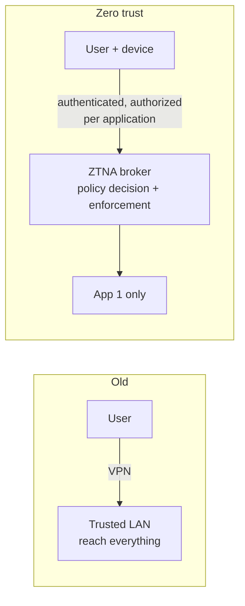

# Zero-trust networking

## Summary

Zero-trust networking is the network-security side of the zero-trust model: the principle that being on the network grants no trust, and that every access to a resource is authenticated, authorized and encrypted per request based on identity, device state and context, not on network location. In practice it replaces the "connect to the VPN and you are inside" model with Zero-Trust Network Access (ZTNA), where a broker grants access to one specific application at a time, and it leans on [microsegmentation](microsegmentation.md) and [mutual TLS](../secure-transport/tls-in-network-security.md) to remove implicit east-west trust. The architecture itself is defined in NIST SP 800-207, covered in the cloud-and-infrastructure area; this note is the networking view of how to actually build toward it.

## Prerequisites

- [NIST zero trust architecture (SP 800-207)](nist-zero-trust-architecture.md): the full model, tenets and components.
- [Network segmentation](network-segmentation.md), [microsegmentation](microsegmentation.md) and [VPNs](../secure-transport/vpns.md).
- [Network threat model](../foundations/network-threat-model.md): why "inside" is not trustworthy.

## Core concepts

### Definition

*Zero-trust networking* applies the zero-trust principle, "never trust, always verify", to network access: no network location (the office LAN, the VPN) confers trust; each request to a resource is evaluated on identity, device posture and context and granted with least privilege for that session only. *Zero-Trust Network Access (ZTNA)* is the access model that implements this for users reaching applications.

### Analogy

The old model is a gated community: pass the gate (the VPN or the office network) and you may walk up to any house. Zero trust is a city where there is no gate, and every building checks your ID and your specific appointment at its own door, every time, regardless of which street you came from. Losing one person's street map (a stolen credential) no longer opens every house; the attacker still faces each door's individual check.

The analogy holds well; it breaks in that the "door checks" are continuous and automated (re-evaluated during a session as context changes), which a human doorkeeper could not sustain.

### What changes at the network level

- **No implicit perimeter trust.** Traffic from the office LAN is treated like traffic from the internet; both must authenticate. This directly applies SP 800-207's tenet that network location does not imply trust.
- **Per-application access, not network access.** ZTNA connects a verified user and device to one specific application, never placing them on a flat network. The application's existence is often hidden until access is granted (no network scanning of what you cannot reach).
- **Identity and device posture drive policy.** Access depends on who the user is (strong authentication, MFA), what device they use (managed, patched, encrypted), and context (location, time, risk), re-evaluated continuously.
- **Microsegmentation and mTLS for workloads.** Server-to-server traffic is authorized per workload identity with [microsegmentation](microsegmentation.md) and authenticated with [mutual TLS](../secure-transport/tls-in-network-security.md), removing east-west implicit trust.

### ZTNA vs VPN

| | Traditional VPN | ZTNA |
| --- | --- | --- |
| Grants | Access to a network | Access to specific applications |
| Trust basis | Network location after connect | Identity + device + context, per request |
| Visibility to user | Whole reachable network | Only authorized apps; others hidden |
| Lateral movement | Possible once connected | Blocked by per-app authorization |
| Device posture | Often ignored | Central to the decision |

ZTNA is the remote-access successor to the VPN; many organizations run both during migration, using the VPN for legacy needs and ZTNA for new application access.

### It is a journey, not a product

Zero trust is an architecture applied incrementally, not a box to install (SP 800-207 is explicit about this). The network path typically runs: strong identity and MFA everywhere, then device posture, then segmenting and microsegmenting internal traffic, then replacing broad VPN access with per-application ZTNA, then continuous evaluation. Each step reduces implicit trust; none alone is "zero trust".

## Worked example

A company moves one legacy internal app (`hr.example`) from VPN access to ZTNA:

1. **Before.** Remote staff connect to the VPN, land on the corporate LAN, and can reach `hr.example` and everything else; a stolen VPN credential exposes the whole LAN.
2. **Identity and device.** A ZTNA broker requires the user to authenticate with MFA and checks that the connecting device is managed, patched and encrypted.
3. **Per-application tunnel.** On success, the broker establishes a connection to `hr.example` only. The user never gets an IP route to the rest of the LAN, and cannot even see other services; `hr.example` is not exposed to the internet directly, only through the broker.
4. **Continuous evaluation.** If the device falls out of compliance mid-session (disables encryption, fails a posture check) or the risk signal changes, access is revoked.
5. **East-west.** `hr.example`'s own connections to its database are authorized by [microsegmentation](microsegmentation.md) and authenticated with mTLS, so a compromise of `hr.example` cannot freely reach other servers.

Result: a stolen credential alone fails (MFA plus device posture), a connected user reaches only the one authorized app, the app is invisible to everyone else, and a compromise of the app is contained east-west. The same user's access to other apps is a separate decision each time.

## Trade offs and when to use it

- **Containment vs effort.** Zero trust strongly limits credential-theft and lateral-movement damage, but it requires mature identity, device management and policy, and incremental migration; it is a multi-year program, not a switch.
- **ZTNA vs VPN.** ZTNA fits per-application remote access with least privilege; VPNs remain simpler for site-to-site and some legacy needs. Expect to run both during transition.
- **User experience.** Done well, ZTNA is smoother than a VPN (direct per-app access, no full tunnel); done poorly, continuous checks add friction. Tune policy to risk.
- **Dependency on identity and device systems.** Zero trust concentrates reliance on the identity provider and device posture signals; these become critical and must themselves be hardened and redundant.

## Common mistakes

- **Buying a "zero trust product" and declaring victory.** It is an architecture applied across identity, device and network. Fix: treat it as an incremental program per SP 800-207.
- **ZTNA that still drops users onto a flat network.** Recreates the VPN problem. Fix: per-application access with no broad network route.
- **Ignoring device posture.** Identity alone is not zero trust; a valid user on a compromised device is still a risk. Fix: include device state in the decision.
- **No internal microsegmentation.** Per-user access is undermined if workloads still trust each other freely. Fix: microsegmentation and mTLS east-west.
- **Weak or non-redundant identity provider.** The decision point becomes a single point of failure and attack. Fix: harden and make the IdP resilient, with phishing-resistant MFA.

## Practice

1. What is the core principle of zero-trust networking, and which VPN assumption does it reject?
2. How does ZTNA differ from a VPN in what it grants and what a user can see?
3. Why is device posture, not just identity, part of a zero-trust access decision?
4. Why is zero trust described as a journey rather than a product?
5. What internal network controls complement user-facing ZTNA, and why are they necessary?

### Answers

1. That network location confers no trust and every resource access is authenticated, authorized and encrypted per request based on identity, device and context; it rejects the VPN assumption that connecting to the network makes a user "inside" and trusted.
2. ZTNA grants access to specific applications rather than to a network, and the user sees and can reach only authorized apps, with others hidden, rather than gaining a route to a whole LAN.
3. A valid credential on a compromised, unpatched or unmanaged device is still a threat; evaluating device posture ensures access depends on the security state of the endpoint, not only on who the user is.
4. It is an architecture applied incrementally across identity, device and network (per SP 800-207), with each step reducing implicit trust; no single product delivers it.
5. Microsegmentation and mutual TLS for workload-to-workload traffic; without them, per-user access is undermined because compromised workloads could still move freely east-west.

## Further reading

- NIST SP 800-207, Zero Trust Architecture (2020), the authoritative model: https://doi.org/10.6028/NIST.SP.800-207
- [NIST zero trust architecture (SP 800-207)](nist-zero-trust-architecture.md): this repository's detailed treatment.
- NIST SP 1800-35, Implementing a Zero Trust Architecture (NCCoE practice guide).
- CISA, Zero Trust Maturity Model: https://www.cisa.gov/zero-trust-maturity-model
