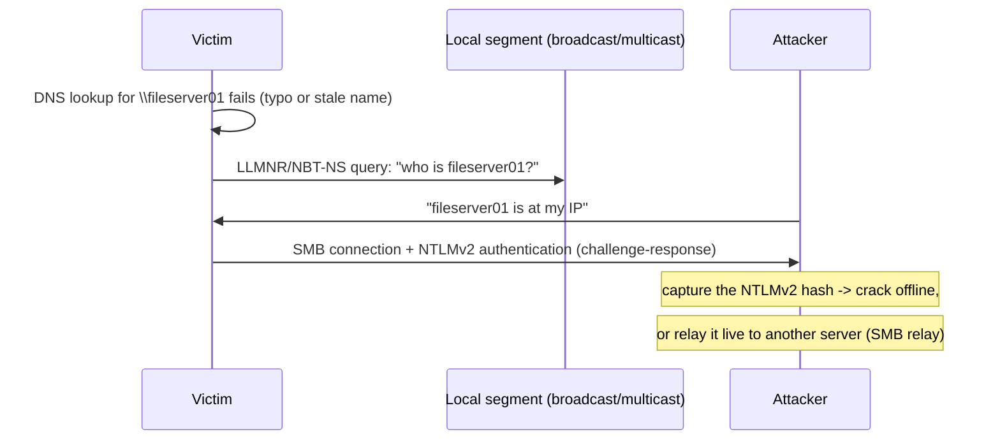

# Local name resolution poisoning

## Summary

When a Windows or mixed network cannot resolve a name through DNS, hosts fall back to broadcast-based local name protocols: LLMNR, NetBIOS Name Service (NBT-NS) and mDNS. These protocols ask the whole local segment "who is NAME?" and trust whoever answers. An attacker on the segment answers every such query with "it is me", and because many clients then try to authenticate to the attacker, they capture password hashes (NTLMv2) that can be cracked offline or relayed. The related WPAD mechanism, which auto-discovers a web proxy by name, lets an attacker become the proxy for all web traffic. These attacks are a staple of internal penetration tests. The decisive defense is to disable the fallback protocols and WPAD, because they offer little value and large risk.

## Prerequisites

- [Protocol design weaknesses](../foundations/protocol-design-weaknesses.md): broadcast discovery and unsolicited answers.
- [Network threat model](../foundations/network-threat-model.md): adjacent attacker.
- [DNS threat landscape](../dns-security/dns-threat-landscape.md): the primary resolution these protocols fall back from.

Authorized use only: these techniques are used in authorized internal penetration tests. This note frames them for defense.

## Core concepts

### Definition

*Local name resolution poisoning* is answering broadcast or multicast name queries with forged replies to impersonate a host and induce victims to connect to the attacker. The protocols involved:

- *LLMNR* (Link-Local Multicast Name Resolution, RFC 4795): a multicast fallback when DNS fails.
- *NBT-NS* (NetBIOS Name Service): the older broadcast name service, still enabled on many Windows networks.
- *mDNS* (Multicast DNS, RFC 6762): the `.local` resolution used by Apple Bonjour and many devices.
- *WPAD* (Web Proxy Auto-Discovery): finds a proxy configuration by resolving the name `wpad`, often via the above fallbacks.

MITRE ATT&CK tracks this as LLMNR/NBT-NS Poisoning and SMB Relay (T1557.001).

### Analogy

Imagine an office where, if the front-desk directory (DNS) does not list someone, you simply shout their name down the hallway and trust whoever shouts back "that's me". An impostor who answers every such shout gets people walking up to them and handing over their ID to prove who *they* are (the authentication attempt). WPAD is the same office trusting a shouted answer to "who runs the mailroom?", so the impostor becomes the mailroom and sees all the mail.

The analogy holds closely; the only break is that the "ID handed over" is a cryptographic challenge-response (an NTLMv2 hash), which the attacker cannot use directly but can crack offline or relay to another server in real time.

### Mechanism

Two outcomes from the captured authentication:

- *Offline cracking*: the NTLMv2 response is subject to a password-guessing attack; weak passwords fall quickly.
- *Relay*: if SMB signing is not required on the target, the attacker relays the live authentication to another server and acts as the victim without ever knowing the password.

### Defense: disable the fallbacks

These protocols exist for convenience on small networks and are rarely needed when DNS is correctly configured. The defenses, in order of impact:

- **Disable LLMNR** (Group Policy: Turn off multicast name resolution) and **NBT-NS** (per-adapter, or via DHCP option / registry) across the fleet.
- **Disable or pin WPAD**: create a DNS entry for `wpad` (so it is not left to broadcast fallback) or disable WPAD entirely; block the name in DNS.
- **Require SMB signing** everywhere, which prevents SMB relay even if an authentication is captured.
- **Restrict NTLM** and move to Kerberos; use strong passwords so any captured hash resists cracking.
- **Segment** so an attacker's poisoned answers reach fewer victims.
- **mDNS**: disable where not needed, or confine it; it is harder to remove because devices rely on it, so segmentation and monitoring carry more weight.

## Worked example

This is a Windows-domain and broadcast scenario, not reproducible in the Linux namespace lab, so it is described rather than run.

1. A user mistypes a share name, `\\fileserver01` instead of `\\fileserver-01`. DNS has no record, so Windows falls back to LLMNR and NBT-NS and broadcasts "who is fileserver01?".
2. The attacker's responder tool answers "me". The user's machine opens SMB to the attacker and sends an NTLMv2 authentication for the user's account.
3. The attacker captures the NTLMv2 hash. If the password is weak, offline cracking recovers it in minutes. If SMB signing is not enforced on, say, a server the user can access, the attacker instead relays the authentication there and gains the user's access without the password.
4. **With defenses:** LLMNR and NBT-NS are disabled, so the mistyped lookup simply fails with no broadcast to answer; the attacker gets nothing. Even if a residual broadcast path existed, enforced SMB signing blocks relay, and a 16-character passphrase makes offline cracking impractical.

The defense is almost entirely preventive configuration, which is why this is one of the highest-value, lowest-effort hardening steps on a Windows network.

## Trade offs and when to use it

- **Disabling LLMNR/NBT-NS** has minimal downside on a network with working DNS and removes a whole attack class. Do it; test for rare legacy dependencies first.
- **Requiring SMB signing** has a small performance cost and some compatibility considerations with old devices, outweighed by blocking relay.
- **WPAD**: pinning a DNS record is low-effort; fully disabling proxy auto-discovery is cleaner where a proxy is configured explicitly.
- **mDNS** is the hardest to remove because printers, casting and discovery depend on it; prefer segmentation and monitoring over breaking device features.

## Common mistakes

- **Leaving LLMNR and NBT-NS enabled by default.** They are on out of the box on Windows and are the single most common finding on internal tests. Fix: disable via Group Policy and DHCP.
- **Disabling LLMNR but forgetting NBT-NS.** NBT-NS is a separate, older service. Fix: disable both.
- **Not enforcing SMB signing.** Captured authentications can be relayed. Fix: require signing on servers and clients.
- **Ignoring WPAD.** An unresolved `wpad` falls back to broadcast and hands the attacker all web traffic. Fix: pin or disable WPAD, block the name.
- **Weak passwords behind NTLM.** Captured hashes crack fast. Fix: long passphrases, move to Kerberos, restrict NTLM.

## Practice

1. Why do LLMNR and NBT-NS queries let an attacker impersonate any host?
2. What two things can an attacker do with a captured NTLMv2 authentication, and which needs no password cracking?
3. Why is disabling these protocols considered high-value and low-risk on a network with working DNS?
4. How does WPAD poisoning differ in impact from ordinary name poisoning?
5. Which single server-side setting blocks the SMB relay outcome?

### Answers

1. They broadcast or multicast "who is NAME?" to the whole segment with no authentication, so the attacker simply answers first claiming to be that host.
2. Crack the NTLMv2 response offline to recover the password, or relay the live authentication to another server (SMB relay) to act as the victim; relay needs no cracking.
3. The protocols are only convenience fallbacks rarely needed when DNS works, so disabling them removes a major attack class with minimal operational impact (after checking for legacy dependencies).
4. WPAD poisoning makes the attacker the victim's web proxy, so they see and can alter all of the victim's web traffic, not just one connection to an impersonated host.
5. Requiring SMB signing.

## Further reading

- MITRE ATT&CK, Adversary-in-the-Middle: LLMNR/NBT-NS Poisoning and SMB Relay (T1557.001): https://attack.mitre.org/techniques/T1557/001/
- RFC 4795 (LLMNR) and RFC 6762 (mDNS): https://www.rfc-editor.org/rfc/rfc6762
- Microsoft guidance on disabling LLMNR and NBT-NS, and on requiring SMB signing.
- CISA and NSA hardening guidance on NTLM relay mitigation and WPAD.
