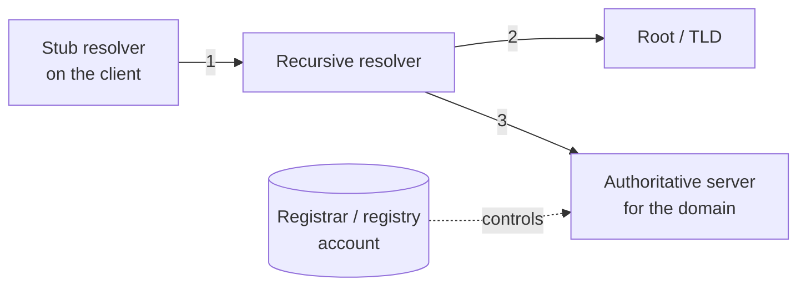

# DNS threat landscape

## Summary

DNS turns names people can remember into the addresses machines use, and almost every connection starts with a DNS lookup. That makes DNS both a high-value target and a powerful control point. The threats fall into a few families: forging answers (spoofing and cache poisoning) to send victims to the wrong place, hijacking the records or the registrar account to redirect a domain, abusing DNS for denial of service (amplification), and using DNS as a covert channel ([tunneling](dns-tunneling/README.md)). This note maps the landscape and points to the defenses, which are developed in the DNSSEC, encrypted DNS and protective DNS notes. The theme is that DNS was built to be fast and trusting, so each defense adds a verification or control the original protocol lacked.

## Prerequisites

- [Protocol design weaknesses](../foundations/protocol-design-weaknesses.md): predictable fields, unsolicited answers.
- [Network threat model](../foundations/network-threat-model.md): off-path and on-path.
- How recursive DNS resolution works (stub resolver, recursive resolver, authoritative servers).

## Core concepts

### Definition

The *DNS threat landscape* is the set of attacks against the Domain Name System and its resolution path: the stub resolver on the client, the recursive resolver, and the authoritative servers for a domain. Each hop is a place to forge, intercept, redirect or abuse.

### Analogy

DNS is the internet's phone directory and switchboard. You ask "what is the number for the bank?" and dial whatever you are told. Attacks are: an impostor shouting a wrong number before the real operator answers (spoofing), someone slipping a forged page into the printed directory so everyone who looks up the bank gets the wrong number for a while (cache poisoning), someone bribing the directory publisher to change the bank's listing at the source (hijacking), and prank callers using the directory service to flood a victim with callbacks (amplification).

The analogy holds well; it breaks mainly in speed and scale, since a poisoned cache can misdirect thousands of users in milliseconds and a hijack at the registrar redirects a domain globally.

### The resolution path and where it is attacked

| Target | Attack | Effect |
| --- | --- | --- |
| Client to resolver (1) | On-path spoofing, or malicious resolver | All of the client's lookups can be answered falsely |
| Resolver cache | Cache poisoning (forged answers accepted and cached) | Many clients misdirected until the record expires |
| Resolver to authoritative (3) | Off-path spoofing (the Kaminsky attack) | Poisoned cache entries |
| Authoritative records | DNS hijacking (compromise the server or zone) | The domain points wherever the attacker wants |
| Registrar / registry (account) | Domain hijacking via the account | Full control of the domain, including moving name servers |
| Any open resolver / authoritative | Amplification (reflection) | The server is used to flood a third party |
| The channel itself | Tunneling | Covert data exfiltration and C2 |

### Cache poisoning and the Kaminsky attack

A recursive resolver caches answers to be fast. If an attacker can get the resolver to cache a forged answer, every client using that resolver is misdirected until the cache entry expires. The classic *Kaminsky attack* (2008) exploited two weaknesses: the only proof that a reply matched a query was a 16-bit transaction ID (guessable), and an attacker could trigger many queries for names under a target domain and race forged replies, poisoning not just one record but the delegation for the whole domain. The immediate mitigation was *source port randomization* (adding ~16 bits of entropy, since the attacker must also guess the UDP source port) and later *0x20 encoding* (randomizing the case of the query name as extra entropy). These make blind poisoning impractical but do not authenticate the answer; only [DNSSEC](dnssec.md) does that.

### DNS hijacking

Rather than forging answers in transit, the attacker changes the real records. This can be at the authoritative server (compromise it), or, more damagingly, at the registrar or registry account, where changing the name server delegation hands over the whole domain. Registrar-account hijacks (the "Sea Turtle" and related campaigns) are high-impact because they survive caches and look legitimate. Defenses are account security (MFA, registrar lock) rather than a protocol feature.

### Amplification and tunneling

DNS over UDP answers an unverified source, so a small spoofed query can trigger a larger reply to a victim (amplification, see [DDoS](../network-attacks/denial-of-service/distributed-denial-of-service.md); the US-CERT table gives DNS a bandwidth amplification factor of 28 to 54). And because DNS is almost always allowed out, it serves as a covert channel ([tunneling](dns-tunneling/README.md)). Both abuse DNS rather than the resolution of a specific name.

## Worked example

Trace a user visiting their bank and the points an attacker could intervene, with the matching defense:

1. The stub resolver asks the recursive resolver for `bank.example`. On a hostile local network, an on-path attacker or a rogue DHCP-assigned resolver could answer falsely. Defense: a trusted resolver and [encrypted DNS](encrypted-dns.md) so the client-to-resolver path cannot be read or forged.
2. The recursive resolver, if the name is not cached, queries the authoritative servers. An off-path attacker races forged replies (Kaminsky). Defense: source-port and 0x20 randomization make this impractical; [DNSSEC](dnssec.md) validation detects any forgery outright.
3. If the attacker instead compromised the bank's registrar account and changed the name servers, every resolver worldwide would get attacker-controlled answers that validate as "real". Defense: registrar lock and MFA on the domain account, plus monitoring for delegation changes.
4. Separately, the bank's own DNS servers, if open resolvers, could be used to flood a third party. Defense: do not run open resolvers; apply response rate limiting.

No single control covers all four; DNS security is the combination of protocol add-ons (DNSSEC, encrypted DNS) and operational security (account protection, not running open resolvers, monitoring).

## Trade offs and when to use it

- **Randomization vs DNSSEC.** Source-port and 0x20 randomization are free and universal but only make forgery hard, not detectable; DNSSEC authenticates answers but requires deployment on both signing and validating sides. Both are used together.
- **Trusted resolver vs encrypted DNS.** Using a controlled resolver and encrypting the client path defends the first hop, but moving to an external encrypted resolver can remove enterprise visibility; this tension is the subject of [encrypted DNS](encrypted-dns.md).
- **Protocol fixes do not cover account hijacking.** The highest-impact attacks are often at the registrar, defended operationally, not by DNSSEC.

## Common mistakes

- **Assuming DNSSEC stops all DNS attacks.** It authenticates records; it does nothing for confidentiality, amplification, tunneling or account hijacking. Fix: layer the controls.
- **Ignoring registrar-account security.** The domain account is a single point of total compromise. Fix: MFA, registrar lock, restricted access, change monitoring.
- **Running open recursive resolvers.** Enables amplification against others and cache poisoning against your users. Fix: restrict the resolver to your clients, apply rate limiting.
- **Trusting DHCP-assigned resolvers on untrusted networks.** A rogue resolver answers everything falsely. Fix: configured trusted resolvers, encrypted DNS.
- **No monitoring of DNS answers or delegation.** Poisoning and hijacking go unnoticed. Fix: monitor for unexpected answers and NS/registrar changes; see [protective DNS](protective-dns.md).

## Practice

1. Why does poisoning a recursive resolver's cache affect many users at once?
2. What two weaknesses did the Kaminsky attack exploit, and what mitigations raised the bar?
3. Why is a registrar-account hijack more damaging than in-transit answer forgery?
4. What does DNSSEC provide, and what does it not?
5. Why is DNS a favored covert channel and amplification vector?

### Answers

1. All clients using that resolver receive the cached forged answer until the record's time-to-live expires, so one poisoning misdirects everyone behind the resolver.
2. The 16-bit transaction ID was the only match check (guessable), and an attacker could trigger many queries and race forged replies to poison a whole delegation; source-port randomization and 0x20 case encoding added entropy that makes blind poisoning impractical.
3. It changes the real records at the source, so every resolver worldwide gets attacker-controlled answers that validate as legitimate and survive caches, rather than a transient, localized forgery.
4. DNSSEC authenticates the integrity and origin of DNS records; it does not provide confidentiality, stop amplification or tunneling, or protect the registrar account.
5. DNS is almost always permitted outbound (so it crosses firewalls as a covert channel) and answers unverified sources over UDP with larger replies than requests (so it amplifies reflected floods).

## Further reading

- NIST SP 800-81r3, Secure Domain Name System (DNS) Deployment Guide (final, March 2026): https://doi.org/10.6028/NIST.SP.800-81r3
- RFC 5452, Measures for Making DNS More Resilient against Forged Answers (2009), the post-Kaminsky guidance: https://www.rfc-editor.org/rfc/rfc5452
- US-CERT (CISA) Alert TA14-017A, UDP-Based Amplification Attacks (DNS amplification factor): https://www.cisa.gov/news-events/alerts/2014/01/17/udp-based-amplification-attacks
- MITRE ATT&CK, Hijack Execution Flow and Dynamic Resolution; and the DNS techniques under Command and Control.
