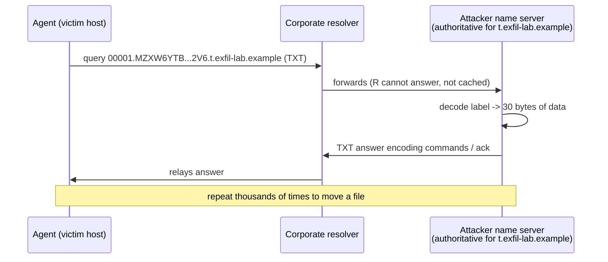

# DNS tunneling

## Summary

DNS tunneling smuggles arbitrary data inside DNS queries and responses, using the name service as a covert channel. Because almost every network allows DNS out (directly or through a resolver), an attacker who controls an authoritative name server for some domain can encode outbound data into query names and receive data back in responses, bypassing firewalls and reaching the internet even from networks that block everything else. It is used for command and control, for data exfiltration, and by captive-portal bypass tools. This note explains the mechanism and shows a detector, run on a synthetic resolver log, that separates a real tunnel from legitimate services that also use long machine-generated names.

## Prerequisites

- [DNS threat landscape](../dns-threat-landscape.md): how DNS resolution works and its other weaknesses.
- [Data exfiltration](../../network-attacks/data-exfiltration.md) and [command and control traffic](../../network-attacks/command-and-control-traffic.md).
- Authorized use only: build and run tunnels only in a lab you own. This note describes the mechanism to enable detection and does not provide a tunneling tool.

## Core concepts

### Definition

*DNS tunneling* encodes a non-DNS data stream into DNS messages. The attacker registers a domain (say `t.exfil-lab.example`) and points its authoritative name server at a machine they control. A client-side agent encodes data into the labels of query names under that domain. The victim's resolver, doing its normal job, forwards those queries to the attacker's name server, which decodes them and answers with encoded data in the response (in TXT, NULL, CNAME or other records). Neither endpoint needs a direct connection; the recursive resolver relays everything. MITRE ATT&CK tracks this as Application Layer Protocol: DNS (T1071.004) and Exfiltration Over Alternative Protocol.

### Analogy

Imagine a prison that forbids letters but allows inmates to shout a single word to the guard at the gate, who relays it to anyone outside who asks. Inmates agree on a code where each "word" is really a chunk of a longer message spelled out over many shouts. The guard, following the rules, relays faithfully and never realizes a conversation is happening. The domain is the outside contact everyone's shouts are relayed to; the resolver is the guard.

The analogy breaks because DNS relays are automatic and fast, so the covert channel can carry kilobytes per second, not one word at a time, though it is still far slower and noisier than a direct connection.

### Mechanism



Each query name carries a small payload. A DNS label is at most 63 characters and a full name at most 253, so a single query moves tens of bytes after encoding overhead (base32 is common because DNS names are case-insensitive). Moving a 40 KB file this way takes over a thousand queries, which is what makes the traffic pattern stand out.

### Detection signals

A tunnel must push data through names, so under one parent domain it produces:

- Many *unique* subdomains (little caching benefit, because each name is used once).
- *Long* subdomain labels (to maximize payload per query).
- *High-entropy* labels (encoded data looks random, unlike dictionary words).
- Unusual record types (TXT, NULL) or a high volume for one domain.
- Often a single client responsible for most of it.

The hard part is that legitimate services share some of these traits: content delivery networks use hashed hostnames, and some anti-malware products encode file hashes into DNS lookups. A good detector measures all the signals and ranks, rather than alerting on any one.

## Worked example

[scripts/generate-dns-log.py](scripts/generate-dns-log.py) writes one hour of resolver logs mixing ordinary lookups, a CDN with hashed names, an anti-virus reputation service, and a tunnel exfiltrating a 40 KB file. [scripts/detect-dns-tunneling.py](scripts/detect-dns-tunneling.py) groups by parent domain and measures the signals. Tested with Python 3.10, fixed seed, 2026-10:

```bash
python3 scripts/generate-dns-log.py dns.tsv
python3 scripts/detect-dns-tunneling.py dns.tsv
```

Output:

```text
domain               queries unique clients sub len entropy bytes in names  qtypes
exfil-lab.example       1334   1334       1    56.0    4.57          74672  NULL 484, CNAME 452, TXT 398  <- review
avvendor.example         150    150      54    37.0    3.86           5550  TXT 150
cdnprovider.example      600     40      61    21.0    3.47            840  A 600
example.net             1111      3      61     4.3    1.95             13  A 677, HTTPS 224, AAAA 210
example.com             1169      3      61     3.7    1.33             11  A 707, AAAA 243, HTTPS 219
example.org              720      2      61     4.5    2.16              9  A 423, HTTPS 157, AAAA 140
```

Reading the result: the tunnel domain is flagged for review and stands apart on every axis. It has 1,334 unique names (one per query, no reuse), an average subdomain length of 56 characters, high entropy (4.57 bits per character, near the maximum for its alphabet), odd record types (NULL, CNAME), and roughly 74 KB of data pushed into names, all from a single client. The CDN and anti-virus services have long or high-entropy names too, but far fewer of them and from many clients, so they fall below the thresholds. Ordinary domains have short, low-entropy names reused across clients.

The detector's logic is deliberately a ranking, not a verdict: the anti-virus domain has high entropy (3.86) and long names (37 characters), so a cruder rule that alerted on "entropy > 3.5" alone would flag it as a false positive. Measuring volume and uniqueness together is what separates it from the tunnel.

## Trade offs and when to use it

- **Thresholds vs ranking.** Fixed thresholds are simple but produce false positives on CDNs and security products. Ranking by a combined score, with an allow list of known services, scales better.
- **Log-based vs inline.** Analyzing resolver logs is retrospective and cheap. Inline detection on a DNS firewall can block in real time but adds latency and needs tuning.
- **Where to look.** The corporate resolver's query log is the best vantage point, because every client query passes through it. This is a strong argument for forcing all DNS through controlled resolvers and blocking direct outbound port 53 (see [protective DNS](../protective-dns.md)).
- **Encrypted DNS complicates it.** If clients use [DoH](../encrypted-dns.md) to an external resolver, the tunnel hides inside HTTPS and the resolver log disappears. This is the central enterprise tension around encrypted DNS.

## Common mistakes

- **Alerting on entropy or length alone.** Fix: combine uniqueness, volume, entropy, length and record type; keep an allow list of CDNs and security vendors.
- **Only inspecting A and AAAA records.** Tunnels favor TXT and NULL. Fix: include all record types.
- **Letting clients talk to any resolver.** Fix: force DNS through controlled resolvers, block direct outbound 53, and detect or block external DoH.
- **Looking at one query at a time.** A single long name is not conclusive; the pattern across a domain is. Fix: aggregate by parent domain over a window.
- **Forgetting the Public Suffix List.** Grouping by "last two labels" misattributes names under multi-label suffixes (`example.co.uk`). Fix: use the Public Suffix List to find the registrable domain. The script notes this simplification.

## Practice

1. Why can DNS tunneling cross a firewall that blocks all other outbound traffic?
2. Which two measurements separate a real tunnel from a CDN that also uses long, random hostnames?
3. Why do tunnels favor TXT and NULL records over A records?
4. Why does base32 rather than base64 encoding appear in query names?
5. How does external DoH undermine log-based tunnel detection?

### Answers

1. Networks almost always permit DNS resolution, directly or via a resolver, and the recursive resolver relays queries to the attacker's authoritative server, so no direct connection to the attacker is needed.
2. The number of unique names (a tunnel reuses almost none) and the total volume per domain from, often, a single client; a CDN has far fewer names spread across many clients.
3. TXT and NULL can carry larger arbitrary payloads in the answer, whereas A records return only a 4-byte address, limiting the downstream channel.
4. DNS names are case-insensitive, so the mixed case that base64 relies on is not preserved; base32 uses a case-insensitive alphabet.
5. DoH to an external resolver moves the queries inside HTTPS to a server the enterprise does not control, so they never appear in the corporate resolver log the detector reads.

## Further reading

- MITRE ATT&CK, Application Layer Protocol: DNS (T1071.004): https://attack.mitre.org/techniques/T1071/004/ and Exfiltration Over Alternative Protocol (T1048): https://attack.mitre.org/techniques/T1048/
- Farnham, G., "Detecting DNS Tunneling", SANS Institute (2013). A thorough early treatment of the signals: https://www.sans.org/white-papers/34152/
- NIST SP 800-81r3, Secure Domain Name System (DNS) Deployment Guide (2026), on resolver control and query-information minimization: https://doi.org/10.6028/NIST.SP.800-81r3
- The Public Suffix List, needed to find registrable domains correctly: https://publicsuffix.org/
