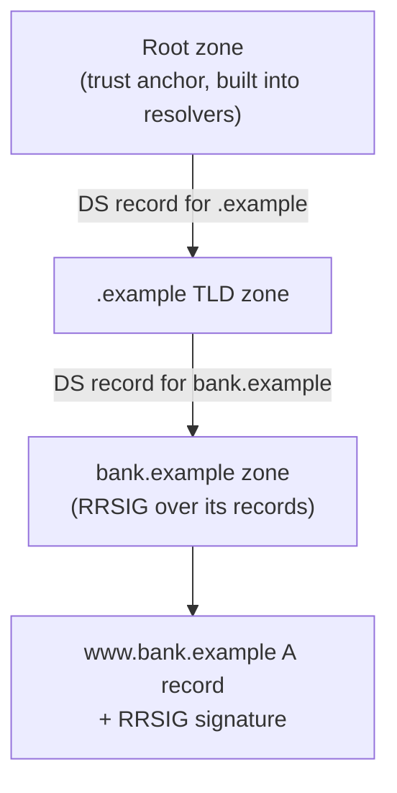

# DNSSEC

## Summary

DNS Security Extensions (DNSSEC) add cryptographic signatures to DNS records so that a resolver can verify an answer really came from the domain's owner and was not forged or altered. It closes the forgery and cache-poisoning gap that plain DNS leaves open, by building a chain of trust from the root zone down to each signed domain. DNSSEC provides authentication and integrity only; it does not encrypt queries (that is [encrypted DNS](encrypted-dns.md)) and it does not protect the registrar account. Its benefit depends on two separate deployments: domains must sign their records, and resolvers must validate signatures, and a validating resolver rejects a broken or forged chain with a SERVFAIL rather than returning a possibly poisoned answer.

## Prerequisites

- [DNS threat landscape](dns-threat-landscape.md): the forgery and poisoning attacks DNSSEC addresses.
- [Public Key Infrastructure](../../../security-architecture-and-engineering/cryptography/public-key-infrastructure.md): chains of trust and signatures.
- How recursive DNS resolution and delegation work.

## Core concepts

### Definition

*DNSSEC* (RFC 4033-4035 and updates) adds record types that carry digital signatures over DNS data: RRSIG (the signature on a record set), DNSKEY (the public keys), DS (a hash of a child zone's key, held by the parent, linking the chain), and NSEC/NSEC3 (signed proof that a name does not exist). A *validating resolver* checks these signatures up a chain of trust rooted in the DNS root zone's well-known key.

### Analogy

Plain DNS is a directory where any slip of paper claiming to be a listing is believed. DNSSEC is a directory where every listing carries a wax seal, each seal is vouched for by the seal of the section above it, and the top section's seal is published in a way everyone already trusts. To look up a number you check the seals from the top down; a forged listing has no valid seal and is thrown out. The "number does not exist" answer is itself sealed (NSEC), so an attacker cannot forge a "no such listing" either.

The analogy breaks in that the seals protect authenticity, not privacy: anyone watching still sees which listing you looked up, which is why DNSSEC and encrypted DNS are separate, complementary things.

### The chain of trust



Each zone signs its records with its private key; the parent zone holds a DS record that is a hash of the child's key, vouching for it; and the root's key is the trust anchor shipped with resolvers. Validation walks from the root down, checking each link. If any signature is missing, expired or wrong, validation fails.

### What a validating resolver does

When a resolver validates, three outcomes are possible, signalled in the response:

- *Secure*: the chain validates; the resolver sets the Authenticated Data (AD) flag and returns the answer.
- *Insecure*: the domain is not signed (no DNSSEC); the answer is returned without the guarantee.
- *Bogus*: the domain is signed but validation fails (forged, expired, or misconfigured); the resolver returns SERVFAIL and no answer, refusing to hand over a possibly poisoned record.

This "fail closed" behavior is the point: a poisoned answer for a signed domain is rejected rather than served.

### What DNSSEC does not do

- **No confidentiality.** Queries and answers are still visible on the wire; use [encrypted DNS](encrypted-dns.md) for privacy.
- **No protection of the registrar account.** A hijacker who controls the domain account can re-sign with their own keys (and update the DS record); DNSSEC does not defend the account.
- **No defense against amplification; it worsens it.** Signed responses are larger, so DNSSEC-enabled servers make better reflection amplifiers if left open. Response rate limiting is still needed.
- **Operational fragility.** Expired signatures or botched key rollovers take a domain offline for validating resolvers, which is a real and common outage cause.

## Worked example

A validating public resolver demonstrates the fail-closed behavior. Tested with `dig` against Cloudflare's validating resolver `1.1.1.1` (BIND dig 9.18, 2026-10):

```bash
dig +dnssec cloudflare.com  @1.1.1.1   # a correctly signed domain
dig dnssec-failed.org       @1.1.1.1   # a deliberately broken DNSSEC domain
```

Results (status line):

```text
cloudflare.com     -> status: NOERROR    (signed chain validates, answer returned)
dnssec-failed.org  -> status: SERVFAIL   (broken chain, resolver refuses to answer)
```

Reading it: `dnssec-failed.org` is a test domain whose signatures are intentionally invalid. A validating resolver detects the broken chain and returns SERVFAIL, withholding any address, exactly the behavior that stops a forged or poisoned answer for a signed domain from reaching the client. A non-validating resolver, by contrast, would return whatever address it was given, forged or not. The signed domain resolves normally, with the RRSIG records present in the DNSSEC-aware response.

## Trade offs and when to use it

- **Signing your domain** protects your users from forged answers wherever validation is done, at the cost of key management and the risk of self-inflicted outages from expired signatures or bad rollovers. Automate signing and monitoring.
- **Validating on your resolvers** protects your users from accepting forged answers for any signed domain; the cost is occasional SERVFAIL outages caused by other domains' DNSSEC mistakes, which some operators find disruptive.
- **NSEC vs NSEC3.** NSEC lets someone enumerate all names in a zone (walk the chain of "nothing exists between A and B" proofs); NSEC3 hashes the names to hinder enumeration, at some CPU cost. Prefer NSEC3 (or NSEC with careful consideration) for zones where name privacy matters.
- **Adoption is partial.** Many domains are unsigned and many resolvers do not validate, so DNSSEC's protection is real but not universal; it complements, not replaces, source-port randomization and encrypted DNS.

## Common mistakes

- **Signing without monitoring expiry.** Expired RRSIGs take the domain offline for validators. Fix: automated re-signing and expiry alerts.
- **Botched key rollovers.** Removing an old key before the parent DS updates breaks the chain. Fix: follow staged rollover procedures (RFC 6781), monitor DS consistency.
- **Assuming DNSSEC gives privacy.** It does not. Fix: add encrypted DNS for confidentiality.
- **Leaving a signed resolver open.** Larger signed responses amplify reflection attacks. Fix: restrict the resolver and apply response rate limiting.
- **Enabling validation without preparing for SERVFAIL from others' errors.** Fix: understand that some outages are external DNSSEC mistakes; have a diagnostic path.

## Practice

1. What two properties does DNSSEC provide, and which common DNS risk does it deliberately not address?
2. What does a validating resolver do when a signed domain's chain fails to validate, and why is that the desired behavior?
3. What is the role of the DS record in the chain of trust?
4. Why does DNSSEC make a resolver a better amplification vector if left open?
5. What is the difference between NSEC and NSEC3?

### Answers

1. Authentication of origin and integrity of records; it does not provide confidentiality (queries remain visible) and does not protect the registrar account.
2. It returns SERVFAIL and withholds the answer ("fail closed"), so a forged or poisoned record for a signed domain is rejected rather than served to the client.
3. The DS record, held by the parent zone, is a hash of the child zone's key and links the child into the chain of trust, letting a validator confirm the child's key via the parent.
4. Signed responses carry extra records (RRSIG, DNSKEY) and are larger, so an open signed resolver returns bigger replies to spoofed queries, increasing the amplification factor.
5. NSEC proves non-existence by naming the gap between two existing names, which allows zone enumeration; NSEC3 proves non-existence using hashed names to hinder enumeration, at extra CPU cost.

## Further reading

- RFC 4033, 4034, 4035, DNS Security Introduction and Requirements, Resource Records, and Protocol Modifications: https://www.rfc-editor.org/rfc/rfc4033
- RFC 6781, DNSSEC Operational Practices, Version 2 (key rollovers): https://www.rfc-editor.org/rfc/rfc6781
- NIST SP 800-81r3, Secure DNS Deployment Guide (2026), the authoritative deployment guidance: https://doi.org/10.6028/NIST.SP.800-81r3
- The test domain `dnssec-failed.org`, maintained to demonstrate validation failure.
