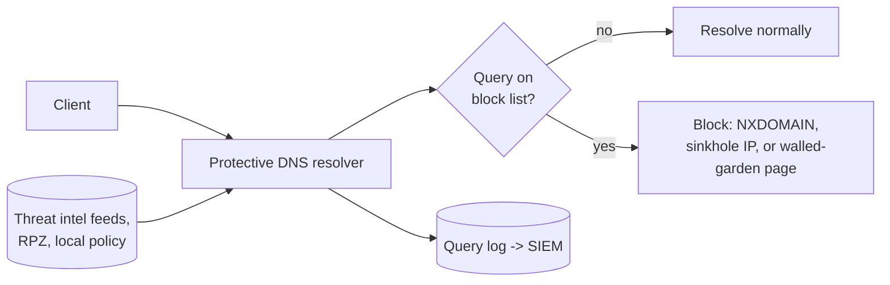

# Protective DNS

## Summary

Protective DNS (PDNS) uses the DNS resolver as a security control: because almost every connection begins with a name lookup, a resolver that refuses to resolve known-malicious domains blocks a wide range of attacks (malware callbacks, phishing links, command and control) at the earliest possible moment, cheaply and before any connection is made. It works by comparing each query against threat intelligence and policy, and returning a block response (or a sinkhole address) for bad names. PDNS also turns the resolver into a rich monitoring point, since every lookup is logged. Its two main limits are that it only sees queries that pass through it (so [encrypted DNS](encrypted-dns.md) bypass must be prevented) and that it acts on names, not content.

## Prerequisites

- [DNS threat landscape](dns-threat-landscape.md) and [encrypted DNS](encrypted-dns.md): why the resolver is a control point and how it can be bypassed.
- [Threat intelligence](../../../security-operations/threat-intelligence/threat-intelligence.md): the source of block lists.
- [Command and control traffic](../network-attacks/command-and-control-traffic.md): a main thing PDNS disrupts.

## Core concepts

### Definition

*Protective DNS* is a recursive resolver that applies security policy to queries: it blocks, redirects (sinkholes) or logs lookups of domains judged malicious or disallowed, using threat intelligence feeds and local policy. The mechanism for selective blocking is commonly *Response Policy Zones* (RPZ), a resolver feature that overrides answers for listed names.

### Analogy

PDNS is a switchboard operator with a list of known scam numbers. When anyone in the building dials a number, the operator checks the list; if it is a known scam, the call is refused and logged, and the caller hears "this number is blocked" instead of being connected. Because every call goes through the switchboard, one updated list protects everyone at once, before the call even rings. The limit is that someone with a private mobile line (encrypted DNS to an outside resolver) bypasses the switchboard entirely.

The analogy holds well; it breaks only in that the "scam list" must be kept current from intelligence feeds, and a brand-new malicious domain is not on it yet.

### How it works

- **Block responses.** The resolver can return NXDOMAIN (name does not exist), a *sinkhole* address (a controlled server that records the attempt and serves nothing useful), or redirect to a warning page. Sinkholing is valuable because it both blocks the connection and reveals which internal host tried to reach the bad domain, a strong infection signal.
- **Categories blocked.** Known malware and C2 domains, phishing, newly registered domains (often malicious), domains matching DGA (domain generation algorithm) patterns, and policy categories (e.g. disallowed content).
- **Logging.** Every query, blocked or not, is a detection source. A host suddenly querying many random-looking or newly registered domains is a strong indicator, feeding [beaconing detection](../monitoring-and-detection/beaconing-detection/README.md) and threat hunting.

### Why it is high-value

PDNS stops an attack at the name-resolution step, before a TCP connection, a TLS handshake or any payload. It is cheap (one resolver change protects every client), it works regardless of port or protocol (the lookup happens first), and it catches both inbound (phishing link) and outbound (malware calling home) directions. National cyber agencies (NSA/CISA in the US, NCSC in the UK) run or recommend PDNS as a baseline control precisely because the cost-to-benefit ratio is so favorable.

### Limits

- **Only sees what passes through it.** If clients use [encrypted DNS](encrypted-dns.md) to an outside resolver, PDNS is bypassed. PDNS therefore depends on forcing all DNS through the controlled resolver (block outbound 53 to others, steer encrypted DNS to the corporate resolver, block known public DoH endpoints).
- **Acts on names, not content.** A malicious file on an allowed domain (a compromised CDN, a cloud storage bucket) is not blocked by PDNS. It complements, not replaces, content inspection.
- **Intelligence lag.** A brand-new domain is not on any list yet; heuristics (newly registered domain, DGA patterns) partly cover this but with false positives.
- **Domain fronting and IP-literal C2.** Attackers who avoid DNS (hard-coded IPs) or hide behind shared front domains reduce PDNS effectiveness.

## Worked example

An employee receives a phishing email with a link to `secure-login.bank-verify.example`, a lookalike domain registered two days ago and hosting credential-harvesting pages.

1. The employee clicks. The browser first resolves `secure-login.bank-verify.example` through the corporate PDNS resolver.
2. The resolver checks the name: it is on a phishing feed (and, failing that, flagged as a newly registered domain by heuristic). RPZ overrides the answer and returns a sinkhole address with a warning page.
3. The browser connects to the warning page, not the phishing site. No credentials are exposed.
4. The query and block are logged to the SIEM. The security team sees which user and host clicked, and can check whether others received the same lure.

Contrast with the bypass case: if the laptop used DoH to a public resolver, step 2 never happens, the real phishing site resolves, and the only defense left is the user and the browser. This is why PDNS and encrypted-DNS steering are designed together: PDNS is only as good as its coverage of the organization's lookups.

## Trade offs and when to use it

- **Block (NXDOMAIN) vs sinkhole.** NXDOMAIN is simplest; sinkholing additionally identifies the infected host and can serve a warning, at the cost of running sinkhole infrastructure. For security value, sinkhole.
- **Feed quality and false positives.** Aggressive feeds (all newly registered domains) catch more but block legitimate new sites; tune categories and keep an allow list and a fast unblock path.
- **Coverage is the hard part.** PDNS value collapses if DNS can be done off-resolver; the operational work is forcing all DNS through it. See [encrypted DNS](encrypted-dns.md).
- **Privacy.** Logging every lookup is powerful for detection and sensitive for privacy; handle logs under policy and retention limits.

## Common mistakes

- **Deploying PDNS but allowing DNS to any resolver.** Clients (and malware) bypass it. Fix: block outbound 53 to non-corporate resolvers, steer and restrict encrypted DNS.
- **Relying on PDNS for content threats.** It blocks names, not malicious files on good domains. Fix: pair with content inspection and endpoint protection.
- **No tuning or unblock path.** False positives from aggressive feeds frustrate users and get PDNS disabled. Fix: category tuning, allow lists, quick exceptions.
- **Ignoring the query logs.** The monitoring value is half the benefit. Fix: ship logs to the SIEM and hunt in them.
- **Forgetting sinkhole intelligence.** A plain block hides which host is infected. Fix: sinkhole and alert on internal hosts hitting it.

## Practice

1. Why does blocking at DNS stop an attack earlier and more cheaply than blocking at the firewall or endpoint?
2. What is the difference between returning NXDOMAIN and sinkholing, and why is sinkholing more useful for detection?
3. What single configuration gap makes protective DNS ineffective, and how is it closed?
4. What class of threat does PDNS not address, and why?
5. How do PDNS query logs contribute beyond blocking?

### Answers

1. The name lookup happens before any connection, so blocking it prevents the TCP connection, TLS handshake and payload entirely, with one resolver change protecting all clients regardless of port or protocol.
2. NXDOMAIN tells the client the name does not exist; sinkholing redirects to a controlled address that records the attempt and can serve a warning, so it both blocks and reveals which internal host tried to reach the bad domain.
3. Allowing clients to use other resolvers (including encrypted DNS to public resolvers) bypasses PDNS; it is closed by forcing all DNS through the controlled resolver and steering/restricting encrypted DNS.
4. Malicious content hosted on an allowed domain (compromised CDN, cloud storage), because PDNS acts on the domain name, not the content served.
5. Every lookup is logged, so the logs reveal infected hosts (queries to blocked or DGA domains), support beaconing detection and threat hunting, and show the spread of a phishing lure.

## Further reading

- NSA/CISA, Selecting a Protective DNS Service (2021): https://media.defense.gov/2021/Mar/03/2002593055/-1/-1/1/CSI_Selecting-Protective-DNS_UOO11765221.PDF
- UK NCSC, Protective DNS service documentation and rationale: https://www.ncsc.gov.uk/
- RFC-style documentation of Response Policy Zones (RPZ), the common blocking mechanism.
- NIST SP 800-81r3, Secure DNS Deployment Guide (2026): https://doi.org/10.6028/NIST.SP.800-81r3
