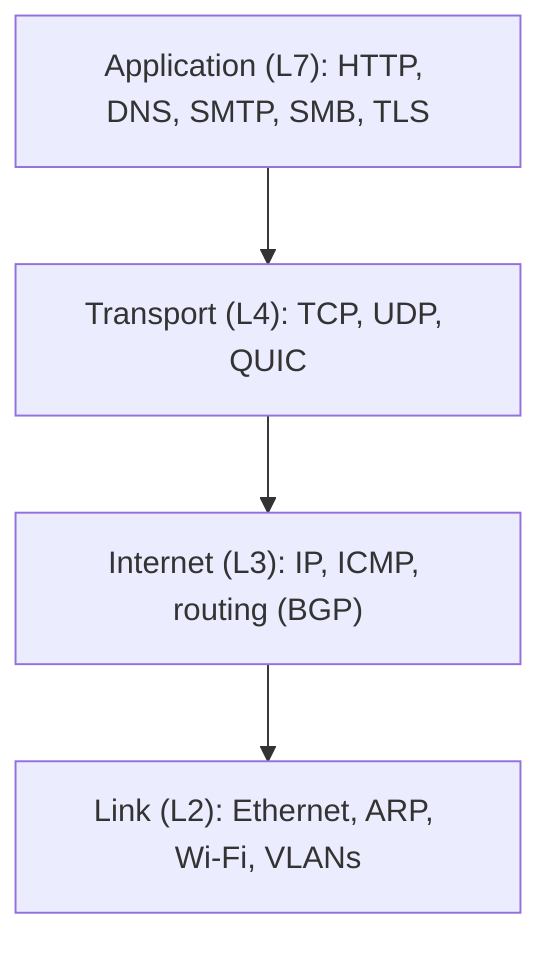

# Attack surface by layer

## Summary

The TCP/IP stack is built in layers, and each layer adds its own addresses, protocols and trust assumptions, which means each layer has its own attacks and its own controls. A link-layer attack like ARP spoofing cannot be stopped by a layer-3 firewall, and a layer-7 application flood passes straight through one. This note maps the layers to their characteristic attacks and defenses, so that any specific technique in this area can be placed and so that a defender knows which layer a given control actually protects. It is the index that the rest of the area hangs from.

## Prerequisites

- [Network threat model](network-threat-model.md): attacker positions.
- [Protocol design weaknesses](protocol-design-weaknesses.md): why each layer trusts by default.
- Basic familiarity with the OSI and TCP/IP layer models.

## Core concepts

### Definition

The *attack surface* of a network is the set of points where an attacker can interact with it. Organizing it *by layer* uses the TCP/IP model (link, internet, transport, application) because an attack and its defense almost always live at the same layer, and a control at one layer is usually blind to the others.

### Analogy

Think of a building: foundations, structural frame, plumbing and electrics, and the furnished rooms people use. A crack in the foundation (link layer) cannot be fixed by locking a room door (application layer), and a thief who walks in through an unlocked room is not stopped by a strong foundation. Each layer is inspected and secured by a different specialist. A building inspector who only checks door locks misses the cracked foundation entirely.

The analogy holds well because the layers really are built on each other, and it breaks only in that network layers can be bypassed or tunneled (one layer carried inside another), which a physical building cannot do.

### The map

| Layer | Addresses / identifiers | Characteristic attacks | Characteristic controls |
| --- | --- | --- | --- |
| Link (L2) | MAC addresses, VLAN tags | [ARP spoofing](../link-layer/arp-spoofing/README.md), [MAC flooding](../link-layer/mac-flooding.md), [VLAN hopping](../link-layer/vlan-hopping.md), [rogue DHCP](../link-layer/dhcp-attacks.md), rogue Wi-Fi | [Switch security](../link-layer/switch-security.md) (port security, DHCP snooping, DAI), [802.1X](../link-layer/network-access-control-8021x.md), Wi-Fi encryption |
| Internet (L3) | IP addresses, routes | [IP spoofing](../core-protocols/ip-spoofing-and-source-validation.md), [ICMP abuse](../core-protocols/icmp-security.md), [BGP hijack](../core-protocols/bgp-security.md), [IPv6 RA attacks](../core-protocols/ipv6-security.md) | Ingress filtering (BCP 38), uRPF, RPKI, RA Guard, L3 firewall ACLs |
| Transport (L4) | Ports, sequence numbers | [SYN flood](../network-attacks/denial-of-service/syn-flood.md), [TCP reset and hijack](../core-protocols/tcp-attacks.md), port [scanning](../network-attacks/network-scanning.md) | Stateful firewalls, SYN cookies, randomized sequence numbers |
| Application (L7) | Names, URLs, sessions | [DNS poisoning](../dns-security/dns-threat-landscape.md), [tunneling](../dns-security/dns-tunneling/README.md), HTTP floods, [name resolution poisoning](../core-protocols/local-name-resolution-poisoning.md), credential theft on cleartext protocols | [TLS](../secure-transport/tls-in-network-security.md), [WAF](../traffic-filtering/web-application-firewalls.md), [secure web gateways](../traffic-filtering/proxies-and-secure-web-gateways.md), [protective DNS](../dns-security/protective-dns.md) |

Note that TLS is an application-layer control for the network's purposes even though it sits logically between transport and application; it is the main defense for the confidentiality and integrity of application data in transit.

### Cross-layer effects

Two properties make the layering leaky, and both matter for defense:

- **Lower layers undermine higher ones.** If an attacker owns layer 2 (ARP spoofing), they become on-path and can attack everything above, regardless of layer-3 and layer-4 controls. Securing the lowest reachable layer first is therefore high-value.
- **Higher layers tunnel through lower-layer controls.** [DNS tunneling](../dns-security/dns-tunneling/README.md) carries arbitrary data at layer 7 through a port-53 hole in a layer-4 firewall. [VPNs](../secure-transport/vpns.md) deliberately tunnel whole networks inside a single application flow. Encapsulation means a control must understand the payload, not just the headers, to see what is really there.

### Using the map

For any control, ask "which layer does this actually protect?" A firewall ACL (L3/L4) does nothing about ARP spoofing (L2) or an HTTP flood (L7). For any attack, ask "which layer is it at?" to know which control family applies. Defense in depth, in network terms, means having a control at each layer rather than several controls at one.

## Worked example

An attacker on the office LAN wants to read a colleague's intranet session. Trace the layers:

1. **L2.** They send forged ARP replies so the victim's traffic to the gateway comes to them instead. A layer-3 firewall never sees this; the fix is Dynamic ARP Inspection on the switch (L2).
2. **L3/L4.** Now on-path, they forward traffic and observe it. Firewall rules between subnets do not help because the traffic is within one subnet. Segmentation into smaller subnets (L3) would reduce who they can reach.
3. **L7.** The intranet uses HTTP, so the session cookie is in cleartext and they read it. The fix is TLS (L7), which would leave them seeing only ciphertext even while on-path.

The single attack touched three layers, and each layer needed its own control. "We have a firewall" protects only one of them.

## Trade offs and when to use it

- The layered view is a thinking tool, not a strict taxonomy: QUIC blends L4 and L7, TLS spans layers, and tunnels deliberately cross them. Use it to place attacks and controls, not to argue about exact boundaries.
- Securing the lowest layer first gives the most leverage (owning L2 beats everything above), but the lowest layer is also where controls are most often missing on flat and legacy networks.
- A control at every layer is the goal, but it costs money and complexity; prioritize by which layers an attacker can actually reach given your [threat model](network-threat-model.md).

## Common mistakes

- **Expecting a control to protect a layer it cannot see.** A firewall for ARP spoofing, TLS for an insider on the endpoint. Fix: match the control's layer to the attack's layer.
- **Securing only the perimeter (L3/L4) and ignoring L2 inside.** Fix: switch security and segmentation internally.
- **Forgetting that tunneling defeats header-only filtering.** Fix: inspect payloads where the risk justifies it (DNS, HTTP), and control egress.
- **Treating TLS as a network-layer fix for everything.** It protects data in transit, not the link layer, not availability, not the endpoints. Fix: layer it with L2, L3 and L7 controls.

## Practice

1. Why can a layer-3 firewall not stop ARP spoofing?
2. Give the layer of each: SYN flood, DNS cache poisoning, VLAN hopping, BGP hijack.
3. What two properties make the layer boundaries leaky, and give an example of each.
4. Why does owning layer 2 give an attacker leverage over all higher layers?
5. Which layer does TLS protect, and which does it not?

### Answers

1. ARP operates at the link layer (L2); a layer-3 firewall processes IP packets and never sees or filters the ARP exchange on the local segment.
2. SYN flood: transport (L4). DNS cache poisoning: application (L7). VLAN hopping: link (L2). BGP hijack: internet (L3).
3. Lower layers undermine higher ones (owning L2 via ARP spoofing exposes everything above), and higher layers tunnel through lower-layer controls (DNS tunneling through a port-53 firewall hole).
4. Controlling L2 makes the attacker on-path for all traffic on that segment, so they can observe or alter higher-layer traffic regardless of L3/L4/L7 controls.
5. TLS protects the confidentiality and integrity of application data in transit (L7 for network purposes); it does not protect the link layer, availability, or data on the endpoints.

## Further reading

- RFC 1122, Requirements for Internet Hosts (1989), for the TCP/IP layer model as specified: https://www.rfc-editor.org/rfc/rfc1122
- Bellovin, S., "Security Problems in the TCP/IP Protocol Suite" (1989): layer-by-layer weaknesses in the original stack.
- NIST SP 800-215, Guide to a Secure Enterprise Network Landscape (2022): https://doi.org/10.6028/NIST.SP.800-215
- MITRE ATT&CK, the Network platform matrix, for techniques grouped by effect: https://attack.mitre.org/
