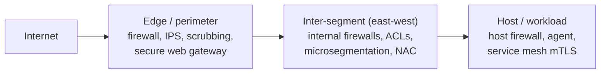

# Network security controls

## Summary

A network security control is a safeguard that reduces network risk by preventing, detecting or responding to an attack. This note organizes the controls in this area into a small taxonomy, so that any specific control (a firewall rule, a DNS sinkhole, a flow sensor) can be placed by what it does and where it sits. The organizing ideas are the function of a control (prevent, detect, respond), its placement (at the edge, between segments, on the host), and the recognition that no single control is sufficient, so controls are layered. The note closes by mapping common network controls to the NIST Cybersecurity Framework functions and to MITRE D3FEND, so this area connects to the governance and defensive material already in the repository.

## Prerequisites

- [Attack surface by layer](attack-surface-by-layer.md) and [network threat model](network-threat-model.md).
- [Defense in depth](../../../security-architecture-and-engineering/design-principles/defense-in-depth.md): the principle this applies to networks.
- [Security controls](../../../security-and-risk-management/governance-and-compliance/frameworks/security-controls.md): the general control vocabulary.

## Core concepts

### Definition

A *network security control* is a technical or procedural measure applied to network traffic, devices or architecture to reduce risk. Controls are classified two ways at once:

- By *function*: preventive (stop the attack), detective (notice it), responsive (contain and recover). The same underlying framework (NIST CSF 2.0) uses the functions Identify, Protect, Detect, Respond and Recover.
- By *placement*: at the perimeter, between internal segments (east-west), or on the endpoint. Placement decides what traffic the control can even see.

### Analogy

Consider securing a warehouse. Preventive controls are the fence and locks. Detective controls are the cameras and motion sensors. Responsive controls are the guards who come when an alarm sounds and the procedure for after a break-in. Placement is whether a camera watches the gate, the aisles, or a single vault. A warehouse with only a fence (prevent, perimeter) and no cameras inside (detect, east-west) is blind once someone is over the fence.

The analogy holds well; it breaks only in that network controls can be duplicated instantly and cheaply across thousands of points, which physical guards cannot.

### The functional taxonomy

| Function | What it does | Network examples |
| --- | --- | --- |
| Prevent | Stops disallowed traffic or access | [Firewalls](../traffic-filtering/firewalls.md), [segmentation](../architecture/network-segmentation.md), [802.1X](../link-layer/network-access-control-8021x.md), [TLS](../secure-transport/tls-in-network-security.md), [VPNs](../secure-transport/vpns.md), [egress filtering](../traffic-filtering/egress-filtering.md), [protective DNS](../dns-security/protective-dns.md) |
| Detect | Reveals attacks and anomalies | [IDS](../../../security-operations/defensive-operations/detection/ids/README.md), [NSM](../monitoring-and-detection/network-security-monitoring.md), [flow monitoring](../monitoring-and-detection/flow-monitoring.md), [Zeek](../monitoring-and-detection/zeek.md), [beaconing detection](../monitoring-and-detection/beaconing-detection/README.md), [encrypted traffic analysis](../monitoring-and-detection/encrypted-traffic-analysis.md) |
| Respond | Contains, blocks and recovers | [IPS](../../../security-operations/defensive-operations/detection/ips.md), [NDR](../monitoring-and-detection/network-detection-and-response.md), dynamic ACL/quarantine, [network incident response](../operations-and-assurance/network-incident-response.md), upstream scrubbing |

Some controls serve more than one function: an IPS prevents (blocks) and detects; a secure web gateway prevents (policy) and detects (logs).

### The placement taxonomy

- **Edge controls** see all north-south traffic but none of the east-west traffic that follows a breach.
- **Inter-segment controls** see traffic crossing zone boundaries, where lateral movement shows up.
- **Host controls** see a workload's own traffic, including east-west within a segment, but depend on the host not being compromised.

A control only protects traffic it can see. This single fact explains most monitoring blind spots: a sensor at the edge is blind to a compromise that never crosses it.

### Why controls are layered

No control is complete. Firewalls do not see inside TLS; IDS can be evaded; segmentation does not stop an attacker with valid credentials; encryption does not stop flooding. [Defense in depth](../../../security-architecture-and-engineering/design-principles/defense-in-depth.md) stacks independent controls so one failure is not total, and the key word is *independent*: five controls that all depend on the same admin credential are one control. In network terms, layering means a preventive and a detective control at each reachable layer and placement, not five firewalls in a row.

### Mapping to frameworks

- **NIST CSF 2.0 functions:** the functional taxonomy above is the Protect, Detect and Respond functions applied to the network. Identify maps to asset and flow inventory (you cannot control what you have not mapped); Recover maps to failover and restoration of connectivity.
- **NIST SP 800-53 controls:** SC-7 (Boundary Protection) for segmentation and firewalls, SC-8 (Transmission Confidentiality and Integrity) for TLS and IPsec, SI-4 (System Monitoring) for IDS and NSM, AC-4 (Information Flow Enforcement) for the flow matrix.
- **MITRE D3FEND:** a knowledge graph of defensive techniques that maps controls to the ATT&CK techniques they counter, useful for checking coverage. See [MITRE D3FEND](../../../security-operations/threat-intelligence/mitre/mitre-d3fend.md).

## Worked example

A mid-size company maps its network controls to check for gaps:

| Reachable layer / placement | Preventive | Detective | Responsive | Gap found |
| --- | --- | --- | --- | --- |
| Edge | NGFW, egress filtering | IDS on the uplink | IPS blocking | - |
| East-west | VLAN ACLs | none | none | No east-west visibility or control |
| Host | Host firewall on servers | EDR | EDR isolate | Workstations have no host firewall |
| DNS | Protective DNS | Resolver query logging | Sinkhole | - |

Reading the table, the company has solid perimeter and DNS coverage but two gaps: it cannot see or stop lateral movement east-west, and workstations have no host firewall. An attacker who gets one workstation can move freely to others. The fix is microsegmentation or host firewalls on workstations and a flow sensor on the internal core, adding a detective and a preventive control where there were none. The value of the taxonomy is exactly this: it turns "are we secure?" into a grid with visible empty cells.

## Trade offs and when to use it

- **Prevent vs detect.** Prevention is better when you can define "disallowed" precisely (block Telnet). Detection is necessary when you cannot (is this HTTP request an attack?). Most environments need both; pure prevention gives false confidence, pure detection gives alerts with no stopping power.
- **Edge vs host placement.** Edge controls are few and easy to manage but blind east-west; host controls see everything local but multiply management and trust the host. Modern designs push controls toward the host ([microsegmentation](../architecture/microsegmentation.md), [zero trust](../architecture/zero-trust-networking.md)) as east-west traffic grows.
- **More layers cost more.** Each control is money, latency and operational burden. Layer according to the threat model, not reflexively.

## Common mistakes

- **Counting controls instead of coverage.** Five edge firewalls are not defense in depth. Fix: one preventive and one detective control per reachable layer and placement.
- **Dependent "layers".** Controls sharing one credential or one device fail together. Fix: ensure independence.
- **Prevention with no detection.** When prevention fails, nobody knows. Fix: pair every preventive control with a way to detect its bypass.
- **Blind east-west.** Only perimeter controls, so lateral movement is invisible. Fix: internal segmentation and flow monitoring.
- **Controls on unseen traffic.** Expecting a sensor to catch what never crosses it. Fix: place controls where segmentation forces traffic through.

## Practice

1. What are the three functional categories of control, and give a network example of each?
2. Why does placement determine what a control can protect?
3. What does it mean for layered controls to be independent, and why does it matter?
4. In the worked example, which two gaps did the taxonomy reveal and how would you close them?
5. When is detection necessary rather than prevention?

### Answers

1. Preventive (firewall, segmentation), detective (IDS, flow monitoring), responsive (IPS, scrubbing, incident response).
2. A control can only act on traffic it can observe; an edge control never sees east-west traffic, so its placement bounds its protection.
3. Independent means a single failure or compromise does not disable several of them; controls sharing one credential or device fail together, collapsing the depth to one.
4. No east-west visibility or control, and no host firewall on workstations; close them with internal flow monitoring plus microsegmentation or host firewalls on workstations.
5. When "disallowed" cannot be defined precisely in advance, for example distinguishing a malicious HTTP request from a legitimate one, so you must observe and judge rather than block by rule.

## Further reading

- NIST Cybersecurity Framework 2.0 (2024), the Protect, Detect, Respond functions: https://doi.org/10.6028/NIST.CSWP.29
- NIST SP 800-53 Rev. 5, control families SC, SI and AC: https://csrc.nist.gov/pubs/sp/800/53/r5/upd1/final
- NIST SP 800-215, Guide to a Secure Enterprise Network Landscape (2022): https://doi.org/10.6028/NIST.SP.800-215
- MITRE D3FEND, defensive technique knowledge graph: https://d3fend.mitre.org/
