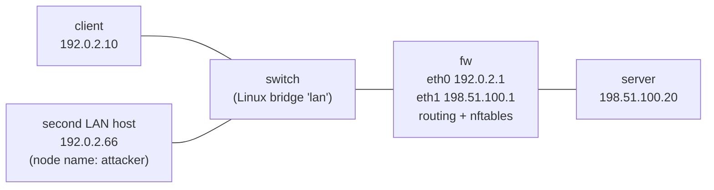

# Network security lab

## Summary

This note describes a small, disposable lab network that runs on any modern Linux machine without root rights. It uses Linux network namespaces inside a user namespace to create five isolated nodes: a client, a second host on the same LAN, a switch, a firewall and a server. Worked examples in this area use it so that firewall rules, captures and monitoring can be tried on real packets without touching any real network. When the lab shell exits, the whole network disappears.

## Prerequisites

- A Linux kernel with unprivileged user namespaces enabled (default on Ubuntu 22.04 and later, Debian 11 and later, Fedora).
- `iproute2`, `nftables`, `python3` and `nc` (netcat). Optional: `tcpdump`.
- Basic shell knowledge.

## Core concepts

### Definition

A *network namespace* is a Linux kernel feature that gives a group of processes its own copy of the network stack: interfaces, routing table, ARP table, firewall rules and sockets. A *user namespace* maps the current user to "root" inside the namespace only, which is enough to configure the namespaced network stack but gives no privilege on the host. A *veth pair* is a virtual cable, two interfaces where whatever enters one end leaves the other.

### Analogy

The lab is like a model railway on a table. The tracks, signals and stations behave like the real thing, so you can test a timetable or watch a collision in slow motion. Nothing on the table can reach the real railway.

The analogy breaks in one place: the nodes share the host kernel. A kernel bug triggered inside the lab affects the host. For untrusted code or real malware, use a virtual machine instead.

### Topology



The diagram shows two subnets. The outside LAN `192.0.2.0/24` holds the client and a second host that plays the untrusted party in examples. The inside network `198.51.100.0/24` holds the server. All traffic between the two crosses the `fw` node, where the firewall rules are loaded. Both ranges are documentation addresses (RFC 5737), so commands copied from these notes can never reach a real host.

### How the script builds it

The script [scripts/start-lab.sh](scripts/start-lab.sh) does the following:

1. Re-executes itself with `unshare --user --map-root-user --net --mount`, which creates the private namespaces.
2. Mounts a private `tmpfs` on `/run`, so that `ip netns add` can create named namespaces without real root.
3. Creates the five namespaces, the bridge in `switch` and one veth pair per host.
4. Assigns addresses and default routes, and turns on IP forwarding in `fw` only.
5. Starts an interactive shell, or runs the script given as an argument and then exits.

Run a command on a node with `ip netns exec <node> <command>`.

## Worked example

Start the lab and check basic reachability. Tested on Ubuntu 22.04, kernel 6.8, iproute2 5.15, 2026-10.

```bash
./scripts/start-lab.sh
# inside the lab shell:
ip netns exec client ping -c2 -W1 198.51.100.20
ip netns exec client ip neigh
```

Output:

```text
lab ready: client 192.0.2.10, attacker 192.0.2.66, fw 192.0.2.1 / 198.51.100.1, server 198.51.100.20
2 packets transmitted, 2 received, 0% packet loss, time 1055ms
rtt min/avg/max/mdev = 0.068/0.073/0.079/0.005 ms
192.0.2.1 dev eth0 lladdr ea:2a:f1:ac:66:9b REACHABLE
```

The client reached the server through the firewall, and its neighbor table holds the firewall's MAC address as the gateway. MAC addresses are random on each run.

Non-interactive use, as in the other notes of this area:

```bash
./scripts/start-lab.sh my-test.sh
```

Examples that use the lab:

- [Firewall rule design](../../traffic-filtering/firewall-rule-design/README.md): loading and testing an nftables policy on `fw`.
- [Packet capture analysis](../../monitoring-and-detection/packet-capture-analysis/README.md): `tcpdump` on any node.

## Trade offs and when to use it

| Option | Isolation | Startup time | Needs root | Good for |
| --- | --- | --- | --- | --- |
| Network namespaces (this lab) | Shared kernel | Under one second | No | Firewall rules, routing, captures, small services |
| Containers (Docker, Podman) | Shared kernel, plus image isolation | Seconds | Usually (rootless possible) | Running tools with dependencies (Zeek, Suricata) |
| Virtual machines | Separate kernel | Tens of seconds | For setup | Different operating systems, untrusted code, Windows protocols |
| Emulators (GNS3, Containerlab) | Varies | Minutes | Yes | Router operating systems, BGP, OSPF |

Namespaces cannot run Windows, router operating systems or Wi-Fi. For those topics, the notes describe the mechanism and mark the examples as not tested in this lab.

## Common mistakes

- **Running lab tools on the host by accident.** Forgetting `ip netns exec` sends traffic from the host network. Fix: use the lab shell prompt `[lab]` as a reminder, and use documentation addresses only.
- **Expecting namespace isolation to contain malware.** Fix: use a VM for anything untrusted.
- **Leaving background servers running between tests.** They die with the namespace, but inside one session they can confuse results. Fix: start each test with a fresh lab, as the non-interactive mode does.

## Practice

1. Which kernel feature gives each node its own ARP table and firewall rules?
2. Why does the script mount a private `/run`?
3. Why are the lab addresses taken from `192.0.2.0/24` and `198.51.100.0/24`?

### Answers

1. Network namespaces.
2. `ip netns add` creates bind mounts under `/run/netns`, which an unprivileged user cannot write. A private `tmpfs` in the new mount namespace makes it writable without affecting the host.
3. They are reserved for documentation (RFC 5737) and are never routed on the internet, so a mistake cannot reach a real system.

## Further reading

- Linux manual pages `network_namespaces(7)`, `user_namespaces(7)`, `ip-netns(8)` and `veth(4)`. The authoritative description of the kernel features used here.
- RFC 5737, IPv4 Address Blocks Reserved for Documentation (2010): https://www.rfc-editor.org/rfc/rfc5737
- nftables wiki, the reference for the firewall syntax used in the lab: https://wiki.nftables.org/
