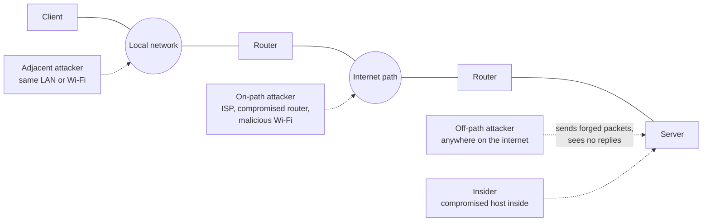

# Network threat model

## Summary

A network threat model describes where an attacker sits relative to the traffic you care about, and what that position lets them do: observe packets, inject packets, modify or drop packets, or only send packets from far away. Almost every network attack and every network control makes sense only once you know which position it assumes. Encryption defends against an on-path observer, source address validation defends against an off-path spoofer, and segmentation limits what an insider can reach. Most mistakes in network security come from defending against the wrong position.

## Prerequisites

- [CIA triad](../../../security-and-risk-management/foundations/cia-triad/README.md): the properties each attacker capability threatens.
- [Threat modeling](../../../security-and-risk-management/threat-modeling/threat-modeling.md) and [STRIDE](../../../security-and-risk-management/threat-modeling/methods/stride.md): the general method this note applies to networks.
- Basic networking: IP addresses, routing, TCP and UDP ports.

## Core concepts

### Definition

A *network attacker model* is a precise statement of the capabilities an adversary has over communication between two endpoints. The classic formal version is the Dolev-Yao model (Dolev and Yao, 1983), in which the attacker *is* the network: they can read, block, replay and forge any message, but cannot break the cryptography. Real attackers are usually weaker than Dolev-Yao, and the useful question is "how much weaker, and where".

### Analogy

Think of letters sent through a postal system. A neighbor across town can mail you a letter with a fake return address, but never sees your mail (off-path). A postal worker on your route can read postcards and could swap envelopes (on-path). Someone who lives in your building can read the names on every mailbox and slip notes under doors (adjacent, same local network). A roommate already holds your keys (insider).

The analogy breaks because postal mail is slow and physical. A network attacker can try millions of forged letters per second, and on many networks becoming "the postal worker" takes only a few forged packets.

### Attacker positions

The diagram places four attacker types relative to one client-server conversation. Only the on-path attacker sees the traffic by default, but the adjacent attacker can often promote themselves to on-path.

| Position | Sees traffic | Can inject | Can modify or drop | Typical examples |
| --- | --- | --- | --- | --- |
| Off-path (remote) | No | Yes, blind, with spoofed source | No | Internet scanner, spoofing to reach a stateless service, blind TCP reset attempts |
| Adjacent (same broadcast domain) | Broadcast and multicast only, until promoted | Yes | After promotion | Attacker on office LAN or café Wi-Fi using ARP, DHCP or name resolution poisoning |
| On-path, passive | Yes | No | No | Eavesdropper on a mirrored port, wiretap, monitoring at an ISP |
| On-path, active | Yes | Yes | Yes | Compromised router, rogue access point, TLS-intercepting proxy, BGP hijacker |
| Insider (compromised endpoint) | Its own traffic and whatever it can reach | Yes | Its own traffic | Malware on a workstation moving laterally |
| Infrastructure insider | Depends on role | Yes | Yes | Rogue administrator, compromised management plane |

Terminology: older texts say "man-in-the-middle". This repository uses *on-path attacker* for the position and [adversary-in-the-middle](../network-attacks/man-in-the-middle.md) for the attack technique, matching MITRE ATT&CK T1557.

### From one position to another

Attackers rarely start where they want to be. Most network attacks are *position upgrades*:

- **Adjacent to on-path.** [ARP spoofing](../link-layer/arp-spoofing/README.md), [rogue DHCP](../link-layer/dhcp-attacks.md), [LLMNR and NBT-NS poisoning](../core-protocols/local-name-resolution-poisoning.md), IPv6 router advertisements and [evil twin access points](../wireless/wireless-attacks.md) all turn a neighbor into a relay.
- **Off-path to on-path.** [BGP hijacking](../core-protocols/bgp-security.md) or [DNS cache poisoning](../dns-security/dns-threat-landscape.md) redirect traffic from anywhere on the internet.
- **Insider to wider insider.** [Lateral movement](../network-attacks/lateral-movement.md) uses reachability that a flat network gives away.

Each upgrade has a matching control family: link-layer protections in switches, routing security, DNSSEC, and [segmentation](../architecture/network-segmentation.md).

### What each capability threatens

- **Observe** threatens confidentiality: credentials in cleartext protocols, session cookies, the metadata of who talks to whom. Encryption hides content, but not metadata such as addresses, timing and sizes.
- **Inject** threatens integrity and availability: forged resets, forged DNS answers, forged routing announcements.
- **Modify or drop** threatens everything: downgrade attacks strip security from a negotiation, content can be rewritten, and selective dropping can censor or force a fallback to a weaker protocol.

### The assumption of a hostile network

Modern guidance treats the network as untrusted by default. NIST SP 800-207 states that the entire enterprise private network is not an implicit trust zone (see [NIST zero trust architecture](../architecture/nist-zero-trust-architecture.md)). The network-security consequence is simple: design each protocol and service as if an active on-path attacker were present, and use the network controls to make that attacker rarer, noisier and more contained, not to replace endpoint security.

## Worked example

A company runs an internal web application at `http://intranet.example.com` (no TLS) and a VPN for remote staff. Walk through each position:

1. **Off-path attacker on the internet.** Cannot see the traffic. They can scan the VPN gateway and try exploits against it. Relevant controls: patching the gateway, MFA, exposing nothing else.
2. **Adjacent attacker in the office (a visitor on the guest Wi-Fi).** If guest Wi-Fi is bridged to the office LAN, the visitor can spoof ARP for the default gateway and read every intranet session cookie. Relevant controls: a separate guest network, dynamic ARP inspection, TLS on the intranet.
3. **Adjacent attacker next to a remote worker (hotel Wi-Fi).** Sees the worker's traffic before the VPN tunnel is up. If the VPN client has split tunneling or a leak, intranet traffic can leave unprotected. Relevant controls: always-on VPN, encrypted DNS, TLS everywhere.
4. **Insider (phished workstation).** Already inside the VPN. TLS on the intranet does not help here, because the attacker uses the legitimate client. Relevant controls: segmentation, authentication and authorization on the application itself, monitoring east-west traffic.

The same application needs four different answers. "We have a firewall" answers only the first one.

## Trade offs and when to use it

- A strong attacker model (Dolev-Yao everywhere) leads to end-to-end encryption and authentication, which is the right default for new systems. It is expensive to retrofit into legacy industrial and embedded protocols, where a weaker model plus compensating network controls is often the only practical choice (see [OT network security](../ot-and-iot/ot-network-security.md)).
- Modeling the insider is uncomfortable for organizations because it implies distrust of colleagues and managed devices. In practice the "insider" is usually a compromised endpoint, not a malicious employee.
- Over-modeling exotic positions (nation-state on the backbone) while ignoring the café Wi-Fi is a common failure. Prioritize by likelihood.

## Common mistakes

- **Treating "internal" as "trusted".** Fix: state the attacker position explicitly for every flow, including flows that never leave the building.
- **Assuming encryption solves on-path attacks completely.** It protects content. It does not hide metadata and does not stop dropping or downgrade. Fix: require authenticated encryption with downgrade protection (for example TLS 1.3) and watch for fallbacks.
- **Assuming the attacker cannot see replies, so spoofing is harmless.** Blind injection still works against stateless protocols such as UDP-based services and against weakly randomized TCP. Fix: [source address validation](../core-protocols/ip-spoofing-and-source-validation.md) and unpredictable protocol fields.
- **Forgetting the management plane.** Whoever controls the routers is an infrastructure insider. Fix: [management plane security](../architecture/management-plane-security.md).

## Practice

1. Which attacker position can read a session cookie sent over HTTP on a switched LAN without doing anything active?
2. Name three techniques that upgrade an adjacent attacker to an on-path attacker.
3. Why does TLS protect against a rogue Wi-Fi access point but not against malware on the client?
4. What is the difference between the Dolev-Yao attacker and a realistic off-path attacker?
5. A colleague says "the database is only reachable from the internal network, so it does not need authentication". Which position did they forget?

### Answers

1. None, on a switched LAN unicast traffic is not delivered to other ports. A passive on-path position (for example a mirror port) or an active promotion is required.
2. ARP spoofing, rogue DHCP, LLMNR or NBT-NS poisoning, rogue IPv6 router advertisements, evil twin Wi-Fi.
3. TLS authenticates the server and encrypts the channel between the endpoints, so the access point sees only ciphertext. Malware on the client sits at an endpoint and sees data before encryption.
4. Dolev-Yao controls the whole network: read, drop, modify, forge. An off-path attacker can only send packets and cannot observe the conversation.
5. The insider, a compromised internal host that already has network reachability.

## Further reading

- Dolev, D. and Yao, A., "On the Security of Public Key Protocols", IEEE Transactions on Information Theory, 1983. The origin of the formal network attacker model.
- NIST SP 800-207, Zero Trust Architecture (2020), section 2. The assumption that the enterprise network is not a trust zone: https://doi.org/10.6028/NIST.SP.800-207
- RFC 3552, Guidelines for Writing RFC Text on Security Considerations (2003). Defines the Internet threat model used by the IETF, including passive and active attacks and on-path versus off-path: https://www.rfc-editor.org/rfc/rfc3552
- RFC 7258, Pervasive Monitoring Is an Attack (2014). Why passive observation is treated as an attack in protocol design: https://www.rfc-editor.org/rfc/rfc7258
- MITRE ATT&CK T1557, Adversary-in-the-Middle: https://attack.mitre.org/techniques/T1557/
