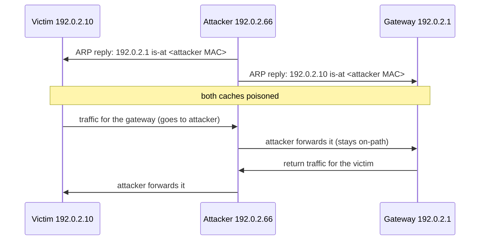

# ARP spoofing

## Summary

ARP spoofing (also called ARP poisoning) is a link-layer attack in which a host on a local network sends forged Address Resolution Protocol (ARP) messages to associate its own MAC address with the IP address of another host, usually the default gateway. Because ARP has no authentication, victims believe the forgery and send their traffic to the attacker, who becomes on-path and can read, alter or drop it. It is the classic way an adjacent attacker promotes itself to an on-path attacker on a wired or wireless LAN. The authoritative defense is on the switch (Dynamic ARP Inspection with DHCP snooping), because host behavior offers only partial resistance.

## Prerequisites

- [Network threat model](../../foundations/network-threat-model.md): the adjacent-to-on-path upgrade.
- [Protocol design weaknesses](../../foundations/protocol-design-weaknesses.md): unsolicited-answer trust.
- [Switch security](../switch-security.md): where the real defense lives.
- How ARP resolves an IPv4 address to a MAC address on a local segment.

Authorized use only. The demonstration here runs in the isolated [network security lab](../../foundations/network-security-lab/README.md) against documentation addresses.

## Core concepts

### Definition

*ARP spoofing* is the sending of forged ARP replies (or gratuitous ARP announcements) to poison the ARP caches of other hosts, so that traffic meant for one IP address is delivered to the attacker's MAC address. ARP (RFC 826) maps IPv4 addresses to MAC addresses on a segment and was designed with no way to verify that a reply is truthful. MITRE ATT&CK tracks it as Adversary-in-the-Middle: ARP Cache Poisoning (T1557.002).

### Analogy

ARP is like asking a crowded room "who is Alice?" and trusting whoever raises their hand. Normally Alice raises hers. An impostor who raises a hand faster, or who walks around announcing "I am Alice" to everyone, gets your messages for Alice instead. Nothing in the process checks a badge.

The analogy breaks because, unlike people, some hosts remember who Alice was and are suspicious of an unsolicited "I am Alice", which is exactly the partial host resistance the lab shows below.

### Mechanism



For a full on-path position the attacker poisons both directions and forwards packets so the connection keeps working while it is observed. If it does not forward, the result is a denial of service instead.

### Host resistance is only partial

Modern hosts are not defenseless, but they are not safe either. Tested in the lab (Linux kernel 6.8, 2026-10). The unsolicited reply is sent by [scripts/arp-cache-demo.py](scripts/arp-cache-demo.py), run from the attacker namespace:

```text
client arp_accept default: 0
genuine gateway: 192.0.2.1 dev eth0 lladdr de:99:ee:b8:6d:7c REACHABLE
-- unsolicited gratuitous ARP against existing REACHABLE entry (arp_accept=0):
   after: 192.0.2.1 dev eth0 lladdr de:99:ee:b8:6d:7c REACHABLE   (unchanged)
```

By default Linux does not overwrite a healthy ("REACHABLE") cache entry just because an unsolicited ARP reply arrives, so the simplest broadcast poisoning fails against an active entry. The attack still works in practice because:

- The attacker can answer the victim's own ARP *request*, racing the real owner. If the attacker's reply arrives first (or the attacker floods replies), the victim caches the forgery while it has no valid entry.
- Entries expire; when the victim re-resolves, the race is available again.
- Other operating systems and devices (printers, IoT, older stacks) are more permissive, and some accept unsolicited updates.

The lesson is that you cannot rely on host behavior to prevent ARP spoofing. It raises the effort slightly; it does not close the hole. The hole is closed on the switch.

### Defense: Dynamic ARP Inspection

The authoritative control is *Dynamic ARP Inspection* (DAI) on managed switches, built on *DHCP snooping*. DHCP snooping watches DHCP exchanges and builds a trusted table of "this IP belongs to this MAC on this port". DAI then checks every ARP packet against that table and drops any ARP that claims a binding the switch did not witness. Because the check is enforced in the network, no host can opt out of protection, and a forged ARP never reaches other hosts. Static entries cover devices with fixed addresses.

## Worked example

The lab result above is the core of the example: an unauthenticated ARP reply is accepted or rejected purely on host policy, with no cryptographic check anywhere. To detect an attack in progress, watch for the signature: one MAC address suddenly claiming many IP addresses, or the gateway's IP mapping to a new MAC. On a host:

```bash
ip neigh show            # Linux: look for the gateway IP mapped to an unexpected MAC
```

A network sensor detects it by counting IP-to-MAC bindings per MAC over time; a MAC that binds to the gateway IP and several host IPs at once is poisoning. Tools such as `arpwatch` alert on changed bindings. In the lab, the attacker's MAC appearing as `192.0.2.1` (the gateway) in a victim's table would be the alert.

The prevention side is configuration, not code. On a Cisco switch the essentials are:

```text
ip dhcp snooping
ip dhcp snooping vlan 10
interface GigabitEthernet0/1
 ip dhcp snooping trust          # uplink toward the real DHCP server
ip arp inspection vlan 10        # DAI drops ARPs that violate the snooping bindings
```

(Configuration shown for reference; not run in the namespace lab, which has no managed switch.)

## Trade offs and when to use it

- **DAI plus DHCP snooping** is the real fix and is standard on enterprise switches. Cost: it requires managed switches and correct trust-port configuration, and static-address devices need manual bindings.
- **Static ARP entries** on critical hosts (pinning the gateway MAC) resist poisoning for those entries but do not scale and break when hardware changes.
- **Host-based detection (arpwatch)** notices attacks but does not prevent them; useful where you cannot control the switch.
- **TLS everywhere** does not prevent ARP spoofing but makes it far less rewarding: an on-path attacker sees only ciphertext. This is why ARP spoofing matters most on networks with cleartext protocols.

When ARP spoofing is not your problem: fully switched networks with DAI, or segments with a single host, or environments where all sensitive traffic is authenticated and encrypted end to end.

## Common mistakes

- **Assuming modern hosts are immune.** They resist the simplest case only; the request-race still works and other devices are permissive. Fix: enforce DAI on the switch.
- **Enabling DAI without DHCP snooping.** DAI needs the snooping bindings to check against. Fix: enable snooping first, with correct trust ports.
- **Forgetting static-address and non-DHCP devices.** They fail DAI unless given static bindings. Fix: add ARP ACL / static bindings for them.
- **Relying on cleartext protocols on a flat LAN.** One poisoned entry exposes everything. Fix: TLS, and segment the LAN.
- **Bridging guest Wi-Fi into the corporate LAN.** A visitor can poison corporate hosts. Fix: separate the guest network.

## Practice

1. Why does ARP have no defense against a forged reply built into the protocol?
2. In the lab, why did the unsolicited gratuitous ARP not change the victim's gateway entry, and why is the attack still feasible?
3. What two switch features combine to form Dynamic ARP Inspection, and what does each contribute?
4. Why does an attacker poison both the victim and the gateway, and forward packets, rather than just the victim?
5. Why does TLS reduce the impact of ARP spoofing without preventing it?

### Answers

1. ARP (RFC 826) was designed for a trusting LAN and includes no authentication, so a reply carries no proof that the sender owns the claimed IP address.
2. Default Linux does not overwrite a healthy REACHABLE entry from an unsolicited reply; the attack instead races the victim's own ARP requests (or exploits entry expiry and more permissive devices), so host behavior only raises the effort.
3. DHCP snooping builds a trusted IP-to-MAC-to-port table from observed DHCP exchanges; DAI drops any ARP packet that does not match that table.
4. To sit on-path in both directions and keep the connection working while observing it; poisoning only the victim, or not forwarding, produces a denial of service instead of interception.
5. The attacker still receives the traffic, but it is encrypted and authenticated, so they cannot read or alter it without a certificate the client will reject; the interception succeeds, the payoff does not.

## Further reading

- RFC 826, An Ethernet Address Resolution Protocol (1982): the protocol with no authentication: https://www.rfc-editor.org/rfc/rfc826
- Cisco, Configuring Dynamic ARP Inspection, the reference for DAI and DHCP snooping.
- MITRE ATT&CK, Adversary-in-the-Middle: ARP Cache Poisoning (T1557.002): https://attack.mitre.org/techniques/T1557/002/
- `arpwatch` manual page, for host and network ARP-change detection.
