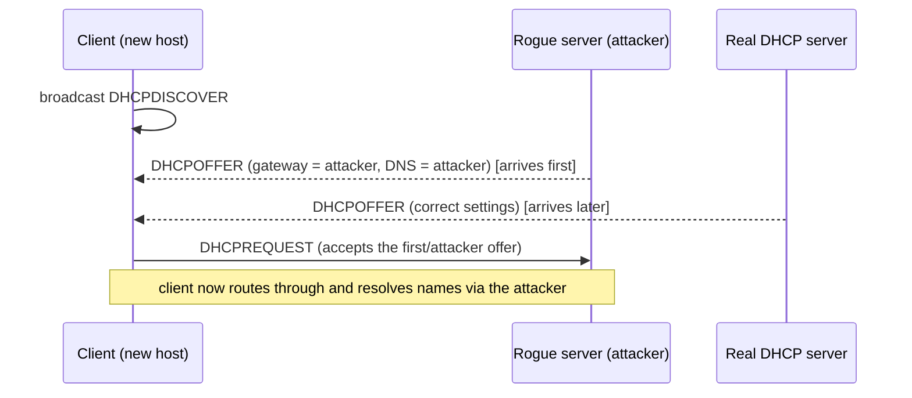

# DHCP attacks

## Summary

The Dynamic Host Configuration Protocol (DHCP) hands out IP addresses and network settings to hosts when they join a network, and it does so with no authentication in either direction. Two attacks follow: a *rogue DHCP server* answers clients faster than the real one and hands them attacker-controlled settings (a poisoned default gateway or DNS server), making the attacker on-path; and *DHCP starvation* exhausts the real server's address pool so it can no longer serve legitimate clients, often as a setup for the rogue server. Both are prevented on the switch with DHCP snooping, which trusts DHCP server replies only from designated ports.

## Prerequisites

- [Switch security](switch-security.md): DHCP snooping.
- [Network threat model](../foundations/network-threat-model.md): adjacent-to-on-path.
- [Protocol design weaknesses](../foundations/protocol-design-weaknesses.md): broadcast discovery.

Authorized use only. Mechanism described for defense.

## Core concepts

### Definition

*DHCP* (RFC 2131) lets a client broadcast a request for configuration and accept the first suitable offer. A *rogue DHCP server* is an unauthorized server that answers these requests with malicious settings. *DHCP starvation* floods the server with requests using many fake client identifiers to consume its address pool. The rogue-server interception is tracked under MITRE ATT&CK Adversary-in-the-Middle: DHCP Spoofing (T1557.003).

### Analogy

Joining a network via DHCP is like arriving in a new town and shouting "who can give me directions and a map?" You take directions from whoever answers first. A rogue DHCP server is a stranger who answers first and hands you a map where every road leads past their house (the poisoned gateway) and the phone book lists their number for every business (the poisoned DNS). Starvation is that stranger first sending a hundred fake newcomers to use up the real tourist office's maps, so only they are left to answer.

The analogy holds well; it breaks only in that the "map" is accepted automatically by the device with no human to notice the roads all lead to one house.

### Mechanism: rogue DHCP (DHCP spoofing)



The most damaging poisoned settings are the default gateway (all off-subnet traffic flows through the attacker) and the DNS server (the attacker answers name lookups, redirecting the client anywhere). The attacker becomes on-path without touching ARP.

### Mechanism: DHCP starvation

The attacker sends many DHCP requests, each with a different client hardware address, consuming one lease per request until the pool is empty. Legitimate clients can then get no address. Starvation is frequently the first step: empty the real server, then the rogue server is the only one answering.

### Defense: DHCP snooping

*DHCP snooping* on the switch classifies ports as *trusted* (toward the legitimate DHCP server and other switches) or *untrusted* (access ports with end devices). DHCP server messages (OFFER, ACK) arriving on an untrusted port are dropped, so a rogue server on an access port cannot answer clients. Snooping also rate-limits DHCP messages per port (blunting starvation) and builds the IP-MAC-port binding table that [Dynamic ARP Inspection](arp-spoofing/README.md) and IP Source Guard depend on. Port security limiting MACs per port further constrains starvation that relies on many fake client addresses.

## Worked example

The namespace lab has no managed switch, so this is a configuration and detection example. DHCP snooping on a Cisco switch:

```text
ip dhcp snooping
ip dhcp snooping vlan 10
ip dhcp snooping information option          ! option 82, optional
interface GigabitEthernet0/48
 ip dhcp snooping trust                      ! uplink toward the real DHCP server
interface range GigabitEthernet0/1 - 24
 ip dhcp snooping limit rate 10              ! blunt starvation on access ports
```

Reading it: only the uplink is trusted to carry DHCP server replies, so a rogue server plugged into any access port is silenced; access ports are rate-limited to slow a starvation flood. Detection without snooping: watch for DHCP OFFER/ACK messages whose source is not the known server, or a sudden surge of DHCPDISCOVER messages with many distinct client MACs. A host can also notice it received a gateway or DNS server it does not expect.

## Trade offs and when to use it

- **Snooping trust configuration** is the crux: the uplink toward the real server must be trusted, everything else untrusted. Getting it wrong either blocks real DHCP or defeats the control.
- **Rate limiting** access ports slows starvation but a limit too low disrupts legitimate bursts (many devices booting at once). Tune to the environment.
- **Option 82** (DHCP relay information) adds port context and helps large deployments, at some complexity.

DHCP snooping is standard on enterprise access switches and should be on by default. It is absent on unmanaged gear, which is another reason untrusted devices belong on separate managed infrastructure.

## Common mistakes

- **No DHCP snooping on access VLANs.** A rogue server or a user's home router plugged in by mistake hands out bad settings. Fix: enable snooping with correct trust ports.
- **Trusting the wrong port.** Fix: trust only paths toward the legitimate server and inter-switch links.
- **Ignoring accidental rogue servers.** Many incidents are a misconfigured device, not an attacker, but the effect is the same. Fix: snooping catches both.
- **Relying only on starvation rate limits.** They slow but do not stop a patient attacker. Fix: combine with port security and snooping.
- **Forgetting IPv6.** DHCPv6 and especially IPv6 router advertisements are a parallel path; see [IPv6 security](../core-protocols/ipv6-security.md). Fix: RA Guard and DHCPv6 guard.

## Practice

1. Which two DHCP-provided settings are the most damaging when poisoned, and why?
2. How does a rogue DHCP server usually win against the legitimate one?
3. What is the relationship between DHCP starvation and a rogue server attack?
4. How does DHCP snooping stop a rogue server?
5. Why must IPv6 be considered separately even if DHCP snooping is deployed for IPv4?

### Answers

1. The default gateway (routes all off-subnet traffic through the attacker) and the DNS server (lets the attacker redirect any name lookup), because both put the attacker on-path for the client's traffic.
2. By answering the client's broadcast first (or after starving the real server), since clients accept the first suitable offer.
3. Starvation empties the legitimate server's address pool so it cannot answer, leaving the rogue server as the only responder; starvation is often the setup for the rogue-server step.
4. It drops DHCP server messages arriving on untrusted (access) ports, so only the server on a trusted port can answer clients.
5. IPv6 hosts configure via router advertisements and DHCPv6, a separate mechanism that IPv4 DHCP snooping does not cover; RA Guard and DHCPv6 guard are needed.

## Further reading

- RFC 2131, Dynamic Host Configuration Protocol (1997): https://www.rfc-editor.org/rfc/rfc2131
- Cisco, Configuring DHCP Snooping, the reference for trust ports and rate limiting.
- MITRE ATT&CK, Adversary-in-the-Middle: DHCP Spoofing (T1557.003): https://attack.mitre.org/techniques/T1557/003/
- NSA, Network Infrastructure Security Guide (2022): https://media.defense.gov/2022/Jun/15/2003018261/-1/-1/0/CTR_NSA_NETWORK_INFRASTRUCTURE_SECURITY_GUIDE_20220615.PDF
