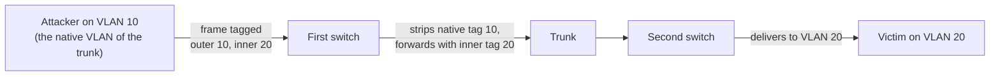

# VLAN hopping

## Summary

VLAN hopping is a link-layer attack that lets a host on one VLAN send traffic to another VLAN it should not reach, defeating the separation that VLANs are supposed to provide. It works in two ways: *switch spoofing*, where the attacker's port negotiates a trunk and so gains access to all VLANs, and *double tagging*, where a crafted frame with two VLAN tags is carried across to a target VLAN by the way switches strip tags. Both are prevented by disabling automatic trunk negotiation on access ports and by configuring the native VLAN correctly. VLAN hopping matters because many designs rely on VLANs for security separation, and a hop breaks that assumption.

## Prerequisites

- [Switch security](switch-security.md) and [network segmentation](../architecture/network-segmentation.md): what VLANs are meant to do.
- IEEE 802.1Q VLAN tagging, access ports and trunk ports.

Authorized use only. Mechanism described for defense; no attack tool is provided.

## Core concepts

### Definition

A *VLAN* (IEEE 802.1Q) partitions one physical switch fabric into separate broadcast domains identified by a tag. An *access port* carries one untagged VLAN to an end device; a *trunk port* carries many tagged VLANs between switches. *VLAN hopping* is any technique that moves frames from the attacker's VLAN into another without passing through a router that enforces policy.

### Analogy

VLANs are like color-coded internal mail in an office: red mail stays among red desks, blue among blue. VLAN hopping is slipping a letter into the system with two envelopes, a blue outer and a red inner, so that when the sorter removes the outer blue envelope it finds a red letter and delivers it to the red floor, bypassing the rule that your blue desk may not write to red. Switch spoofing is instead convincing the mailroom that your desk is actually a mail-exchange point entitled to all colors.

The analogy breaks because double tagging is one-way (you can send into the target VLAN but replies do not come back the same way), which limits it to injection rather than full two-way access.

### Mechanism 1: switch spoofing

Cisco's Dynamic Trunking Protocol (DTP) can automatically negotiate whether a port becomes a trunk. If an access port is left in the default auto-negotiating mode, an attacker's device can speak DTP and negotiate a trunk, after which it sends and receives tagged frames for every VLAN on that trunk. The fix is to turn off DTP and hard-set edge ports to access mode:

```text
interface GigabitEthernet0/5
 switchport mode access
 switchport nonegotiate       ! do not offer DTP
```

### Mechanism 2: double tagging



The attacker, on the trunk's *native VLAN* (the one sent untagged), crafts a frame with two 802.1Q tags: an outer tag for the native VLAN and an inner tag for the target VLAN. The first switch removes the outer (native) tag as usual and forwards the frame on the trunk still carrying the inner tag, so the second switch delivers it to the target VLAN. It is one-way: useful for injection or a DoS, not for a two-way session. The fix is to make the native VLAN an unused, dedicated VLAN that no access port uses, and to tag the native VLAN on trunks (`vlan dot1q tag native`), so there is no untagged VLAN to abuse.

## Worked example

The namespace lab does not model 802.1Q trunks, so this is a hardening baseline. A correctly hardened edge and trunk:

```text
! every access port:
interface range GigabitEthernet0/1 - 24
 switchport mode access
 switchport access vlan 10
 switchport nonegotiate            ! defeats switch spoofing

! every trunk between switches:
interface GigabitEthernet0/48
 switchport mode trunk
 switchport trunk native vlan 999  ! an unused VLAN, not any access VLAN
 switchport trunk allowed vlan 10,20,30   ! prune unused VLANs
vlan dot1q tag native              ! tag the native VLAN, defeats double tagging
```

Reading it: access ports cannot negotiate a trunk (no switch spoofing), the native VLAN is an unused VLAN that carries no real hosts and is itself tagged (no double tagging), and the trunk carries only the VLANs it needs. An attacker on an access port is confined to VLAN 10, and crossing to VLAN 20 requires the router, where [segmentation](../architecture/network-segmentation.md) policy applies.

## Trade offs and when to use it

- **Hard-set access vs auto-negotiation.** Auto is convenient for provisioning but allows switch spoofing. Prefer explicit `switchport mode access` and `nonegotiate` on edge ports.
- **Dedicated native VLAN.** Using an unused native VLAN and tagging it costs one VLAN ID and a small config change, and removes the double-tagging path entirely. Low cost, clear benefit.
- **VLAN pruning.** Allowing only needed VLANs on each trunk limits what a hop could reach and reduces broadcast scope.

The deeper point: VLANs are a traffic-separation mechanism, and their security value depends on correct configuration plus a router that enforces policy between them. Where strong isolation is required, do not rely on VLANs alone; add firewall policy between the VLANs and consider physical or [microsegmentation](../architecture/microsegmentation.md) boundaries.

## Common mistakes

- **Leaving DTP enabled on access ports.** Allows switch spoofing. Fix: `switchport mode access` and `switchport nonegotiate`.
- **Using VLAN 1 (or an access VLAN) as the native VLAN.** Enables double tagging. Fix: a dedicated unused native VLAN, tagged.
- **Allowing all VLANs on every trunk.** Widens the blast radius of a hop. Fix: prune to needed VLANs.
- **Assuming VLAN separation equals a firewall.** Inter-VLAN routing without policy allows free movement anyway. Fix: enforce policy at the layer-3 boundary.

## Practice

1. What are the two mechanisms of VLAN hopping, and which is one-way?
2. How does switch spoofing give an attacker access to other VLANs?
3. Why does placing the attacker on the trunk's native VLAN enable double tagging?
4. What two trunk settings defeat double tagging?
5. Why are VLANs alone not a sufficient security boundary?

### Answers

1. Switch spoofing (negotiating a trunk) and double tagging (a frame with two 802.1Q tags); double tagging is one-way.
2. By negotiating a trunk via DTP on an auto-mode port, the attacker's port then carries tagged frames for every VLAN on that trunk.
3. The first switch strips the outer tag because it matches the untagged native VLAN, forwarding the frame still carrying the inner tag to the target VLAN.
4. Setting the native VLAN to an unused dedicated VLAN that no access port uses, and tagging the native VLAN on trunks (`vlan dot1q tag native`).
5. VLAN separation depends on correct configuration and on a router enforcing policy between VLANs; misconfiguration or unfiltered inter-VLAN routing lets traffic cross, so a firewall policy is still required.

## Further reading

- IEEE 802.1Q, the VLAN tagging standard: https://standards.ieee.org/
- Cisco, VLAN Security White Paper, on switch spoofing, double tagging and native-VLAN hardening.
- NSA, Network Infrastructure Security Guide (2022): https://media.defense.gov/2022/Jun/15/2003018261/-1/-1/0/CTR_NSA_NETWORK_INFRASTRUCTURE_SECURITY_GUIDE_20220615.PDF
- MITRE ATT&CK, Network Boundary Bridging (T1599) for the general idea of crossing a segmentation boundary.
