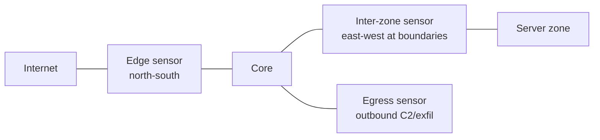

# Network security monitoring

## Summary

Network security monitoring (NSM) is the practice of collecting, analyzing and retaining network data to detect and investigate intrusions. Its founding idea is that prevention eventually fails, so you must be able to see what is happening on the network to catch what got through and to understand it afterwards. NSM defines the data types to collect (full packets, flow records, transaction logs, alerts), where to place sensors so they actually see the important traffic, and how to use the data for detection, hunting and incident response. The recurring failure it guards against is the blind spot: a sensor only sees traffic that reaches it, so visibility must be designed alongside the network, not bolted on.

## Prerequisites

- [Network security controls](../foundations/network-security-controls.md): the detect function and placement.
- [Packet capture analysis](packet-capture-analysis/README.md) and [flow monitoring](flow-monitoring.md): two of the data types.
- [Network segmentation](../architecture/network-segmentation.md): choke points are where sensors go.

## Core concepts

### Definition

*Network security monitoring* is the collection and analysis of network traffic data to identify and respond to intrusions. The term and discipline were formalized by Richard Bejtlich; the premise is detection and response, built on the assumption that prevention is imperfect.

### Analogy

NSM is the building's security-camera and logbook system. Prevention is the locks; NSM is knowing, during and after an incident, who went where and when. Cameras must be placed where people must pass (choke points), there must be enough of them to avoid blind corners, and the footage must be kept long enough to review after a break-in discovered weeks later. A building with locks but no cameras can be robbed with nobody ever learning how.

The analogy holds closely; it breaks in that network "footage" can be enormous, so NSM must choose which data to keep at full fidelity and which to summarize.

### The data types

NSM collects complementary data, each with a different cost and value:

| Data type | What it is | Strength | Cost |
| --- | --- | --- | --- |
| Full packet capture | Every byte ([pcap](packet-capture-analysis/README.md)) | Complete ground truth, content | Huge storage, privacy |
| Transaction / protocol logs | Structured records of connections and protocol events ([Zeek](zeek.md)) | Rich, compact, searchable | Needs a tool to generate |
| Flow records | Connection summaries ([NetFlow/IPFIX](flow-monitoring.md)) | Very compact, keepable long-term | No content |
| Alerts | IDS/IPS signature and anomaly hits ([Suricata/Snort](suricata-and-snort.md)) | Actionable signals | False positives; misses unknown |
| Statistical / extracted | File hashes, certificates, JA3/JA4 ([ETA](encrypted-traffic-analysis.md)) | Works on encrypted traffic | Derived, not complete |

A mature NSM program keeps flow and transaction logs for a long time (months), alerts indefinitely, and full packets briefly at key points, because full capture of everything forever is infeasible.

### Sensor placement: the visibility problem

A sensor sees only the traffic that crosses it. The central NSM design decision is where to place sensors so they see the traffic that matters:

- *North-south* at the edge: sees traffic to and from the internet.
- *East-west* at [segment](../architecture/network-segmentation.md) boundaries: sees [lateral movement](../network-attacks/lateral-movement.md), the stage perimeter-only monitoring misses.
- *Egress*: focused on outbound for [C2](../network-attacks/command-and-control-traffic.md) and [exfiltration](../network-attacks/data-exfiltration.md).

Sensors get traffic via a *SPAN/mirror port* (a switch copies traffic to the sensor) or a *network TAP* (a passive device on the link). TAPs are more reliable under load; SPAN ports can drop packets when busy. Encrypted traffic limits content analysis, pushing NSM toward metadata and [encrypted traffic analysis](encrypted-traffic-analysis.md).

### Blind spots

The defining failure of NSM is the blind spot, traffic that no sensor sees:

- East-west traffic within a zone that never crosses a monitored boundary.
- Encrypted traffic where only content inspection was planned.
- Traffic on a path (rogue AP, cellular, direct cloud) that bypasses the sensors.
- Cloud and remote-worker traffic that never touches the on-premises sensors.

Designing visibility with the network (choke points via segmentation, cloud flow logs, endpoint telemetry for what the network cannot see) is how blind spots are closed.

## Worked example

A team builds NSM for a segmented network, combining the tested tools from this subarea:

1. **Placement.** TAPs at the internet edge and at each segment boundary (so east-west lateral movement is visible), plus a focus on egress.
2. **Data.** [Zeek](zeek.md) turns traffic into transaction logs (connections, DNS, TLS metadata) kept for months; [flow records](flow-monitoring.md) kept longer; [Suricata](suricata-and-snort.md) alerts on signatures; short-term full [pcap](packet-capture-analysis/README.md) at the edge for deep investigation.
3. **Detection in the data.** The [beaconing detector](beaconing-detection/README.md) runs over the flow/conn logs to find [C2](../network-attacks/command-and-control-traffic.md); the [DNS tunnel detector](../dns-security/dns-tunneling/README.md) runs over DNS logs; Suricata catches known-bad signatures; the [pcap summarizer](packet-capture-analysis/README.md) triages captures during incidents.
4. **Investigation.** When an alert fires, the analyst pivots: the alert gives a host and time, flow records show who else it talked to, Zeek logs give the protocol detail, and short-term pcap gives the actual bytes if still retained.
5. **Closing blind spots.** Cloud workloads, invisible to on-premises sensors, are covered by [VPC flow logs](flow-monitoring.md) and the cloud provider's logging; remote workers by endpoint telemetry.

The example shows NSM as a layered data program feeding detection and investigation, with the tested detectors in this subarea as the analysis layer on top of the collected data.

## Trade offs and when to use it

- **Fidelity vs retention.** Full packets are complete but unkeepable long-term; flow and logs are compact and keepable. Keep a pyramid: alerts and flow long, logs medium, packets briefly at key points.
- **Coverage vs cost.** More sensors see more but cost money and generate data; place them at choke points (segment boundaries, edge, egress) for maximum visibility per sensor.
- **TAP vs SPAN.** TAPs are reliable under load; SPAN is cheaper and flexible but can drop packets. Use TAPs where completeness matters.
- **Content vs metadata.** Encryption limits content analysis; invest in metadata and [ETA](encrypted-traffic-analysis.md) rather than assuming you can read payloads.

## Common mistakes

- **Perimeter-only monitoring.** Misses east-west lateral movement. Fix: sensors at internal segment boundaries.
- **Assuming a sensor sees everything.** It sees only what crosses it. Fix: map traffic paths, place sensors at choke points, cover cloud and remote with flow logs and endpoint data.
- **Keeping only alerts.** No data to investigate the alert or hunt. Fix: retain flow and transaction logs for context.
- **Full capture of everything.** Unaffordable and a privacy risk. Fix: the retention pyramid.
- **SPAN ports dropping under load.** Silent gaps exactly when busy. Fix: TAPs on important links; watch drop counters.

## Practice

1. What is the founding assumption of network security monitoring?
2. Why is sensor placement the central NSM design decision?
3. Give the four main NSM data types and one strength of each.
4. Why does perimeter-only monitoring create a blind spot, and what closes it?
5. Why keep a retention pyramid rather than full packet capture of everything?

### Answers

1. That prevention eventually fails, so you must be able to detect, investigate and respond to what gets through, which requires collecting and analyzing network data.
2. A sensor only sees traffic that crosses it, so where sensors are placed determines what can ever be detected or investigated; visibility must be designed around the network's choke points.
3. Full packet capture (complete content/ground truth), transaction/protocol logs (rich and compact), flow records (very compact, long-term keepable), and alerts (actionable signals).
4. The perimeter sees only north-south traffic, so lateral movement and other east-west activity never cross it and go unseen; placing sensors at internal segment boundaries closes it.
5. Full capture of everything is infeasible in storage and raises privacy issues; a pyramid keeps compact flow and logs for a long time and full packets only briefly at key points, balancing cost against investigative value.

## Further reading

- Bejtlich, R., The Practice of Network Security Monitoring (No Starch Press). The foundational text.
- NIST SP 800-137, Information Security Continuous Monitoring (ISCM): https://doi.org/10.6028/NIST.SP.800-137
- [Zeek](zeek.md), [flow monitoring](flow-monitoring.md), [Suricata and Snort](suricata-and-snort.md) and [packet capture analysis](packet-capture-analysis/README.md) for the data sources.
- SANS reading room papers on NSM sensor placement and architecture.
