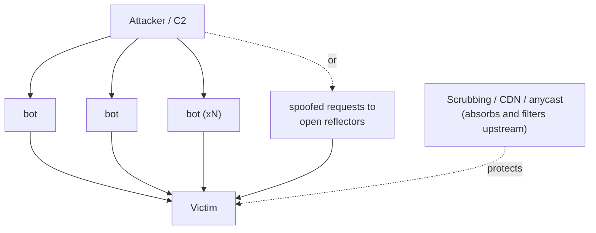

# Distributed denial of service

## Summary

A distributed denial of service (DDoS) attack is a denial of service launched from many sources at once, so that no single address can be blocked and the combined volume can exceed what the victim can absorb. The sources are usually a botnet of compromised devices or a set of misused public servers acting as reflectors. DDoS spans all three DoS classes (volumetric, protocol and application), and the defining difficulty is distribution itself: the traffic comes from everywhere, often resembles legitimate users, and arrives in volumes that only large, upstream infrastructure can handle. Defense is therefore mostly a service you buy and prepare for in advance, not a device you configure at the last minute.

## Prerequisites

- [Denial of service](denial-of-service.md): the classes and the single-source case.
- [SYN flood](syn-flood.md) and [ICMP flood](icmp-flood.md): examples of techniques a DDoS distributes.
- [Network threat model](../../foundations/network-threat-model.md): spoofing, reflection, botnets.

Authorized use only. DDoS-for-hire ("booter" and "stresser") services are illegal in most jurisdictions, including against your own systems if they share infrastructure. Legitimate resilience testing is arranged in writing with the provider.

## Core concepts

### Definition

A *distributed denial of service* uses many coordinated sources to deny a service to its users. Two structures are common:

- A *botnet*: many compromised devices (home routers, IP cameras, servers) each send attack traffic on command. The Mirai botnet, built from default-credential IoT devices, is the well-known example.
- *Reflection and amplification*: the attacker spoofs the victim's address and sends small requests to many public servers (DNS, NTP, memcached), which send large replies to the victim. This both distributes and amplifies, and needs no botnet.

It is tracked as MITRE ATT&CK Network Denial of Service (T1498) and Endpoint Denial of Service (T1499).

### Analogy

A single-source DoS is one person blocking a shop's doorway; a guard removes them. A DDoS is a coordinated crowd of thousands arriving from every direction, many looking like ordinary shoppers. You cannot identify and remove each one, and the sheer number blocks the door regardless. The only answers are a much wider entrance (capacity), crowd-control staff hired in advance (a scrubbing provider), and the ability to spread people across many entrances in different cities (anycast).

The analogy breaks because network traffic can also be forged to appear to come from the victim's own customers, and because the "crowd" can be redirected in seconds, so defenses must be automatic.

### Why distribution is the hard part

- **No single source to block.** Blocking addresses one at a time cannot keep up with thousands, and reflected traffic appears to come from legitimate servers.
- **Volume beyond the victim.** Combined bandwidth can reach terabits per second, more than any single site's link, so filtering must happen upstream where capacity exists.
- **Looks legitimate.** Application-layer DDoS sends real-looking requests from real (compromised) devices, so simple signatures do not separate attack from customer.

### The defense model: absorb and filter upstream

Effective DDoS defense moves the fight away from the victim's link:

- **Anycast and large capacity.** Content delivery networks and DDoS providers announce the protected addresses from many sites worldwide, so an attack is split across many large data centers instead of hitting one link.
- **Scrubbing centers.** Traffic is diverted (by BGP or DNS) through facilities that filter attack traffic and forward only clean traffic to the origin.
- **Rate limiting and challenges at the edge.** For application-layer floods, the edge applies per-client limits, JavaScript or CAPTCHA challenges, and behavioral analysis to tell bots from users.
- **Not being an amplifier.** Closing open resolvers, NTP and memcached, and deploying BCP 38 source-address validation, reduces the reflection capacity available to attackers everywhere. This is a collective defense: it protects others, not yourself.

### Preparation matters more than reaction

Because the traffic arrives faster than humans can respond and larger than on-site equipment can handle, the useful work happens before the attack: contracting a provider, pre-configuring diversion, knowing which assets are critical, and rehearsing the runbook. An unprepared organization spends the first hour discovering it has no mechanism to divert traffic.

## Worked example

A retailer's checkout API is hit by a 300 Gbps reflection flood plus an application-layer flood of fake "add to cart" requests. Walking through a prepared response:

1. **Detection.** Monitoring shows inbound traffic far above baseline and the upstream link near saturation. Flow records show many sources and a spike in UDP from port 53 and 123 (DNS and NTP reflection).
2. **Volumetric mitigation.** The pre-arranged diversion is triggered: the provider announces the retailer's prefixes, traffic flows through scrubbing centers, and the reflected UDP is dropped upstream because the retailer never sends requests that would elicit those replies. The origin link recovers.
3. **Application-layer mitigation.** The fake "add to cart" requests look like real HTTP. The edge applies per-client rate limits and a challenge to new clients; legitimate browsers solve it transparently, most bots do not. Expensive endpoints get a stricter limit.
4. **Not amplifying.** Separately, the retailer confirms its own DNS and NTP servers are not open reflectors, so it is not contributing to attacks on others.
5. **After action.** The runbook is updated, thresholds tuned, and provider escalation contacts confirmed.

The example shows the division of labor: the network and provider absorb volume, the application handles the human-looking flood, and both depend on preparation done earlier.

## Trade offs and when to use it

- **CDN / scrubbing provider.** The only practical defense against large volumetric DDoS. Costs money, adds a dependency, and for HTTPS the provider must terminate or inspect TLS, which has privacy and trust implications.
- **Always-on vs on-demand diversion.** Always-on protects instantly but adds latency and cost to all traffic; on-demand is cheaper but has a detection-and-divert delay during which the site is down.
- **Challenges (CAPTCHA, proof-of-work).** Separate bots from users under application-layer attack, at the cost of friction for real users.
- **Overprovisioning capacity.** Helps against moderate attacks but cannot match the largest; it is a complement, not a substitute, for upstream mitigation.

## Common mistakes

- **Trying to handle a volumetric DDoS on-site.** The link is full before any on-site device can act. Fix: upstream scrubbing or CDN.
- **No pre-arranged diversion.** Discovering you have no mechanism during the attack wastes the critical first hour. Fix: contract and rehearse in advance.
- **Blocking individual source addresses.** Cannot scale to thousands and blocks reflectors that are legitimate servers. Fix: filter by traffic characteristics upstream.
- **Running open reflectors.** Makes you part of attacks on others and invites blocklisting. Fix: close open DNS/NTP/memcached, deploy BCP 38.
- **Ignoring the application layer.** Volumetric defenses do not stop a low-volume, human-looking flood of expensive requests. Fix: rate limits, challenges and caching at the application.

## Practice

1. Why can you not defend against a large volumetric DDoS by blocking source addresses on your firewall?
2. What are the two common ways to assemble the many sources of a DDoS?
3. How does anycast help absorb a DDoS?
4. Why does closing your open DNS resolver protect other organizations rather than yourself?
5. Why is preparation emphasized more for DDoS than for most other attacks?

### Answers

1. The sources number in the thousands and reflected traffic appears to come from legitimate servers, so per-address blocking cannot keep up; and the volume fills the link before the firewall can act.
2. A botnet of compromised devices, or reflection and amplification off open public servers with the victim's address spoofed.
3. The protected addresses are announced from many data centers worldwide, so the attack is split across many large sites instead of concentrating on one link.
4. An open resolver is an amplifier attackers use against victims; closing it removes capacity from attacks aimed at others, but does not defend your own bandwidth.
5. The traffic arrives faster than humans can react and larger than on-site equipment can handle, so the effective mechanisms (diversion, scrubbing contracts, runbooks) must exist before the attack starts.

## Further reading

- CISA, Understanding and Responding to Distributed Denial-of-Service Attacks (joint CISA, FBI, MS-ISAC guidance): https://www.cisa.gov/resources-tools/resources/understanding-and-responding-distributed-denial-service-attacks
- Antonakakis, M. et al., "Understanding the Mirai Botnet", USENIX Security 2017, on the IoT botnet behind record attacks: https://www.usenix.org/conference/usenixsecurity17/technical-sessions/presentation/antonakakis
- US-CERT (CISA) Alert TA14-017A, UDP-Based Amplification Attacks: https://www.cisa.gov/news-events/alerts/2014/01/17/udp-based-amplification-attacks
- BCP 38 / RFC 2827, Network Ingress Filtering: https://www.rfc-editor.org/rfc/rfc2827
- MITRE ATT&CK, Network Denial of Service (T1498): https://attack.mitre.org/techniques/T1498/
