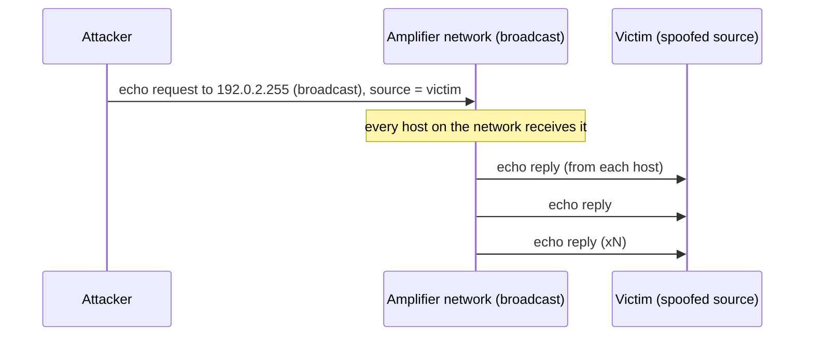

# ICMP flood

## Summary

An ICMP flood is a denial-of-service technique that sends a large volume of ICMP traffic (most often echo requests, the packets behind `ping`) to overwhelm a target's bandwidth or packet-processing capacity. A classic variant, the smurf attack, amplified it by sending echo requests to a network's broadcast address with the victim's address spoofed as the source, so every host on that network replied to the victim. Modern networks defend against ICMP floods by rate-limiting ICMP, disabling directed broadcasts, and absorbing volume upstream. The defender's aim is to keep the useful parts of ICMP (error reporting, path MTU discovery) working while capping the abusable parts.

## Prerequisites

- [Denial of service](denial-of-service.md): the general model.
- [ICMP security](../../core-protocols/icmp-security.md): what ICMP is for and why it cannot simply be blocked.
- [Network threat model](../../foundations/network-threat-model.md): spoofing and reflection.

Authorized use only. This note describes the mechanism for detection and mitigation and generates no attack traffic beyond a rate-limit demonstration in a private lab.

## Core concepts

### Definition

An *ICMP flood* overwhelms a target with ICMP packets. The direct form sends echo requests as fast as possible; the target spends CPU and bandwidth generating echo replies. The *smurf* form is a reflection and amplification attack: the attacker sends echo requests to a network's broadcast address with the victim's address spoofed as the source, and every host that answers sends an echo reply to the victim. It is tracked under MITRE ATT&CK Network Denial of Service (T1498).

### Analogy

A direct ICMP flood is like a prankster ringing your doorbell non-stop: you waste time answering. A smurf attack is like mailing a postcard to every house on a street, each one signed with your enemy's return address and asking "please write back"; the whole street mails replies to your enemy, who never sent anything. The amplification is the number of houses on the street.

The analogy breaks because the "street" (a network's broadcast domain) can be large and the whole exchange happens in milliseconds, so the reply flood can be far larger than the attacker's own effort.

### Mechanism

The direct form is simple volume: more echo requests than the link or CPU can handle. Each request obliges a reply, so the target spends resources in both directions.

The smurf amplification works like this:



The gain equals the number of responding hosts. This is why the specific fix, disabling *directed broadcasts* on routers (so a packet addressed to a network's broadcast address is not delivered to every host from outside), removed smurf as a large-scale threat.

### Why you cannot just block all ICMP

ICMP carries essential control messages. Blocking it entirely breaks things in ways that are hard to diagnose:

- *Fragmentation needed* (type 3, code 4) is how path MTU discovery works; blocking it causes connections that hang on large transfers.
- *Time exceeded* (type 11) is how `traceroute` and TTL-expiry diagnostics work.
- *Destination unreachable* (type 3) tells senders quickly that a host or port is gone.

The correct posture is selective: permit the error types that keep the network healthy, rate-limit echo, and never blanket-drop ICMP. This is one place where a crude "block ICMP" rule does more operational harm than security good.

## Worked example

This uses the [network security lab](../../foundations/network-security-lab/README.md). The firewall permits the essential ICMP error types, permits echo but rate-limits it, and relies on the link for the rest. The relevant rules (nftables):

```
ip protocol icmp icmp type { destination-unreachable, time-exceeded, parameter-problem } accept
icmp type echo-request limit rate over 5/second burst 10 packets drop
icmp type echo-request accept
```

The rate limit must sit before the connection-state rule, because Linux connection tracking folds repeated echo requests into one "established" flow; placed after it, the limit never runs. This subtlety is covered in [firewall rule design](../../traffic-filtering/firewall-rule-design/README.md). Testing the corrected rule by sending 50 echo requests at 20 per second (nftables 1.0.2, kernel 6.8, 2026-10):

```text
50 packets transmitted, 22 received, 56% packet loss
```

The 22 that arrive are the burst of 10 plus 5 per second over the 2.5-second run. Normal diagnostic pings (a few per second) pass untouched, while a flood is capped. Importantly, this protects the host's CPU and the far side of the firewall; it does not protect the firewall's own inbound link, which only upstream capacity can defend.

Directed-broadcast handling is a router setting, not shown in the namespace lab; on Cisco IOS it is `no ip directed-broadcast` (the default since IOS 12.0), and Linux hosts ignore broadcast echo by default (`net.ipv4.icmp_echo_ignore_broadcasts = 1`, confirmed set on this host).

## Trade offs and when to use it

- **Rate-limit echo vs block echo.** Rate-limiting keeps diagnostics working while capping abuse; blocking echo entirely stops `ping`-based monitoring and troubleshooting. Prefer rate-limiting.
- **Permit essential ICMP error types.** The small risk of information disclosure from these messages is outweighed by the breakage caused by dropping them. Permit them.
- **Disable directed broadcasts.** Almost pure benefit; the feature has no modern legitimate use on the edge.
- **Upstream absorption for volume.** A large distributed ICMP flood is a bandwidth problem and needs the same upstream scrubbing as any volumetric attack.

## Common mistakes

- **Blanket-dropping all ICMP.** Breaks path MTU discovery and diagnostics. Fix: permit essential error types, rate-limit echo.
- **Rate-limit rule placed after the state-accept rule.** It never runs. Fix: limit before the state rule, as shown.
- **Leaving directed broadcasts enabled.** Makes your network a smurf amplifier against others. Fix: disable them on all routers.
- **Thinking a host rate limit stops a volumetric flood.** It protects CPU, not the saturated link. Fix: upstream capacity for volume.
- **Allowing spoofed sources to leave your network.** Reflection attacks depend on spoofing. Fix: BCP 38 ingress filtering, see [IP spoofing and source validation](../../core-protocols/ip-spoofing-and-source-validation.md).

## Practice

1. What distinguishes a smurf attack from a direct ICMP flood, and where does its amplification come from?
2. Why is "block all ICMP" a poor firewall rule?
3. Which single router setting removed smurf as a large-scale threat?
4. Why must an echo-request rate limit be placed before the connection-state accept rule on Linux?
5. What does a host-level ICMP rate limit protect, and what does it not protect?

### Answers

1. A smurf attack reflects off a broadcast network with the victim's address spoofed as the source, so many hosts reply to the victim; the amplification equals the number of responding hosts. A direct flood is just raw volume from the attacker.
2. ICMP carries essential control messages (fragmentation-needed for path MTU discovery, time-exceeded for traceroute, destination-unreachable); blocking all of it breaks connectivity in ways that are hard to diagnose.
3. Disabling directed broadcasts on routers, so externally sourced packets to a network's broadcast address are not delivered to every host.
4. Connection tracking groups repeated echo requests sharing an ICMP identifier into one "established" flow, so a limit after the state rule never sees them.
5. It protects the host's CPU and the network behind the firewall; it does not protect the firewall's own inbound link bandwidth.

## Further reading

- CERT Advisory CA-1998-01, Smurf IP Denial-of-Service Attacks (historical, explains the amplification).
- RFC 2644 / BCP 34, Changing the Default for Directed Broadcasts in Routers (1999): https://www.rfc-editor.org/rfc/rfc2644
- RFC 4890, Recommendations for Filtering ICMPv6 Messages in Firewalls (2007), the IPv6 analogue of "do not blanket-drop ICMP": https://www.rfc-editor.org/rfc/rfc4890
- MITRE ATT&CK, Network Denial of Service: Reflection Amplification (T1498.002): https://attack.mitre.org/techniques/T1498/002/
