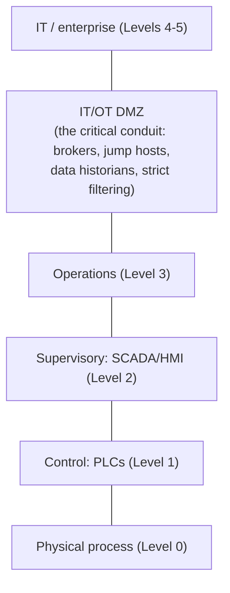

# OT network security

## Summary

Operational technology (OT) is the computing that runs physical processes: the industrial control systems, PLCs and SCADA behind factories, power grids, water treatment and building systems. Its network security is different from IT's because the priorities invert, availability and safety come first, confidentiality last, and because its protocols (Modbus, DNP3, others) were designed for isolated, trusted networks and have little or no authentication. You often cannot patch or even scan OT devices without risking the process. The dominant model is IEC 62443's zones and conduits, which segments the OT environment and strictly controls the boundary between IT and OT (often via the Purdue model). The guiding idea: when you cannot secure the endpoints, you secure the network around them.

## Prerequisites

- [Network segmentation](../architecture/network-segmentation.md): zones and conduits are segmentation for OT.
- [Protocol design weaknesses](../foundations/protocol-design-weaknesses.md) and [insecure legacy protocols](../core-protocols/insecure-legacy-protocols.md).
- [Network threat model](../foundations/network-threat-model.md).

## Core concepts

### Definition

*Operational technology* is hardware and software that detects or causes changes in physical processes through direct monitoring and control of physical devices. *OT network security* protects the networks connecting industrial control systems (ICS), including SCADA (supervisory control and data acquisition), PLCs (programmable logic controllers) and the protocols between them.

### Analogy

IT security protects information; OT security protects a running machine, like the difference between guarding a library's records and guarding the controls of a moving train. You will not take the train's control system offline to patch it mid-journey, and a false "stop" command is not a data breach but a derailment. So you cannot apply IT's "patch and reboot, confidentiality first" habits; you build a secure cab around the controls and tightly control who can reach them, because you cannot change the controls themselves while the train runs.

The analogy holds closely; it carries the inverted priorities (safety/availability over confidentiality) and the "cannot touch the endpoint" constraint.

### Why OT is different: inverted priorities

IT security prioritizes confidentiality, integrity, availability (often in that order). OT inverts it: *safety* and *availability* come first, because the system controls physical processes where downtime or malfunction can cause physical harm, environmental damage or large losses; confidentiality is usually least important. This changes every decision:

- You do not patch or reboot freely; an unplanned stop can be as bad as an attack, and patches may not exist or may not be vendor-approved.
- You often cannot actively [scan](../network-attacks/network-scanning.md) OT devices; fragile stacks can crash from a scan that any IT system would shrug off. Passive monitoring is preferred.
- Devices have decades-long lifecycles, so unpatchable, insecure-by-design equipment is normal and must be compensated for, not simply replaced.

### Insecure-by-design protocols

OT protocols (Modbus, DNP3, EtherNet/IP, PROFINET and others) were designed for isolated, trusted networks and typically have no authentication or encryption: a command on the wire is obeyed, and anyone on the network can send one. There is usually no equivalent of "fix the protocol", because the installed base cannot be changed. The defense is therefore network-level: ensure only authorized systems are on the OT network and only authorized traffic crosses into it.

### The Purdue model and IEC 62443 zones and conduits

OT architecture is traditionally described by the *Purdue model*, which layers the environment from physical process (Level 0) up through control (PLCs, Level 1), supervisory (SCADA/HMI, Level 2), operations (Level 3), to the IT/enterprise network (Levels 4-5), with a demilitarized zone between OT and IT.

*IEC 62443* (the main ICS security standard) formalizes segmentation as *zones and conduits*: group assets with common security requirements into zones, and allow communication between zones only through defined, controlled *conduits*. The most important conduit is the IT/OT boundary:

The IT/OT DMZ is where most OT security effort goes: no direct IT-to-OT traffic, data passed through brokers and historians, administrative access through hardened [jump hosts](../architecture/management-plane-security.md), and strict, minimal filtering. Many OT incidents (including ransomware spilling from IT into OT) are failures of this boundary.

### Securing the network around unsecurable endpoints

Because the endpoints often cannot be secured, OT network security concentrates on:

- *Strong IT/OT segmentation* with a controlled DMZ conduit, so an IT compromise cannot reach OT and vice versa.
- *Zone segmentation within OT*, so a problem in one cell does not spread.
- *Passive monitoring* (OT-aware network monitoring that understands Modbus/DNP3) to detect anomalies without probing fragile devices.
- *Tight access control* on who and what may reach OT (jump hosts, no direct vendor internet access, controlled remote access).
- *Allow-listing* of expected traffic, since OT traffic is far more predictable than IT traffic, which makes anomaly detection more effective.

## Worked example

Securing a factory where PLCs speak unauthenticated Modbus and cannot be patched (conceptual; OT is not modelled in the lab):

1. **Segment IT from OT.** Establish an IT/OT DMZ: no direct connections between the enterprise network and the control network. Data for business systems is pulled from a historian in the DMZ, not from the PLCs directly.
2. **Zones and conduits.** Within OT, separate production cells into zones; a conduit between a cell and the supervisory layer allows only the specific expected traffic. A compromise in one cell cannot reach another.
3. **Controlled access.** Engineers and vendors reach OT only through a hardened jump host in the DMZ, with MFA and logging; no device on the OT network has direct internet access.
4. **Passive monitoring.** An OT-aware passive sensor on the control network baselines the normal, highly repetitive Modbus traffic and alerts on anomalies (an unexpected write command, a new device, traffic to a PLC from an unexpected source), without ever actively probing the fragile PLCs.
5. **Compensate for unpatchable devices.** The insecure Modbus PLCs are not exposed beyond their zone; only the SCADA systems that must talk to them can, over the defined conduit, and that traffic is monitored.
6. **Result.** The PLCs remain insecure by design, but an attacker cannot reach them from IT, cannot move between OT zones, and any anomalous command is detected, security provided by the network because it could not be provided by the endpoints.

The example embodies the OT principle: secure the network around devices you cannot secure, with the IT/OT boundary as the most important control.

## Trade offs and when to use it

- **Availability/safety vs IT-style controls.** OT cannot adopt patch-and-reboot or active scanning without risking the process; accept slower, vendor-approved patching and passive monitoring, and compensate with segmentation.
- **Segmentation effort vs the IT/OT boundary payoff.** Building zones, conduits and a proper IT/OT DMZ is significant work, but it is the control that stops IT compromises (including ransomware) from reaching physical processes, the highest-impact OT risk.
- **Passive vs active monitoring.** Passive is safe for fragile devices but sees only what crosses the sensor; active scanning is usually off-limits. Favor passive, OT-aware monitoring.
- **Replace vs compensate.** Insecure-by-design devices with decades-long lifecycles usually cannot be replaced soon; compensate with network controls and plan replacement over the long term.

## Common mistakes

- **Flat IT/OT connectivity.** Lets IT compromises (ransomware) reach OT, a frequent, high-impact incident. Fix: a proper IT/OT DMZ conduit, no direct traffic.
- **Active scanning of OT devices.** Can crash fragile control systems. Fix: passive, OT-aware monitoring.
- **Applying IT priorities (confidentiality first, patch aggressively) to OT.** Causes outages and misses safety/availability. Fix: OT priorities, vendor-approved change windows.
- **Direct internet or vendor access to OT devices.** A direct attack path. Fix: access only via hardened jump hosts in the DMZ.
- **No internal OT segmentation.** A problem in one cell spreads across the plant. Fix: zones and conduits within OT.

## Practice

1. How do OT security priorities differ from IT, and why?
2. Why can you often not patch or actively scan OT devices?
3. What are zones and conduits, and which conduit matters most?
4. Why does OT security concentrate on the network rather than the endpoints?
5. Why is OT traffic well suited to allow-listing and anomaly detection?

### Answers

1. OT prioritizes safety and availability over confidentiality (the reverse of typical IT), because the systems control physical processes where downtime or malfunction can cause physical harm, so keeping them running and safe outranks protecting data.
2. Patching may require an unacceptable process stop or may not exist/be vendor-approved for long-lived equipment, and active scanning can crash fragile control-system network stacks, so both carry process risk.
3. Zones group assets with common security requirements; conduits are the only, controlled communication paths between zones (IEC 62443). The IT/OT boundary conduit (the IT/OT DMZ) matters most, since it stops IT compromises reaching physical processes.
4. The endpoints are frequently insecure by design and unpatchable with decades-long lifecycles, so security must be provided by the network around them (segmentation, controlled access, monitoring) rather than on the devices.
5. OT traffic is highly repetitive and predictable (the same devices exchanging the same commands), so defining what is expected (allow-listing) and flagging deviations is far more effective than in noisy, variable IT environments.

## Further reading

- IEC 62443, the ICS security standard series (zones and conduits, security levels).
- NIST SP 800-82 Rev. 3, Guide to Operational Technology (OT) Security (2023): https://doi.org/10.6028/NIST.SP.800-82r3
- The Purdue model for ICS network architecture.
- CISA ICS advisories and the MITRE ATT&CK for ICS matrix: https://attack.mitre.org/matrices/ics/
