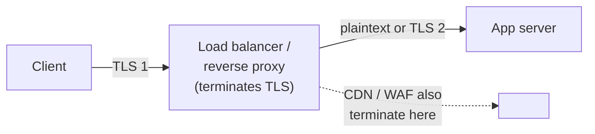

# TLS in network security

## Summary

This note is the network-security view of the TLS protocol. A note on the protocol itself is planned in the [cryptography area](../../../security-architecture-and-engineering/cryptography/README.md). For a defender the questions are not how the handshake works but where TLS is terminated, whether it is actually enforced, how certificates are managed at scale, how to authenticate both ends (mutual TLS) for internal traffic, and what TLS does and does not hide from an on-path attacker. TLS is the single most important control for the confidentiality and integrity of data in transit, and the main reason an on-path position (ARP spoofing, rogue Wi-Fi, a compromised router) no longer automatically yields readable traffic. Its network-security weak points are downgrade, termination points, certificate validation, and the metadata it leaves exposed.

## Prerequisites

- Transport Layer Security (TLS) as a protocol: planned in the [cryptography area](../../../security-architecture-and-engineering/cryptography/README.md). Until it exists, RFC 8446 is the protocol reference: https://www.rfc-editor.org/rfc/rfc8446
- [Public Key Infrastructure](../../../security-architecture-and-engineering/cryptography/public-key-infrastructure.md): certificates and trust.
- [Network threat model](../foundations/network-threat-model.md): the on-path attacker TLS defends against.

## Core concepts

### Definition

In network-security terms, *deploying TLS* means ensuring that sensitive traffic is encrypted and authenticated in transit, that the encryption cannot be stripped or downgraded, that both ends are who they claim to be, and that you know where the plaintext exists along the path.

### Analogy

Think of TLS as sending documents in locked, tamper-evident courier pouches. The protocol designs the pouch; network security is the logistics: making sure nobody is allowed to send documents unlocked (enforcement), that the recipient really is who the address says (certificate validation), that for internal transfers both parties show ID (mutual TLS), and knowing at which sorting office the pouch is opened and its contents handled in the clear (termination).

The analogy holds well; it breaks in that the courier can still see the addresses on the pouch (the destination IP and server name), which is the metadata TLS does not hide.

### Where TLS terminates

The most important network-security question about any TLS deployment is *where the plaintext is*. TLS is often not end-to-end:



A load balancer, CDN or WAF commonly terminates the client's TLS and starts a new connection inward. Between those points the data may be plaintext. This matters because: the terminating device sees everything; an internal hop left in plaintext is exposed to an insider or an east-west attacker; and compliance may require re-encryption of internal legs. Always know the termination points and whether internal legs are re-encrypted.

### Enforcement and downgrade

Offering TLS is not the same as requiring it. An on-path attacker can try to keep a client on the plaintext version (SSL stripping on HTTP, STARTTLS stripping on mail). The enforcement tools:

- *HSTS* (HTTP Strict Transport Security): the server tells browsers to only ever use HTTPS for the domain; preloading removes even the first insecure request.
- Refusing plaintext: redirect HTTP to HTTPS and then do not serve anything useful over HTTP; disable TLS 1.0/1.1 and weak ciphers so a downgrade has nowhere to land.
- For mail, [MTA-STS and DANE](../core-protocols/email-transport-security.md) prevent STARTTLS stripping.

### Mutual TLS for internal traffic

Public TLS authenticates only the server; the client is usually authenticated at the application layer (a password, a token). For service-to-service and [zero-trust](../architecture/zero-trust-networking.md) designs, *mutual TLS* (mTLS) authenticates both ends with certificates, so a service only accepts connections from peers holding a valid client certificate. This is the network control that makes "the database only talks to the app service" cryptographic rather than address-based. Service meshes automate mTLS between workloads (see [Kubernetes network security](../cloud-and-modern-networks/kubernetes-network-security.md)).

### Certificate management at scale

TLS's trust depends on certificates being valid, current and correctly issued. At scale this is an operations problem:

- *Automated issuance and renewal* (ACME) is now mandatory in practice: CA/Browser Forum ballot SC-081 reduces maximum certificate validity to 200 days (March 2026), 100 days (2027) and 47 days (2029), checked 2026-10, which manual processes cannot sustain.
- *Certificate inventory*: expired certificates are a leading cause of outages, and forgotten ones are a security gap. Track every certificate and its expiry.
- *Private CA* for internal mTLS, with short lifetimes and automated rotation.
- *Certificate Transparency monitoring* to detect mis-issuance of your domains.

### What TLS does not hide

Even perfect TLS leaves metadata visible to an on-path observer: the destination IP address, the server name (SNI) unless *Encrypted Client Hello* is used, and the timing and sizes of traffic. This is why [encrypted traffic analysis](../monitoring-and-detection/encrypted-traffic-analysis.md) and [beaconing detection](../monitoring-and-detection/beaconing-detection/README.md) still work on TLS traffic, and why TLS protects content but not the fact of a communication.

## Worked example

Verifying enforcement and termination for a service, with a real TLS check plus the network questions:

```bash
echo | openssl s_client -connect cloudflare.com:443 -tls1_3 2>/dev/null \
  | grep -iE "Protocol|Cipher|Verify return"
```

```text
New, TLSv1.3, Cipher is TLS_AES_256_GCM_SHA384
Verify return code: 0 (ok)
```

That confirms a strong version, an AEAD cipher and a valid certificate. The network-security checklist then adds questions the handshake alone does not answer:

1. Is plaintext HTTP refused or redirected, and is HSTS set (ideally preloaded)? If not, an on-path attacker can strip TLS on the first visit.
2. Where does TLS terminate? If a CDN or load balancer terminates it, is the hop to the origin re-encrypted, and who can read the plaintext at the termination point?
3. Are TLS 1.0/1.1 and weak ciphers disabled so a downgrade has nowhere to go?
4. For internal service traffic, is mTLS used so the server authenticates the client too?
5. Is the certificate on an automated renewal track given the shrinking validity limits?

A deployment that passes the handshake check but fails these can still be attacked, which is the network-security point: the protocol is sound, the deployment is where it goes wrong.

## Trade offs and when to use it

- **End-to-end vs terminate-and-inspect.** Terminating TLS at a proxy enables [inspection](tls-inspection.md), WAF and caching but creates a plaintext point and a powerful target. Re-encrypt internal legs where the threat model requires it.
- **mTLS everywhere vs selective.** Universal mTLS (service mesh) is strong but adds certificate-management overhead to every workload; selective mTLS protects the sensitive flows with less cost.
- **Strict enforcement vs legacy clients.** Disabling old TLS and requiring HSTS can break ancient clients; the security gain almost always outweighs it, but inventory first.
- **Short certificate lifetimes** improve security but force automation; adopt ACME before the shorter maxima bite.

## Common mistakes

- **Offering TLS without enforcing it.** No HSTS, HTTP still serving content. Fix: redirect, HSTS (preload), refuse plaintext.
- **Not knowing where TLS terminates.** Plaintext internal hops exposed to insiders. Fix: map termination points, re-encrypt sensitive internal legs.
- **Address-based internal trust instead of mTLS.** A spoofed or lateral-moving host is trusted. Fix: mTLS for service-to-service.
- **Manual certificate management.** Outages from expiry, gaps from forgotten certs. Fix: ACME automation and a certificate inventory.
- **Assuming TLS hides the destination and SNI.** It does not (without ECH). Fix: treat metadata as exposed; use ECH and other controls where needed.

## Practice

1. Why is "where does TLS terminate" the key network-security question about a TLS deployment?
2. What is the difference between offering and enforcing TLS, and which mechanisms enforce it?
3. What does mutual TLS add over ordinary server-authenticated TLS, and where is it used?
4. Why do the shrinking certificate validity limits force automation?
5. What does TLS leave visible to an on-path observer, and why does that matter for monitoring?

### Answers

1. Because TLS is often not end-to-end; wherever it terminates (CDN, load balancer, proxy) the plaintext exists and is exposed to that device and any plaintext internal hop, which defines who can read the data.
2. Offering TLS still allows a plaintext path an attacker can force the client onto; enforcement (HSTS and preloading, refusing/redirecting HTTP, disabling old versions, MTA-STS/DANE for mail) removes the plaintext fallback.
3. mTLS authenticates the client to the server with a certificate as well, making peer trust cryptographic rather than address- or password-based; it is used for service-to-service traffic and zero-trust designs, often via a service mesh.
4. Maximum certificate lifetimes are dropping to 47 days by 2029, far shorter than manual issuance and renewal can sustain, so ACME-based automation becomes necessary.
5. The destination IP, the server name (SNI) unless Encrypted Client Hello is used, and traffic timing and sizes; this metadata lets encrypted-traffic analysis and beaconing detection work despite encryption.

## Further reading

- [Cryptography area](../../../security-architecture-and-engineering/cryptography/README.md): the planned home of the TLS protocol note.
- RFC 6797, HTTP Strict Transport Security (HSTS): https://www.rfc-editor.org/rfc/rfc6797
- NIST SP 800-52 Rev. 2, Guidelines for TLS Implementations: https://doi.org/10.6028/NIST.SP.800-52r2
- CA/Browser Forum ballot SC-081 (certificate validity reductions): https://cabforum.org/
- RFC 9849, TLS Encrypted Client Hello (2026), for hiding SNI: https://www.rfc-editor.org/rfc/rfc9849
