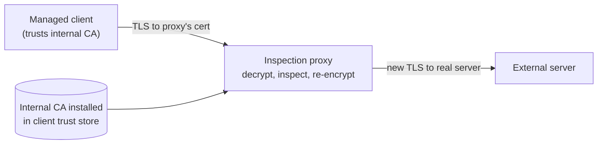

# TLS inspection

## Summary

TLS inspection (also called TLS interception, SSL inspection or break-and-inspect) is the deliberate decryption of TLS traffic by a security device so that it can apply content inspection, data-loss prevention, malware scanning and policy to traffic that would otherwise be opaque. The device terminates the client's TLS session, presents a certificate the client trusts (issued by an internal CA installed on managed devices), inspects the plaintext, and opens a new TLS session to the real server. It is a sanctioned on-path attacker. TLS inspection is genuinely useful because most threats now hide in encrypted traffic, but it is also risky: it concentrates all plaintext at one device, can weaken security if implemented poorly, and raises privacy and legal questions. The decision is a real trade-off, not an obvious yes or no.

## Prerequisites

- [TLS in network security](tls-in-network-security.md). The TLS protocol note itself is planned in the [cryptography area](../../../security-architecture-and-engineering/cryptography/README.md).
- [Public Key Infrastructure](../../../security-architecture-and-engineering/cryptography/public-key-infrastructure.md): why presenting a trusted certificate works.
- [Network threat model](../foundations/network-threat-model.md): the on-path position.

## Core concepts

### Definition

*TLS inspection* is a controlled adversary-in-the-middle performed by an organization on its own traffic: a proxy decrypts outbound (or inbound) TLS, inspects the plaintext against security policy, and re-encrypts it onward. It is distinguished from an attack only by authorization and by the client's deliberate trust of the inspecting CA.

### Analogy

TLS inspection is airport security opening sealed parcels. Travelers agree (by using the airport) that their sealed bags may be opened, scanned for dangerous items, and resealed with airport tape before continuing. It catches smuggled threats that the seal would otherwise hide. The costs are real: the security desk now sees everyone's private contents, becomes a tempting target for a corrupt insider, and if it reseals badly the parcel is less secure than before.

The analogy is close because the organization really is doing to its own traffic what an attacker would do without permission; the difference is consent, scope and competence.

### How it works

The proxy holds an intermediate CA key whose root is installed in the trust store of every managed device. For each connection it mints a certificate for the destination name on the fly, signed by that CA, so the client validates it as trusted. The client talks TLS to the proxy; the proxy talks TLS to the real server and verifies the real server's certificate itself. Between the two sessions the proxy has the plaintext.

### Why organizations do it

- Most malware delivery, C2 and data exfiltration now use TLS, so a device that cannot see inside TLS is largely blind.
- Data-loss prevention, antivirus scanning, URL filtering and WAF functions all need the plaintext.
- It is the only way to apply content policy to encrypted traffic without endpoint agents.

### Why it is risky

- **Single point of total exposure.** The proxy sees all decrypted traffic, including credentials, health and financial data. Compromising it compromises everything.
- **Can weaken security.** Studies (including a US-CERT alert, TA17-075A) found many inspection products validated upstream certificates poorly, negotiated weak ciphers, or did not pass through validation errors, so the client saw "secure" while the proxy had accepted a bad server certificate. The inspector must be at least as strict as a modern browser.
- **Breaks things.** Certificate pinning (apps that refuse any certificate but their own), mutual TLS, and some protocols fail through inspection and must be bypassed by policy.
- **Privacy and legal.** Decrypting employee traffic (banking, health, personal mail) has legal and ethical constraints that vary by jurisdiction and require policy, notice and exclusions.
- **Encrypted Client Hello and certificate transparency** are in tension with interception, and future protocol changes may constrain it further.

### Doing it responsibly

- Inspect selectively: bypass sensitive categories (banking, health, legal) by destination; inspect the risky and unknown.
- Validate upstream certificates strictly and pass errors through to the client; never make the client less safe than it would be without inspection.
- Protect the proxy and its CA key as crown-jewel assets; log access; segment it.
- Be transparent: policy, user notice, and legal review.
- Prefer endpoint-based inspection (an agent on the device sees plaintext without a network MITM) where feasible, which avoids some of the risks.

## Worked example

A company wants to stop data exfiltration and malware over HTTPS but must not expose employees' personal banking.

1. It deploys an inspection proxy with an internal CA pushed to all managed laptops' trust stores.
2. Policy: *bypass* inspection for destination categories "financial", "health" and "government" (served through without decryption); *inspect* "uncategorized", "newly registered domains" and "file sharing".
3. For inspected traffic, the proxy validates the real server's certificate as strictly as a browser and refuses or warns on errors, so inspection never downgrades server authentication.
4. The proxy is placed in its own segment, its CA key is in an HSM, and access to decrypted logs is restricted and audited.
5. Pinned apps (some banking and messaging apps) break through inspection; they are added to the bypass list by destination.

Result: malware and exfiltration over inspectable traffic are caught, personal-sensitive traffic is left private, and the proxy does not weaken the TLS it does inspect. A naive deployment that inspected everything and validated upstream certificates loosely would have been both a privacy violation and a security downgrade.

## Trade offs and when to use it

- **Visibility vs risk concentration.** Inspection restores visibility into encrypted threats but concentrates all plaintext at one high-value device. Justify it against the threat model and protect the proxy accordingly.
- **Network inspection vs endpoint agents.** Endpoint agents see plaintext at the source without a network MITM, avoiding the certificate and pinning problems, but require managed endpoints. Prefer endpoints where possible; use network inspection for unmanaged or IoT traffic.
- **Inspect-all vs selective.** Selective inspection reduces privacy and breakage problems at some coverage cost; it is the responsible default.
- **When not to.** On networks with unmanaged or guest devices (you cannot install the CA), for traffic subject to legal privacy constraints, or where pinning makes it futile.

## Common mistakes

- **Weak upstream validation.** The proxy accepts bad server certificates while the client sees "secure", a net downgrade (TA17-075A). Fix: validate strictly, pass errors through.
- **Inspecting everything, including sensitive personal traffic.** Privacy and legal exposure. Fix: category-based bypass, notice, legal review.
- **Under-protecting the proxy and CA key.** It becomes the ultimate target. Fix: HSM for the key, segmentation, strict access logging.
- **Ignoring pinning and mTLS breakage.** Apps fail mysteriously. Fix: maintain a bypass list; test.
- **No transparency.** Users and regulators object after the fact. Fix: clear policy and notice up front.

## Practice

1. How does a TLS inspection proxy get a client to accept its substituted certificate?
2. Why can poorly implemented TLS inspection make clients *less* secure than no inspection?
3. Why is the inspection proxy a particularly high-value target?
4. Give two kinds of traffic that should typically be bypassed rather than inspected, and why.
5. When is an endpoint agent preferable to network TLS inspection?

### Answers

1. The proxy holds an intermediate CA whose root is installed in the client's trust store, so it can mint a trusted certificate for any destination name on the fly.
2. If the proxy validates the real server's certificate loosely (accepting expired, mismatched or weakly-signed certificates) while presenting the client a valid-looking one, the client believes the connection is secure when the proxy has actually accepted an insecure upstream.
3. It holds the plaintext of all inspected traffic (credentials, sensitive data) and a CA key trusted by every managed device, so compromising it exposes everything and allows impersonation.
4. Financial/banking and health traffic, because decrypting them creates privacy and legal exposure disproportionate to the security benefit; also pinned apps, which break.
5. When endpoints are managed: an agent sees plaintext at the source without a network man-in-the-middle, avoiding certificate substitution, pinning breakage and the single plaintext choke point.

## Further reading

- US-CERT Alert TA17-075A, HTTPS Interception Weakens TLS Security (2017): https://www.cisa.gov/news-events/alerts/2017/03/16/https-interception-weakens-tls-security
- NSA, Managing Risk from TLS Inspection (2019): https://media.defense.gov/2019/Nov/18/2002212783/-1/-1/0/MANAGING%20RISK%20FROM%20TLS%20INSPECTION.PDF
- Durumeric, Z. et al., "The Security Impact of HTTPS Interception", NDSS 2017.
- [TLS in network security](tls-in-network-security.md) for the deployment context.
