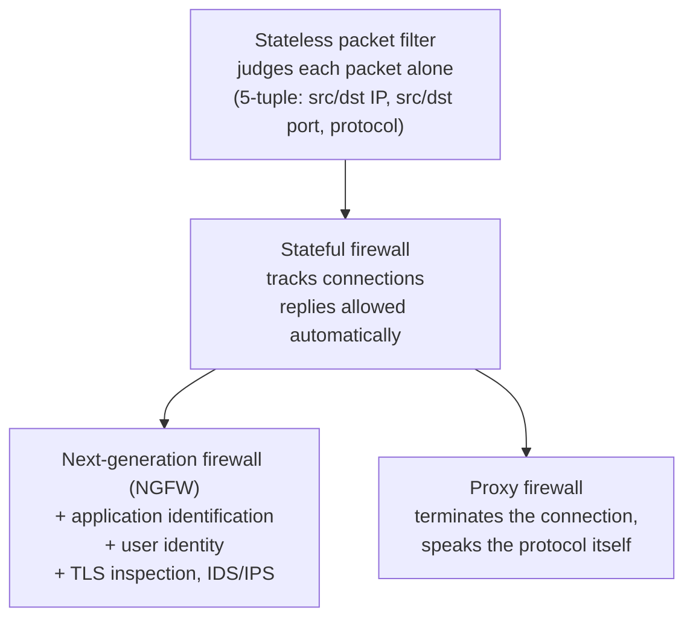

# Firewalls

## Summary

A firewall is a device or software that enforces a policy on traffic crossing a boundary: it inspects each packet or connection and decides to allow, drop or reject it. Firewalls are the main enforcement point for [segmentation](../architecture/network-segmentation.md). They evolved from stateless packet filters, which judge each packet alone, to stateful firewalls, which track connections, to next-generation firewalls, which also identify applications and users and inspect content. A firewall is only as good as its rule set and its placement: it cannot filter traffic that does not pass through it, and a permissive rule set gives a false sense of safety.

## Prerequisites

- [Network threat model](../foundations/network-threat-model.md) and [network segmentation](../architecture/network-segmentation.md).
- TCP/IP basics: addresses, ports, the TCP handshake, UDP.
- [Firewall rule design](firewall-rule-design/README.md) for the hands-on rule writing that this note explains conceptually.

## Core concepts

### Definition

A *firewall* enforces an access control policy between network segments by inspecting traffic and acting on it. Three actions matter:

- *Allow* (accept): let the packet or connection through.
- *Drop*: discard it silently. The sender sees a timeout.
- *Reject*: discard it and send an error (TCP RST or ICMP unreachable). The sender learns the port is closed immediately.

Drop hides the host and slows scanners; reject is faster and friendlier for internal troubleshooting. The choice is itself a security decision.

### Analogy

A firewall is the security desk in a building lobby. A stateless filter is a guard who checks each person against a list but has no memory: an answer carried back out must be on the list too. A stateful firewall is a guard who remembers "this visitor was let in to see the finance team", so the visitor's escort back to the lobby needs no separate entry on the list. A next-generation firewall also reads the visitor's badge (identity) and looks in their bag (content).

The analogy breaks because a firewall processes millions of "visitors" per second and follows its rules literally, with none of a guard's judgment about something that looks wrong but is technically allowed.

### Generations and types



| Type | Decides on | Keeps state | Strength | Weakness |
| --- | --- | --- | --- | --- |
| Stateless packet filter | 5-tuple of each packet | No | Fast, simple, good for coarse ACLs | Cannot tell a reply from an unsolicited packet, so return traffic needs broad rules |
| Stateful firewall | 5-tuple plus connection state | Yes | Replies allowed automatically, blocks out-of-state packets | State table is a target for exhaustion ([SYN flood](../network-attacks/denial-of-service/denial-of-service.md)) |
| Application-layer proxy | Full application protocol | Yes | Deep validation, breaks direct path | One proxy per protocol, latency |
| Next-generation firewall | Application, user, content | Yes | Policy by application and user, integrated inspection | Cost, complexity, TLS inspection trade-offs |
| Host firewall | Traffic to and from one host, by process | Yes | Follows the workload, enforces east-west | Trusts the host it runs on |

### Stateful inspection in detail

A stateful firewall keeps a *connection tracking table*. The first packet of a new connection (a TCP SYN, or the first packet of a UDP flow) is matched against the rule set. If allowed, an entry is created, and all later packets of that connection are matched against the table, which is fast and lets replies through without a separate rule. This is why a good rule set has an early rule such as "accept established and related" and then only needs rules for *new* connections in the intended direction.

The state table has a finite size, and each half-open connection consumes an entry. This is the resource a SYN flood exhausts. Modern firewalls defend with SYN cookies or SYN proxying, which avoid allocating state until the handshake completes.

### The policy model

A sound firewall policy follows a few rules, covered with runnable examples in [firewall rule design](firewall-rule-design/README.md):

- **Default deny.** The last rule drops everything; only explicit allows pass.
- **Least privilege.** Allow the narrowest source, destination, protocol and port that the need requires.
- **Order matters.** Most firewalls use first-match. A broad allow placed above a narrow deny makes the deny dead (a *shadowed* rule).
- **Both directions.** Control outbound ([egress filtering](egress-filtering.md)) as well as inbound.
- **Log the deny.** Denied traffic is a detection source. Rate-limit the logging so the log itself cannot be flooded.

### What firewalls do not do

- They do not inspect traffic that bypasses them (a rogue wireless access point, a cellular modem, an east-west path that never crosses the firewall).
- A plain firewall does not see inside TLS. Content inspection requires [TLS inspection](../secure-transport/tls-inspection.md), which has its own costs.
- They do not stop an attacker using an allowed flow with valid credentials.
- They are not a patch. An allowed service with a vulnerability is still exploitable through the allow rule.

## Worked example

This uses the [network security lab](../foundations/network-security-lab/README.md). The firewall node `fw` sits between the outside LAN and the server. The policy in [firewall-rule-design/scripts/fw-baseline.nft](firewall-rule-design/scripts/fw-baseline.nft) allows the public to reach the web server on 443, allows one admin host to reach SSH, and denies the rest by default.

Loading the policy and probing from two hosts (tested with nftables 1.0.2, kernel 6.8, 2026-10):

```text
client -> 198.51.100.20:443 open
attacker -> 198.51.100.20:443 open
client -> 198.51.100.20:22 open
attacker -> 198.51.100.20:22 blocked
client -> 198.51.100.20:8080 blocked
attacker -> 192.0.2.1:22 blocked
```

Reading the result: both hosts reach the public web port; only the admin host (`client`) reaches SSH; the unused port 8080 is blocked for everyone; and SSH to the firewall itself is refused to the untrusted host. The default-policy counter on the forward chain shows the dropped packets:

```text
type filter hook forward priority filter; policy drop;
counter packets 4 bytes 240 comment "dropped by default policy"
```

The full policy, the stateful "established" rule and the anti-spoofing rule are explained line by line in [firewall rule design](firewall-rule-design/README.md).

## Trade offs and when to use it

- **Stateless vs stateful.** Stateless filters are used where speed matters and the policy is coarse (router ACLs, cloud network ACLs, anti-spoofing at the edge). Stateful firewalls are the default for boundaries where return traffic and connection direction matter.
- **Central vs distributed.** A central firewall is easy to manage and monitor but hairpins east-west traffic and is a bottleneck. Host firewalls and [microsegmentation](../architecture/microsegmentation.md) enforce close to the workload but depend on the host's integrity.
- **NGFW features cost performance.** Application identification and TLS inspection reduce throughput and add latency. Enable them where the risk justifies the cost, not everywhere by default.

## Common mistakes

- **Allow rules that outlive their purpose.** Fix: ownership, tickets and expiry for every rule; audit for shadowed and unused rules.
- **Trusting the firewall for traffic that does not cross it.** Fix: ensure there is no path around it, and enforce east-west with segmentation or host firewalls.
- **Over-broad "any-any" outbound.** Fix: egress filtering with an allow list of destinations and ports.
- **No logging or unbounded logging.** Fix: log denies, rate-limit the logging, and ship logs to a [SIEM](../../../security-operations/defensive-operations/operations/siem.md).
- **Confusing NAT with a security policy.** NAT hides addresses but is not access control. Fix: write an explicit filter policy regardless of NAT.

## Practice

1. Why does a stateful firewall need only a rule for *new* connections in one direction, while a stateless filter needs rules for both directions?
2. What is a shadowed rule, and why is it dangerous?
3. When would you choose reject over drop?
4. Which firewall resource does a SYN flood exhaust, and what mitigation avoids allocating it?
5. Give one kind of traffic a plain stateful firewall cannot inspect.

### Answers

1. The stateful firewall creates a connection tracking entry on the first allowed packet and matches replies against it automatically. A stateless filter has no memory, so the return packets must match their own allow rule.
2. A rule that can never match because an earlier rule already covers all of its traffic. If the earlier rule has the opposite action, the policy silently does not do what its author intended.
3. Inside a network for faster troubleshooting, where revealing that a port is closed is acceptable. On an internet-facing interface, drop is usually preferred to slow scanners and reveal less.
4. The connection tracking (state) table, through half-open connections. SYN cookies or SYN proxying avoid allocating state until the handshake completes.
5. The content of an encrypted (TLS) session, without TLS inspection.

## Further reading

- NIST SP 800-41 Rev. 1, Guidelines on Firewalls and Firewall Policy (2009). The reference for firewall types and policy, still largely accurate for the fundamentals: https://doi.org/10.6028/NIST.SP.800-41r1
- nftables wiki, the modern Linux firewall framework used in the examples: https://wiki.nftables.org/
- Al-Shaer, E. and Hamed, H., "Conflict Classification and Analysis of Distributed Firewall Policies", IEEE JSAC, 2005. The formal basis for the rule anomaly audit in this area.
- NSA, Network Infrastructure Security Guide (2022): https://media.defense.gov/2022/Jun/15/2003018261/-1/-1/0/CTR_NSA_NETWORK_INFRASTRUCTURE_SECURITY_GUIDE_20220615.PDF
