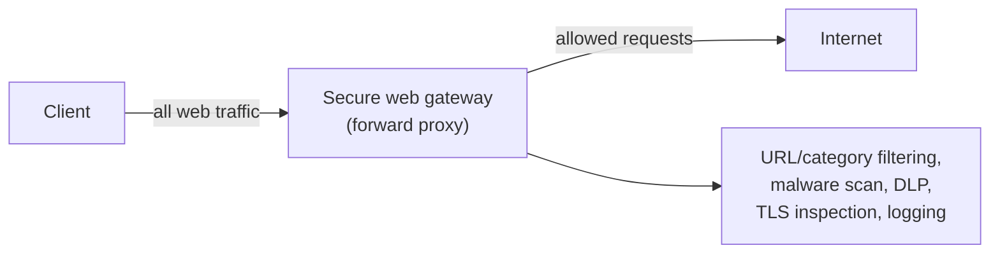

# Proxies and secure web gateways

## Summary

A proxy is an intermediary that terminates a client's connection, makes the request on the client's behalf, and returns the result, so it can see, log and control the traffic. A secure web gateway (SWG) is a proxy specialized for outbound web traffic that adds security policy: URL and category filtering, malware scanning, data-loss prevention and, often, [TLS inspection](../secure-transport/tls-inspection.md). Proxies are a central point for [egress filtering](egress-filtering.md) of web traffic and for monitoring what users and servers reach on the internet. They are the enforcement engine behind much of the web-security half of [SASE/SSE](../architecture/sase-and-sse.md).

## Prerequisites

- [Firewalls](firewalls.md) and [egress filtering](egress-filtering.md).
- [TLS inspection](../secure-transport/tls-inspection.md): how a proxy sees inside HTTPS.
- [Network security controls](../foundations/network-security-controls.md).

## Core concepts

### Definition

A *proxy* is a server that sits between clients and the servers they contact, terminating and re-originating connections. A *forward proxy* acts on behalf of internal clients reaching external servers (the focus here); a *reverse proxy* acts on behalf of servers, fronting them for external clients (load balancing, TLS termination, [WAF](web-application-firewalls.md)). A *secure web gateway* is a forward proxy with integrated security controls for web traffic.

### Analogy

A forward proxy is a company mailroom that sends and receives all post on behalf of staff. Because everything passes through it, it can refuse mail to blacklisted addresses (URL filtering), scan parcels for dangerous contents (malware scanning), stop confidential documents leaving (DLP), and keep a record of all correspondence (logging). Staff do not contact the outside world directly; the mailroom does it for them.

The analogy holds well; it breaks in that web traffic is mostly encrypted, so to scan "parcel contents" the mailroom must open sealed envelopes ([TLS inspection](../secure-transport/tls-inspection.md)), with all the trade-offs that entails.

### What a secure web gateway does

- **URL and category filtering.** Block or allow by destination category (malware, phishing, newly registered domains, policy categories), using threat and categorization feeds.
- **Malware scanning.** Inspect downloaded content for malware (requires TLS inspection for HTTPS).
- **Data-loss prevention.** Detect and block sensitive data leaving in uploads.
- **TLS inspection.** Decrypt HTTPS to apply the above, with the risks covered in [TLS inspection](../secure-transport/tls-inspection.md).
- **Authentication and per-user policy.** Tie policy to user identity, not just IP.
- **Logging.** A complete record of web access, a primary detection and investigation source.

### Explicit vs transparent proxying

- *Explicit*: clients are configured to use the proxy (a proxy setting or PAC file). Reliable and clear, but clients can sometimes bypass it.
- *Transparent*: network routing or policy forces traffic through the proxy without client configuration. Harder to bypass but more complex, and can interact badly with some protocols.

A proxy only provides value for traffic that actually goes through it, so enforcing that (blocking direct outbound 80/443 at the firewall, as in [egress filtering](egress-filtering.md)) is essential; otherwise clients reach the internet directly and the gateway sees nothing.

### Caching and performance

Proxies historically also cached content to save bandwidth. With most traffic now encrypted and personalized, caching matters less, and the security and control functions are the main reason to deploy a proxy today.

## Worked example

A company routes all user web traffic through a secure web gateway:

1. **Enforcement.** The firewall blocks direct outbound 80/443 from user subnets; only the SWG may reach the web directly. Clients are configured (explicit proxy / PAC) to use it. This guarantees the SWG sees all web traffic.
2. **A phishing click.** A user clicks a link to a newly registered lookalike domain. The SWG's category filter flags "newly registered domain" and blocks it, showing a warning page and logging the attempt with the user's identity. (This complements [protective DNS](../dns-security/protective-dns.md), which would also block the name resolution.)
3. **A malware download.** A user tries to download a malicious file over HTTPS from an allowed site. With TLS inspection enabled for that category, the SWG scans the decrypted content, detects the malware, and blocks the download.
4. **A data-leak attempt.** Malware on a host tries to upload a sensitive file to a cloud storage site. DLP in the SWG matches the content pattern and blocks the upload, alerting the security team.
5. **Investigation.** When an incident is suspected, the SWG logs show exactly which sites each host and user reached and when.

The SWG is the single control and visibility point for web egress. Its effectiveness depends entirely on all web traffic being forced through it and on the (carefully scoped) TLS inspection needed to see inside HTTPS.

## Trade offs and when to use it

- **Visibility and control vs a central choke point.** The SWG sees and controls all web traffic but is a performance bottleneck and an outage risk; cloud-delivered SWGs ([SSE](../architecture/sase-and-sse.md)) address scale and remote users.
- **TLS inspection dilemma.** Full web malware and DLP scanning needs decryption, inheriting all the [TLS inspection](../secure-transport/tls-inspection.md) privacy, breakage and implementation risks. Inspect selectively.
- **Explicit vs transparent.** Explicit is simpler and clearer; transparent is harder to bypass but more complex. Either way, block direct egress so the proxy cannot be skipped.
- **On-premises vs cloud SWG.** On-premises suits a central office; cloud SWG covers remote users without backhaul, at the cost of provider trust.

## Common mistakes

- **Deploying an SWG but allowing direct outbound web.** Clients bypass it and it sees nothing. Fix: block direct 80/443, force traffic through the proxy.
- **Inspecting all TLS indiscriminately.** Privacy and breakage problems. Fix: selective TLS inspection with category bypass (banking, health).
- **Relying on the SWG alone for web security.** It misses non-web protocols and encrypted bypass paths. Fix: combine with egress filtering, protective DNS and endpoint protection.
- **Ignoring the logs.** The web-access log is a major detection source. Fix: ship to the SIEM and use it in hunts and investigations.
- **Single on-premises SWG for a remote workforce.** Remote users are unprotected or backhauled. Fix: cloud-delivered SWG/SSE.

## Practice

1. What does a forward proxy let an organization do that direct client-to-internet connections do not?
2. Why must direct outbound web be blocked for a secure web gateway to be effective?
3. What security functions does an SWG add beyond basic URL filtering, and which of them require TLS inspection?
4. What is the difference between a forward proxy and a reverse proxy?
5. Why has caching become a secondary reason to run a proxy?

### Answers

1. Because all traffic passes through one point, the organization can filter destinations, scan content for malware, prevent sensitive data from leaving, tie policy to user identity, and log all web access.
2. The proxy only controls and sees traffic that passes through it; if clients can reach the web directly, they bypass the gateway entirely and its controls and logging are void.
3. Malware scanning, data-loss prevention, per-user policy and logging; malware scanning and DLP of HTTPS content require TLS inspection to see inside the encrypted traffic.
4. A forward proxy acts on behalf of internal clients reaching external servers; a reverse proxy acts on behalf of servers, fronting them for external clients (load balancing, TLS termination, WAF).
5. Most traffic is now encrypted and personalized, so cacheable shared content is limited; the security and control functions, not bandwidth savings, are the main reason to deploy a proxy.

## Further reading

- NIST SP 800-215, Guide to a Secure Enterprise Network Landscape (2022): https://doi.org/10.6028/NIST.SP.800-215
- Squid and other proxy documentation for forward-proxy mechanics.
- [TLS inspection](../secure-transport/tls-inspection.md) and [SASE and SSE](../architecture/sase-and-sse.md) for the decryption and cloud-delivery aspects.
- Vendor SWG documentation (evaluate critically as marketing sources).
