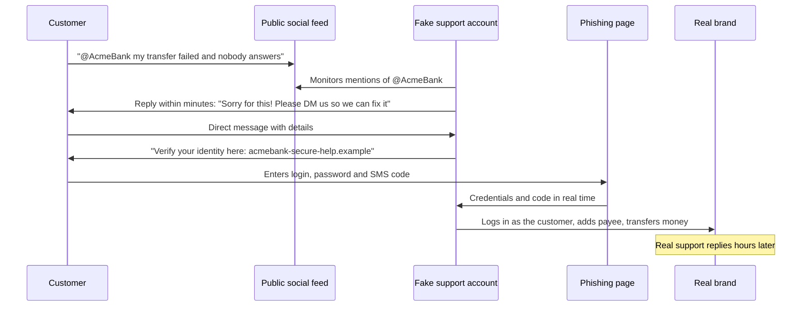

# Angler phishing

## Summary

Angler phishing is a social media scam in which attackers pose as a company's customer support account and reply to customers who have publicly complained or asked for help. The fake "support agent" answers quickly and sympathetically, then moves the customer to a direct message, a phishing link or a phone call to collect login credentials, card data or one-time codes. It works because the victim started the conversation and is waiting for an answer, so the usual suspicion toward unsolicited messages is missing. Proofpoint researchers named the technique in 2016 after the anglerfish, which lures prey with a glowing bait. Defense needs both the brand (monitoring and takedown of impersonating accounts, clear official channels) and customers (never giving secrets in social media conversations).

## Prerequisites

- [Phishing](phishing.md): the general technique and its variants.
- [Impersonation](impersonation.md): posing as a trusted person or organization.
- [Social engineering](social-engineering.md) and the [psychology of cyberattacks](psychology-of-cyberattacks.md).

## Core concepts

### Definition

*Angler phishing* is phishing delivered through social media, in which the attacker impersonates an organization's customer service presence and targets people who are already trying to contact that organization. Proofpoint's April 1, 2016 threat insight post describes fake accounts that monitor mentions of the real brand handle, reply to customers waiting for a response, use the brand's logo as their profile image, and choose handles that look like support accounts, in their PayPal example by adding "Ask" to the start of the handle (`AskPayPal_Tech`, `AskPayPalCRT`). The replies linked to convincing fake login pages. Proofpoint reported that most of the attacks it observed targeted financial services brands.

In MITRE ATT&CK (Enterprise v20.1, November 2026) the behavior maps to:

| Technique | Why it fits |
| --- | --- |
| T1566.003 Spearphishing via Service | Messages sent through social media rather than enterprise email |
| T1684.001 Impersonation | Posing as a trusted organization (replaced T1656 in 2026) |
| T1585.001 Establish Accounts: Social Media Accounts | The attacker creates the fake support account in advance |
| T1598 Phishing for Information | The goal is often credentials or card data rather than malware |

Angler phishing differs from related attacks:

| Attack | Who starts the contact | Channel | Typical bait |
| --- | --- | --- | --- |
| Angler phishing | The victim (complaint or question to a brand) | Social media replies and DMs | "We are sorry, please verify your account here" |
| Classic [phishing](phishing.md) | The attacker | Email | Invoice, delivery, password expiry |
| Smishing and vishing | The attacker | SMS or phone | Bank alert, parcel fee |
| Search engine poisoning of support numbers | The victim (searches for a helpline) | Search results, ads | Fake support phone number |
| Tech support scam | Usually the attacker (pop-up or call) | Browser pop-up, phone | "Your PC is infected" |

### Analogy

A customer stands in a shop queue and says loudly: "My card was charged twice, I need help." A person in a jacket with the shop's logo steps out of the crowd, says "I can sort that out for you, just come over here and let me see your card and PIN." The customer is relieved that someone answered and does not ask why the helper came from the crowd instead of from behind the counter.

The analogy captures the reversed initiative, which is the core of angler phishing. It breaks in one way: in the shop, other people might notice a stranger wearing the logo. On social media, the fake reply looks exactly like a real one, and the real brand may never see the exchange.

### Mechanism



The sequence shows the three steps that define the technique: watching public complaints, replying faster than the real brand, and moving to a private channel where the theft happens. Real-time relay of one-time codes lets the attacker defeat SMS-based multi-factor authentication.

### Why it works

- **Reversed initiative.** The victim asked for help, so a reply is expected, not suspicious.
- **Emotional state.** Frustrated customers want a quick solution. Urgency and relief lower scrutiny.
- **Speed advantage.** Attackers reply in minutes, real support teams often take hours, especially at night and on weekends. Proofpoint noted that most phishing activity exploits non-business hours.
- **Visual trust signals are cheap to copy.** Logo, banner, display name and tone of voice are easy to clone. Display names can contain the brand even when the handle does not.
- **Platform verification is not a reliable signal.** Paid verification badges on some platforms are available to anyone, so a checkmark alone does not prove a brand account. This is a platform policy question that changes over time; check the current rules of each platform.

### What attackers ask for

- Online banking or account login, often followed by the SMS or app code.
- Card number, expiry date and security code "to process a refund".
- Installing a remote access app "so our technician can check".
- Moving the conversation to a phone call or to a messaging app outside the platform.
- Payment of a fee to "release" a refund.

## Worked example

A bank's social media and fraud teams want to find fake support accounts that reply to their customers. Every account that replies to a mention of the bank is scored. The brand and handles below are fictional.

```python
# Python 3.10, standard library only. Fictional brand and handles.
OFFICIAL = {"acmebank", "acmebankhelp"}
BRAND = "acmebank"
SUPPORT_WORDS = ("ask", "help", "support", "care", "service", "desk", "team")
HOMOGLYPHS = str.maketrans({"0": "o", "1": "l", "3": "e", "4": "a", "5": "s", "8": "b", "_": "", ".": "", "-": ""})

def normalize(handle: str) -> str:
    return handle.lower().translate(HOMOGLYPHS).replace("rn", "m")

def distance(a: str, b: str) -> int:
    """Levenshtein distance, small inputs only."""
    prev = list(range(len(b) + 1))
    for i, ca in enumerate(a, 1):
        cur = [i]
        for j, cb in enumerate(b, 1):
            cur.append(min(prev[j] + 1, cur[j - 1] + 1, prev[j - 1] + (ca != cb)))
        prev = cur
    return prev[-1]

def score(acct):
    h = normalize(acct["handle"])
    if acct["handle"].lower() in OFFICIAL and acct["verified_org"]:
        return 0, ["official"]
    s, why = 0, []
    core = h
    for w in SUPPORT_WORDS:
        core = core.replace(w, "")
    if BRAND in h or distance(core, BRAND) <= 2:
        s += 40; why.append("brand or lookalike in handle")
    if any(w in h for w in SUPPORT_WORDS):
        s += 20; why.append("support wording")
    if acct["age_days"] < 30:
        s += 20; why.append(f"new account ({acct['age_days']} d)")
    if acct["followers"] < 100:
        s += 10; why.append("few followers")
    if acct["asks_dm_or_link"]:
        s += 10; why.append("pushes DM or link")
    return s, why

accounts = [
    {"handle": "AcmeBankHelp",      "verified_org": True,  "age_days": 2900, "followers": 51000, "asks_dm_or_link": True},
    {"handle": "AskAcmeBank",       "verified_org": False, "age_days": 6,    "followers": 12,    "asks_dm_or_link": True},
    {"handle": "Acrne8ank_Support", "verified_org": False, "age_days": 3,    "followers": 4,     "asks_dm_or_link": True},
    {"handle": "AcmeBankFan",       "verified_org": False, "age_days": 1400, "followers": 230,   "asks_dm_or_link": False},
    {"handle": "jane_doe_1987",     "verified_org": False, "age_days": 2100, "followers": 310,   "asks_dm_or_link": False},
]
for a in sorted(accounts, key=lambda a: -score(a)[0]):
    s, why = score(a)
    print(f"{s:3d}  {a['handle']:<18} {'; '.join(why)}")
```

Output:

```text
100  AskAcmeBank        brand or lookalike in handle; support wording; new account (6 d); few followers; pushes DM or link
100  Acrne8ank_Support  brand or lookalike in handle; support wording; new account (3 d); few followers; pushes DM or link
 40  AcmeBankFan        brand or lookalike in handle
  0  AcmeBankHelp       official
  0  jane_doe_1987
```

`Acrne8ank_Support` is caught because normalization maps `8` to `b` and `rn` to `m`, turning it into `acmebanksupport`. `AcmeBankFan` scores 40: it contains the brand but has no support wording, is old and does not push links, so it goes to manual review rather than takedown. The two accounts at 100 go to the platform's impersonation reporting process, and the customers they replied to are contacted through official channels.

The weights are illustrative, not calibrated. A production system would also compare profile images with the brand logo (perceptual hashing), check display names, track reply speed to brand mentions and learn from confirmed takedowns. Commercial digital risk protection services do this at scale.

## Trade offs and when to use it

For brands:

| Control | Benefit | Cost and limits |
| --- | --- | --- |
| Monitoring mentions and lookalike accounts | Finds fake accounts within hours | Needs tooling or a service, false positives (fan and parody accounts) |
| Fast official replies, including nights and weekends | Removes the attacker's speed advantage | Staffing cost |
| Clear published channels ("we will never ask for your password or codes in DMs") | Gives customers a rule they can apply | Only works if repeated consistently |
| Platform verification for official accounts | Helps customers recognize the real account | Verification rules vary by platform and change over time |
| Takedown process with each platform | Removes accounts | Attackers create new ones within hours |
| Phishing-resistant authentication for customers (passkeys) | Stolen passwords and codes become useless | Customer adoption takes years |

For individuals: contact companies only through channels listed on their official website or app, treat any request for passwords, codes or card security numbers in a social media conversation as fraud, and check the account's age and history before replying.

## Common mistakes

- **Trusting a reply because it came fast and used the logo.** Fix: verify the account from the company's website, not from the reply.
- **Thinking a checkmark proves authenticity.** Fix: check what verification means on that platform and confirm the handle independently.
- **Brands ignoring social channels in security monitoring.** Fix: include social media in the threat intelligence and fraud scope, with an owner.
- **Asking customers to DM account details.** When the real brand asks for details in DMs, customers cannot tell real from fake. Fix: move sensitive support to authenticated channels (app, website login).
- **Relying on SMS codes as the last line of defense.** Attackers relay them in real time. Fix: passkeys or app-based confirmation that shows the transaction details.

## Detection and mitigation

**Detection.**

- Brand monitoring for new accounts that combine the brand name or lookalikes with support wording, as in the worked example.
- Monitoring of replies to the brand's own mentions: any non-official account replying to many customers is suspicious.
- Fraud signals: logins from new devices shortly after a customer complained publicly, new payees added after a social media conversation.
- Customer reports routed to a single team.

**Mitigation.**

- Takedown requests through each platform's impersonation process, and registration of lookalike handles defensively where possible.
- Fast, official, around-the-clock responses that point customers to authenticated channels.
- Public guidance pinned on official profiles stating what support will never ask for.
- Phishing-resistant authentication and transaction confirmation that names the payee and amount.
- For incidents: reset the affected customer's credentials, revoke sessions, review recent transactions and report the phishing domain for blocking.

## Practice

1. What makes angler phishing different from classic email phishing?
2. Which ATT&CK technique describes phishing through social media, and which replaced T1656?
3. Why does SMS-based MFA not stop a typical angler phishing attack?
4. In the worked example, why did `Acrne8ank_Support` score as a lookalike?
5. Name two things a bank can do so that customers can tell a fake reply from a real one.

Answers:

1. The victim starts the contact by publicly asking a brand for help, and the attacker replies while posing as that brand's support.
2. T1566.003 Spearphishing via Service. T1684.001 Impersonation replaced T1656.
3. The attacker relays the code from the fake page to the real site in real time.
4. Normalization turned `8` into `b` and `rn` into `m`, so the handle became `acmebanksupport`, which contains the brand.
5. Publish and repeat a rule that support never asks for passwords or codes in social media, and move all account-specific support into authenticated channels such as the app. Fast official replies also help.

## Further reading

- [Proofpoint, "Fraudulent Social Media Accounts Continue to Phish for Banking Credentials", April 1, 2016](https://www.proofpoint.com/us/threat-insight/post/fraudulent-social-media-accounts-continue-phish-banking-credentials): the original description of angler phishing with the PayPal examples. Vendor source. Checked 2026-11.
- [MITRE ATT&CK T1566.003 Spearphishing via Service](https://attack.mitre.org/techniques/T1566/003/): technique description (Enterprise v20.1, checked 2026-11 via the STIX data).
- [MITRE ATT&CK T1684.001 Impersonation](https://attack.mitre.org/techniques/T1684/001/): impersonation of trusted organizations (Enterprise v20.1).
- [NIST SP 800-53 Rev. 5, AT-2(3)](https://csrc.nist.gov/pubs/sp/800/53/r5/upd1/final): training on social engineering, which the control guidance says includes "social media exploitation".
- Related notes: [phishing](phishing.md), [impersonation](impersonation.md), [quid pro quo](quid-pro-quo.md), [typosquatting](../../../security-operations/threats-and-attacks/web-attacks/typosquatting.md).
