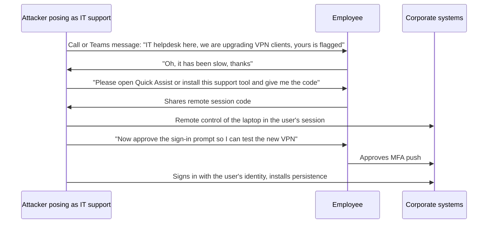

# Quid pro quo

## Summary

A quid pro quo attack ("something for something") is social engineering in which the attacker offers a service or benefit in exchange for information or an action. The classic form is a caller posing as IT support who offers to fix a problem, speed up a slow laptop or upgrade a VPN, and in return asks the victim to read out a password or one-time code, approve an MFA prompt, or install a remote access tool. Because the victim receives help, the exchange feels fair and the request feels routine. Real intrusions, including the Scattered Spider campaigns described by CISA, used this pattern against employees and help desks. Defenses are verifiable support processes (support never asks for passwords or codes, users call back on a known number), allow-listed remote access tools and phishing-resistant MFA. Testing it is done only within an authorized social engineering engagement.

## Prerequisites

- [Social engineering](social-engineering.md) and the [psychology of cyberattacks](psychology-of-cyberattacks.md), especially reciprocity and authority.
- [Phishing](phishing.md), including vishing (voice phishing).
- [Impersonation](impersonation.md).

## Core concepts

### Definition

*Quid pro quo* in social engineering is an exchange-based manipulation: the attacker provides, or promises, something the victim values and asks for something that gives the attacker access. The benefit can be a service (technical help, a faster laptop, a software license), a reward (gift card, prize, payment for a survey) or relief from a problem (a "fix" for a fake security alert).

NIST SP 800-53 Rev. 5, control AT-2(3) Social Engineering and Mining, names quid pro quo explicitly in its guidance as one form of social engineering, next to phishing, pretexting, impersonation, baiting, thread-jacking, social media exploitation and tailgating (catalog 5.2.0, checked 2026-11).

How it differs from neighbors:

| Technique | Core lever | Example |
| --- | --- | --- |
| Quid pro quo | Exchange: a service or benefit for access | "I'll fix your VPN, just install this tool and read me the code" |
| Baiting | Curiosity or greed, no conversation | USB stick labeled "Salaries 2026" left in the lobby |
| Pretexting | A fabricated scenario that justifies a request | "I'm the auditor, I need the vendor list by noon" |
| Scareware | Fear of a fake problem, then a paid "fix" | Pop-up claiming infection, see [scareware](../../../security-operations/threats-and-attacks/malware/scareware.md) |
| Tech support scam | Fear plus a phone number to call | Overlaps with quid pro quo when the "support" is free |

In practice these combine. A help desk impersonation call is pretexting (the story) plus quid pro quo (the offered fix).

In MITRE ATT&CK (Enterprise v20.1) the behavior maps to T1684 Social Engineering and T1684.001 Impersonation, T1566.004 Spearphishing Voice and T1598.004 Spearphishing Voice (for information), T1219 Remote Access Tools when the victim installs one, and T1621 Multi-Factor Authentication Request Generation when the victim is asked to approve prompts.

### Analogy

A stranger in a car park sees you struggling with a flat tire and offers to change it. While you are grateful and distracted, he asks to borrow your phone "to call his colleague" and walks off with it. The help was real, which is what made you hand over the phone.

The analogy fits the reciprocity mechanism: a favor creates a felt obligation to return one. It breaks because in IT the "help" is often fake or created by the attacker (they caused the problem, or there was no problem), and the victim usually does not see the theft, since a typed password or an approved MFA prompt leaves no visible loss.

### Mechanism



The sequence shows the pattern described by CISA advisory AA23-320A on Scattered Spider (published November 16, 2023, updated July 29, 2025): the group posed as IT or help desk staff "using phone calls or SMS messages to obtain credentials from employees", directed employees "to run commercial remote access tools enabling initial access", and also called the help desk while posing as employees to "convince IT help desk personnel to reset passwords and/or transfer MFA tokens". The second variant turns the target around: the help desk is the victim, and the attacker poses as a user who needs help.

Microsoft has also reported criminal groups abusing its own Quick Assist tool in calls posing as IT support (2024). I did not re-check that report for this note.

### Why it works

- **Reciprocity.** Receiving help creates a sense that cooperation is owed.
- **Authority.** IT support is expected to ask for unusual things and to have special access.
- **Plausibility.** Organizations really do run upgrades and really do use remote support tools. Users have been trained by legitimate IT to accept remote sessions.
- **Low cost of the request.** "Read me the code" or "click approve" feels like a small thing compared with the help received.
- **Volume.** An attacker can call 100 employees. A few accepting is enough.

### Variants

| Variant | Offer | Ask |
| --- | --- | --- |
| Fake IT support call | Fix a slow laptop, upgrade VPN, remove "virus" | Password, MFA code, remote access session |
| Help desk impersonation (reverse) | The attacker is the "user" who needs help | Password reset, MFA device re-enrollment |
| Survey or prize | Gift card for a short survey | Personal and company details, login on a fake portal |
| Free software or license | Premium tool, cracked software | Installation of a trojanized installer, see [dropper](../../../security-operations/threats-and-attacks/malware/dropper.md) |
| Fake recruiter | Job opportunity | "Coding test" that runs malware, credentials to a "candidate portal" |

## Worked example

After a wave of calls claiming to be from IT, the security team at a fictional company writes a simple correlation: any remote access tool that is not the approved one is flagged, and the severity rises when the same user received an external call claiming to be IT within the previous 30 minutes. Events are synthetic.

```python
# Python 3.10, standard library only. Synthetic events, fictional company.
from datetime import datetime, timedelta

ALLOWED_RAT = {"companyremote.exe"}            # the only approved remote support tool
KNOWN_RAT = {"anydesk.exe", "screenconnect.clientservice.exe", "teamviewer.exe",
             "quickassist.exe", "rustdesk.exe", "atera_agent.exe"}

process_events = [  # (time, host, user, image)
    ("2026-11-10 09:12", "LT-0412", "m.kowalska", "companyremote.exe"),
    ("2026-11-10 14:03", "LT-0388", "p.nowak", "quickassist.exe"),
    ("2026-11-10 14:05", "LT-0388", "p.nowak", "anydesk.exe"),
    ("2026-11-10 16:40", "LT-0127", "a.zielinski", "teamviewer.exe"),
]
phone_log = [  # (time, user, caller, direction, note)
    ("2026-11-10 13:55", "p.nowak", "external, number withheld", "inbound", "caller said: IT helpdesk, free VPN upgrade"),
]

def t(s):
    return datetime.strptime(s, "%Y-%m-%d %H:%M")

for when, host, user, image in process_events:
    img = image.lower()
    if img in ALLOWED_RAT or img not in KNOWN_RAT:
        continue
    calls = [c for c in phone_log if c[1] == user and timedelta(0) <= t(when) - t(c[0]) <= timedelta(minutes=30)]
    severity = "HIGH" if calls else "medium"
    reason = f"; external call at {calls[0][0][11:]}: {calls[0][4]}" if calls else ""
    print(f"{severity:6} {when} {host} {user} ran {image} (not allow-listed){reason}")
```

Output:

```text
HIGH   2026-11-10 14:03 LT-0388 p.nowak ran quickassist.exe (not allow-listed); external call at 13:55: caller said: IT helpdesk, free VPN upgrade
HIGH   2026-11-10 14:05 LT-0388 p.nowak ran anydesk.exe (not allow-listed); external call at 13:55: caller said: IT helpdesk, free VPN upgrade
medium 2026-11-10 16:40 LT-0127 a.zielinski ran teamviewer.exe (not allow-listed)
```

The pattern on `LT-0388` matches the quid pro quo sequence: an external "IT" call, a built-in remote tool started eight minutes later, then a second tool installed for persistent access. Response: isolate the laptop with EDR, end remote sessions, reset the user's password and revoke sessions and tokens, check for MFA prompts approved after 13:55 and for new MFA devices, and review what the remote session did. The `medium` event on `LT-0127` may be a user installing TeamViewer for personal reasons, which still violates policy but needs a different conversation.

In a real environment the phone side often does not exist as data. A reporting channel ("report suspicious calls to the SOC") and Teams or Zoom external contact logs can partly fill the gap.

## Trade offs and when to use it

| Control | Benefit | Cost and limits |
| --- | --- | --- |
| Rule: IT never asks for passwords or MFA codes, and never asks you to approve a prompt you did not start | Simple test every user can apply | Must be true. If real IT breaks the rule, users cannot tell |
| Call-back verification: users hang up and call the help desk on the number from the intranet | Defeats caller ID spoofing and pretexts | Slower support, needs a reachable help desk |
| Help desk identity verification for resets (video check, manager approval, verified callback, in-person) | Stops the reverse variant | Friction for genuine users, needs documented exceptions |
| Allow-listing remote access tools, blocking others | Removes the attacker's easiest tool | Must cover portable versions and built-in tools such as Quick Assist |
| Phishing-resistant MFA (FIDO2, WebAuthn, PKI) | CISA states these "are resistant to phishing and not susceptible to push bombing or SIM swap attacks" | Rollout cost, recovery processes become the new target |
| Number matching and context in MFA prompts | Reduces blind approvals | Still defeated if the user reads the number to the attacker |
| Restricting external chat (Teams, Slack Connect) | Blocks a growing delivery channel | Business collaboration needs exceptions |

## Common mistakes

- **Training users only on email phishing.** Fix: include phone, chat and "IT support" scenarios, and practice the call-back rule.
- **Help desk rewarded only for speed.** Fix: measure and reward correct verification. Give agents a script and authority to refuse.
- **Allowing any remote access tool.** Fix: one approved tool, others blocked by application control, alerts on execution.
- **Weak reset processes.** Knowledge-based questions (birth date, employee ID) are easy to research. Fix: verification that an attacker cannot answer from public or stolen data.
- **Treating an approved MFA prompt as proof of legitimacy.** Fix: alert on approvals that follow unusual events, review new device registrations.

## Detection and mitigation

**Detection.**

- Execution of non-approved remote access tools (EDR, application control logs), as in the worked example.
- MFA push spikes for one user, approvals at unusual times or from unusual locations (ATT&CK T1621).
- New MFA device registrations and password resets shortly after help desk calls, especially for privileged users.
- External chat messages from tenants that use names like "IT Support" or "Helpdesk".
- User reports of suspicious calls.

**Mitigation.**

- Clear, published support rules and a verified call-back number.
- Strong identity verification at the help desk for resets and MFA changes, with extra checks for administrators.
- Phishing-resistant MFA, number matching where push is still used.
- Application control for remote access tools, and restriction of built-in tools to approved users.
- Awareness training per AT-2(3), including recognizing and reporting quid pro quo.

## Practice

1. What distinguishes quid pro quo from baiting?
2. Which NIST SP 800-53 Rev. 5 control names quid pro quo in its guidance?
3. Describe the "reverse" quid pro quo used against help desks.
4. Why does phishing-resistant MFA help even if the user is fully convinced by the caller?
5. In the worked example, why is the TeamViewer event rated medium and not high?

Answers:

1. Quid pro quo offers a service or benefit in a conversation and asks for something in return. Baiting leaves a lure (a USB stick, a download) that the victim takes without any exchange.
2. AT-2(3) Social Engineering and Mining.
3. The attacker poses as an employee who needs help and persuades the help desk to reset the password or move MFA to a new device.
4. FIDO2 and WebAuthn bind the login to the real site and device, so there is no code to read out and no push to approve for the attacker's session.
5. There was no external "IT" call to that user in the preceding 30 minutes, so there is no evidence of social engineering, only a policy violation.

## Further reading

- [CISA, Scattered Spider, Advisory AA23-320A (November 16, 2023, updated July 29, 2025)](https://www.cisa.gov/news-events/cybersecurity-advisories/aa23-320a): help desk impersonation, remote access tools, MFA fatigue and mitigations. Checked 2026-11.
- [NIST SP 800-53 Rev. 5, AT-2(3) Social Engineering and Mining](https://csrc.nist.gov/pubs/sp/800/53/r5/upd1/final): training requirement that names quid pro quo. Checked against catalog 5.2.0, 2026-11.
- [MITRE ATT&CK T1684 Social Engineering](https://attack.mitre.org/techniques/T1684/) and [T1219 Remote Access Tools](https://attack.mitre.org/techniques/T1219/): techniques used in the example (Enterprise v20.1).
- [MITRE ATT&CK T1621 Multi-Factor Authentication Request Generation](https://attack.mitre.org/techniques/T1621/): MFA fatigue.
- Related notes: [social engineering](social-engineering.md), [phishing](phishing.md), [angler phishing](angler-phishing.md), [tailgating](tailgating.md), [scareware](../../../security-operations/threats-and-attacks/malware/scareware.md).
