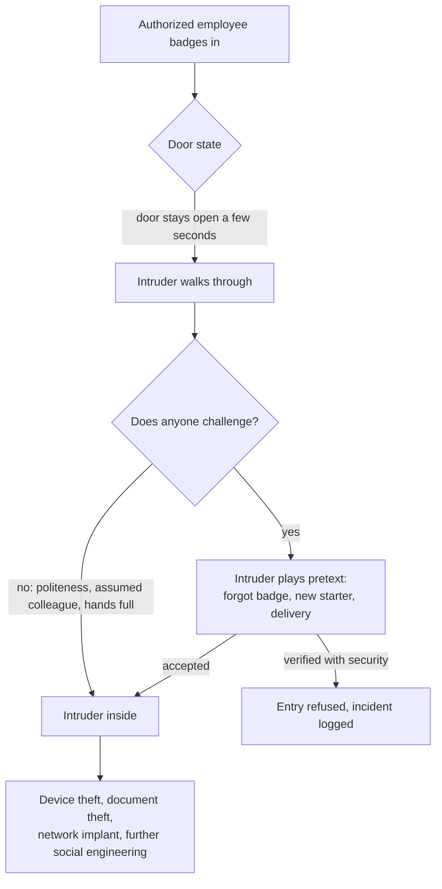
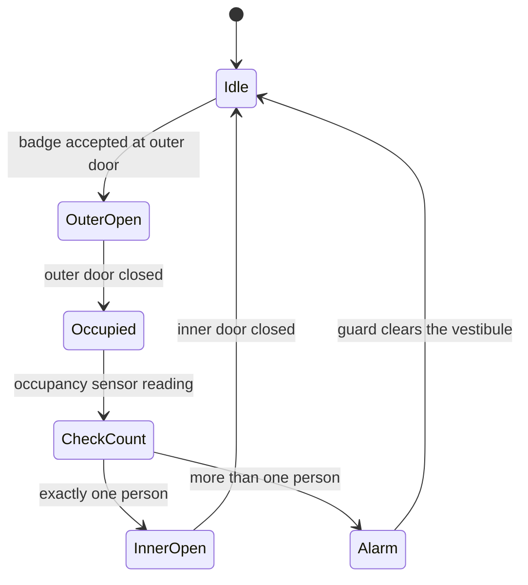

# Tailgating

## Summary

Tailgating is gaining physical entry to a controlled area by following someone who is authorized to enter, so that the intruder passes the door, turnstile or gate on another person's credential. When the authorized person knowingly lets the intruder in, for example by holding the door for someone carrying boxes, it is usually called piggybacking. It works because physical access systems authenticate a badge, not the number of bodies passing, and because politeness makes people hold doors. Once inside, an intruder can steal devices and documents, plant network implants or keyloggers, or reach a server room. Defenses combine people (a culture where challenging strangers is normal), physical design (turnstiles, security vestibules) and detection (correlating badge events with door sensors and people counters). Testing tailgating is done only under a signed physical penetration test authorization.

## Prerequisites

- [Social engineering](social-engineering.md) and [psychology of cyberattacks](psychology-of-cyberattacks.md): the principles (helpfulness, authority, social proof) that tailgating exploits.
- [Defense in depth](../../../security-architecture-and-engineering/design-principles/defense-in-depth.md): physical security is one of the layers.
- Basic idea of a physical access control system (PACS): badge readers, controllers, door contacts and logs.

## Core concepts

### Definition

*Tailgating* is unauthorized entry into a controlled area by closely following an authorized person through an access point. *Piggybacking* is the same act with the authorized person's knowledge or consent. Many sources use the two words interchangeably. In this repository: tailgating means the authorized person does not knowingly grant entry, piggybacking means they do.

NIST SP 800-53 Rev. 5 lists tailgating among social engineering techniques in the guidance of control AT-2(3), Social Engineering and Mining: "Social engineering includes phishing, pretexting, impersonation, baiting, quid pro quo, thread-jacking, social media exploitation, and tailgating." The control requires literacy training on recognizing and reporting such attempts (catalog version 5.2.0, checked 2026-11).

Tailgating differs from related physical attacks:

| Attack | How entry is gained | Credential involved |
| --- | --- | --- |
| Tailgating | Following an authorized person without their consent | Victim's badge, used once |
| Piggybacking | Authorized person lets the intruder in | Victim's badge, with consent |
| Badge cloning | Copying a low-frequency proximity card with a reader | Copy of the victim's credential |
| Impersonation | Posing as a contractor, inspector or courier at reception | Visitor badge obtained by deception, see [impersonation](impersonation.md) |
| Lock bypass | Defeating the lock or door hardware | None |

### Analogy

A nightclub bouncer checks one ticket per person at the door. If the door opens and two people walk through close together while the bouncer looks at the first ticket, the second person is in. The ticket system is fine. The control fails because it counts tickets and not people.

The analogy maps the badge reader to the bouncer and shows the core design flaw: authentication of a credential is not the same as authorization of each person who passes. It breaks because nightclub bouncers can see faces, while most badge readers cannot, and in an office the person holding the door is a colleague trying to be polite, not a paid guard.

### Why it works



The diagram shows two failure points: a door that admits more than one person per badge, and a person who does not challenge or verify. The psychological levers are well documented in [psychology of cyberattacks](psychology-of-cyberattacks.md):

- **Helpfulness and reciprocity.** Holding a door is a social norm. Letting it close in someone's face feels rude.
- **Social proof and familiarity.** A person in a hi-vis vest, with a lanyard or a coffee cup, looks like they belong.
- **Authority.** Clothing and confidence suggest a manager, an auditor or a technician.
- **Distraction and props.** Full hands (boxes, coffee trays), a phone call in progress.
- **Diffusion of responsibility.** In a crowd at a busy entrance, everyone assumes someone else checks.
- **Large and hybrid workplaces.** Nobody knows everyone, so a stranger is not unusual.

### What an intruder does once inside

| Goal | Example | Cyber impact |
| --- | --- | --- |
| Theft | Laptops, phones, badges, printed documents from desks and printers | Data breach, credential theft |
| Network access | Plug a small implant (for example a single-board computer or a malicious network adapter) into a free wall port or behind a printer | Persistent remote access past the perimeter firewall |
| Keystroke capture | Hardware keylogger between keyboard and PC | Credentials |
| Malicious media | Drop USB devices in the kitchen (baiting) | Malware execution, see [malware](../../../security-operations/threats-and-attacks/malware/malware.md) |
| Reconnaissance | Photograph whiteboards, badge design, floor plans | Better pretexts and badge forgery |
| Server room access | Follow an engineer through a second door | Full compromise, sabotage |

### Controls

| Control type | Examples | What it addresses |
| --- | --- | --- |
| Physical design | Optical turnstiles, full-height turnstiles, security vestibules (mantraps), revolving doors that admit one person | Enforces one person per credential |
| Technical | Door held open alarms, door forced alarms, people counters and anti-tailgating sensors, anti-passback, video analytics | Detects multiple entries, prolonged open doors |
| Procedural | Visible badges at all times, escort rule for visitors, "no badge, no entry" policy, reporting channel | Makes challenge expected, not personal |
| Training | AT-2(3) style training on recognizing and reporting, practicing polite challenge phrases | Changes the social default |
| Audit | Physical access log review (NIST SP 800-53 PE-6), visitor records (PE-8), authorized physical penetration tests | Finds what slipped through |

*Anti-passback* rejects a badge that tries to enter twice without exiting, which stops one person passing their badge back to a second person, but not a second person walking in on the same door cycle. A *security vestibule* (often called a mantrap) uses two interlocked doors so that the second opens only after the first has closed and, in stronger designs, after a sensor confirms one occupant:



The state diagram shows the interlock: the inner door never opens while the outer one is open, and a count of more than one person goes to an alarm instead of the inner door.

NIST SP 800-53 Rev. 5 PE-3 (Physical Access Control) requires enforcing physical access authorizations by "verifying individual access authorizations before granting access to the facility" and controlling ingress and egress. The word *individual* is the point: one authorization per person.

## Worked example

A data center room `DC-1` has a badge reader and an overhead people counter that reports how many people passed per door cycle, plus a door contact that reports how long the door was open. An analyst correlates the three sources to find possible tailgating. The data is synthetic.

```python
# Python 3.10, standard library only. Synthetic data, no real people.
badge_events = [  # (time, door, badge_id, result)
    ("08:01:10", "DC-1", "B-1042", "granted"),
    ("08:03:40", "DC-1", "B-7781", "denied"),     # expired badge tried first
    ("08:03:55", "DC-1", "B-2210", "granted"),
    ("12:30:41", "DC-1", "B-1042", "granted"),
    ("17:45:12", "DC-1", "B-3307", "granted"),
]
counter_events = [  # (time, door, people_in) per door cycle
    ("08:01:11", "DC-1", 1),
    ("08:03:56", "DC-1", 2),   # two people on one badge
    ("12:30:42", "DC-1", 1),
    ("17:45:13", "DC-1", 1),
]
door_held = [("08:03:56", "DC-1", 14)]  # door held open for 14 seconds

def sec(t):
    h, m, s = map(int, t.split(":"))
    return h * 3600 + m * 60 + s

alerts = []
for t, door, n in counter_events:
    granted = [b for b in badge_events
               if b[1] == door and b[3] == "granted" and 0 <= sec(t) - sec(b[0]) <= 5]
    if n > len(granted):
        alerts.append((t, door, f"{n} entered on {len(granted)} badge(s): possible tailgating"))
for t, door, s in door_held:
    if s > 10:
        alerts.append((t, door, f"door held open {s} s"))
for b in [b for b in badge_events if b[3] == "denied"]:
    later = [c for c in counter_events if c[1] == b[1] and 0 <= sec(c[0]) - sec(b[0]) <= 60]
    if later:
        alerts.append((b[0], b[1], f"denied badge {b[2]} followed by entry within 60 s"))
for a in sorted(alerts):
    print(*a, sep="  ")
```

Output:

```text
08:03:40  DC-1  denied badge B-7781 followed by entry within 60 s
08:03:56  DC-1  2 entered on 1 badge(s): possible tailgating
08:03:56  DC-1  door held open 14 s
```

Three weak signals line up at 08:03: an expired badge is refused, 15 seconds later one valid badge admits two people, and the door stays open for 14 seconds. Each alone could be innocent. Together they justify pulling the camera recording for 08:03:30 to 08:04:30, identifying the holder of `B-7781` (an expired contractor badge) and asking the holder of `B-2210` whether they let someone in. The response then follows the incident process: check what `DC-1` contains, look for new devices on network ports, and revoke or recover expired badges. PE-6 asks organizations to coordinate the results of physical access reviews with the incident response capability.

Lessons from the example: the badge system alone logged only successful, normal-looking entries. Detection required a second sensor (the people counter) and correlation, which is defense in depth applied to physical security.

## Trade offs and when to use it

| Control | Strength | Cost and limits |
| --- | --- | --- |
| Security vestibule with occupancy check | Strongest physical enforcement | Expensive, slow at shift changes, accessibility and fire egress must be designed in |
| Optical turnstiles | Good throughput, alarms on two people | Can be jumped, needs a guard to respond to alarms |
| Door held and forced alarms | Cheap, easy | Many nuisance alarms if not tuned, people learn to ignore them |
| People counters and video analytics | Detect tailgating without slowing entry | Privacy review needed (video of employees), false positives with carts and luggage |
| Guards at reception | Judgment, can verify identity | Staff cost, fatigue, social engineering of guards |
| Awareness and challenge culture | Covers every door, including internal ones | Takes time, must be supported by management, never punish someone for challenging |

Match the control to the area: a lobby needs reception and turnstiles, a server room needs a vestibule or at least badge plus PIN and an occupancy alarm, an office floor relies mostly on culture and visible badges. Fire codes and accessibility law constrain all designs: emergency exits must open from the inside, so they need alarms and cameras rather than locks.

## Common mistakes

- **Counting badges, not people.** Fix: add people counters, turnstiles or vestibules where the risk justifies it.
- **Relying on politeness rules alone.** Fix: give staff a non-confrontational script ("Hi, I don't think we've met, can I see your badge?" or "Let me take you to reception") and make security staff respond quickly when called.
- **Punishing the employee who held the door.** It discourages reporting. Fix: treat tailgating as a system failure and coach.
- **Ignoring exits and side doors.** Smoking areas and loading docks are classic tailgating points. Fix: door held alarms and cameras on all doors, not only the main entrance.
- **Forgetting internal doors.** Fix: separate zones (lobby, office, server room) with their own controls.
- **Never testing.** Fix: authorized physical penetration tests with a signed letter of authorization, and metrics such as the rate at which test intruders are challenged.

## Detection and mitigation

**Detection.**

- Correlate badge events with door contacts, people counters and video analytics, as in the worked example.
- Alarms for doors held or forced open, with a response time target.
- Review physical access logs (PE-6): access outside normal hours, out-of-sequence accesses, denied badges followed by entries.
- Network side: new devices on wall ports in areas without assigned devices (802.1X failures, unknown MAC addresses, rogue DHCP).
- Staff reports through an easy channel.

**Mitigation.**

- One person per credential where it matters: turnstiles, vestibules.
- Visible badges, visitor escort, prompt deactivation of lost and expired badges.
- Network access control (802.1X) on wall ports, so a physical intruder's implant does not get network access automatically.
- Locked screens, clean desk policy, cable locks, locked server racks (PE-3(4) lockable casings).
- Regular training that includes physical social engineering, and authorized testing.

## Practice

1. What is the difference between tailgating and piggybacking as used in this repository?
2. Why does anti-passback not stop classic tailgating?
3. Which NIST SP 800-53 Rev. 5 control's guidance names tailgating as social engineering, and what does the control require?
4. In the worked example, which single signal would have been enough to suspect tailgating, and why are the others still useful?
5. Name one network control that reduces the impact of a successful tailgater.

Answers:

1. Tailgating: the authorized person does not knowingly grant entry. Piggybacking: they knowingly let the intruder in.
2. Anti-passback stops a badge being used twice for entry without an exit. In tailgating, the second person uses no badge at all.
3. AT-2(3) Social Engineering and Mining. It requires literacy training on recognizing and reporting social engineering and social mining.
4. The people counter reporting two entries on one badge. The denied badge and the held door raise confidence and help reconstruct the event.
5. 802.1X network access control on wall ports, or disabling unused ports.

## Further reading

- [NIST SP 800-53 Rev. 5 (catalog 5.2.0, OSCAL JSON)](https://github.com/usnistgov/oscal-content/tree/main/nist.gov/SP800-53/rev5): controls PE-3, PE-6, PE-8 and AT-2(3) quoted above. Checked 2026-11.
- [NIST SP 800-53 Rev. 5 publication page](https://csrc.nist.gov/pubs/sp/800/53/r5/upd1/final): the human-readable control catalog.
- ISC2 CISSP Exam Outline (April 2024), section 7.14 "Implement and manage physical security" (perimeter and internal security controls) and 1.12 (awareness, including social engineering).
- ISO/IEC 27002:2022, control 7.2 Physical entry: guidance on access points and delivery areas. I did not re-read the standard for this note.
- Related notes: [social engineering](social-engineering.md), [impersonation](impersonation.md), [shoulder surfing](shoulder-surfing.md), [quid pro quo](quid-pro-quo.md), [defense in depth](../../../security-architecture-and-engineering/design-principles/defense-in-depth.md).
