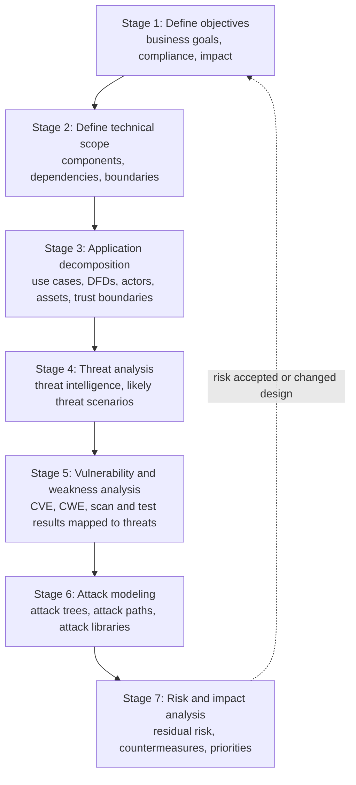
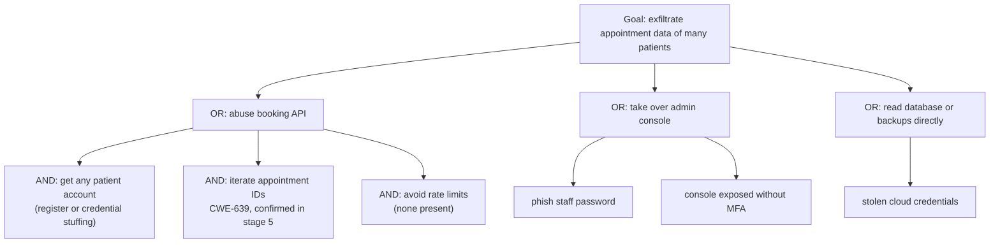
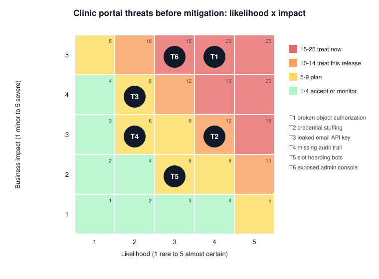

# Process for Attack Simulation and Threat Analysis (PASTA)

## Summary

PASTA is a seven-stage, risk-centric threat modeling methodology that starts from business objectives and ends with a prioritized list of risks and countermeasures. In between, it decomposes the application, gathers threat intelligence, maps real vulnerabilities and simulates how an attacker would chain them into attacks. Its value is that every technical finding is tied to a business impact, so leaders can decide what to fix first. Its cost is effort: a full PASTA analysis needs business owners, architects, developers, threat intelligence and testers, and can take weeks. It was published by Tony UcedaVelez and Marco M. Morana in *Risk Centric Threat Modeling* (Wiley, 2015).

## Prerequisites

- [Threat modeling](../threat-modeling.md): the four questions and the clinic booking portal example.
- [STRIDE](stride.md), often used inside stage 4.
- [Attack trees](attack-trees.md), used in stage 6.
- Basic risk concepts (likelihood, impact, residual risk).

## Core concepts

### Definition

PASTA (Process for Attack Simulation and Threat Analysis) is a methodology that "aims to bring business objectives and technical requirements together" (SEI, Shevchenko 2018). It is risk-centric: the output is not a list of threats but a ranked list of risks with business impact. It is attacker-centric in its analysis: stages 4 to 6 ask what real adversaries would do and simulate their attack paths. The SEI summary describes it as dating from 2012, and the full method was published in the 2015 Wiley book by UcedaVelez and Morana.

### Analogy

PASTA is a bank's robbery risk assessment done by a team that includes the branch manager, the architect of the building, the security company, the police liaison and a former burglar. They start with "what would hurt the bank most" (cash, customer deposit boxes, reputation), study the building plans, review recent robberies in the region, list weak points in the alarms and doors, then walk through concrete robbery plans step by step. The final report tells the board which three changes buy the most risk reduction for the money.

The analogy holds for the business-first framing and the realistic attack simulation. It breaks in scale: a bank branch changes rarely, while software changes every sprint. A process designed for thorough, slow analysis struggles to keep up, which is PASTA's main practical weakness.

### The seven stages

The stages narrow from business context (1 and 2) through system understanding (3) to the attacker's view (4 to 6) and back to business decisions (7). Stage names follow VerSprite's description of the method by Tony UcedaVelez (checked 2026-11). The activities listed per stage below are my summary of common descriptions of PASTA; I did not have the 2015 book at hand to check every detail.

| Stage | Key question | Typical inputs | Outputs |
| --- | --- | --- | --- |
| 1. Define objectives | What must the business protect, and what would a breach cost? | Business goals, regulations (GDPR, PCI DSS), data classification | Business impact analysis, security and compliance requirements |
| 2. Define technical scope | What is in scope, and what does it depend on? | Architecture diagrams, cloud accounts, third parties, libraries | Inventory of components, boundaries and dependencies |
| 3. Application decomposition | How does the system work and where is trust decided? | Use cases, DFDs, roles and permissions | Annotated DFDs, actors, assets, entry points, trust boundaries |
| 4. Threat analysis | Who would attack this and how, based on evidence? | Threat intelligence, incident history, sector reports, logs | Ranked threat scenarios relevant to the business |
| 5. Vulnerability and weakness analysis | Which weaknesses would those threats use? | Scanner and SAST results, pentest reports, CWE, CVE, design flaws | Vulnerabilities mapped to threats and to DFD elements |
| 6. Attack modeling | Can the attacker actually chain these weaknesses into an attack? | Attack trees, CAPEC, ATT&CK, exploit availability | Attack paths with feasibility, test cases for pentesters |
| 7. Risk and impact analysis | What is the residual risk and what do we change first? | Outputs of stages 1 to 6, control costs | Risk register, countermeasures, priorities, residual risk accepted by owners |

### What makes PASTA different

- **Business impact first.** Stage 1 sets the scale against which every later finding is measured.
- **Evidence-based threats.** Stage 4 uses threat intelligence rather than imagination alone.
- **Joins design threats with real vulnerabilities.** Stage 5 connects the threat model to scan and test results, so that known weaknesses are rated by the threats that would exploit them.
- **Simulation.** Stage 6 tests whether an attack is feasible end to end, which filters out theoretical threats and feeds pentest scope.

## Worked example

The clinic booking portal from [threat modeling](../threat-modeling.md#worked-example), shortened to one or two lines per stage.

**Stage 1, objectives.** Patients must be able to book 24/7. Appointment data is health-related personal data (GDPR Article 9), and a breach must be reported to the supervisory authority within 72 hours (GDPR Article 33). Business impact scale: 5 = breach of health data or more than one day of outage, 1 = minor inconvenience.

**Stage 2, technical scope.** Booking API and admin console in one cloud account, managed PostgreSQL, third-party email SaaS, a single sign-on provider for staff. Out of scope: the clinic's medical records system (a separate future assessment).

**Stage 3, decomposition.** The DFD from the threat modeling note with seven flows, three external entities (patient, staff, email provider) and two trust boundaries.

**Stage 4, threat analysis.** Evidence used: healthcare is a frequent ransomware and data theft target; credential stuffing is constant against any public login; API authorization flaws (OWASP API1:2023) are the most common API weakness class. The team ranks six threat scenarios, T1 to T6, the same IDs as in the threat modeling note.

**Stage 5, vulnerability analysis.** A DAST run and a code review find two real weaknesses: `GET /appointments/{id}` returns any appointment without an ownership check (CWE-639, authorization bypass through user-controlled key), and the email provider API key is in a `.env` file committed to a private repository (CWE-798, hard-coded credentials).

**Stage 6, attack modeling.** The team models the most dangerous goal, "attacker exfiltrates many patients' appointment data", as an attack tree:

The left branch is feasible today with no special skill: every AND node is satisfied. The team writes a pentest case for it, and the tester confirms it in a staging environment by reading 500 appointments with one patient account.

**Stage 7, risk and impact.** Likelihood and impact on 1 to 5 scales, product as score:

| ID | Threat | L | I | Score | Decision |
| --- | --- | --- | --- | --- | --- |
| T1 | Broken object level authorization on appointments | 4 | 5 | 20 | Fix before next release, add authorization tests, add detection for ID enumeration |
| T6 | Admin console exposed without MFA | 3 | 5 | 15 | Fix now: SSO with MFA and network restriction |
| T2 | Credential stuffing | 4 | 3 | 12 | Rate limiting and breached password check this release |
| T3 | Leaked email API key | 2 | 4 | 8 | Rotate key, move to secret manager, plan scope reduction |
| T4 | Missing audit trail for staff | 2 | 3 | 6 | Plan for next quarter |
| T5 | Slot hoarding by bots | 3 | 2 | 6 | Plan, monitor booking rates |

The clinic manager signs the residual risk for T4 and T5 with a review date. The ranking is what STRIDE alone did not provide.

## Trade offs and when to use it

**Strengths.**

- Speaks the language of executives: risk, impact, priorities.
- Uses evidence: threat intelligence and real vulnerability data.
- Produces outputs that other teams use: pentest cases (stage 6), detection use cases, a risk register.
- Fits regulated environments where risk decisions must be justified.

**Weaknesses and costs.**

- Heavy. Seven stages with many participants. For a small feature, it is overkill.
- Needs skills that many teams lack: threat intelligence, attack modeling, risk analysis.
- Depends on stage 1. If business impact is guessed rather than agreed, the whole ranking is unreliable.
- Hard to repeat every sprint. Organizations often run full PASTA for a new system and lighter STRIDE reviews for later changes.

**When to use PASTA.**

- New high value or regulated systems: payments, health data, critical infrastructure.
- When leadership must decide on large security investments.
- When pentest and detection engineering need a threat-driven scope.

**When not to.**

- Small features or low risk internal tools: use [STRIDE](stride.md).
- Teams without access to business owners: the risk ranking will be fiction.
- When the deadline allows hours, not weeks.

**Relation to other frameworks.** PASTA stage 7 feeds an organizational risk process such as the NIST Risk Management Framework (SP 800-37). Stage 4 can use MITRE ATT&CK, stage 6 CAPEC and ATT&CK techniques, stage 5 CWE and CVE.

## Common mistakes

- **Skipping stage 1.** Fix: get the business owner to agree on the impact scale before any technical work.
- **Copying generic threat intelligence.** "APT groups target healthcare" is not a threat scenario. Fix: write scenarios specific to this system's entry points and assets.
- **Treating vulnerabilities as threats.** A CVE in a library matters only if a threat scenario can reach it. Fix: map each vulnerability to a threat and a DFD element in stage 5.
- **Attack trees that stop at one level.** Fix: refine until each leaf is something a tester can try.
- **Never closing the loop.** Fix: verify mitigations with tests and re-run stages 5 to 7 after major changes.

## Practice

1. Which PASTA stage connects scanner results to threat scenarios?
2. Why can stage 7 not be done well if stage 1 was skipped?
3. In the attack tree, why is the "abuse booking API" branch rated feasible?
4. Name one output of stage 6 that a different team can use directly.
5. When would you choose STRIDE instead of PASTA for the clinic portal?

Answers:

1. Stage 5, vulnerability and weakness analysis.
2. Because impact has no agreed scale. Rankings then reflect the analyst's guess, not business priorities.
3. All its AND children are satisfied: accounts can be created freely, the ownership check is missing (confirmed), and no rate limit stops enumeration.
4. Attack paths turned into penetration test cases, or detection use cases for the SOC.
5. For the next small change, such as adding an "add to calendar" button, where the design change is small and contained in one trust zone.

## Further reading

- Tony UcedaVelez and Marco M. Morana, *Risk Centric Threat Modeling: Process for Attack Simulation and Threat Analysis*, Wiley, 2015: the primary source for PASTA.
- [VerSprite, What is PASTA threat modeling (Tony UcedaVelez)](https://versprite.com/blog/what-is-pasta-threat-modeling/): stage names and goals from the method's co-author. Vendor source. Checked 2026-11.
- [SEI, Threat Modeling: 12 Available Methods (Shevchenko, 2018)](https://www.sei.cmu.edu/blog/threat-modeling-12-available-methods/): neutral short description of PASTA among other methods. Checked 2026-11.
- [MITRE CAPEC](https://capec.mitre.org/) and [MITRE ATT&CK](https://attack.mitre.org/): attack libraries for stages 4 and 6.
- [GDPR, Regulation (EU) 2016/679](https://eur-lex.europa.eu/eli/reg/2016/679/oj): Articles 9 and 33 used in stage 1 of the example.
- Related notes: [STRIDE](stride.md), [Trike](trike.md), [attack trees](attack-trees.md), [threat modeling methodologies](../methodologies.md).
