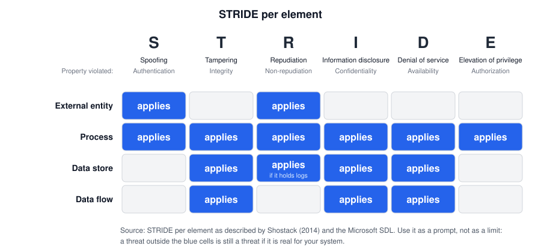
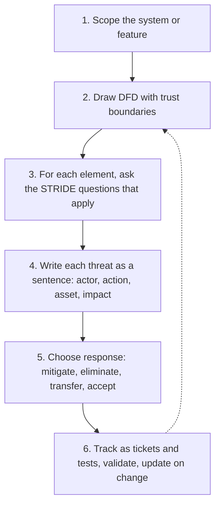

# STRIDE

## Summary

STRIDE is a mnemonic for six categories of security threats: Spoofing, Tampering, Repudiation, Information disclosure, Denial of service and Elevation of privilege. Each category is the violation of one security property, such as authentication or integrity. Teams use it to ask "what can go wrong?" systematically for every element of a data flow diagram, so that whole classes of threats are not forgotten. Microsoft engineers Loren Kohnfelder and Praerit Garg introduced it in 1999, and it remains the most widely used threat elicitation technique in software development because it is simple, fast and fits design reviews.

## Prerequisites

- [Threat modeling](../threat-modeling.md): the four questions, data flow diagrams and trust boundaries. The clinic booking portal used below is introduced there.
- The [CIA triad](../../foundations/cia-triad/README.md) and the difference between authentication and authorization.

## Core concepts

### Definition and origin

STRIDE is a *threat classification*, not a full methodology. It answers only the second of the four threat modeling questions, "what can go wrong?". Kohnfelder and Garg's internal Microsoft paper "The threats to our products" (April 1, 1999) introduced it as "The S.T.R.I.D.E. security threat model" that "should be used by all MS products to identify various types of threats the product is susceptible to during the design phase". Their original names were slightly different: "Spoofing of user identity", "Tampering with data", "Repudiability", "Information disclosure (privacy breach)", "Denial of Service (D.o.S.)" and "Elevation of privilege".

### The six categories

| Letter | Threat | Property violated | What the attacker does | Typical mitigations |
| --- | --- | --- | --- | --- |
| S | Spoofing | Authentication | Pretends to be another user, service or component | Strong authentication, MFA, mutual TLS, signed tokens |
| T | Tampering | Integrity | Changes data at rest, in transit or in memory, or changes code | MACs, signatures, AEAD, access control on writes, code signing |
| R | Repudiation | Non-repudiation (accountability) | Denies having performed an action, and the system cannot prove otherwise | Tamper-evident audit logs with identity and time, signed transactions |
| I | Information disclosure | Confidentiality | Reads data it should not see | Encryption, authorization checks, data minimization, error handling |
| D | Denial of service | Availability | Makes the system unavailable or degraded | Rate limits, quotas, autoscaling, timeouts, redundancy |
| E | Elevation of privilege | Authorization | Gains capabilities beyond what was granted | Least privilege, authorization on every request, sandboxing, memory safety |

The property mapping is the useful part. It turns STRIDE into a check of whether each security property is enforced at each place in the design.

### Analogy

STRIDE is a building inspector's checklist with six headings: locks (who gets in), tamper seals (has anything been changed), visitor log (who did what), curtains and safes (who can see what), fire exits and capacity (can the building keep working), and staff-only areas (can a visitor reach the manager's office). The inspector walks room by room and asks all six questions in each room.

The analogy holds for the systematic, room-by-room use. It breaks because a checklist only names categories. It does not tell the inspector how a thief would actually combine a weak lock and an unwatched corridor into a burglary. For that, STRIDE needs attack trees or attacker-centric thinking (see [attack trees](attack-trees.md) and [PASTA](pasta.md)).

### STRIDE per element

Not every category applies equally to every DFD element. The *STRIDE per element* approach, described by Adam Shostack in *Threat Modeling: Designing for Security* (2014) and used in the Microsoft SDL, limits the questions per element type:

The logic behind the matrix:

- An **external entity** can be impersonated (S) and can deny its actions (R). You cannot tamper with or disclose from a user; that happens to flows and stores.
- A **process** is code that runs, so it is exposed to all six.
- A **data store** can be modified (T), read (I) and filled or deleted (D). Repudiation applies when the store holds audit logs, because tampering with logs destroys accountability.
- A **data flow** can be modified (T), read (I) or interrupted (D) in transit.

A variant, *STRIDE per interaction*, enumerates threats per tuple of (source, flow, destination), which fits flows crossing trust boundaries well. I did not re-check its exact definition in a primary source for this note.

### Process

Step 4 matters more than it looks. "Spoofing on the API" is not actionable. "An attacker replays a stolen patient session cookie from another device to read appointments" is.

### Related techniques

- **DREAD** (Damage, Reproducibility, Exploitability, Affected users, Discoverability) was a Microsoft risk rating scheme often paired with STRIDE. Microsoft later stopped recommending it because scores were subjective and inconsistent between raters. This history is from memory and not re-checked here. Prefer a simple impact and likelihood scale or CVSS for implementation bugs.
- **LINDDUN** (Linking, Identifying, Non-repudiation, Detecting, Data disclosure, Unawareness, Non-compliance) is a privacy counterpart to STRIDE, developed at KU Leuven. Note that non-repudiation is a threat in LINDDUN (for privacy) but a goal in STRIDE (for security).
- **Elevation of Privilege** is a card game built on STRIDE, released by Microsoft, that structures STRIDE sessions as play.
- **STRIDE-LM** adds Lateral Movement, used in some enterprise threat models. Not verified against a primary source.

## Worked example

The clinic booking portal from [threat modeling](../threat-modeling.md#worked-example). We apply STRIDE per element to five elements. The DFD numbers flows 1 to 7.

| Element (type) | Cat. | Threat statement | Mitigation |
| --- | --- | --- | --- |
| Patient (external entity) | S | Attacker logs in as a patient with credentials from another breach (credential stuffing) | Rate limit per account and IP, breached password check, passkeys |
| Patient (external entity) | R | Patient denies having cancelled an appointment that incurred a no-show fee | Audit event with session ID, time, IP and the action, confirmation email |
| Booking API (process) | S | Attacker forges a JWT by switching the algorithm to `none` or using the public key as an HMAC secret | Library that pins the expected algorithm, reject `none` |
| Booking API (process) | T | Attacker modifies the price or slot in a request body | Server recomputes price and checks slot availability, never trusts client fields |
| Booking API (process) | R | Staff impersonation through a shared service account leaves no trace of the real person | Per-person identities, audit log with the human identity behind a session |
| Booking API (process) | I | Error responses include stack traces with SQL and table names | Generic errors to clients, detailed errors to logs only |
| Booking API (process) | D | Bot books all free slots | Max open bookings per patient, CAPTCHA after threshold |
| Booking API (process) | E | Patient reads or cancels another patient's booking by changing `appointment_id` | Ownership check in a central authorization layer (OWASP API1:2023 broken object level authorization) |
| Flow 6 to email provider (data flow) | I | API key sent in a URL query string ends up in proxy logs | Send key in a header, scope it to "send only", rotate it |
| Flow 1 (data flow) | T | On a hostile Wi-Fi, an attacker strips TLS | HTTPS only, HSTS with preload |
| Appointments DB (data store) | I | Backup snapshot shared publicly by mistake | Encrypted backups, block public sharing by policy, posture monitoring |
| Appointments DB (data store) | T | Admin console account with write access edits records without approval | Separate roles, four-eyes approval for bulk changes |
| Audit log (data store) | R | Attacker with API access deletes log entries to hide actions | Append-only storage, logs shipped to a separate account |

In about an hour, a small team gets 13 concrete threats with mitigations, and each row becomes a ticket. Notice what STRIDE did not produce on its own: the ranking of which threat matters most to the clinic. PASTA or a risk scale adds that (see [PASTA](pasta.md)).

The same walk can be done in the Microsoft Threat Modeling Tool or OWASP Threat Dragon, which generate candidate STRIDE threats from a drawn DFD. Treat generated lists as a starting point and delete threats that do not apply.

## Trade offs and when to use it

**Strengths.**

- Simple to teach. Developers can apply it after a short introduction.
- Systematic: per-element coverage reduces forgotten categories.
- Fast: fits into a design review or a sprint refinement.
- Tool support: Microsoft Threat Modeling Tool, OWASP Threat Dragon, and many commercial tools.

**Weaknesses.**

- No prioritization. Every threat looks equally important unless you add a risk scale.
- No attacker model. It does not ask who would attack, why, or how steps chain together.
- Category overlap. A broken authorization check can be filed under I or E. That is harmless as long as the threat is recorded once.
- Weak on business logic abuse and on privacy, unless the team adds prompts for them.
- Can produce long, generic lists when run mechanically by tools.

**When to use STRIDE.**

- Design reviews of new features and services.
- Teams new to threat modeling.
- As the elicitation step inside heavier methods: PASTA stage 4 and VAST both commonly use STRIDE categories.

**When something else fits better.**

- When leadership needs business risk and prioritization: [PASTA](pasta.md).
- When one critical goal needs deep analysis (for example "attacker transfers money out"): [attack trees](attack-trees.md).
- For privacy questions: LINDDUN.
- For completeness proofs in an audit: [Trike](trike.md).

## Common mistakes

- **Running STRIDE without a diagram.** Fix: draw the DFD and boundaries first, even on a whiteboard.
- **Applying it only to the whole system.** "The system can be spoofed" is not useful. Fix: per element or per interaction.
- **Stopping at the category name.** Fix: write each threat as a sentence with actor, action, asset and impact.
- **Ignoring repudiation.** Teams skip R because it sounds legal. Fix: ask for every privileged action "could we prove who did this?".
- **Treating tool output as finished.** Fix: review generated threats, delete irrelevant ones, add business logic threats by hand.
- **No follow-up.** Fix: each threat becomes a tracked item with an owner, and mitigations get tests.

## Practice

1. Which security property does each STRIDE letter violate?
2. Using STRIDE per element, which categories apply to a data flow, and why not S?
3. Classify: an attacker replays a captured bank transfer request so it executes twice.
4. Classify: a log server accepts unauthenticated syslog messages, so an attacker injects fake entries blaming another user.
5. Why does STRIDE alone not tell you which threat to fix first?

Answers:

1. S: authentication. T: integrity. R: non-repudiation. I: confidentiality. D: availability. E: authorization.
2. Tampering, information disclosure and denial of service. A flow does not authenticate itself; spoofing is analyzed at the endpoints (processes and external entities) of the flow.
3. Primarily tampering (the integrity of the transaction stream, missing replay protection). Kohnfelder and Garg listed replay under spoofing in 1999, so either is defensible; record it once.
4. Repudiation (the log no longer proves who did what), enabled by spoofing of the log source.
5. It classifies threats but has no notion of likelihood, business impact or attacker motivation.

## Further reading

- [Loren Kohnfelder and Praerit Garg, "The threats to our products", Microsoft, April 1, 1999](https://shostack.org/files/microsoft/The-Threats-To-Our-Products.docx): the original description with examples per category. Checked 2026-11.
- [Microsoft Learn, Threat Modeling Tool threats](https://learn.microsoft.com/en-us/azure/security/develop/threat-modeling-tool-threats): Microsoft's current STRIDE definitions. Checked 2026-11.
- Adam Shostack, *Threat Modeling: Designing for Security*, Wiley, 2014: STRIDE per element and per interaction, chapter 3.
- [OWASP Threat Modeling Cheat Sheet](https://cheatsheetseries.owasp.org/cheatsheets/Threat_Modeling_Cheat_Sheet.html): STRIDE in a practical process.
- [OWASP API Security Top 10 2023](https://owasp.org/API-Security/editions/2023/en/0x11-t10/): API1:2023 broken object level authorization, the most common E and I threat in APIs.
- [LINDDUN](https://linddun.org/): the privacy threat modeling framework that complements STRIDE.
- Related notes: [threat modeling](../threat-modeling.md), [PASTA](pasta.md), [Trike](trike.md), [VAST](vast.md), [attack trees](attack-trees.md), [threat modeling methodologies](../methodologies.md).
