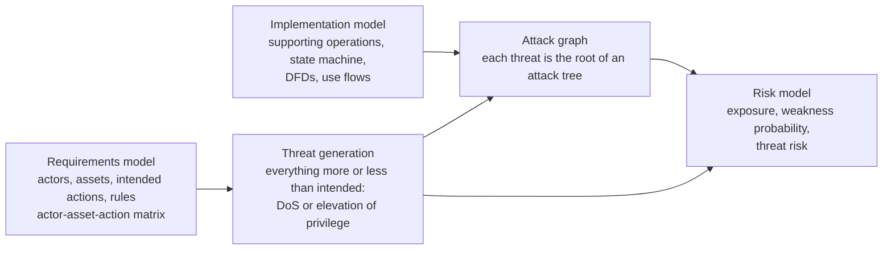
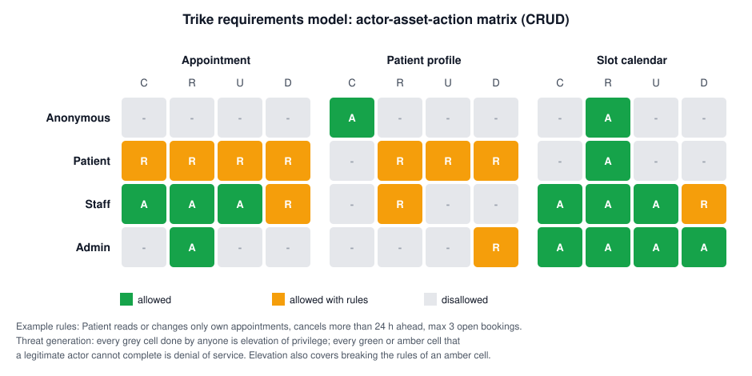

# Trike

## Summary

Trike is a risk-based threat modeling methodology that starts from a formal model of what the system is supposed to allow: who (actors) may do what (create, read, update, delete) to which data (assets), and under which rules. Anything more or less than those intended actions is a threat, so threats can be generated mechanically and completely from the model, and every threat falls into one of only two classes: denial of service or elevation of privilege. Trike then scores threats with a simple risk model based on asset values, action risks and actor trust. It was designed for security audits by Paul Saitta, Brenda Larcom and Michael Eddington, whose v1 methodology document is dated July 2005. It is precise and repeatable, but laborious, and its tooling and later versions never reached wide use.

## Prerequisites

- [Threat modeling](../threat-modeling.md): data flow diagrams, trust boundaries and the clinic booking portal example.
- [STRIDE](stride.md), for comparison.
- CRUD (create, read, update, delete) as the basic operations on data.
- [Attack trees](attack-trees.md), used in Trike's attack graph.

## Core concepts

### Definition

The Trike v1 document defines itself as "a unified conceptual framework for security auditing from a risk management perspective through the generation of threat models in a reliable, repeatable manner". Three choices distinguish it, in the authors' words: "the high levels of automation possible within the system, the defensive perspective of the system, and the degree of formalism present in the methodology". Where PASTA looks through the attacker's eyes, Trike starts from the defender's specification of correct behavior.

Trike builds three linked models:



The requirements model alone already produces the full list of threats and a first ranking (exposure). The implementation model and attack graph add how those threats could be realized.

### Analogy

Trike works like auditing a hospital's access badge system against the official access policy. First you write the policy as a table: nurses may open ward doors, pharmacists may open the drug store, visitors may open nothing after 8 pm. Then every way the system could break the table becomes a finding: a visitor opening the drug store (elevation of privilege), or a nurse who cannot open a ward door in an emergency (denial of service). Because the table is complete, the list of possible violations is complete too.

The analogy holds for the completeness argument. It breaks because a door policy is small. A real application has many assets and roles, and the number of matrix cells, and therefore threats, grows quickly. The Trike authors themselves warn that "the number of threats increases geometrically with the number of assets".

### Requirements model

**Actors** are human roles that interact with the system in scope. Trike is strict here: a backup administrator is not an actor unless the backup system is in scope, and scheduled jobs are not actors. "The actual entity being described by an actor is the role that the actor takes."

**Assets** are discrete data entities, or sometimes physical objects, "inherently meaningful in the problem domain". The v1 document gives a sharp example: a widget being shipped is an asset, "while the password of a blog user is not an asset". The password is an artifact of how the system is implemented, not of what it is for. Assets are usually given a dollar value by the business, not by the auditor.

**Intended actions** are triples of action, asset and rules, where the action is one of create, read, update or delete. Compound actions break down into these (copy is read plus create, move is read, update and delete). The authors allow an "invoke" action only for systems whose purpose is to move and run code.

**Rules** are declarative sentence fragments joined by and, or and not, such as "actor is in role Patient and appointment.patient = actor and start_time > now + 24h".

**The actor-asset-action matrix** puts roles in rows and assets in columns, with each cell split into C, R, U and D. Each action cell is allowed, disallowed, or allowed with rules.

### Threat generation

Trike's taxonomy has two classes, both derived from the matrix:

- **Denial of service**: "an actor is prevented from taking a legitimate, intended action in the system when acting in accordance with the rules for that action".
- **Elevation of privilege**, in three situations: an actor performs an action that no actor is intended to perform on an asset, an actor performs an action despite the rules, or an actor uses the system to perform an action on another system's asset. The authors call the last case the "social responsibility" threat, for example an open mail relay abused by spammers.

Threats in Trike are "never technology specific or implementation specific (those are attacks)". "SQL injection" is an attack. "Patient reads another patient's appointment" is a threat. Each threat becomes the root of an attack tree in the attack graph.

### Implementation model

The implementation model describes how the system actually works:

- **Supporting operations** such as login, which change the state of the actor or system (put the user in a role) without acting on an asset.
- **A state machine** of state tags and the operations that add or remove them.
- **Data flow diagrams**, decomposed "until there are no longer any processes which cross trust boundaries", annotated with technologies and versions.
- **Use flows** that trace each action through the DFD.

The v1 document labels supporting operations, the state machine and use flows as experimental.

### Risk model

| Quantity | Trike v1 definition | Scale |
| --- | --- | --- |
| Asset value | Business value, set by the business | Dollars, used as a relative number |
| Action risk | Undesirability of a threat on an asset-action pair, rated twice: for DoS and for EoP | 1 to 5 |
| Actor risk | Trust in a role: 1 highly trusted, 5 untrusted or anonymous | 1 to 5 |
| Threat exposure | Asset value multiplied by the action-specific risk | Relative, "not a real dollar value" |
| Weakness probability | Reproducibility times exploitability times actor risk of the least trusted actor who can reach it | 1 to 125 |
| Threat risk | Threat exposure multiplied by the largest applicable vulnerability risk | Relative |

The authors are candid that the model is coarse: the probability factor is "not quantitative by any stretch of the imagination" and the asset value model is "currently somewhat intentionally naive".

## Worked example

The clinic booking portal from [threat modeling](../threat-modeling.md#worked-example), a fictional system. Four roles, three assets.



Note what is not an asset: the patient's password and the session token. They are how the system authenticates, not what it is for. Patient profile is an asset because the clinic would need it even with a different login method.

**Threat generation.** Reading the matrix:

- Every grey cell yields an elevation of privilege threat, for example "Anonymous reads an appointment" or "Patient updates the slot calendar".
- Every amber cell yields an elevation of privilege threat for breaking its rules, for example "Patient reads an appointment that is not theirs". This is the broken object level authorization flaw found in the [STRIDE](stride.md#worked-example) and [PASTA](pasta.md#worked-example) examples, now derived mechanically.
- Every green or amber cell yields a denial of service threat, for example "Patient cannot create an appointment while following the rules" (the slot hoarding bots of T5).

**Risk.** The business sets relative asset values: appointment 400, patient profile 250, slot calendar 1,000 (because if the calendar is wrong or unreadable, the whole clinic stops). Action risks are set from 1 to 5. A short Python 3.10 script applies the v1 formulas:

```python
# exposure = asset value * action-specific risk (Trike v1, section 4.1)
assets = {"Appointment": 400, "Patient profile": 250, "Slot calendar": 1000}
eop = {("Appointment", "R"): 5, ("Appointment", "U"): 4, ("Appointment", "D"): 4, ("Appointment", "C"): 2,
       ("Patient profile", "R"): 5, ("Patient profile", "U"): 3,
       ("Slot calendar", "U"): 3, ("Slot calendar", "D"): 5}
dos = {("Appointment", "C"): 4, ("Slot calendar", "R"): 5, ("Appointment", "D"): 2}
threats = [(f"EoP: {act} {a} against the rules", assets[a] * r) for (a, act), r in eop.items()]
threats += [(f"DoS: authorized {act} {a} blocked", assets[a] * r) for (a, act), r in dos.items()]
for name, e in sorted(threats, key=lambda t: -t[1]):
    print(f"{e:6d}  {name}")

# Weakness: missing ownership check on GET /appointments/{id}
repro, exploit, actor = 5, 5, 4          # trivial, simple request, any registered patient
p = repro * exploit * actor
print("weakness probability factor:", p, "of max", 5 * 5 * 5)
print("threat risk for 'R Appointment against the rules':", assets["Appointment"] * 5 * p)
```

Output:

```text
  5000  EoP: D Slot calendar against the rules
  5000  DoS: authorized R Slot calendar blocked
  3000  EoP: U Slot calendar against the rules
  2000  EoP: R Appointment against the rules
  1600  EoP: U Appointment against the rules
  1600  EoP: D Appointment against the rules
  1600  DoS: authorized C Appointment blocked
  1250  EoP: R Patient profile against the rules
   800  EoP: C Appointment against the rules
   800  DoS: authorized D Appointment blocked
   750  EoP: U Patient profile against the rules
weakness probability factor: 100 of max 125
threat risk for 'R Appointment against the rules': 200000
```

Reading the result: the business's choice to value the calendar highest puts integrity and availability of the calendar on top of the exposure list, above confidentiality of appointments. That may or may not be what the clinic wants, given that appointments are health data. Trike makes the choice visible and debatable, which is its purpose. A team that disagrees changes the asset values, not the method. Once the implementation model shows a concrete weakness (the missing ownership check, probability factor 100 of 125), the threat risk of the appointment read threat becomes the highest number in the model.

## Trade offs and when to use it

**Strengths.**

- **Completeness relative to the model.** If the matrix is correct, the threat list is complete for DoS and EoP. The v1 document claims that with a correct model "multiple independent auditors will arrive at the same conclusions".
- **Defensive and requirements based.** Good for systems with clear business rules: banking, healthcare scheduling, workflow and approval systems.
- **Finds business logic flaws.** Rules such as "cancel only more than 24 hours ahead" become explicit and testable.
- **Automation friendly.** The matrix can be generated and checked by tools, and turned into authorization test cases.

**Weaknesses.**

- **Laborious.** Matrix size grows with roles times assets times four actions.
- **Only two threat classes.** Confidentiality appears as a read EoP, which is fine, but repudiation and some privacy threats do not fit naturally.
- **Experimental parts.** The authors marked supporting operations, the state machine and use flows as experimental, and the risk model as tested only "to a certain degree".
- **Little ecosystem.** The original tool and later versions saw limited adoption, so there is little community material. I did not find a current, maintained Trike tool for this note.

**When to use Trike.**

- Audits that must show completeness and repeatability.
- Systems where authorization rules are the main security property.
- As a way to derive an authorization test suite from requirements.

**When not to.**

- Fast feature reviews: use [STRIDE](stride.md).
- When business risk and threat intelligence drive decisions: use [PASTA](pasta.md).
- Infrastructure or network threat models without clear data assets.

## Common mistakes

- **Treating implementation artifacts as assets** (passwords, tokens, config files). Fix: ask whether the data would exist with a different implementation.
- **Treating jobs and services as actors.** Fix: actors are human roles. Model service accounts in the implementation model.
- **Vague rules.** "Patients see their own data" is not checkable. Fix: write rules as precise predicates on actor and asset attributes.
- **Reading the exposure numbers as money.** Fix: they are relative rankings, as the authors state.
- **Stopping after the matrix.** Fix: map high exposure threats to attack trees and real weaknesses before deciding.

## Practice

1. What are Trike's two threat classes, and how is each derived from the matrix?
2. Why is a user's password not an asset in Trike?
3. Compute the exposure of "Patient profile read against the rules" with asset value 250 and action risk 5.
4. Which three situations count as elevation of privilege in Trike v1?
5. Name one Trike component that its authors labeled experimental.

Answers:

1. Denial of service: an intended action that a legitimate actor cannot complete. Elevation of privilege: an action beyond what the matrix and rules allow.
2. It exists only because of the chosen authentication implementation. Assets are data meaningful in the problem domain.
3. 250 x 5 = 1,250.
4. An entirely disallowed action, an action performed despite its rules, and using the system to act on another system's asset (social responsibility).
5. Supporting operations, the state machine or use flows.

## Further reading

- [Paul Saitta, Brenda Larcom and Michael Eddington, Trike v.1 Methodology Document (draft), July 13, 2005, archived copy](https://web.archive.org/web/2016/http://www.octotrike.org/papers/Trike_v1_Methodology_Document-draft.pdf): the primary source for every definition and formula in this note. Read via the Internet Archive because octotrike.org refused direct download. Checked 2026-11.
- [SEI, Threat Modeling: 12 Available Methods (Shevchenko, 2018)](https://www.sei.cmu.edu/blog/threat-modeling-12-available-methods/): a short neutral description of Trike. Checked 2026-11.
- Related notes: [STRIDE](stride.md), [PASTA](pasta.md), [VAST](vast.md), [attack trees](attack-trees.md), [threat modeling methodologies](../methodologies.md).
