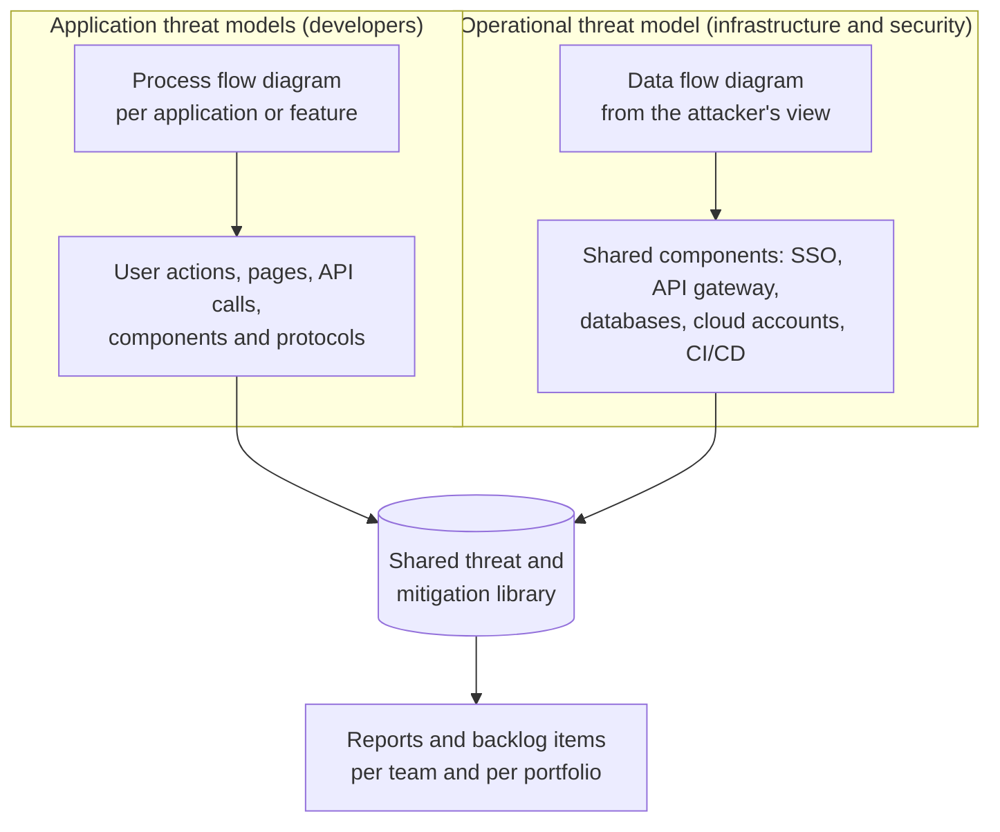
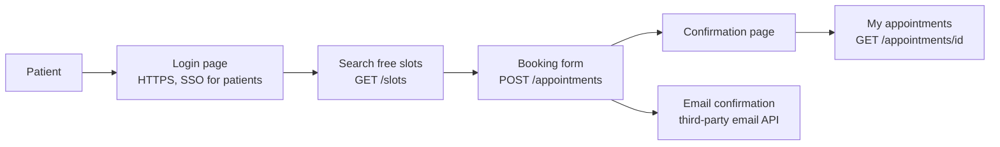
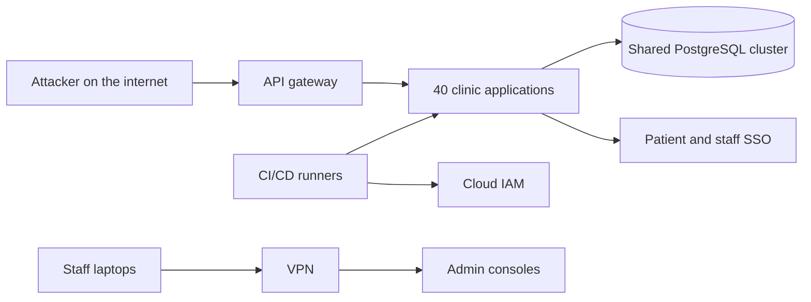

# VAST

## Summary

VAST (Visual, Agile and Simple Threat modeling) is a threat modeling approach built for large organizations that must model hundreds of applications continuously, not a few systems by hand. Its central idea is to split the work into two kinds of models: application threat models, drawn as process flow diagrams that developers understand, and operational threat models, drawn as data flow diagrams from the attacker's view of shared infrastructure. Both feed one threat library and are kept current through automation and integration with development pipelines. VAST was developed by the company ThreatModeler and is tied to its commercial platform, so most detailed descriptions are vendor statements and should be read as such.

## Prerequisites

- [Threat modeling](../threat-modeling.md): the four questions, DFDs and the clinic booking portal example.
- [STRIDE](stride.md): VAST tools commonly reuse STRIDE-style threat categories.
- Agile and DevOps basics: user stories, sprints, CI/CD pipelines.

## Core concepts

### Definition and source situation

The SEI summary by Nataliya Shevchenko (December 2018) describes VAST as based on ThreatModeler, an automated threat modeling platform, designed to scale across the infrastructure and the whole development lifecycle, and states that "VAST requires creating two types of models: application threat models and operational threat models". Application models use process flow diagrams that represent the architectural point of view. Operational models are based on data flow diagrams created from the attacker's point of view.

ThreatModeler's own pages (checked 2026-11) state that "ThreatModeler developed the Visual, Agile, and Simple Threat (VAST) modeling framework" and describe it with three pillars, automation, integration and collaboration, in its glossary, and with four properties, scalable, automated, integrated and collaborative, on another page. These are **vendor statements**. I found no independent specification of VAST comparable to the Trike v1 document or the PASTA book. Several secondary sources attribute VAST to ThreatModeler's founder, Anurag Agarwal; I could not confirm this in a primary source.

The practical consequence: VAST is best understood as a set of design ideas (two model types, visual diagrams for non-specialists, automation, pipeline integration) rather than a precisely defined procedure. Those ideas can be applied with any tool.

### Analogy

Think of fire safety in a large office campus. Each tenant company (an application team) gets a simple floor plan template and checks its own offices: exits, storage of flammable materials, who has keys. The campus facilities team (operations) separately assesses the shared parts that every tenant depends on: the power plant, the sprinkler main, the security desk, the shared parking garage. Both assessments use the same catalog of hazards, are stored in one system and are updated whenever a tenant remodels.

The analogy holds for the split between team-owned and shared assets, and for scale through templates. It breaks because buildings change slowly and inspectors visit rarely, while VAST's promise is continuous modeling driven by automation, something no fire inspection regime does.

### Two model types

The diagram shows the dual track: many application models owned by development teams, one or a few operational models owned by infrastructure and security teams, joined through a common library of threats and mitigations.

| Aspect | Application threat model | Operational threat model |
| --- | --- | --- |
| Diagram | Process flow diagram (PFD) | Data flow diagram (DFD) |
| Viewpoint | How a user moves through the application | How an attacker moves through the infrastructure |
| Owners | Development teams, product owners | Infrastructure, platform, security operations |
| Typical elements | Login page, booking form, API call, third-party widget | SSO server, database cluster, VPN, cloud IAM, CI/CD runners |
| Typical threats | Authorization bypass, injection, session misuse | Lateral movement, misconfiguration, credential theft, supply chain |
| Change frequency | Every feature or sprint | When infrastructure changes |

### Process flow diagrams versus data flow diagrams

A *process flow diagram* in VAST follows the user's path through the application: from page to page or call to call, with the widgets, components and communication protocols used at each step. It reads like a user story, which is why the approach calls it more natural for developers than a DFD. A DFD, used in the operational model, shows processes, data stores, flows and trust boundaries, which suits reasoning about infrastructure and attacker movement. The distinction is described by the SEI summary and ThreatModeler; the exact PFD notation is defined by the vendor's tool and I did not verify it.

### Scale, automation and integration

VAST's motivation is the scale problem of manual threat modeling. If one expert session per application takes a day, a portfolio of 500 applications needs 500 expert days per cycle, and the models are outdated before the cycle finishes. VAST addresses this with:

- **Templates and reusable components.** A "login with corporate SSO" component carries its threats and mitigations into every diagram that uses it.
- **A central threat library.** Threats are linked to components, not rediscovered in each session.
- **Pipeline integration.** Diagrams and threats link to issue trackers and CI/CD, so new components trigger review and mitigations become tickets.
- **Portfolio reporting.** Security leadership sees which applications share a vulnerable component.

These capabilities are claims about the vendor's platform. The ideas themselves (component libraries, threat model as code, pipeline hooks) are also available in open tools such as OWASP Threat Dragon or pytm, and in other commercial products.

## Worked example

The clinic booking portal from [threat modeling](../threat-modeling.md#worked-example), a fictional system, now one of 40 applications run by a regional clinic group with a shared platform.

**Application threat model: "Book an appointment" process flow.**

Threats attached by the component library and the team:

| Step | Component | Threat from library | Mitigation |
| --- | --- | --- | --- |
| Login page | Patient SSO | Credential stuffing | Rate limit, breached password check (inherited from the SSO component) |
| Search free slots | Public API endpoint | Scraping and slot hoarding | Bot detection, per-user booking limit |
| Booking form | JSON API | Mass assignment of price or slot fields | Server-side allow-list of fields |
| Email confirmation | Third-party email API | Key leakage, sender spoofing | Secret manager, SPF, DKIM, DMARC (inherited) |
| My appointments | Object by ID | Broken object level authorization | Ownership check, authorization tests |

**Operational threat model: shared platform.**

Threats from the attacker's view: a compromised CI runner deploys modified code to all 40 applications; the shared PostgreSQL cluster uses one superuser account for all applications, so one SQL injection anywhere exposes every clinic; a phished staff laptop reaches all admin consoles through the VPN.

**What the split shows.** The booking team could not have found the shared database account problem in its own model, and the platform team would not have found the mass assignment flaw in the booking form. The finding "all applications share one database superuser" appears once in the operational model and links to every application model that uses the cluster, which is the portfolio view that VAST aims for. It is also a direct violation of [defense in depth](../../../security-architecture-and-engineering/design-principles/defense-in-depth.md): one common-mode failure defeats every application's database layer.

## Trade offs and when to use it

**Strengths.**

- Designed for scale: many teams, many applications, continuous change.
- Developer-friendly diagrams lower the barrier for teams without security specialists.
- Separates application and infrastructure concerns while linking them.
- Fits agile delivery when integrated with backlogs and pipelines.

**Weaknesses.**

- Tied to one vendor. Detailed public documentation is mostly marketing material, and there is no independent standard.
- Less business risk focus than PASTA. A secondary source notes that VAST concentrates on operational and technical threats rather than business risk.
- Quality depends on the threat library. Automated threats can be generic, and teams can confuse a generated list with analysis.
- Tool cost and the effort of building component templates.

**When to use VAST ideas.**

- Organizations with large application portfolios and a central platform team.
- When threat modeling must be continuous and integrated with CI/CD.
- When most developers are not security specialists.

**When not to.**

- A single critical system that needs deep, business-driven analysis: use [PASTA](pasta.md).
- Small teams with a few applications: [STRIDE](stride.md) sessions are cheaper.
- Audits that require a documented, reproducible method: [Trike](trike.md) or a documented in-house process.

## Common mistakes

- **Buying a tool and calling it a program.** Fix: define who models, when, and how findings become work, then choose tooling.
- **Only application models.** The shared infrastructure, where common-mode failures live, stays unmodeled. Fix: maintain an operational model owned by the platform team.
- **Accepting every library threat without review.** Fix: teams confirm or reject each generated threat and add business logic threats by hand.
- **No link back from operational findings to applications.** Fix: tag shared components so a finding propagates to every affected application.
- **Treating vendor claims as evidence.** Fix: pilot on a few applications and measure findings that led to changes.

## Practice

1. What are VAST's two model types, and which diagram does each use?
2. Why would a developer find a process flow diagram easier than a DFD?
3. In the example, which finding could only come from the operational model?
4. Why should claims such as "reduces threat evaluation from hours to minutes" be labeled as vendor statements?
5. Name one open tool that supports threat models stored as code.

Answers:

1. Application threat models with process flow diagrams, and operational threat models with data flow diagrams from the attacker's view.
2. It follows the user's path through pages and calls, like a user story, instead of abstract processes, stores and flows.
3. The shared PostgreSQL superuser account (or the CI runner or VPN threats), because it concerns infrastructure that no single application team owns.
4. They come from the company that sells the platform and were not independently measured.
5. OWASP pytm (threat models in Python) or OWASP Threat Dragon (models stored as JSON).

## Further reading

- [SEI, Threat Modeling: 12 Available Methods (Nataliya Shevchenko, December 3, 2018)](https://www.sei.cmu.edu/blog/threat-modeling-12-available-methods/): the most neutral short description of VAST, with the two model types. Checked 2026-11.
- [ThreatModeler, VAST threat methodology glossary](https://www.threatmodeler.ai/glossary/vast-threat-methodology): vendor description with the three pillars. Vendor source. Checked 2026-11.
- [ThreatModeler, VAST innovation lab page](https://www.threatmodeler.ai/innovation-lab/vast): vendor description with the four properties. Vendor source. Checked 2026-11.
- [OWASP pytm](https://owasp.org/www-project-pytm/) and [OWASP Threat Dragon](https://owasp.org/www-project-threat-dragon/): open tools for threat models as code.
- Related notes: [threat modeling](../threat-modeling.md), [STRIDE](stride.md), [PASTA](pasta.md), [Trike](trike.md), [threat modeling methodologies](../methodologies.md).
