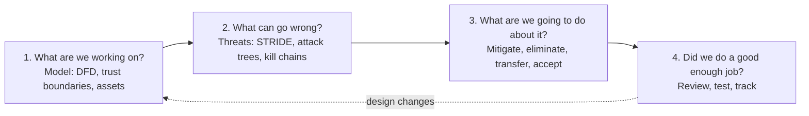
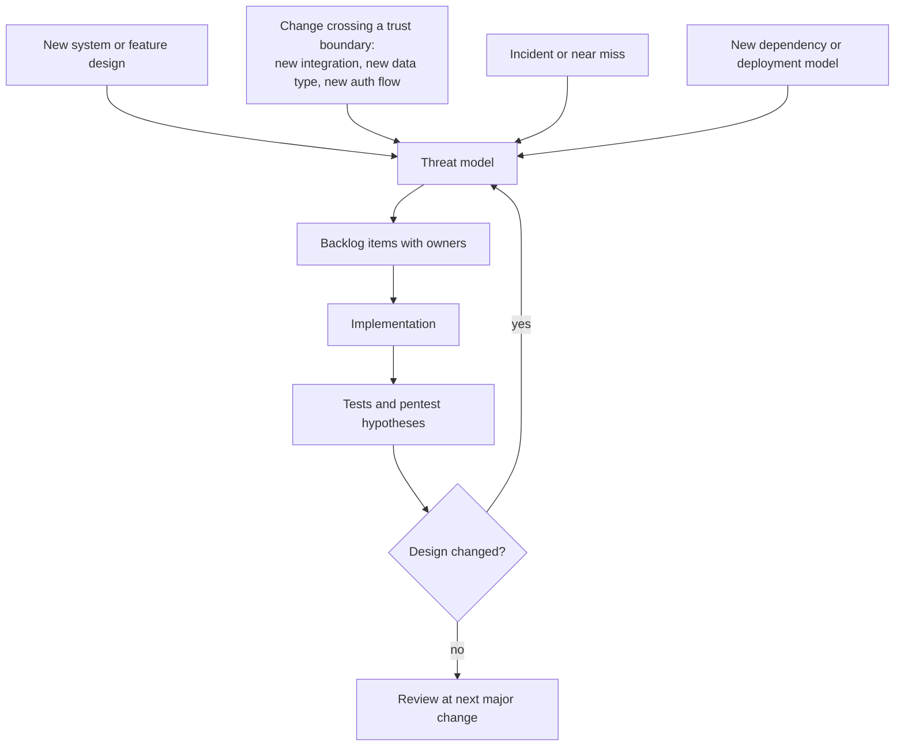
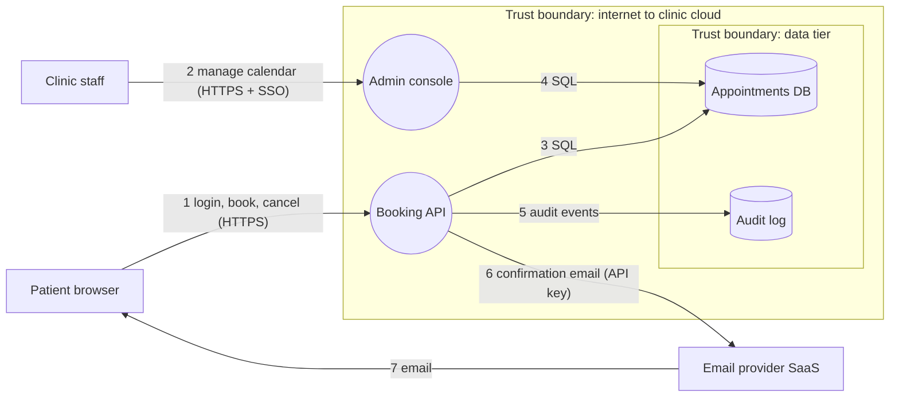

# Threat modeling

## Summary

Threat modeling is the structured analysis of a system's design to find what can go wrong with its security and privacy, before attackers or incidents find it. A team draws a model of the system (usually a data flow diagram with trust boundaries), asks systematically what could go wrong at each element, decides what to do about each finding and checks whether the analysis was good enough. It is cheapest during design, when a changed decision costs a meeting instead of a rewrite, and it finds design and business logic flaws that scanners and code review miss. Methods such as STRIDE, PASTA, Trike and VAST are different ways to run the same four questions.

## Prerequisites

- The [CIA triad](../foundations/cia-triad/README.md): threats are described as violations of security properties.
- Basic idea of risk as likelihood and impact. The risk management notes in [governance and compliance](../governance-and-compliance/README.md) go deeper.
- Being able to read a simple architecture diagram.

## Core concepts

### Definition

The Threat Modeling Manifesto defines it as "analyzing representations of a system to highlight concerns about security and privacy characteristics". The key word is *representations*: threat modeling works on a model of the system (a diagram, a description, a list of use cases), not on the running system. That is why it can happen before code exists, and why it differs from testing.

Terms that are often mixed up, as defined by Loren Kohnfelder and Praerit Garg in the 1999 Microsoft paper that introduced STRIDE:

| Term | Meaning (Kohnfelder and Garg, 1999) | Example |
| --- | --- | --- |
| Threat | Any potential occurrence, malicious or otherwise, that can have an undesirable effect on system resources | Patient records are read by someone who is not their clinician |
| Vulnerability | A characteristic that makes it possible for a threat to occur | The API does not check that the record belongs to the logged-in patient |
| Attack | An action taken by a malicious intruder to exploit vulnerabilities and enact the threat | Changing `patient_id=17` to `18` in the request |

Other terms: an *asset* is something of value to protect (data, availability of a service, reputation). A *trust boundary* is a place where the level of trust changes, for example between the internet and an API, or between an application and a third-party service. A *mitigation* is a control that reduces the likelihood or impact of a threat.

Threat modeling is different from related activities:

| Activity | Question it answers | Works on |
| --- | --- | --- |
| Threat modeling | How could this design fail, and what do we change? | A model of one system |
| Risk assessment | Which risks matter most to the organization, and how much? | Assets, threats and impacts across the organization |
| Threat intelligence | Who is attacking organizations like ours, and how? | Adversaries and campaigns |
| Penetration testing | Can these weaknesses be exploited in the running system? | The implemented system |
| Code review and SAST | Are there bugs in the code? | Source code |

A threat model feeds risk assessment with concrete mechanisms, and gives penetration testers a list of hypotheses to verify.

### The four questions

The Threat Modeling Manifesto organizes every method around four questions, originally popularized by Adam Shostack:

The loop back from question 4 to question 1 is the important part: the model is updated when the design changes, not filed after a single workshop.

### Analogy

Threat modeling is what a building's fire safety review does with the architect's plans. Before construction, the reviewer walks through the drawings room by room and asks: where can a fire start, how does it spread, where are the exits, what happens if the sprinkler pump fails? Changing a staircase on paper is cheap. Changing it after the building is finished is not.

The analogy holds for timing, for working from plans instead of the building, and for systematic room-by-room checking. It breaks because fire is not intelligent: it does not look for the weakest door on purpose, adapt to your sprinklers or read your plans. Attackers do all of that, which is why threat modeling also needs adversarial thinking, not only a checklist.

### The model: data flow diagrams

Most methods start with a *data flow diagram* (DFD). It has four element types and one annotation:

| Element | Meaning | Usual symbol |
| --- | --- | --- |
| External entity | Something outside your control that interacts with the system: users, partner systems | Rectangle |
| Process | Code that runs and transforms data | Circle or rounded box |
| Data store | Where data rests: databases, files, queues, caches | Two parallel lines |
| Data flow | Data moving between elements | Arrow |
| Trust boundary | Where privilege or ownership changes | Dashed line or box |

The Trike v1 document (2005) adds a useful rule: decompose the DFD "until there are no longer any processes which cross trust boundaries". Threats concentrate on flows that cross boundaries.

### Where threats come from

Threats are found by combining a model with a structured prompt:

- **Category lists** such as [STRIDE](methods/stride.md), applied to each DFD element.
- **Attack trees** that refine an attacker goal into sub-goals. See [attack trees](methods/attack-trees.md).
- **Attack libraries** such as MITRE ATT&CK for enterprise behavior, CAPEC for application attack patterns, and the OWASP Top 10.
- **Requirements analysis**, as in [Trike](methods/trike.md): every action that the system should not allow is a threat.
- **Risk and attacker focus**, as in [PASTA](methods/pasta.md).
- **Card games** such as [Security Cards](methods/security-cards.md) or Elevation of Privilege that push teams to think broadly.

### Responses to a threat

Each finding gets one of four responses:

| Response | Meaning | Example |
| --- | --- | --- |
| Mitigate | Add or change a control to reduce likelihood or impact | Add an ownership check on every record access |
| Eliminate | Remove the feature or data that creates the threat | Stop storing full card numbers |
| Transfer | Move the risk to another party, by contract or design | Use a payment provider so card data never touches your servers |
| Accept | Document and live with the risk, with an owner's signature | Accept a low impact denial of service on an internal tool |

Accepting a risk is legitimate when it is explicit, owned and revisited. Silent acceptance, where nobody wrote the threat down, is the failure mode.

### Choosing a method

| Method | Center of gravity | Typical effort | Best for |
| --- | --- | --- | --- |
| [STRIDE](methods/stride.md) | Threat categories per DFD element | Hours per feature | Development teams, design reviews |
| [Attack trees](methods/attack-trees.md) | Attacker goals refined into steps | Hours to days per goal | Deep analysis of one critical asset |
| [PASTA](methods/pasta.md) | Business risk and attack simulation, seven stages | Days to weeks | High value applications, risk-driven organizations |
| [Trike](methods/trike.md) | Requirements matrix of actors, assets and CRUD actions | Days | Audits that need completeness and repeatability |
| [VAST](methods/vast.md) | Scale and automation: application and operational models | Tool-dependent | Large portfolios with many teams |
| [Security Cards](methods/security-cards.md) | Brainstorming across human, motivation, resource, method | One workshop | Exploring unusual threats |
| [hTMM](methods/hybrid-threat-modeling-method.md) | Combination of Security Cards, PnG and SQUARE | Days | Research and requirements work |

The comparison of strengths and weaknesses is in [threat modeling methodologies](methodologies.md). The SEI white paper "Threat Modeling: A Summary of Available Methods" (Shevchenko et al., 2018) compares twelve methods and concludes that none is best for every project.

### When to threat model

The diagram shows triggers, not a calendar. A yearly threat modeling session that is not tied to design changes produces documents that are already out of date.

## Worked example

The same small, fictional system is used across the method notes so that the methods can be compared: a **clinic booking portal**. Patients book appointments in a browser, clinic staff manage the calendar in an admin console, the booking API stores appointments in PostgreSQL and sends confirmations through a third-party email service.

**Question 1, what are we working on?** The DFD with trust boundaries:

Assets: patient identity and contact data, appointment history (health related, so special category data under GDPR Article 9), staff accounts, availability of booking.

**Question 2, what can go wrong?** Walking each element with STRIDE gives, among others:

| ID | Element | Category | Threat |
| --- | --- | --- | --- |
| T1 | Flow 1, Booking API | Elevation of privilege, information disclosure | Patient changes an appointment ID in the request and reads or cancels another patient's booking (broken object level authorization) |
| T2 | Patient browser | Spoofing | Credential stuffing against the patient login |
| T3 | Flow 6, email provider | Information disclosure | API key for the email provider leaks from the repository, attacker sends phishing from the clinic's domain |
| T4 | Audit log | Repudiation | Staff member deletes appointments and the log does not record who did it |
| T5 | Booking API | Denial of service | Bot books every free slot for a week |
| T6 | Admin console | Spoofing, elevation of privilege | Admin console exposed to the internet with password only |

**Question 3, what are we going to do about it?**

| ID | Response | Action | Owner |
| --- | --- | --- | --- |
| T1 | Mitigate | Ownership check in a central authorization layer, test case per endpoint | API team |
| T2 | Mitigate | Rate limiting, breached password check, optional passkeys | Identity team |
| T3 | Mitigate | Key in secret manager, scope key to "send" only, SPF, DKIM and DMARC on the domain | Platform team |
| T4 | Mitigate | Append-only log with staff identity, separate write permission | API team |
| T5 | Mitigate | Limit open bookings per patient, CAPTCHA after threshold | Product and API team |
| T6 | Eliminate exposure | Admin console reachable only through SSO with MFA and the clinic VPN | Platform team |

**Question 4, did we do a good enough job?** Check that every element and every boundary-crossing flow was examined, that every threat has a response and an owner, and that T1 and T5 have automated tests. Ask a colleague who did not attend to read the model and add threats. Schedule an update when the planned SMS reminders feature adds a new third party.

The method notes take this example further: [STRIDE](methods/stride.md) per element, [PASTA](methods/pasta.md) through seven stages with business impact, [Trike](methods/trike.md) with an actor-asset-action matrix and exposure scores, and [VAST](methods/vast.md) with separate application and operational models.

## Trade offs and when to use it

**Benefits.**

- Finds design flaws early, when they are cheap to fix. Microsoft's guidance for its Threat Modeling Tool makes the same argument: issues found early "are relatively easy and cost-effective to resolve" (Microsoft Learn, checked 2026-11).
- Finds business logic abuse (refund loops, booking hoarding, quota gaming) that scanners cannot see.
- Produces shared understanding between developers, architects, operations and security.
- Turns into concrete artifacts: backlog items, test cases, pentest scope, detection requirements.

**Costs.**

- Time from people who know the system. A focused STRIDE session for one feature takes one to two hours. A full PASTA analysis can take weeks.
- Skill. Without someone who knows attack techniques, sessions produce generic threats ("hackers could hack it").
- Maintenance. A model that is not updated becomes misleading.

**When it is the wrong tool or wrongly sized.**

- For a trivial change inside one trust zone (a text change, a new field in an internal form), a full session is overhead. Use a short checklist instead.
- When the design is already fixed and nobody can change it, threat modeling turns into risk documentation. It still has value for detection and response, but say so honestly.
- When the goal is to find implementation bugs, use code review, SAST, DAST and testing. Threat modeling tells you where to look, not whether line 214 has a bug.

## Common mistakes

- **Starting with the method instead of the system.** Teams fill STRIDE tables without a shared diagram. Fix: agree on the DFD and trust boundaries first.
- **Boiling the ocean.** Modeling the whole company at once yields hundreds of vague threats. Fix: scope to one feature or one service, model in layers.
- **Threats without mitigations or owners.** Fix: every threat leaves the session with a response, an owner and a ticket.
- **Only external hackers.** Fix: include insiders, compromised suppliers, mistakes by administrators and abuse by legitimate users.
- **Treating the model as a document for auditors.** Fix: store it with the code, review it in design reviews, update it on change.
- **One hero threat modeler.** The Manifesto lists this as an anti-pattern. Fix: the team that builds the system does the modeling, security coaches.
- **Perfect diagrams.** Another Manifesto anti-pattern. Fix: a whiteboard photo that the team understands beats a perfect diagram nobody updates.

## Practice

1. What are the four questions of threat modeling?
2. In the clinic example, which flows cross a trust boundary?
3. Distinguish threat, vulnerability and attack using the T1 example.
4. A product owner wants to accept T3 (leaked email API key) because "it is unlikely". What should an acceptable risk acceptance contain?
5. Name two triggers that should cause a threat model update.

Answers:

1. What are we working on? What can go wrong? What are we going to do about it? Did we do a good enough job?
2. Flows 1 and 2 (internet to the clinic cloud), 3 and 4 (into the data tier), and 6 and 7 (to and from the third-party email provider).
3. Threat: another patient's booking is read or cancelled. Vulnerability: the API does not check ownership of the appointment ID. Attack: changing the ID in the request.
4. A clear threat description, the rationale, the residual risk, a named owner with authority, an expiry or review date and any compensating controls such as monitoring for unusual sending volume.
5. Any two of: a new feature crossing a trust boundary, a new third party or dependency, a new authentication flow, a new data type such as health data, an incident or near miss.

## Further reading

- [Threat Modeling Manifesto](https://www.threatmodelingmanifesto.org/): definition, four questions, values, principles, patterns and anti-patterns from a group of practitioners including Adam Shostack, Kim Wuyts and Izar Tarandach. Checked 2026-11.
- [Loren Kohnfelder and Praerit Garg, "The threats to our products", Microsoft, April 1, 1999](https://shostack.org/files/microsoft/The-Threats-To-Our-Products.docx): the original STRIDE paper with the threat, vulnerability and attack definitions used above. Checked 2026-11.
- [OWASP Threat Modeling Cheat Sheet](https://cheatsheetseries.owasp.org/cheatsheets/Threat_Modeling_Cheat_Sheet.html): a practical process with DFD guidance.
- [SEI, Threat Modeling: 12 Available Methods (Shevchenko, December 2018)](https://www.sei.cmu.edu/blog/threat-modeling-12-available-methods/): short descriptions of twelve methods. Checked 2026-11.
- [Microsoft Threat Modeling Tool, threats page](https://learn.microsoft.com/en-us/azure/security/develop/threat-modeling-tool-threats): STRIDE definitions as used in Microsoft's SDL tool. Checked 2026-11.
- Adam Shostack, *Threat Modeling: Designing for Security*, Wiley, 2014: the standard book on the four questions and STRIDE per element.
- ISC2 CISSP Exam Outline (April 2024), section 1.10: "Understand and apply threat modeling concepts and methodologies".
