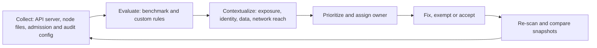

# Kubernetes security posture management (KSPM)

## Summary

Kubernetes security posture management (KSPM) is the continuous, automated checking of how Kubernetes clusters are configured, against a benchmark or policy, with findings that are prioritized by context and tracked over time. It is the Kubernetes counterpart of [cloud security posture management](../cloud-security-posture-management.md): the objects it reads are not cloud resources but pods, roles, namespaces, network policies and node settings. It exists because Kubernetes is permissive by default and almost every security property is a setting someone must make: whether a pod can be privileged, who may read secrets, which pods can talk to which. KSPM answers "is this cluster configured the way we said it should be, and what changed". It does not detect an attack in progress and it does not replace admission control, which prevents a bad object from being created.

## Prerequisites

- [Security posture management](../security-posture-management.md), the umbrella note, and [CSPM](../cloud-security-posture-management.md), because KSPM reuses the same loop of collect, evaluate, prioritize and track.
- [Linux seccomp](../../operating-system-security/linux/seccomp.md), since the seccomp profile of a pod is one of the settings KSPM checks.
- [Defense in depth](../../design-principles/defense-in-depth.md) and the [CIA triad](../../../security-and-risk-management/foundations/cia-triad/README.md).
- Working knowledge of Kubernetes: pods, namespaces, service accounts, Roles and ClusterRoles, the API server and the kubelet.

## Core concepts

### Definition

*KSPM* is a category of tooling and a practice. The tooling reads cluster state, mostly through the Kubernetes API with read access, and sometimes node files and kubelet configuration, then evaluates it against rules. The practice is the loop around it: fix, exempt with a reason, or accept, and watch for regression. NIST SP 800-190 (*Application Container Security Guide*, September 2017) is the reference for container risks in general, covering image, registry, orchestrator, container and host risks. KSPM concentrates on the orchestrator and its configuration.

KSPM differs from three things it is often confused with:

| Thing | What it does | Relation to KSPM |
| --- | --- | --- |
| Admission control (Pod Security Admission, policy engines) | Blocks or warns when an object is created or updated | Preventive. KSPM is detective and covers objects that existed before the rule |
| Image scanning | Finds known vulnerabilities in image contents | Different input. KSPM reads configuration, though platforms join both |
| Runtime detection | Observes behavior of running containers | Different timing. KSPM never sees the exploit, only the exposure |

### Analogy

KSPM is a building inspector, not a guard. The inspector checks that fire doors close, exits are not blocked and the electrical panel is locked, and returns next month to see what changed. The guard (runtime detection) watches people. The building code (admission control) refuses to build a wall without a door. The analogy breaks because a cluster changes many times a day, so a monthly inspection is useless and KSPM must run continuously.

### Why it exists

Kubernetes ships flexibility, not a hardened posture. Examples from the Kubernetes documentation:

- A pod can ask for `privileged: true`, host namespaces or a `hostPath` volume unless something forbids it. The Pod Security Standards define three profiles: Privileged (unrestricted), Baseline (minimally restrictive, prevents known privilege escalations) and Restricted (heavily restricted, following current pod hardening practice).
- RBAC grants are additive and easy to over-grant. The Kubernetes RBAC good practices page warns that `list` and `watch` on Secrets expose their contents, that wildcards also cover future resource types, that members of `system:masters` bypass RBAC and cannot be revoked by removing bindings, and that the verbs `escalate`, `bind` and `impersonate` allow privilege escalation.
- Creating a pod in a namespace implicitly gives access to the secrets, config maps and volumes it can mount, and the right to run as any service account in that namespace.

Each of these is a configuration, so each can be checked automatically. Before KSPM tools, teams ran periodic audits with spreadsheets or one-off scripts, and the results were out of date within days.

### Mechanism



The diagram shows the loop. The sections below follow it.

**Collect.** Three sources:

1. *The Kubernetes API* with a read-only service account: pods and their specs, namespaces and their labels, roles and bindings, network policies, service accounts, services and ingresses. This is the cheapest source and works on any cluster, including managed ones.
2. *Node level data*: kubelet configuration, file permissions of control plane manifests and certificates, container runtime settings. A tool like kube-bench needs host access, because, in its own words, it "will need access to the host's PID namespace in order to check the running processes". On managed Kubernetes the provider operates the control plane, so these files are not reachable.
3. *Cluster configuration state*: whether the API server audit log is on, whether secrets encryption at rest is configured, which admission plugins are enabled. On a managed service this comes from the provider API and not from the cluster (see the CSPM notes).

**Evaluate.** Rules come from several families:

- *Benchmarks.* The CIS Kubernetes Benchmark is the most used. The CIS page I checked (2026-10) lists Kubernetes 2.1.0 and separate benchmarks for Amazon EKS, Google GKE (and Autopilot), Azure AKS, Oracle OKE and Red Hat OpenShift, which exist because the managed control planes cannot be checked the same way. I believe the benchmark is organized into control plane components, etcd, control plane configuration, worker nodes and policies, but the CIS page did not show the section list, so this is unverified.
- *Pod Security Standards.* Baseline and Restricted control lists from the Kubernetes documentation (see below).
- *Government guidance.* The NSA and CISA *Kubernetes Hardening Guidance* (version 1.2, August 2022) is a common rule source. Kubescape lists NSA-CISA, MITRE ATT&CK and CIS among the frameworks it checks. I could not open the guide's PDF (access refused), so I rely on a search summary that names insiders among the threat sources and pod least privilege and network separation among the mitigations.
- *Custom rules* for local policy: allowed registries, required labels, ownership annotations.

**Contextualize.** A flat list of failed checks is not a risk list. A privileged pod in a lab namespace and a privileged pod behind a public load balancer with a cluster-admin service account fail the same rule. Good KSPM joins the facts: is the workload reachable from outside, which identity does it carry and what can that identity do, can the pod escape to the node, does the node have a cloud role. This is the same idea as attack path analysis in [CSPM](../cloud-security-posture-management.md).

**Prioritize and track.** Assign each finding an owner (usually the namespace owner), a due date by severity and an exception record with expiry. Compare snapshots to separate new findings from old ones. The worked example below shows that diff.

### What gets checked

The Kubernetes documentation defines the Pod Security Standards. The Baseline profile (checked 2026-10) restricts, among others: host namespaces (`hostNetwork`, `hostPID`, `hostIPC`), privileged containers, added capabilities beyond a short allow list, `hostPath` volumes, host ports, SELinux options, `procMount`, `Unconfined` seccomp, and unsafe sysctls. The Restricted profile adds: allowed volume types only, `allowPrivilegeEscalation: false`, `runAsNonRoot: true`, a non-zero user, a seccomp profile of `RuntimeDefault` or `Localhost`, and dropping all capabilities (only `NET_BIND_SERVICE` may be added back). The documentation page was fetched in part: the Restricted list above is taken from the upstream standard as reported by the fetch tool, and the part of the page after 100000 characters was not read.

| Area | Typical checks | Why it matters |
| --- | --- | --- |
| Pod security | Privileged, host namespaces, hostPath, capabilities, root user, seccomp | A container is a process on the node. These settings decide how far it is from the node |
| RBAC | Wildcards, `cluster-admin` bindings, secret `list`, `escalate`, `bind`, `impersonate`, `system:masters`, bindings to `system:unauthenticated` | Identity is the main path from one pod to the whole cluster |
| Network | Namespaces with no default-deny NetworkPolicy, public services and ingresses | Kubernetes pod networking is open by default and policies only work if the network plugin enforces them |
| Secrets | Secrets in env vars, encryption at rest, unused service account token mounts (`automountServiceAccountToken`) | Base64 encoding is not encryption |
| Control plane | Anonymous auth, audit logging, API server flags, etcd access | Compromise here is cluster-wide |
| Nodes | Kubelet authentication and authorization, file permissions, runtime version | Node compromise breaks container isolation |
| Supply chain | Images from untrusted registries, mutable tags, no digest pin | The configuration decides what code runs |
| Namespace guardrails | Pod Security Admission labels, resource quotas | Prevention at the namespace level |

The row on network policy rests on the general Kubernetes behavior that pods accept traffic from anywhere until a policy selects them. I did not re-read the networking documentation for this note.

### Tools

| Tool | What it is | Notes (from its repository or documentation, 2026-10) |
| --- | --- | --- |
| kube-bench | Runs the checks of the CIS Kubernetes Benchmark, tests defined in YAML | Apache-2.0 license. Needs host PID namespace access when run in a pod. Selects test sets by Kubernetes version. Not a one-to-one mapping between Kubernetes and benchmark versions |
| Kubescape | Scans clusters, YAML files, Helm charts and images against NSA-CISA, MITRE ATT&CK and CIS | Apache-2.0. A CNCF incubating project created by ARMO. CLI for on-demand scans, operator for continuous monitoring |
| Commercial CNAPP and CSPM platforms | KSPM module inside a larger platform | See [CSPM tools](../cspm-tools.md). The vendor pages I read list Kubernetes among the supported platforms. I did not run any |
| Cloud provider tools | Managed Kubernetes posture in the provider's security service | Names and scope vary, not verified here |

## Worked example

The script `scripts/evaluate-cluster-posture.py` is a small KSPM engine over a synthetic cluster snapshot. The snapshot is a set of Python dictionaries that look like Kubernetes API objects, with two namespaces: `shop` (locked down) and `batch` (not). It evaluates a subset of the Pod Security Standards, RBAC risks and namespace guardrails, adds a context check and diffs two snapshots. Python 3.10, standard library only. It was run, and the output below is real. It is a teaching model, not a replacement for kube-bench or Kubescape, and its rules cover only a part of the standards.

The snapshot has a well configured pod `shop/web-1` (digest-pinned image, no privilege escalation, non-root, all capabilities dropped, `RuntimeDefault` seccomp) and a poorly configured pod `batch/etl-7` (host network, `hostPath`, privileged container, `latest` tag), exposed to the internet and bound to `cluster-admin` through its service account.

```bash
python3 scripts/evaluate-cluster-posture.py
```

Output:

```text
findings (resource, rule, severity):
   ('batch/etl-7', 'PSS-BASELINE-host-namespaces', 'high')
   ('batch/etl-7', 'PSS-BASELINE-hostpath', 'high')
   ('batch/etl-7', 'PSS-BASELINE-privileged', 'critical')
   ('batch/etl-7', 'PSS-RESTRICTED-privilege-escalation', 'medium')
   ('batch/etl-7', 'PSS-RESTRICTED-run-as-non-root', 'medium')
   ('batch/etl-7', 'PSS-RESTRICTED-drop-all-capabilities', 'low')
   ('batch/etl-7', 'PSS-RESTRICTED-seccomp', 'low')
   ('batch/etl-7', 'IMAGE-not-pinned-by-digest', 'low')
   ('rbac', 'RBAC-wildcard-for-workload:sa:batch/etl', 'critical')
   ('namespace', 'NS-no-pod-security-enforce:batch', 'medium')
   ('namespace', 'NS-no-default-deny-networkpolicy:batch', 'medium')
toxic combinations: ['batch/etl-7: exposed + node-escape primitives + cluster-admin identity']
fixed    : [('namespace', 'NS-no-default-deny-networkpolicy:batch')]
new      : [('shop/web-1', 'PSS-BASELINE-privileged')]
```

Reading the result:

1. `batch/etl-7` has eight pod findings, plus one RBAC finding for its service account and two findings for its namespace, while everything in `shop` passes. A per-pod score already separates the two.
2. The three most serious items are the privileged container (critical), the wildcard RBAC grant to a workload identity (critical) and the host path with host network (high). Individually each is a known risk. Together on one exposed workload they form a path from the internet to cluster-admin. The "toxic combination" line is what a flat list cannot say. In a real incident this is the order an attacker follows: reach the pod, escape or use the token, and act as cluster-admin. This is the same shape as the cloud example in the [NIST incident response note](../../../security-operations/defensive-operations/operations/nist-incident-response/README.md).
3. The drift section reports that adding a default-deny policy fixed one finding, and that a later change made `shop/web-1` privileged. The second item is the reason continuous scanning matters: the pod was compliant yesterday. A good workflow alerts on new findings in a previously clean namespace with higher urgency than the old backlog.

Fix for `batch/etl-7` in order of effect: remove the `cluster-admin` binding and give the service account only the verbs it needs, remove `privileged`, `hostNetwork` and `hostPath`, label the namespace with `pod-security.kubernetes.io/enforce` so the next such pod is rejected, and add a default-deny network policy.

## Trade offs and when to use it

**Benefits.** It finds exposure before an attacker does, gives an inventory of how clusters really differ from policy, produces compliance evidence for audits (see [security controls](../../../security-and-risk-management/governance-and-compliance/frameworks/security-controls.md) and [NIST SP 800-53](../../../security-and-risk-management/governance-and-compliance/frameworks/nist-sp-800-53/README.md)) and shows regressions quickly.

**Costs and limits.**

- Read access to the cluster is itself sensitive. A scanner with a broad cluster role can read secrets unless the role is limited to what it needs. Review it as a privileged identity.
- A benchmark is generic. Many CIS checks conflict with legitimate workloads such as CNI plugins, monitoring agents and storage drivers, which need privileges. Expect an exception process.
- Managed Kubernetes hides the control plane, so control plane checks are replaced by provider configuration checks.
- Findings are not exploits. A high count of findings with no context leads to alert fatigue.
- It sees configuration at scan time. Short lived pods and changes between scans can be missed unless the tool watches the API or admission events.
- Version drift. Benchmarks and the Pod Security Standards change between Kubernetes versions, so rules need maintenance.

**Alternatives and companions.** Prevention first: Pod Security Admission (namespace labels `enforce`, `audit`, `warn`) and a policy engine such as Kyverno or OPA Gatekeeper reject bad objects at creation. Infrastructure as code scanning catches the same issues before deployment. Runtime tools catch what configuration cannot. Use KSPM as the detective layer on top of preventive controls, not instead of them.

**When it is the wrong tool.** For a single small cluster with strict admission policy and a stable team, running kube-bench or Kubescape in CI may be enough. A platform is justified when many clusters, several clouds or audit requirements make manual comparison impractical.

## Common mistakes

| Mistake | Effect | Fix |
| --- | --- | --- |
| Treating the CIS score as the goal | Teams fix cheap items and ignore the exposed privileged workload | Prioritize by context, not by count |
| Running the scanner with `cluster-admin` | The scanner becomes the best target in the cluster | Dedicated read-only role, reviewed like any privileged identity |
| Only scanning, never enforcing | The same issue is recreated by the next deployment | Add Pod Security Admission labels or a policy engine |
| Ignoring RBAC | Pod hardening is bypassed by a workload with `cluster-admin` | Review bindings, wildcards and the verbs `escalate`, `bind`, `impersonate` |
| Assuming managed means hardened | The provider secures its part. Workload and RBAC settings are yours | Follow the shared responsibility split of the provider |
| Permanent exceptions | The exception list becomes the real policy | Expiry date and owner on every exception |
| Counting base64 as encryption | Secrets readable by anyone with `get` or `list` | Limit read access, encrypt at rest, use an external secret store |

## Practice

1. Name the three Pod Security Standards profiles and say which two the script in the worked example checks.
2. Why does `list` on Secrets matter for RBAC reviews even when `get` is not granted?
3. A scanner reports 40 findings in `batch` and 3 in `shop`. What extra facts do you collect before deciding the order of work?
4. Why can kube-bench not check an EKS control plane the way it checks a self-managed cluster?
5. Extend the script with a rule that flags a service account bound to a role that can `create` pods in a namespace that is not labeled `enforce`. Why is that combination dangerous?
6. Describe how you would give a KSPM scanner access with the least privilege that still lets it do its job.

**Answers and hints**

1. Privileged, Baseline and Restricted. The script checks parts of Baseline and Restricted.
2. `list` and `watch` return the full objects, including secret data, so `kubectl get secrets -A -o yaml` works with them.
3. Reachability (internet exposure), the identity and its permissions, data and secrets reachable, whether the namespace is production, and ownership.
4. The provider runs the control plane. The files and processes are not on nodes you can access, which is why CIS publishes separate benchmarks for EKS, GKE and AKS.
5. Creating a pod gives access to secrets and config maps mountable in the namespace and the ability to run as any service account there, and without Baseline or Restricted enforcement the pod can be privileged. Kubernetes RBAC good practices describes both effects.
6. A ClusterRole with `get`, `list` and `watch` on the object types the rules need, and no access to the data of Secrets unless a rule needs it. Read-only does not mean harmless.

## Further reading

- Kubernetes documentation, [Pod Security Standards](https://kubernetes.io/docs/concepts/security/pod-security-standards/): the profiles and control lists. Read in part, see the note above.
- Kubernetes documentation, [RBAC good practices](https://kubernetes.io/docs/concepts/security/rbac-good-practices/): privilege escalation risks. Read in part.
- NIST, [SP 800-190, Application Container Security Guide](https://csrc.nist.gov/pubs/sp/800/190/final) (September 2017): container risks and countermeasures. Only the abstract and status were checked.
- NSA and CISA, *Kubernetes Hardening Guidance*, version 1.2, August 2022 ([PDF](https://media.defense.gov/2022/Aug/29/2003066362/1/1/0/CTR_KUBERNETES_HARDENING_GUIDANCE_1.2_20220829.PDF)). Not read: access to the file was refused during this check.
- Center for Internet Security, [Kubernetes benchmarks](https://www.cisecurity.org/benchmark/kubernetes): the benchmark list, including the EKS, GKE, AKS, OKE and OpenShift variants.
- Aqua Security, [kube-bench](https://github.com/aquasecurity/kube-bench) and ARMO, [Kubescape](https://github.com/kubescape/kubescape): open source tools used as examples.
- [CSPM](../cloud-security-posture-management.md), [multicloud CSPM](../multicloud-cspm.md) and [CSPM tools](../cspm-tools.md) in this repository for the cloud side and the commercial platforms.
