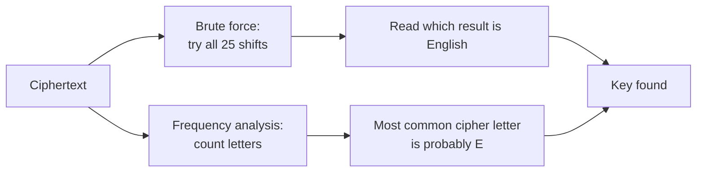
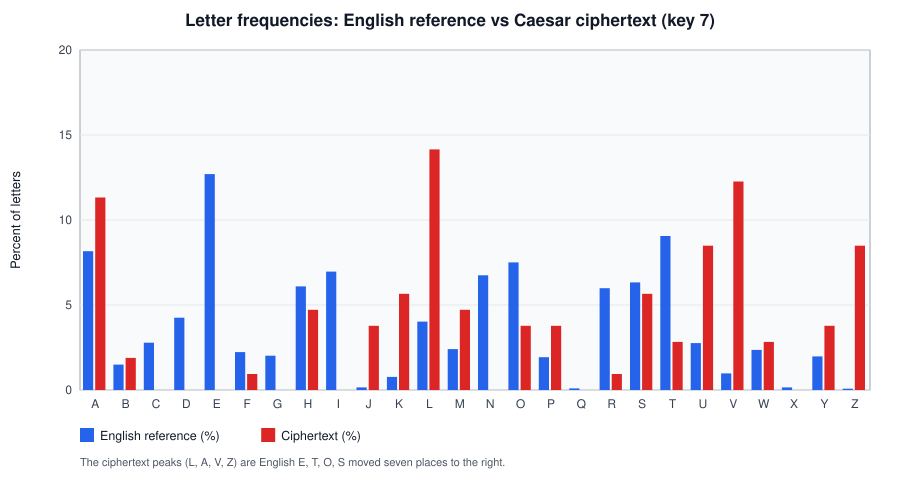
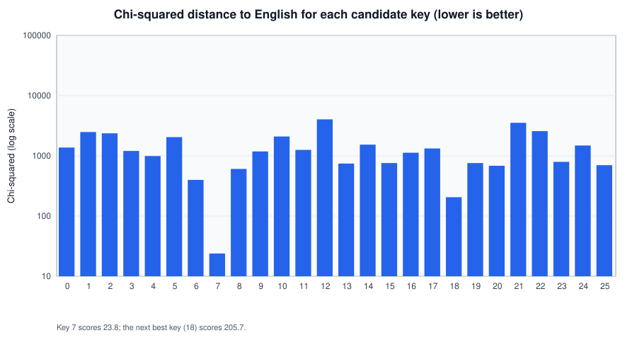

# Caesar cipher

## Summary

The Caesar cipher replaces each letter with the letter a fixed number of positions further along the alphabet, wrapping around from Z to A. With a shift of three, A becomes D and "attack" becomes "dwwdfn". It is named after Julius Caesar, who according to the Roman historian Suetonius used it for private letters. It has only 25 useful keys, so anyone can break it by trying them all, and its letter frequencies betray the key even faster. It has no security value today, but it is the clearest way to learn the vocabulary of cryptography (key, key space, brute force, frequency analysis) and it still appears in CTF challenges, malware string obfuscation and as ROT13.

## Prerequisites

- [Cryptography fundamentals](../../cryptography-fundamentals.md): plaintext, ciphertext, key, key space.
- Modular arithmetic: `(x + k) mod 26` wraps values back to the range 0 to 25.

## Core concepts

### Definition

The Caesar cipher is a *monoalphabetic substitution cipher* with a *shift* key. Number the letters A = 0, B = 1, ..., Z = 25. For a key `k` in 0 to 25:

```text
Encryption:  c = (p + k) mod 26
Decryption:  p = (c - k) mod 26
```

All letters use the same substitution (monoalphabetic), and the substitution is a rotation of the alphabet. A general substitution cipher allows any permutation of the alphabet (26! keys, about 4 x 10^26). The Caesar cipher allows only the 26 rotations, of which `k = 0` is the identity.

Key 3 maps the alphabet like this:

```text
Plain : A B C D E F G H I J K L M N O P Q R S T U V W X Y Z
Cipher: D E F G H I J K L M N O P Q R S T U V W X Y Z A B C
```

*ROT13* is the Caesar cipher with `k = 13`. Because 13 + 13 = 26, encryption and decryption are the same operation, which made it popular on Usenet for hiding spoilers. It hides text from a casual glance, nothing more.

### Source

Suetonius, *The Life of Julius Caesar*, chapter 56 (Loeb Classical Library translation, 1913): Caesar wrote confidential letters "in cipher, that is, by so changing the order of the letters of the alphabet, that not a word could be made out. If anyone wishes to decipher these, and get at their meaning, he must substitute the fourth letter of the alphabet, namely D, for A, and so with the others." Suetonius also wrote that Augustus used a shift of one; I did not re-check that passage for this note.

### Analogy

Picture two concentric paper rings with the alphabet printed on each, like a child's decoder wheel. Turn the inner ring three positions and read across from the outer ring to the inner ring: that is encryption. The number of clicks you turned is the key.

The analogy shows why the key space is tiny: a wheel has only 26 positions, and you can try them all in a minute. It does not show the second weakness, that each plaintext letter always becomes the same ciphertext letter, which is what frequency analysis exploits.

### Why it is weak: two independent attacks



The two paths in the diagram are independent. Either one alone breaks the cipher.

**Brute force.** The key space has 26 keys. A human can try them all with paper, a computer in microseconds. Compare 2^128 keys for AES-128 in [cryptography fundamentals](../../cryptography-fundamentals.md#how-strength-is-measured).

**Frequency analysis.** Natural language has uneven letter frequencies. In English, E is about 12.7 percent of letters, T about 9.1 percent, and Q, X and Z are below 0.2 percent. A monoalphabetic cipher keeps those frequencies and only moves them to other letters. Al-Kindi described this method in the ninth century in his manuscript on deciphering cryptographic messages (from memory, not re-checked).

The *chi-squared statistic* turns frequency analysis into a score: for each candidate key, decrypt, count each letter (observed `O_i`) and compare with the count expected for English text of that length (`E_i`):

```text
chi2 = sum over letters of (O_i - E_i)^2 / E_i
```

The correct key gives the smallest value, because its output looks most like English.

### Security properties in modern terms

| Property | Caesar cipher | Modern requirement |
| --- | --- | --- |
| Key space | 26 (under 5 bits) | At least 2^128 |
| Ciphertext-only attack | Broken by brute force and frequency analysis | Must resist |
| Known plaintext attack | One letter pair reveals the key | Must resist |
| Diffusion | None, each letter is processed alone | Each plaintext bit should affect many ciphertext bits |
| Confusion | Minimal, a simple addition | Complex relation between key and ciphertext |
| Kerckhoffs compliance | Security depends on the method being unknown | Must stay secure when the algorithm is public, see [Kerckhoffs's principle](../../kerckhoffs-principle.md) |

The Caesar cipher is also the simplest member of a family that matters for history: the Vigenere cipher applies a different Caesar shift to each letter according to a keyword, which defeats simple frequency counts and was considered unbreakable until the 19th century.

## Worked example

The script [scripts/caesar.py](scripts/caesar.py) (Python 3.10 or later, standard library only) encrypts, decrypts and breaks the cipher by chi-squared scoring. The core of the attack:

```python
def crack(ciphertext: str) -> list[tuple[int, float, str]]:
    """Try every key. Return (key, chi2, plaintext) sorted best first."""
    results = []
    for k in range(26):
        candidate = shift(ciphertext, -k)
        results.append((k, chi_squared(candidate), candidate))
    return sorted(results, key=lambda r: r[1])
```

Step 1, encrypt and decrypt Caesar's own example with key 3:

```bash
python3 caesar.py enc 3 "attack at dawn"
python3 caesar.py dec 3 "dwwdfn dw gdzq"
```

```text
dwwdfn dw gdzq
attack at dawn
```

Step 2, encrypt a longer sentence with an unknown key (7) and break it without the key:

```bash
CT=$(python3 caesar.py enc 7 "Defense in depth stacks independent controls so that the failure of one control does not lead to a full compromise of the system")
echo "$CT"
python3 caesar.py break "$CT"
```

```text
Klmluzl pu klwao zahjrz puklwluklua jvuayvsz zv aoha aol mhpsbyl vm vul jvuayvs kvlz uva slhk av h mbss jvtwyvtpzl vm aol zfzalt
key= 7 chi2=    23.84 Defense in depth stacks independent controls so that the fai
key=18 chi2=   205.69 Stutcht xc steiw hiprzh xcstetcstci rdcigdah hd iwpi iwt upx
key= 6 chi2=   398.33 Efgfotf jo efqui tubdlt joefqfoefou dpouspmt tp uibu uif gbj
key= 8 chi2=   605.38 Cdedmrd hm cdosg rszbjr hmcdodmcdms bnmsqnkr rn sgzs sgd ezh
key=20 chi2=   684.16 Qrsrafr va qrcgu fgnpxf vaqrcraqrag pbagebyf fb gung gur snv
```

The correct key scores 23.8, almost nine times lower than the next candidate. The frequency chart shows why: the ciphertext's tallest bars sit seven places to the right of the English peaks.





Step 3, the limit of statistics: on very short texts, chi-squared can fail. For the three-word ciphertext `dwwdfn dw gdzq` the script ranks the correct key 3 first with 33.1, but key 18 follows closely with 43.5 (`leelnv le olhy`). With 12 letters, frequencies are noisy. A human reading all 26 candidates still finds the answer at once, which is why brute force with a dictionary check is the more reliable method for short messages.

```text
key= 3 chi2=    33.12 attack at dawn
key=18 chi2=    43.49 leelnv le olhy
key=11 chi2=    47.10 sllsuc sl vsof
```

The English frequency table in the script is the commonly cited one from Robert Lewand's *Cryptological Mathematics* (2000). I took the values from memory of that table and did not re-check them against the book. Small differences between corpora do not change the result.

## Trade offs and when to use it

- **Never for protecting data.** It provides no confidentiality against anyone who tries.
- **Teaching.** It shows key space, brute force, known plaintext and frequency analysis with pencil and paper.
- **CTFs and puzzles.** Recognize it quickly: ciphertext that keeps word lengths, punctuation and letter case, with letter frequencies shaped like English but shifted. Tools such as CyberChef have a ROT13 recipe with a configurable shift.
- **Defensive analysis.** Malware and phishing kits sometimes hide strings (URLs, command names) with shifts or ROT13 to evade simple signature matching. Analysts brute force the 25 shifts the same way as in the example. In Windows, the `UserAssist` registry key stores program names in ROT13, which forensic tools decode routinely (from memory of common DFIR practice, not re-checked).

## Common mistakes

- **Encrypting twice for more security.** A shift of 3 followed by a shift of 5 is a shift of 8. The key space stays 26. Fix: understand that composing rotations gives another rotation, and use a modern cipher.
- **Treating ROT13 or Base64 as encryption in code.** Fix: use AEAD (see [symmetric and asymmetric encryption](../../encryption/symmetric-and-asymmetric-encryption.md)).
- **Relying on frequency analysis for tiny ciphertexts.** Fix: for short text, enumerate all 26 shifts and check against a dictionary.
- **Forgetting non-letters.** Real ciphertexts may shift digits or the whole printable ASCII range (ROT47). Fix: inspect the character set before choosing the alphabet.

## Practice

1. Encrypt `KERCKHOFFS` with key 10.
2. How many keys does a Caesar cipher have, and how many bits is that?
3. You know one plaintext letter `E` encrypted to `R`. What is the key?
4. Why does applying ROT13 twice return the original text?
5. Why does chi-squared scoring work better on 200 letters than on 12?

Answers:

1. `UOBMURYPPC`.
2. 26 keys including the identity, 25 useful ones. `log2(26)` is about 4.7 bits.
3. R is 17, E is 4, so `k = 17 - 4 = 13`. It is ROT13.
4. Because `13 + 13 = 26 = 0 mod 26`.
5. Observed counts approach the expected distribution as the sample grows. With 12 letters, random variation is as large as the signal.

## Further reading

- [Suetonius, The Life of Julius Caesar, chapter 56, Loeb Classical Library 1913, on LacusCurtius](https://penelope.uchicago.edu/Thayer/E/Roman/Texts/Suetonius/12Caesars/Julius*.html): the primary source for Caesar's use of the shift cipher. Checked 2026-11.
- Simon Singh, *The Code Book*, 1999: readable history of substitution ciphers and frequency analysis.
- [CyberChef](https://gchq.github.io/CyberChef/): GCHQ's browser tool, with ROT13 and frequency distribution operations for practice.
- Related notes: [Kerckhoffs's principle](../../kerckhoffs-principle.md), [cryptographic attacks](../../cryptographic-attacks/README.md) (frequency analysis and ciphertext-only attacks), [cryptography fundamentals](../../cryptography-fundamentals.md).
