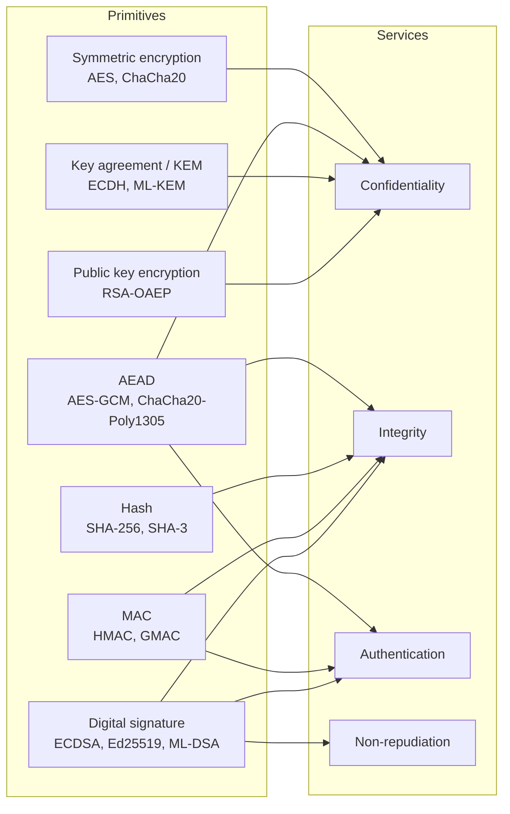

# Cryptography fundamentals

## Summary

Cryptography is the use of mathematics and secret keys to protect information from people who should not read or change it, even when they hold a copy of the data. It provides four services: confidentiality (only key holders can read), integrity (changes are detected), authentication (you know who produced the data) and non-repudiation (the producer cannot credibly deny it). Modern systems combine a small set of primitives (symmetric ciphers, hash functions, message authentication codes, public key encryption, key agreement and signatures) into protocols such as TLS. Almost all real failures come from how the primitives are used and how keys are managed, not from breaking the mathematics.

## Prerequisites

- The [CIA triad](../../security-and-risk-management/foundations/cia-triad/README.md).
- Binary numbers and the XOR operation.
- No previous cryptography knowledge is assumed. The details of each primitive live in their own notes, linked below.

## Core concepts

### Definition and vocabulary

*Cryptography* is the discipline that designs methods to protect data against an adversary. *Cryptanalysis* studies how to break those methods. *Cryptology* covers both.

| Term | Meaning |
| --- | --- |
| Plaintext | The readable input, for example a file or a message |
| Ciphertext | The protected output of encryption |
| Cipher | The algorithm pair for encryption and decryption |
| Key | A secret value that selects one transformation out of the many the cipher can perform |
| Key space | The set of all possible keys. A 128-bit key gives 2^128 keys |
| Nonce or IV | A value that must not repeat for the same key (nonce) or must be unpredictable (IV, depending on the mode) |
| Cryptosystem | Cipher, keys, protocols and the procedures around them |
| Security strength | The work, in bits, that the best known attack needs. AES-128 has 128 bits, RSA-3072 also about 128 bits |

Cryptography is different from *encoding* (Base64, URL encoding), which is reversible by anyone and has no key, and from *hashing*, which is one-way and also has no key (see [hashing algorithms](hashing/hashing-algorithms.md)). It is also different from *steganography*, which hides the existence of a message rather than its content.

### Analogy

A cipher is a lock design that is published in every hardware store catalog, and the key is the small piece of metal in your pocket. Anyone can study the lock, and its quality is judged by how well it resists people who know exactly how it works. Security depends on keeping the key secret and on the lock being installed in a sturdy door.

The analogy holds for [Kerckhoffs's principle](kerckhoffs-principle.md) and for key management. It breaks for public key cryptography: there, the "lock" is something you can hand out freely (a public key) and only the opener stays private, which has no good physical equivalent except perhaps a padlock that anyone can snap shut but only you can open.

### Security services and the primitives that provide them



The diagram shows that no single primitive covers everything. A MAC gives integrity and authentication between two parties who share a key, but not non-repudiation, because either party could have computed it. Only a signature, made with a key that one party alone holds, supports non-repudiation, and even then only if the key was protected (a stolen private key breaks the argument).

| Primitive | Key type | What it protects | Typical use |
| --- | --- | --- | --- |
| Block or stream cipher | One shared secret key | Confidentiality only | Disk encryption (AES-XTS) |
| AEAD | One shared secret key | Confidentiality, integrity and origin between key holders | TLS 1.3 record layer, file encryption |
| Hash function | No key | Integrity against accidents, fingerprints | File checksums, building block for signatures |
| MAC | Shared secret key | Integrity and origin between key holders | API request signing (HMAC-SHA256) |
| Key agreement or KEM | Key pair per party | Establishes a shared secret over a public channel | TLS handshake (X25519, ML-KEM-768) |
| Public key encryption | Recipient's key pair | Confidentiality of small values | Wrapping a symmetric key |
| Digital signature | Signer's key pair | Integrity, origin, non-repudiation | Code signing, certificates |

The split between [symmetric and asymmetric cryptography](encryption/symmetric-and-asymmetric-encryption.md) is the most important structural idea: symmetric algorithms are fast and need a shared secret, asymmetric algorithms solve the key distribution problem but are slow, so real systems use both.

### A short history that explains the design rules

- **Classical ciphers** such as the [Caesar cipher](classical-ciphers/caesar-cipher/README.md) relied on the secrecy of the method and had tiny key spaces. Frequency analysis, described by al-Kindi in the ninth century, broke all simple substitution ciphers.
- **Kerckhoffs (1883)** stated that a military cipher must remain secure when the enemy captures the device. Only the key may be secret. See [Kerckhoffs's principle](kerckhoffs-principle.md).
- **Shannon (1949)** gave cryptography an information theory foundation, defined perfect secrecy (achieved by the one-time pad) and named the two properties a good cipher needs: *confusion* (the relation between key and ciphertext is complex) and *diffusion* (each plaintext bit affects many ciphertext bits).
- **DES (1977)** was the first public standard cipher. Its 56-bit key became too short by the late 1990s, which led to [Triple DES](encryption/triple-des.md) and then AES (FIPS 197, 2001).
- **Public key cryptography (1976 to 1978)**: Diffie and Hellman published key exchange in 1976, Rivest, Shamir and Adleman published RSA in 1977 to 1978.
- **Post-quantum cryptography (2024)**: NIST published FIPS 203 (ML-KEM), FIPS 204 (ML-DSA) and FIPS 205 (SLH-DSA) on August 13, 2024, because a large quantum computer would break RSA and elliptic curve cryptography.

The dates in this list are standard history. I checked the FIPS 203 to 205 date against the NIST announcement. The others are from memory and not re-checked for this note.

### How strength is measured

A cipher is considered broken when an attack is faster than trying every key (brute force). The *security strength* in bits is the base-2 logarithm of the work the best known attack needs. NIST SP 800-57 Part 1 Rev. 5 (Table 4) sets the rule that protection applied after 2030 must have at least 128 bits of strength. Key length and strength are not the same thing: 3TDEA has 168 key bits but 112 bits of strength, and RSA needs a 3072-bit modulus for 128 bits.

To get a feel for 128 bits: a machine that tests 10^12 keys per second would need about 1.7 x 10^26 seconds, around 5.4 x 10^18 years, to try half of a 128-bit key space. The calculation is `2^127 / 10^12 / (3.15 x 10^7 seconds per year)`. The universe is about 1.4 x 10^10 years old.

### Quantum computing

Two quantum algorithms matter. Shor's algorithm breaks RSA, finite field Diffie-Hellman and elliptic curve cryptography completely once a large enough quantum computer exists. Grover's algorithm speeds up brute force search on symmetric keys, but only by a square root in theory, and NIST IR 8547 (final, October 2026) states that approved symmetric primitives with at least 128 bits of classical strength are believed to meet at least Category 1 post-quantum security. The same report says NIST will deprecate quantum-vulnerable public key algorithms (RSA, ECDSA, EdDSA, DH, ECDH) after 2030 and disallow them after 2035, while the most sensitive US federal systems must use post-quantum key establishment by December 31, 2030. The threat today is "harvest now, decrypt later": an adversary records encrypted traffic now and decrypts it when a quantum computer exists, which is why key establishment migrates first.

### Where cryptography fails

| Failure place | Example | Note |
| --- | --- | --- |
| Algorithm | MD5 and SHA-1 collisions, DES key length | Retire on schedule, see SP 800-131A |
| Mode and parameters | AES in ECB mode, nonce reuse in GCM | Use AEAD with unique nonces |
| Implementation | Timing side channels, padding oracles | Use reviewed libraries, never write your own primitives |
| Key management | Keys in source code, no rotation, no revocation | Use a KMS or HSM, see [PKI](public-key-infrastructure.md) |
| Protocol | Downgrade attacks, missing certificate validation | Use current TLS 1.3 with default settings |
| People and process | Shared private keys, lost recovery keys | Procedures and separation of duties |

The [cryptographic attacks](cryptographic-attacks/README.md) note classifies these attacks in detail.

## Worked example

This example shows three primitives on the same data with `openssl` 3.0.2 on Ubuntu 22.04, and shows why encoding is not encryption.

```bash
echo -n "transfer 100 EUR to account 42" > msg.txt

# 1. Encoding: reversible by anyone, no key
base64 msg.txt
# 2. Hash: fixed-size fingerprint, no key, cannot be reversed
openssl dgst -sha256 msg.txt
# 3. MAC: needs the shared key, detects changes by anyone without the key
openssl dgst -sha256 -hmac "<SHARED_KEY>" msg.txt
# 4. Change one character and hash again
echo -n "transfer 900 EUR to account 42" | openssl dgst -sha256
```

Output:

```text
dHJhbnNmZXIgMTAwIEVVUiB0byBhY2NvdW50IDQy
SHA2-256(msg.txt)= 007621d0681e9708e3dfc638a33b29d527ce65b8d1a66224c182b01b139eead4
HMAC-SHA2-256(msg.txt)= fcc966fc42b94b18f15cee2ea131e1461664cdc0b780adf9488f1277477ea218
SHA2-256(stdin)= a5aa2c3d2f495fb180b13408b695a4b64d05e63e8cf93b61b166d73596972118
```

The HMAC line was computed with the literal string `<SHARED_KEY>` as the key, so it is reproducible. Use a random key of at least 32 bytes in practice.

Reading the result: Base64 hides nothing, because `base64 -d` reverses it. The SHA-256 value changes completely when one digit changes (the avalanche effect), but anyone can recompute a hash for the modified message, so a hash alone does not stop an attacker who can change both the message and its hash. The HMAC can only be recomputed by someone with the key, so it detects tampering by outsiders. None of the three provides confidentiality. For that, see the hybrid encryption example in [symmetric and asymmetric encryption](encryption/symmetric-and-asymmetric-encryption.md#worked-example).

## Trade offs and when to use it

- **Use cryptography** when data leaves your direct control: in transit over any network, at rest on devices that can be lost or on storage operated by someone else, and in backups.
- **Prefer high-level, misuse-resistant APIs** (libsodium, Tink, the `cryptography` Python package's `Fernet` or `AESGCM`) over low-level primitives. Every choice you do not have to make is a choice you cannot get wrong.
- **Cryptography moves the problem to the key.** Encrypting a database whose key sits in the same configuration file protects only against disk theft. Ask "who can get the key?" before claiming protection.
- **Costs.** CPU time (small for AES with hardware support, large for RSA private key operations), latency of handshakes, operational cost of key rotation, certificate renewal and HSMs, and the risk of permanent data loss if keys are lost.
- **Limits.** Cryptography does not protect data while it is in use in memory on a compromised host, does not stop an authorized user from leaking data, and does not fix authorization bugs.
- **Regulation and export.** Some sectors require validated modules (FIPS 140-3 in US federal systems). Some countries restrict import or use of strong cryptography. Check local law.

## Common mistakes

- **Calling Base64 or XOR with a fixed key "encryption".** Fix: use a real cipher with a random key, preferably an AEAD.
- **Encryption without integrity.** CBC or CTR alone lets an attacker flip bits in the plaintext or run padding oracle attacks. Fix: AEAD (AES-GCM, ChaCha20-Poly1305) or encrypt-then-MAC.
- **Reusing a nonce with the same key** in GCM or CTR. It reveals the XOR of two plaintexts and, in GCM, allows forgeries. Fix: random 96-bit nonces with a key rotation limit, or a counter, or a nonce-misuse-resistant mode such as AES-GCM-SIV.
- **Rolling your own algorithm or protocol.** Fix: use published, reviewed constructions and standard protocols (TLS 1.3, Noise, age).
- **Hard-coded keys.** Fix: a key management service, environment-specific keys and rotation.
- **Using a fast hash for passwords.** Fix: [Argon2](hashing/argon2.md), scrypt or [bcrypt](hashing/bcrypt.md).
- **Ignoring algorithm agility.** Fix: version every ciphertext format and keep an inventory of algorithms in use, which is also the first step of post-quantum migration.

## Practice

1. Which security service does a digital signature provide that a MAC cannot, and why?
2. Why is Base64 not encryption?
3. A colleague encrypts files with AES-256 in ECB mode. Name two problems.
4. Which public key algorithms does NIST plan to disallow after 2035, and why?
5. 3TDEA has a 168-bit key. What is its security strength according to SP 800-57?

Answers:

1. Non-repudiation. With a MAC, both parties hold the same key, so either could have produced the tag. A signature key is held by one party only.
2. It has no key. Anyone can decode it, so it gives no confidentiality.
3. ECB encrypts equal plaintext blocks to equal ciphertext blocks, so patterns leak. It also provides no integrity. Use AES-GCM.
4. Quantum-vulnerable ones: RSA, ECDSA, EdDSA, finite field and elliptic curve Diffie-Hellman, because Shor's algorithm would break them on a large quantum computer (NIST IR 8547).
5. 112 bits.

## Further reading

- [NIST SP 800-57 Part 1 Rev. 5, Recommendation for Key Management](https://doi.org/10.6028/NIST.SP.800-57pt1r5): security strength tables and key management lifecycle. Tables 2 and 4 used in this note. Checked 2026-11.
- [NIST IR 8547, Transition to Post-Quantum Cryptography Standards, October 2026](https://csrc.nist.gov/pubs/ir/8547/final): deprecation and disallowance dates for quantum-vulnerable algorithms. Checked 2026-11.
- [NIST announcement of FIPS 203, 204 and 205, August 13, 2024](https://csrc.nist.gov/news/2024/postquantum-cryptography-fips-approved): the first post-quantum standards.
- [NIST SP 800-131A Rev. 2](https://doi.org/10.6028/NIST.SP.800-131Ar2): which algorithms and key lengths are acceptable, deprecated or disallowed.
- Claude Shannon, "Communication Theory of Secrecy Systems", Bell System Technical Journal, 1949: the origin of confusion, diffusion and perfect secrecy.
- Related notes: [symmetric and asymmetric encryption](encryption/symmetric-and-asymmetric-encryption.md), [Kerckhoffs's principle](kerckhoffs-principle.md), [PKI](public-key-infrastructure.md), [cryptographic attacks](cryptographic-attacks/README.md).
