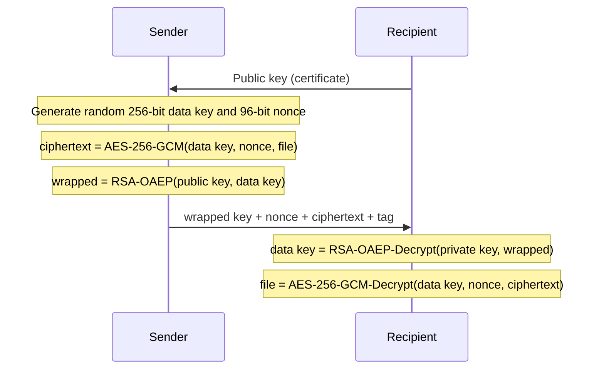
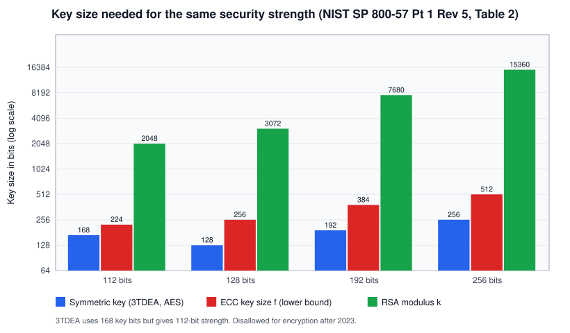
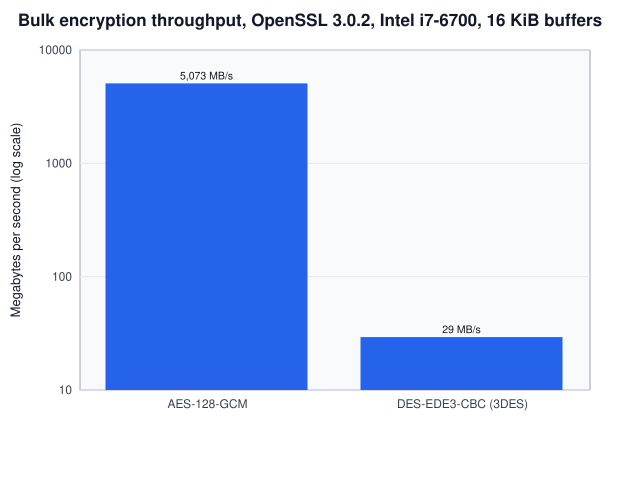

# Symmetric and asymmetric encryption

## Summary

Symmetric encryption uses one secret key for both encryption and decryption. It is fast enough for gigabytes per second, but both sides must already share the key. Asymmetric (public key) cryptography uses a key pair: a public key that anyone may have and a private key that only the owner holds. It solves the problem of agreeing on a key with a stranger over an open network, but it is thousands of times slower and can only process small values. Every practical system, including TLS, SSH, PGP and disk encryption with key escrow, combines the two: asymmetric cryptography establishes or wraps a symmetric key, and the symmetric key protects the data. This is called hybrid encryption.

## Prerequisites

- [Cryptography fundamentals](../cryptography-fundamentals.md): plaintext, ciphertext, keys, security strength, the security services.
- [Hashing algorithms](../hashing/hashing-algorithms.md), used inside OAEP padding and key derivation.
- Modular arithmetic at the level of "remainder after division".

## Core concepts

### Definitions

*Symmetric encryption* is a cipher where the encryption key and the decryption key are the same, or trivially derived from each other. NIST IR 8547 calls these secret-key algorithms. Examples: AES (FIPS 197), ChaCha20, the retired [Triple DES](triple-des.md).

*Asymmetric cryptography* uses a mathematically linked key pair where the private key cannot feasibly be computed from the public key. It covers three different operations, which are often mixed up:

| Operation | Who uses which key | Example algorithms |
| --- | --- | --- |
| Public key encryption | Sender encrypts with recipient's public key, recipient decrypts with private key | RSA-OAEP |
| Key establishment (key agreement or KEM) | Each side combines its private key with the other's public key, or one side encapsulates a secret to the other's public key | ECDH (X25519), finite field DH, ML-KEM (FIPS 203) |
| Digital signature | Signer uses private key, anyone verifies with public key | RSA-PSS, ECDSA, Ed25519, ML-DSA (FIPS 204) |

Signatures are not "encryption with the private key". That description only fits textbook RSA and is wrong for ECDSA, Ed25519 and ML-DSA. Treat signing as its own operation.

### Analogy

Symmetric encryption is a safe with a combination lock. Anyone who knows the combination can lock and unlock it. To send a document, you must first tell the recipient the combination through some other secure channel.

Asymmetric encryption is a mailbox with a slot. Anyone can drop a letter through the slot (the public key), but only the owner with the mailbox key (the private key) can open it and read the letters. You can publish the address of the mailbox on your website.

Hybrid encryption combines them: you put your document in a small combination safe, then drop a note with the combination through the recipient's mailbox slot.

The analogy breaks for key agreement. Diffie-Hellman has no physical counterpart: two people each mix a private ingredient into a public one, exchange the mixtures, and both end up with the same final mixture that an observer cannot reproduce. It also breaks on speed: a mailbox is not slower than a safe, but RSA is thousands of times slower than AES.

### Symmetric encryption: mechanism

Symmetric ciphers come in two forms.

- **Block ciphers** transform a fixed-size block (128 bits for AES, 64 bits for DES and 3DES) under a key. AES is a substitution-permutation network with 10, 12 or 14 rounds for 128, 192 or 256-bit keys (FIPS 197).
- **Stream ciphers** generate a keystream from the key and a nonce and XOR it with the plaintext. ChaCha20 is the common example.

A block cipher on its own encrypts only one block. A *mode of operation* turns it into a cipher for messages of any length:

| Mode | Confidentiality | Integrity | Notes |
| --- | --- | --- | --- |
| ECB | Weak, equal blocks give equal ciphertext | No | Never for data |
| CBC | Yes, needs an unpredictable IV | No | Vulnerable to padding oracle attacks without a MAC |
| CTR | Yes, needs a unique nonce | No | Turns a block cipher into a stream cipher |
| GCM | Yes, unique 96-bit nonce | Yes, 128-bit tag | AEAD, used in TLS 1.3 |
| XTS | Yes, per sector | No | Disk encryption, where ciphertext cannot be larger than plaintext |

*AEAD* (authenticated encryption with associated data) means one operation provides confidentiality and integrity, and can also authenticate unencrypted header data. TLS 1.3 allows only AEAD ciphers (RFC 8446, section 1.2). Use AEAD by default.

### Asymmetric cryptography: mechanism

**RSA** is based on the difficulty of factoring a large number `n = p * q` into its primes. The public key is `(n, e)` and the private key is `d` with `e * d = 1 mod lcm(p-1, q-1)`. Encryption computes `c = m^e mod n` and decryption `m = c^d mod n`. Raw ("textbook") RSA is deterministic and malleable, so it is always used with padding: OAEP for encryption and PSS for signatures (RFC 8017). OAEP limits the message to `k - 2*hLen - 2` bytes, where `k` is the modulus size in bytes. For RSA-3072 with SHA-256 that is `384 - 64 - 2 = 318` bytes, enough for a key but not for a file.

**Diffie-Hellman and ECDH** let two parties derive a shared secret over a public channel. In the elliptic curve version, each party picks a private scalar `a`, publishes `A = a * G` (a point on the curve), and computes `a * B`. Both sides arrive at `a * b * G`. An observer sees `A` and `B` but cannot compute the shared point without solving the elliptic curve discrete logarithm problem. Plain Diffie-Hellman gives no authentication, so it must be combined with signatures or certificates to stop a person in the middle.

**ML-KEM** (FIPS 203, August 2024) is a key encapsulation mechanism based on module lattices. The sender runs `Encaps(publicKey)` and gets a shared secret plus a ciphertext, the recipient runs `Decaps(privateKey, ciphertext)` and gets the same secret. It is designed to resist quantum computers.

### Hybrid encryption



The sequence shows the pattern used by PGP, S/MIME, cloud envelope encryption (where the "public key" role is played by a key in a KMS) and, with key agreement instead of key wrapping, by TLS. In TLS 1.3 the two sides run an ephemeral (EC)DHE or hybrid ML-KEM exchange, derive symmetric keys with HKDF and then encrypt all records with an AEAD.

### Comparison

| Property | Symmetric | Asymmetric |
| --- | --- | --- |
| Keys | One shared secret | Public and private key pair |
| Key distribution | Needs a secure channel or a key agreement first | Public key can be published |
| Number of keys for `n` parties to talk pairwise | `n(n-1)/2` (4,950 for 100 people) | `n` key pairs (100 for 100 people) |
| Speed (measured below) | AES-128-GCM about 5 GB/s on one core | RSA-2048 about 1,700 private key operations per second |
| Data size | Any length | A few hundred bytes per operation |
| Key size for 128-bit strength | 128 bits | RSA 3072 bits, ECC 256 bits |
| Services | Confidentiality, and integrity with AEAD | Key establishment, signatures, non-repudiation |
| Quantum impact | Grover: AES-128 still believed adequate (Category 1) | Shor: RSA and ECC broken, migrate to ML-KEM and ML-DSA |

The key size difference is visible in NIST SP 800-57 Part 1 Rev. 5, Table 2:



RSA key sizes grow much faster than ECC sizes as the target strength rises, which is one reason elliptic curves replaced RSA in most new protocols.

### Performance

Measured with `openssl speed -seconds 2` on OpenSSL 3.0.2, Intel Core i7-6700 at 3.40 GHz, one core, November 2026:

| Operation | Result |
| --- | --- |
| AES-128-GCM, 16 KiB buffers | 5,073,453 kB/s, about 5.07 GB/s |
| DES-EDE3-CBC (3DES), 16 KiB buffers | 29,311 kB/s, about 29 MB/s |
| RSA-2048 sign (private key operation) | 1,701 per second, 0.588 ms each |
| RSA-2048 verify (public key operation) | 57,419 per second |
| ECDSA P-256 sign | 40,313 per second |
| ECDSA P-256 verify | 14,168 per second |



AES is fast because the CPU has AES-NI instructions. An RSA private key operation on a 256-byte value takes about 0.6 ms, which is roughly the time AES-GCM needs to encrypt 3 MB. This gap is the reason for hybrid encryption.

## Worked example

Hybrid encryption with Python 3.10 and the `cryptography` package 3.4.8. The recipient has an RSA-3072 key pair (128-bit strength). The sender encrypts a 33,000-byte message with a fresh AES-256-GCM key and wraps that key with RSA-OAEP. The script also shows a tampered ciphertext and an X25519 key agreement.

```python
# Python 3.10, cryptography 3.4.8
import os
from cryptography.hazmat.primitives.asymmetric import rsa, padding, x25519
from cryptography.hazmat.primitives import hashes
from cryptography.hazmat.primitives.ciphers.aead import AESGCM
from cryptography.hazmat.primitives.kdf.hkdf import HKDF

message = b"Quarterly payroll export, 2026-11" * 1000          # 33,000 bytes

priv = rsa.generate_private_key(public_exponent=65537, key_size=3072)
pub = priv.public_key()

# Fresh key and nonce for this message only: never reuse a nonce with the same key
dek = AESGCM.generate_key(bit_length=256)
nonce = os.urandom(12)
ciphertext = AESGCM(dek).encrypt(nonce, message, b"header-v1")
oaep = padding.OAEP(mgf=padding.MGF1(hashes.SHA256()), algorithm=hashes.SHA256(), label=None)
wrapped = pub.encrypt(dek, oaep)
print("plaintext bytes :", len(message))
print("ciphertext bytes:", len(ciphertext), "(plaintext + 16-byte GCM tag)")
print("wrapped key     :", len(wrapped), "bytes (one 3072-bit RSA block)")

dek2 = priv.decrypt(wrapped, oaep)
assert AESGCM(dek2).decrypt(nonce, ciphertext, b"header-v1") == message
print("round trip ok")

bad = bytearray(ciphertext); bad[0] ^= 1          # flip one bit
try:
    AESGCM(dek2).decrypt(nonce, bytes(bad), b"header-v1")
except Exception as e:
    print("tampered ->", type(e).__name__)

# RFC 8017: OAEP message length limit is k - 2*hLen - 2 bytes
print("max RSA-OAEP plaintext:", 3072 // 8 - 2 * 32 - 2, "bytes")

# Key agreement instead of key wrapping
a, b = x25519.X25519PrivateKey.generate(), x25519.X25519PrivateKey.generate()
k1 = HKDF(hashes.SHA256(), 32, None, b"demo v1").derive(a.exchange(b.public_key()))
k2 = HKDF(hashes.SHA256(), 32, None, b"demo v1").derive(b.exchange(a.public_key()))
print("X25519 shared key equal:", k1 == k2)
```

Output:

```text
plaintext bytes : 33000
ciphertext bytes: 33016 (plaintext + 16-byte GCM tag)
wrapped key     : 384 bytes (one 3072-bit RSA block)
round trip ok
tampered -> InvalidTag
max RSA-OAEP plaintext: 318 bytes
X25519 shared key equal: True
```

What to notice:

- The ciphertext is exactly 16 bytes longer than the plaintext: the GCM authentication tag.
- The wrapped key is 384 bytes regardless of the data size, because it is one RSA block.
- A single flipped bit makes decryption fail with `InvalidTag` instead of returning corrupted data. That is the integrity part of AEAD.
- RSA-OAEP could not encrypt the 33,000-byte message directly. The limit is 318 bytes.
- The X25519 exchange produced the same key on both sides without sending it. In a real protocol both public keys must be authenticated, for example with certificates, or a person in the middle can run two separate exchanges.

## Trade offs and when to use it

| Situation | Use | Reason |
| --- | --- | --- |
| Encrypting files, disks, database fields | Symmetric AEAD (AES-256-GCM, ChaCha20-Poly1305), key in a KMS | Speed, no size limit |
| Two parties who never met, over the internet | Key agreement (ECDHE, ML-KEM hybrid) plus certificates, then AEAD | Solves key distribution |
| Many senders, one recipient (backups to an offline key, encrypted email) | Hybrid: public key wraps per-message keys | Senders never hold a decryption key |
| Proving who produced data | Signatures | Only the private key holder can sign |
| Embedded devices with weak CPUs | Symmetric with pre-shared keys, or ECC instead of RSA | RSA private key operations are slow and keys are large |
| Data that must stay secret for 10 or more years | Post-quantum or hybrid key establishment now | Harvest now, decrypt later |

Costs to keep in mind: symmetric keys must be distributed and rotated, and a leaked shared key compromises every party that holds it. Asymmetric systems need certificate management, revocation and trust anchors ([PKI](../public-key-infrastructure.md)), and larger keys. Post-quantum algorithms have much larger public keys and ciphertexts (ML-KEM-768 public keys are 1,184 bytes, from FIPS 203; I did not re-check the exact figure for this note).

## Common mistakes

- **Encrypting data directly with RSA.** It fails for anything larger than a few hundred bytes and is slow. Fix: hybrid encryption.
- **Textbook RSA or PKCS#1 v1.5 encryption padding.** PKCS#1 v1.5 encryption is vulnerable to Bleichenbacher padding oracle attacks. Fix: RSA-OAEP, or better, use a KEM.
- **Unauthenticated Diffie-Hellman.** Fix: authenticate the exchange with certificates or pre-shared public keys.
- **Static key agreement keys.** Reusing the same ECDH key for all sessions loses forward secrecy: one stolen key decrypts all past traffic. Fix: ephemeral keys (the "E" in ECDHE).
- **Reusing a GCM nonce.** Fix: random nonces and a limit on messages per key, or a counter. NIST SP 800-38D limits random 96-bit nonces to 2^32 invocations per key.
- **Thinking AES-256 is required for quantum resistance.** NIST IR 8547 states that symmetric primitives with at least 128-bit classical strength are believed to meet Category 1. Choose AES-256 for other reasons (policy, long data lifetime margin), not because AES-128 is broken.
- **Confusing signing with encryption.** Fix: use dedicated signature APIs, and separate key pairs for signing and for encryption or key agreement.

## Practice

1. How many keys are needed for 50 people to communicate pairwise with symmetric keys only? With key pairs?
2. Why can RSA-3072 with OAEP-SHA256 not encrypt a 1 KB file directly?
3. What does the "E" in ECDHE give you, and what attack does it limit?
4. Why does TLS 1.3 use AEAD ciphers only?
5. Which operation in the measured table is the slowest, and how does hybrid encryption avoid it for bulk data?

Answers:

1. `50 * 49 / 2 = 1,225` shared keys. With public key cryptography, 50 key pairs.
2. The OAEP limit is `384 - 2*32 - 2 = 318` bytes.
3. Ephemeral keys give forward secrecy: stealing a server's long-term key later does not decrypt recorded past sessions.
4. Because encryption without integrity has led to many practical attacks (padding oracles, bit flipping). AEAD provides both properties in one operation.
5. The RSA-2048 private key operation (about 0.6 ms). Hybrid encryption uses it once per message to unwrap a key, and AES for the data.

## Further reading

- [FIPS 197 (updated 2023), Advanced Encryption Standard](https://doi.org/10.6028/NIST.FIPS.197-upd1): the AES specification with rounds and key sizes.
- [RFC 8017, PKCS #1: RSA Cryptography Specifications Version 2.2](https://www.rfc-editor.org/rfc/rfc8017): RSA-OAEP and RSA-PSS, including the message length limit used above.
- [RFC 8446, TLS 1.3](https://www.rfc-editor.org/rfc/rfc8446): section 1.2 on removing legacy ciphers, the key schedule shows hybrid encryption in practice.
- [NIST SP 800-57 Part 1 Rev. 5](https://doi.org/10.6028/NIST.SP.800-57pt1r5): Table 2 of comparable strengths, used in the chart. Checked 2026-11.
- [NIST IR 8547, October 2026](https://csrc.nist.gov/pubs/ir/8547/final): symmetric algorithms and quantum security categories, transition dates for public key algorithms. Checked 2026-11.
- [FIPS 203, ML-KEM](https://csrc.nist.gov/pubs/fips/203/final): the post-quantum key encapsulation standard.
- Related notes: [Triple DES](triple-des.md), [public key infrastructure](../public-key-infrastructure.md), [cryptographic attacks](../cryptographic-attacks/README.md).
