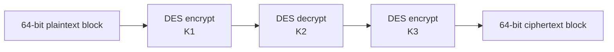
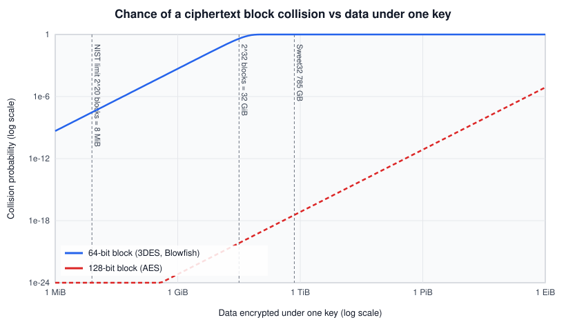
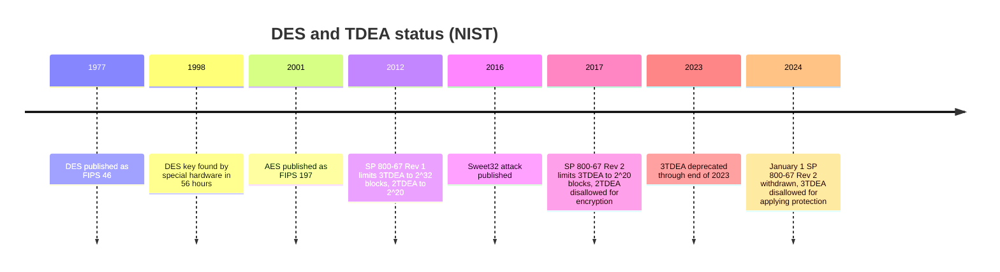

# Triple DES (3DES)

## Summary

Triple DES, officially the Triple Data Encryption Algorithm (TDEA), applies the old DES block cipher three times with up to three different keys to stretch DES's 56-bit key into something that resisted brute force. It was the standard way to keep DES hardware and software useful from the late 1990s until AES replaced it, and it is still found in payment systems, legacy VPNs and old TLS configurations. It is now retired: NIST disallowed 3DES for encrypting new data after December 31, 2023 and withdrew its specification, SP 800-67 Rev. 2, on January 1, 2024. The main reasons are its 64-bit block size, which makes collisions likely after a few tens of gigabytes (the Sweet32 attack), its effective 112-bit strength and its low speed.

## Prerequisites

- [Symmetric and asymmetric encryption](symmetric-and-asymmetric-encryption.md): block ciphers and modes of operation.
- [Cryptography fundamentals](../cryptography-fundamentals.md): security strength.
- The birthday paradox at an intuitive level: in a group of 23 people, two share a birthday with about 50 percent probability.

## Core concepts

### Definition

TDEA is a block cipher with a 64-bit block that uses a *key bundle* of three DES keys `K1, K2, K3`. NIST SP 800-67 Rev. 2 (November 2017) defines the forward (encryption) operation on a 64-bit block `d` as

```text
O = E_K3( D_K2( E_K1(d) ) )
```

and the inverse (decryption) as `O = D_K1( E_K2( D_K3(d) ) )`, where `E` is the DES forward transformation and `D` the DES inverse transformation. The pattern is called *EDE* (encrypt, decrypt, encrypt).

Each DES key is 64 bits, of which 56 are key bits and eight are parity bits that "have no effect on the operation of the algorithm" (SP 800-67 Rev. 2). A full three-key bundle therefore holds 168 key bits.

### Keying options

| Option | Keys | Key bits | Security strength (SP 800-57 Pt 1 Rev 5, Table 2) | Status |
| --- | --- | --- | --- | --- |
| 3TDEA (keying option 1) | `K1, K2, K3` all different | 168 | 112 bits | Disallowed for encryption after 2023, decryption of old data still allowed |
| 2TDEA (keying option 2) | `K1 = K3`, `K2` different | 112 | 80 bits or less | Disallowed for encryption since 2017 (SP 800-67 Rev. 2) |
| Option 3 | `K1 = K2 = K3` | 56 | Same as single DES | Not allowed. SP 800-67 Rev. 2: "A key bundle shall not consist of three identical keys" |

### Analogy

Imagine a lock whose key is too short: a burglar can try every key in an afternoon. Instead of designing a new lock, you install three of the same model in a row, each with a different key. A burglar now needs to find three keys. The improvement is real, but the door is still the same old door: the mail slot (the 64-bit block) is still narrow, and turning three locks is slow.

The analogy breaks on the math of the improvement. Three locks do not give three times the key length, because a meet-in-the-middle attack lets an attacker work from both ends, so 168 key bits give about 112 bits of strength.

### Why it exists and why EDE

DES (FIPS 46, 1977) has a 56-bit key. By the late 1990s that was within reach of special hardware: the Electronic Frontier Foundation's "Deep Crack" machine found a DES key in 56 hours in 1998. Replacing DES everywhere would take years, so the industry needed a stopgap that reused existing DES chips.

Why not just encrypt twice? *Double DES* (`E_K2(E_K1(m))`) gives only about 57 bits of strength against a meet-in-the-middle attack: the attacker encrypts a known plaintext under all 2^56 values of `K1`, stores the results, decrypts the ciphertext under all 2^56 values of `K2`, and looks for a match in the middle. That costs about 2^57 operations and a lot of memory. Triple encryption pushes the meet-in-the-middle cost to about 2^112, which is where the 112-bit strength of 3TDEA comes from.

Why EDE and not EEE? If `K1 = K2 = K3`, the first encryption and the decryption cancel out, and EDE becomes plain single DES with key `K1`. That made 3DES hardware backward compatible with DES systems: set all three keys equal and talk to an old peer. The worked example below shows this on real output. (The DES history dates here are from memory, not re-checked for this note.)

### Structure



Each DES stage is itself a 16-round Feistel network with 48-bit round subkeys derived from the 56-bit key, so 3DES performs 48 Feistel rounds per block. That explains much of its slowness compared with AES, which has 10 to 14 rounds on a 128-bit block and dedicated CPU instructions.

### The 64-bit block problem and Sweet32

In CBC mode, if two ciphertext blocks are equal, `C_i = C_j`, then `P_i XOR P_j = C_(i-1) XOR C_(j-1)`, and the attacker learns the XOR of two plaintext blocks. If one of them is known (for example, a predictable HTTP header) the other is revealed. With a `b`-bit block, collisions become likely after about `2^(b/2)` blocks (the birthday bound). For a 64-bit block that is 2^32 blocks, or 32 GiB.

In 2016 Karthikeyan Bhargavan and Gaetan Leurent (INRIA) turned this into a practical attack called **Sweet32** (CVE-2016-2183 for TLS, CVE-2016-6329 for OpenVPN). According to their site, the attacker uses JavaScript in the victim's browser to send many requests over one long-lived HTTPS connection that uses 3DES, then waits for collisions. They recovered a secret HTTP cookie from 610 GB of traffic captured in 30.5 hours, and an OpenVPN authentication token in 18.6 hours and 705 GB. The full attack needs about 2^36.6 blocks (785 GB).

The chart shows the probability of at least one ciphertext block collision under one key, computed as `1 - exp(-n^2 / 2^(b+1))` for `n` blocks of `b` bits:



| Data under one key | 64-bit block | 128-bit block (AES) |
| --- | --- | --- |
| 8 MiB (2^20 blocks, the NIST limit for 3TDEA) | 3.0 x 10^-8 | 4.0 x 10^-28 |
| 32 GiB (2^32 blocks) | 0.39 | 6.8 x 10^-21 |
| 785 GB (Sweet32 full attack) | about 1 | 3.5 x 10^-18 |

This is why SP 800-67 Rev. 2 (2017) cut the limit for one 3TDEA key bundle to 2^20 blocks (8 MiB), down from 2^32 blocks in the 2012 revision.

### Weak keys

DES has keys that make the cipher degenerate, and SP 800-67 Rev. 2 lists them. Four *weak keys* (for example `0101010101010101` and `FEFEFEFEFEFEFEFE`) make encryption equal to decryption. Six pairs of *semi-weak keys* encrypt plaintext to identical ciphertext. 48 *possibly weak keys* produce only four distinct subkeys instead of 16. Random key generation from an approved random bit generator makes hitting one of them negligible, but key generation code should still reject them.

### Timeline of status



The 2012, 2017, 2023 and 2024 entries are from NIST SP 800-67 Rev. 2 and the NIST withdrawal announcement (checked 2026-11). The 1977, 1998 and 2001 entries are from memory.

## Worked example

This example checks two facts with real output: the EDE structure is backward compatible with single DES when all keys are equal, and 3DES is still available in current libraries, which is why it lingers.

```python
# Python 3.10, cryptography 3.4.8 (OpenSSL 3.0.2 backend)
from cryptography.hazmat.primitives.ciphers import Cipher, algorithms, modes

def ecb_encrypt(key: bytes, block: bytes) -> bytes:
    enc = Cipher(algorithms.TripleDES(key), modes.ECB()).encryptor()
    return enc.update(block) + enc.finalize()

k1 = bytes.fromhex("0123456789ABCDEF")
k2 = bytes.fromhex("23456789ABCDEF01")
k3 = bytes.fromhex("456789ABCDEF0123")
pt = b"The qufc"          # one 64-bit block

print("3TDEA  :", ecb_encrypt(k1 + k2 + k3, pt).hex())
print("K1=K2=K3:", ecb_encrypt(k1 * 3, pt).hex())
```

```bash
# Single DES with K1 only. In OpenSSL 3, single DES lives in the legacy provider.
printf 'The qufc' | openssl enc -des-ecb -K 0123456789ABCDEF -nopad \
    -provider legacy -provider default | xxd -p
```

Output:

```text
3TDEA  : a826fd8ce53b855f
K1=K2=K3: a28e91724c4bba31
a28e91724c4bba31
```

The second and third lines match: with three equal keys, 3DES is single DES. The first line uses three different keys. The same keys and plaintext appear as a TDEA test vector in several library test suites; I did not trace its original publication, so treat the first line as "what OpenSSL 3.0.2 computes", not as an official NIST vector. ECB is used here only to show single-block behavior. Never use ECB for data.

The block cipher is still in the default library, but TLS cipher suites with 3DES are not. On the same Ubuntu 22.04 system:

```bash
openssl ciphers -v 'DES-CBC3'
```

Output:

```text
Error in cipher list
...:error:0A0000B9:SSL routines:SSL_CTX_set_cipher_list:no cipher match:../ssl/ssl_lib.c:2745:
```

OpenSSL has kept 3DES suites out of the default build since version 1.1.0 (they need the `enable-weak-ssl-ciphers` build option; this is from the OpenSSL changelog as I remember it, not re-checked). A server built on another TLS library can still offer them. To check a server you are authorized to test (not run for this note):

```bash
# nmap 7.80 or later
nmap --script ssl-enum-ciphers -p 443 <HOST>
# Look for TLS_RSA_WITH_3DES_EDE_CBC_SHA and the note "64-bit block cipher 3DES vulnerable to SWEET32 attack".
```

## Trade offs and when to use it

There is no case for choosing 3DES in a new design. The choices are about legacy systems.

| Situation | Decision |
| --- | --- |
| New system | AES-GCM or ChaCha20-Poly1305 |
| TLS server offering 3DES suites | Remove them. TLS 1.3 has no 3DES suites at all |
| Decrypting data that was encrypted with 3DES years ago | Allowed by NIST for legacy processing, then re-encrypt with AES |
| Payment hardware that only supports TDEA (some HSMs, older card systems) | Plan replacement. Limit data per key, rotate keys often, isolate the system. Check current payment industry rules, which I did not verify for this note |
| Hardware with no AES support at all | Rare today. Treat as a risk to accept explicitly, with compensating controls |

Measured cost: on an Intel i7-6700 with OpenSSL 3.0.2, 3DES-CBC encrypted about 29 MB/s, AES-128-GCM about 5,073 MB/s, roughly 170 times faster. The chart is in [symmetric and asymmetric encryption](symmetric-and-asymmetric-encryption.md#performance).

## Common mistakes

- **Treating 168 key bits as 168-bit security.** Meet-in-the-middle reduces it to 112 bits. Fix: use the SP 800-57 security strength, not the key length.
- **Using 2TDEA keys** (`K1 = K3`) because older payment specifications allowed them. Fix: they give at most 80 bits of strength. Migrate.
- **Long-lived 3DES sessions.** A VPN tunnel or HTTPS keep-alive connection that encrypts tens of gigabytes under one key is exactly the Sweet32 setting. Fix: disable 3DES, or as an emergency measure, rekey well below 2^20 blocks.
- **Assuming 3DES is gone because TLS 1.3 removed it.** TLS 1.2 servers, SSH, Kerberos, SNMPv3 and payment protocols may still negotiate it. Fix: scan and inventory.
- **Ignoring the decryption allowance.** NIST still allows decryption of old data, so archived data does not need a panic migration, but new encryption must stop.

## Practice

1. What is the effective security strength of 3TDEA and why is it not 168 bits?
2. What happens when all three keys of a TDEA bundle are equal, and why was that useful?
3. How much data can one 3TDEA key bundle protect under SP 800-67 Rev. 2, and why so little?
4. Why does Double DES not give 112 bits of security?
5. A TLS 1.2 server offers `TLS_RSA_WITH_3DES_EDE_CBC_SHA`. Name two separate problems with this suite.

Answers:

1. 112 bits, because a meet-in-the-middle attack splits the work between the first stage and the last two.
2. EDE collapses to single DES with `K1`. It let 3DES equipment interoperate with old DES equipment.
3. 2^20 64-bit blocks, which is 8 MiB. The 64-bit block makes birthday collisions likely around 2^32 blocks, and NIST keeps a large margin.
4. A meet-in-the-middle attack needs about 2^57 operations: 2^56 encryptions plus 2^56 decryptions, matched in a table.
5. The 64-bit block (Sweet32) and RSA key transport, which gives no forward secrecy. CBC with MAC-then-encrypt also has a history of padding oracle attacks.

## Further reading

- [NIST SP 800-67 Rev. 2, Recommendation for the Triple Data Encryption Algorithm (TDEA) Block Cipher, November 2017 (withdrawn January 1, 2024)](https://doi.org/10.6028/NIST.SP.800-67r2): the EDE definition, keying options, weak keys and the 2^20 block limit. Checked 2026-11.
- [NIST announcement on the withdrawal of SP 800-67 Rev. 2](https://csrc.nist.gov/news/2023/nist-to-withdraw-sp-800-67-rev-2): dates and what remains allowed. Checked 2026-11.
- [NIST SP 800-131A Rev. 2, Transitioning the Use of Cryptographic Algorithms and Key Lengths](https://doi.org/10.6028/NIST.SP.800-131Ar2): deprecated and disallowed status.
- [Sweet32: Birthday attacks on 64-bit block ciphers in TLS and OpenVPN](https://sweet32.info/): Bhargavan and Leurent, ACM CCS 2016, with the measured attack costs. Checked 2026-11.
- [NVD CVE-2016-2183](https://nvd.nist.gov/vuln/detail/CVE-2016-2183): the TLS entry for Sweet32.
- Related notes: [symmetric and asymmetric encryption](symmetric-and-asymmetric-encryption.md), [cryptographic attacks](../cryptographic-attacks/README.md).
