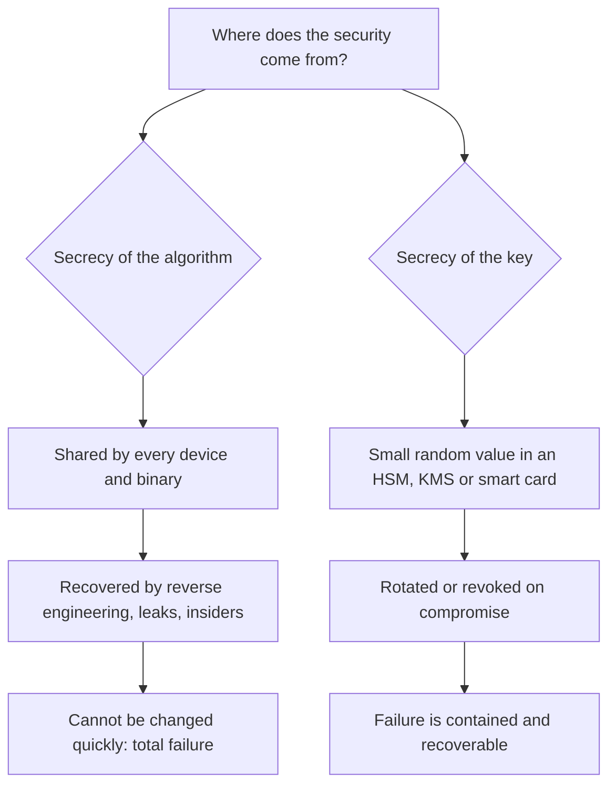

# Kerckhoffs's principle

## Summary

Kerckhoffs's principle says that a cryptographic system must stay secure even if everything about it except the key is known to the enemy. Auguste Kerckhoffs wrote it in 1883 for military ciphers, because cipher devices and codebooks are always eventually captured. Today it is the reason that strong algorithms such as AES, RSA and ML-KEM are public standards, studied for years by thousands of researchers, while only keys are kept secret. The practical lesson: design so that losing the source code, the binary or the documentation does not break security, and so that a compromised secret can be replaced quickly.

## Prerequisites

- [Cryptography fundamentals](cryptography-fundamentals.md): cipher, key, key space.
- No mathematics is needed for this note.

## Core concepts

### Definition and original wording

Auguste Kerckhoffs, a Dutch-born linguist and professor in France, published "La cryptographie militaire" in the *Journal des sciences militaires*, vol. IX, in two parts: January 1883 (pages 5 to 38) and February 1883 (pages 161 to 191). He listed six requirements for a field cipher. The second is the one now called Kerckhoffs's principle. In the original French:

> 2° Il faut qu'il n'exige pas le secret, et qu'il puisse sans inconvénient tomber entre les mains de l'ennemi ;

In English: the system must not require secrecy, and it must be able to fall into the hands of the enemy without inconvenience. A few pages later he makes clear what "the system" means: "j'entends par secret, non la clef proprement dite, mais ce qui constitue la partie matérielle du système : tableaux, dictionnaires ou appareils mécaniques". The secrecy he rejects is the secrecy of tables, dictionaries and machines, not of the key.

All six requirements, translated from the original (my translation, checked against the scan of the 1883 article hosted by Fabien Petitcolas):

| No. | Requirement | Still relevant today |
| --- | --- | --- |
| 1 | The system must be practically, if not mathematically, undecipherable | Yes: computational security, not perfect secrecy |
| 2 | It must not require secrecy and must be able to fall into enemy hands without harm | Yes: the core principle |
| 3 | The key must be communicable and memorable without written notes, and changeable at will by the correspondents | Partly: key change remains essential, memorability does not (keys are random and stored in hardware) |
| 4 | It must be applicable to telegraph correspondence | Generalized: it must fit the transport medium |
| 5 | It must be portable and usable by one person | Partly: usability for a single operator |
| 6 | It must be easy to use, requiring neither mental strain nor knowledge of a long series of rules | Yes: usability failures cause misuse |

Claude Shannon restated the second requirement in 1949 as "the enemy knows the system", often called *Shannon's maxim*. The wording is from memory and was not re-checked against the 1949 paper.

### Analogy

A bank vault door is made by a commercial manufacturer, and the model's blueprint can be bought or stolen. The vault is still safe because its security comes from the combination, which can be changed the day an employee leaves. A vault whose only protection is a hidden mechanism would be worthless the day a former technician talks, and the bank could not "change" the mechanism without replacing the door.

The analogy holds for the key versus design split and for the cost of replacing each. It breaks in one way: with a physical vault, knowing the design still leaves you facing steel. With a cipher, knowing the design of a weak algorithm can lead directly to the plaintext, as the worked example shows.

### Why it is true: replaceability and review

Two arguments support the principle.

**Secrets of different sizes and lifetimes.** An algorithm is implemented in every device, firmware image, client binary and document. It is shared with many people and cannot be changed quickly. A key is small, can be generated randomly, stored in one secure place and rotated in minutes. Security should depend on the part that is easy to protect and easy to replace.

**Public review finds flaws before attackers do.** A public algorithm can be analyzed by anyone. AES was chosen in an open NIST competition from 1997 to 2000, and the post-quantum standards in another open competition from 2016 to 2024 in which several candidates were broken by public cryptanalysis before standardization. A secret algorithm is reviewed only by its designers, who usually lack the incentive to find its weaknesses. (The competition dates are from memory.)



The diagram contrasts the two dependencies: losing an algorithm secret ends in total failure, losing a key ends in a recoverable incident.

### Historical cases where secret designs failed

These cases are widely documented. I list them from memory as illustrations and did not re-check the dates for this note.

| System | What was secret | What happened |
| --- | --- | --- |
| Enigma (1930s to 1940s) | Machine wiring | Polish and British cryptanalysts reconstructed the wiring, captured machines and codebooks helped |
| DVD Content Scrambling System (1996) | Algorithm and keys in players | Reverse engineered in 1999, broken with the DeCSS program |
| GSM A5/1 and A5/2 (1990s) | Stream cipher designs | Reverse engineered in 1999, practical attacks followed |
| MIFARE Classic Crypto-1 (1990s) | Proprietary cipher in transit and access cards | Chip reverse engineered in 2007 to 2008, keys recoverable in seconds |

In every case the secret could not be kept, and once it leaked the whole deployed base was broken at once and could not be fixed by changing a key.

### Scope beyond cryptography

The principle generalizes to *open design*, one of the eight design principles in Saltzer and Schroeder's 1975 paper "The Protection of Information in Computer Systems": the design should not be secret, and protection should rest on keys or passwords. MITRE CWE-656, "Reliance on Security Through Obscurity", is the corresponding weakness. Obscurity is not useless as an extra layer (a non-standard SSH port reduces log noise from mass scanning), but it must never be the layer that carries the security. See [defense in depth](../design-principles/defense-in-depth.md).

## Worked example

A vendor "encrypts" session tokens with a proprietary scheme: XOR with a 4-byte key that is repeated, then Base64. The vendor believes it is safe because nobody knows the algorithm. An attacker who extracts the algorithm from the client binary needs only four bytes of known plaintext to recover the key, then decrypts and forges tokens.

```python
# Python 3.10, standard library only.
import base64, itertools

def vendor_encrypt(data: bytes, key: bytes) -> str:
    x = bytes(b ^ k for b, k in zip(data, itertools.cycle(key)))
    return base64.b64encode(x).decode()

SECRET_KEY = bytes.fromhex("5a17c3e9")              # hidden in the vendor binary
token = vendor_encrypt(b'{"user":"alice","role":"viewer"}', SECRET_KEY)
print("token seen by attacker:", token)

# Attacker knows the algorithm and that tokens are JSON starting with '{"us'.
raw = base64.b64decode(token)
key = bytes(c ^ p for c, p in zip(raw[:4], b'{"us'))
print("recovered key:", key.hex())
plain = bytes(b ^ k for b, k in zip(raw, itertools.cycle(key)))
print("decrypted    :", plain.decode())
forged = vendor_encrypt(b'{"user":"alice","role":"admin"} ', key)
print("forged token :", forged)
```

Output:

```text
token seen by attacker: ITW2mj9l4dN4dq+AOXLhxXhlrIU/NfnLLH6mnj9l4ZQ=
recovered key: 5a17c3e9
decrypted    : {"user":"alice","role":"viewer"}
forged token : ITW2mj9l4dN4dq+AOXLhxXhlrIU/NfnLO3OugDQ1vsk=
```

Two failures happened. The algorithm was weak, which public review would have caught at once. Worse, the key was in the binary, so it was the same for every customer. Changing it requires shipping a new client to everyone.

The Kerckhoffs-compliant design uses a public construction and a server-side secret: either sign the token with HMAC-SHA256 or Ed25519 (integrity), or encrypt it with an AEAD such as AES-256-GCM (confidentiality and integrity), with the key held only on the server in a KMS. An attacker who knows every line of the code still cannot forge a token, and if the key leaks, the operator rotates it and all old tokens become invalid. The [symmetric and asymmetric encryption](encryption/symmetric-and-asymmetric-encryption.md#worked-example) note shows AES-GCM rejecting a single flipped bit.

## Trade offs and when to use it

- **Always for cryptography.** Use public, standardized algorithms and well reviewed libraries. There is no situation where a secret homegrown cipher is the better choice for a normal organization.
- **Secret algorithms do exist** in some national security systems. Those organizations have large in-house cryptanalysis teams and assume the algorithm may leak, so the design must still survive disclosure. Secrecy there adds cost for the attacker, it does not replace strength.
- **Obscurity as a layer.** Hiding version banners, using non-default paths or ports, and keeping detection rules private raise attacker cost a little and reduce noise. Accept them only as extra layers, never as the reason a system is secure.
- **Detection logic is a gray zone.** Defenders often keep exact detection rules private so attackers cannot tune around them. This does not violate the principle, because the security of the detection does not rest only on its secrecy, but expect rules to leak and design for it.
- **Cost of compliance.** Following the principle moves effort to key management: generation, storage in HSMs or KMS, rotation, revocation and backup.

## Common mistakes

- **Thinking open source is insecure because attackers can read it.** Fix: security must hold with the source known. Openness also lets defenders review it.
- **Hard-coding keys in binaries, mobile apps or firmware.** The key becomes part of "the system" and falls with it. Fix: per-device or per-user keys provisioned at enrollment, server-side secrets.
- **Custom "encryption" in APIs and license checks** (XOR, Base64, byte shuffling). Fix: standard AEAD, HMAC or signatures.
- **Treating Kerckhoffs as "publish everything".** The principle says security must not depend on secrecy of the design. It does not require publishing internal architecture or detection rules.
- **Forgetting requirement 3, key change.** A system that is Kerckhoffs-compliant in theory but whose keys cannot be rotated without downtime is fragile. Fix: test rotation as part of normal operations.

## Practice

1. In Kerckhoffs's 1883 text, what exactly must not need to be secret?
2. Why is a hard-coded key in a mobile app a violation of the principle even when the algorithm is AES-GCM?
3. Is moving SSH to port 2222 a violation of Kerckhoffs's principle?
4. Name the weakness identifier in MITRE CWE for reliance on obscurity.
5. In the worked example, how many bytes of known plaintext did the attacker need, and why that many?

Answers:

1. The material part of the system: the tables, dictionaries or mechanical devices used to apply it. The key itself stays secret.
2. The key is distributed with every copy of the app, so it is part of the system that will fall into the enemy's hands. Anyone who extracts it can decrypt or forge.
3. No, as long as SSH security still depends on strong keys or passwords and MFA. The port change is only an extra layer that reduces noise.
4. CWE-656.
5. Four bytes, because the key was four bytes long and repeated. Each known plaintext byte reveals one key byte.

## Further reading

- [Auguste Kerckhoffs, "La cryptographie militaire", Journal des sciences militaires, vol. IX, 1883 (scan hosted by Fabien Petitcolas)](https://www.petitcolas.net/kerckhoffs/index.html): the original six requirements in French, with an English summary. Checked 2026-11.
- Claude Shannon, "Communication Theory of Secrecy Systems", Bell System Technical Journal, 1949: the "enemy knows the system" assumption in information theoretic form.
- Jerome Saltzer and Michael Schroeder, "The Protection of Information in Computer Systems", Proceedings of the IEEE, 1975: open design among the eight design principles.
- [MITRE CWE-656: Reliance on Security Through Obscurity](https://cwe.mitre.org/data/definitions/656.html): the weakness entry with examples.
- Related notes: [cryptography fundamentals](cryptography-fundamentals.md), [Caesar cipher](classical-ciphers/caesar-cipher/README.md), [cryptographic attacks](cryptographic-attacks/README.md).
