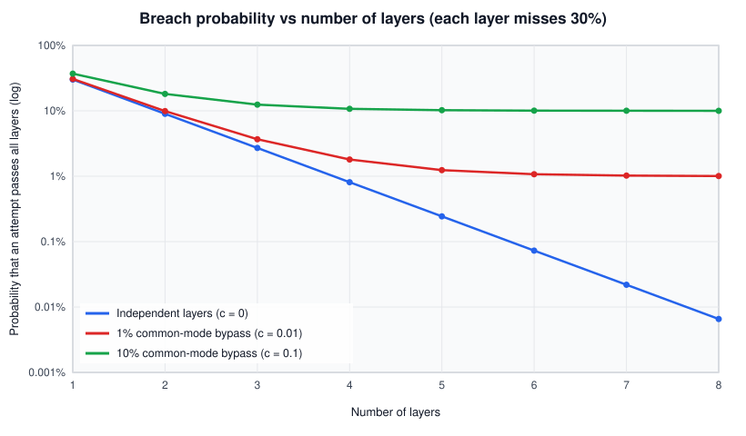
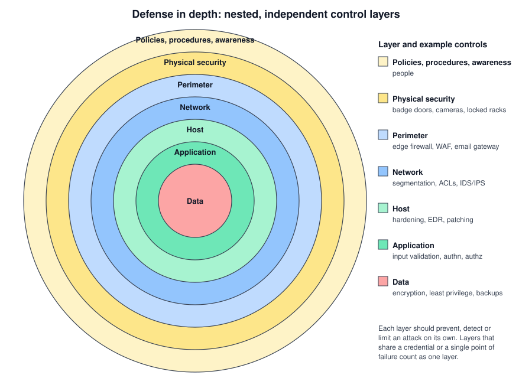
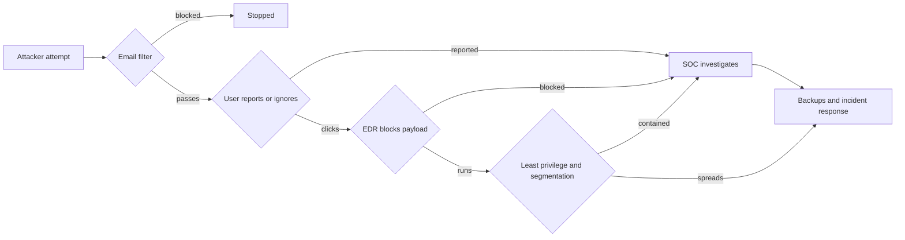

# Defense in depth

## Summary

Defense in depth is the design principle of placing several independent controls between a threat and an asset, so that the failure or bypass of one control does not lead to a full compromise. It assumes every control will fail sometimes and plans for that: the layers prevent, detect and limit an attack at different points and with different mechanisms. Layers only multiply protection when they fail for different reasons. Five controls that all depend on one administrator password are one control.

## Prerequisites

- The [CIA triad](../../security-and-risk-management/foundations/cia-triad/README.md): the layers protect confidentiality, integrity and availability.
- Basic knowledge of networks, hosts and web applications.
- Helpful: [network segmentation](../../communication-and-network-security/network-security/architecture/network-segmentation.md) and [firewalls](../../communication-and-network-security/network-security/traffic-filtering/firewalls.md), which provide several of the layers discussed here.

## Core concepts

### Definition

NIST defines defense in depth as an "information security strategy integrating people, technology, and operations capabilities to establish variable barriers across multiple layers and missions of the organization" (NIST SP 800-53 Rev. 5 glossary, taken from CNSSI 4009). The definition used in industrial control systems (ISA/IEC 62443-1-1, quoted in NISTIR 8183) is more operational: multiple countermeasures applied in a layered or stepwise manner, with heterogeneous technologies placed on the common attack vectors, so that attacks missed by one technology are caught by another.

Three ideas carry the principle:

1. **Multiple layers.** More than one control stands between the attacker and the asset.
2. **Independence.** The layers fail for different reasons. They use different mechanisms, different credentials, different vendors or different people.
3. **Different functions.** Some layers prevent, some detect, some limit the damage or support recovery. A stack of five preventive filters with no detection still fails silently.

It differs from related terms in this way:

| Term | What it means | Difference from defense in depth |
| --- | --- | --- |
| Layered security | Several products in a row, often all technical | Often used as a synonym, but says nothing about independence or people and process |
| Defense in breadth | Coverage of all entry points (email, web, USB, supply chain) | Breadth asks "is every door covered", depth asks "how many locks are on each door" |
| [Zero trust](../../communication-and-network-security/network-security/architecture/nist-zero-trust-architecture.md) | No implicit trust from network location, every request is authenticated and authorized | A modern way to build some of the inner layers, not a replacement for the principle |
| Diversity of defense | Using different vendors or algorithms at different layers | One technique to achieve independence |

### Analogy

A medieval castle has a moat, an outer wall, a gatehouse with guards, an inner wall and a keep. Each obstacle can be overcome, but every one costs the attacker time and makes noise that the guards can hear. The analogy maps well: the moat and walls are prevention, the watchtower is detection, the keep is the protected asset, and the time the attacker spends on each layer is the time defenders have to respond.

The analogy breaks in two places. A castle's layers are concentric and the attacker must cross them in order, while a network has many paths, and a phishing email goes past the "outer walls" straight into the keep. Castle layers are also physically independent, while IT layers often share hidden dependencies such as a single directory service, a single administrator account or a single management network.

### Why it exists

Every control has a failure rate. Antivirus misses new malware, people click on phishing links, patches arrive weeks after a vulnerability becomes public, and firewall rules drift. A design that relies on one control turns that control's failure rate into the system's failure rate. The principle has military roots (defense in depth was a military doctrine of trading space for time) and entered information security through US government guidance such as the NSA information assurance work of the early 2000s, which framed it around people, technology and operations. That framing survives in the NIST definition above. I did not re-read the original NSA document for this note.

### Mechanism: why independent layers multiply protection

Suppose an attack attempt passes a layer with probability `q`. If `n` layers are independent, the probability that the attempt passes all of them is `q^n`. With `q = 0.3` (a layer stops 70 percent of attempts), one layer lets 30 percent through, three layers let 2.7 percent through and five let 0.24 percent through.

Real layers are not fully independent. Model the dependence with a *common-mode failure*: with probability `c` the attacker has a technique that defeats every layer at once (a stolen domain administrator account, a flaw in a shared component, an insider). Then the pass probability is `c + (1 - c) * q^n`, and it can never fall below `c`, no matter how many layers are added.

The chart shows the result. With independent layers the curve keeps falling. With a 1 percent common-mode bypass it flattens at about 1 percent after four layers, and with 10 percent it flattens almost immediately.



The values were computed with the formula above (Python 3.10):

| Layers | Independent (`c = 0`) | `c = 0.01` | `c = 0.1` |
| --- | --- | --- | --- |
| 1 | 30.0% | 30.7% | 37.0% |
| 2 | 9.0% | 9.9% | 18.1% |
| 3 | 2.7% | 3.7% | 12.4% |
| 5 | 0.24% | 1.24% | 10.2% |
| 8 | 0.007% | 1.01% | 10.0% |

The practical lesson: after two or three layers, removing shared dependencies is worth more than adding another layer. This is a simplified model. Real attackers adapt, so `q` is not a fixed number, and layers that detect rather than block change the outcome by shortening dwell time rather than stopping the attempt.

### The layers

There is no single canonical list. A common technical stack, from the outside in, looks like this:



| Layer | Prevent | Detect | Limit and recover |
| --- | --- | --- | --- |
| Policies and people | Acceptable use rules, awareness training | Reporting channel for suspicious email | Incident response plan |
| Physical | Badge doors, locked racks | Cameras, visitor logs | Separate data centers |
| Perimeter | Edge firewall, email filtering, WAF | Gateway logs | Rate limiting, DDoS scrubbing |
| Network | Segmentation, ACLs, microsegmentation | IDS, flow monitoring | Isolation of a segment |
| Host | Hardening, patching, application allow-listing | EDR, file integrity monitoring | Reimaging from golden images |
| Application | Input validation, authentication, authorization | Application logs, anomaly alerts | Feature flags, session revocation |
| Data | Encryption, least privilege on tables | Database activity monitoring | Backups, versioning |

The CISA (then DHS ICS-CERT) recommended practice for industrial control systems, September 2016, organizes the same idea around nine elements of an organization's security program: risk management program, cybersecurity architecture, physical security, ICS network architecture, ICS network perimeter security, host security, security monitoring, vendor management and the human element. Their list shows that defense in depth is a program property, not only a stack of network devices.

### Control functions across the timeline

Layers can also be read along time. A useful view is: deter, prevent, detect, respond and recover. Each phase needs at least one control, otherwise an attacker who passes prevention is never noticed, and a noticed attacker cannot be removed.



The diagram follows one phishing attempt: prevention fails twice, detection and containment still catch it, and recovery remains as the last layer.

## Worked example

A company runs a customer portal: a web application, an API and a PostgreSQL database in one cloud account. We trace one realistic attack, a SQL injection (CWE-89) in a search parameter, through two designs.

**Design A, single layer.** A web application firewall (WAF) is the only control. The application connects to the database as the `postgres` superuser, and the database accepts connections from the whole VPC.

1. The attacker encodes the payload so that the WAF signature does not match. This is common: WAF bypasses are a standard testing step.
2. The injection runs with superuser rights. On PostgreSQL the attacker can read every table and, as superuser, run `COPY ... TO PROGRAM`, which executes shell commands on the database host.
3. Nothing alerts, because nothing else looks at the traffic.

Outcome: full data theft and a foothold on the database host.

**Design B, defense in depth.** Same application, same bug.

| Layer | Control | What it does against this attack |
| --- | --- | --- |
| Perimeter | WAF | Stops the first naive attempts, generates alerts |
| Application | Parameterized queries in most code, but one legacy query is concatenated | The bug still exists in the legacy query |
| Database account | Application role `portal_app` has `SELECT, INSERT` on two tables only | The injection reads two tables, cannot reach `users_credentials`, cannot call `COPY ... TO PROGRAM` (superuser only) |
| Network | Database reachable only from the API subnet on port 5432 | No direct access to the database from other hosts |
| Data | Card numbers stored tokenized, passwords hashed with [Argon2](../cryptography/hashing/argon2.md) | Even read data has limited value |
| Detection | Database activity monitoring alerts on `pg_sleep` and `UNION SELECT` patterns | The SOC sees the attack within minutes |
| Response | Runbook to rotate the application credentials and block the source | Dwell time is short |

The least privilege layer on the database can be checked directly. This was run on PostgreSQL 16.15 in the `postgres:16-alpine` container, with three empty tables `products`, `orders` and `users_credentials`:

```sql
-- Run as an administrator. The application role owns nothing and can only
-- read and insert on the two tables it needs.
CREATE ROLE portal_app LOGIN PASSWORD '<APP_DB_PASSWORD>';
REVOKE ALL ON ALL TABLES IN SCHEMA public FROM portal_app;
GRANT SELECT, INSERT ON public.products, public.orders TO portal_app;

-- Act as the application, as an injected query would.
SET ROLE portal_app;
SELECT * FROM users_credentials;
COPY (SELECT 1) TO PROGRAM 'id';
SELECT count(*) FROM products;
```

Output:

```text
ERROR:  permission denied for table users_credentials
ERROR:  permission denied to COPY to or from an external program
DETAIL:  Only roles with privileges of the "pg_execute_server_program" role may COPY to or from an external program.
 count
-------
     0
(1 row)
```

The injected query can still read the tables the application legitimately uses, which is why the data layer (tokenization, hashing) matters as well.

The bug was not fixed by design B. The damage was limited and the attack was detected. That is the goal of defense in depth.

## Trade offs and when to use it

**Benefits.**

- Tolerance to failure of any single control, including human error and zero-day vulnerabilities.
- Time for detection and response. An attacker who has to cross several layers makes more noise.
- Graceful degradation instead of all-or-nothing security.

**Costs.**

- Money and operational load. Every layer needs licenses, tuning, patching and people who read its alerts.
- Complexity. More components mean more configuration errors, more integration points and sometimes a larger attack surface: security products run with high privileges and have their own vulnerabilities.
- Latency and friction. Inline inspection adds delay, and extra authentication steps annoy users who then look for workarounds.
- Alert overload. Several detection layers that report the same event without correlation flood the SOC.

**When it is the wrong tool or used wrongly.**

- As a substitute for fixing root causes. A WAF in front of an application with known injection bugs is a temporary measure, not a design.
- When layers are added for compliance without a threat model. Each layer should map to a threat it stops, detects or contains. See [threat modeling](../../security-and-risk-management/threat-modeling/threat-modeling.md).
- For small, low value systems the cost of many layers can exceed the risk. A static marketing page does not need database activity monitoring.

**Alternatives and complements.** Zero trust architecture moves trust decisions to every request instead of the network edge, which strengthens the inner layers. Secure by design and memory-safe languages remove whole classes of bugs, which reduces how often the outer layers are tested. Resilience engineering accepts compromise and focuses on recovery time.

## Common mistakes

- **Counting products instead of independent failure modes.** Fix: for each layer, write down what makes it fail and check that two layers do not share that cause (same credential, same vendor engine, same management plane).
- **Only preventive controls.** A stack of filters with no detection lets a successful attacker stay for months. Fix: make sure each critical path has at least one detection layer and an owner who reads its alerts.
- **Hard shell, soft center.** A strong perimeter with a flat internal network means the first compromised laptop reaches everything. Fix: segmentation and least privilege inside the network.
- **Shared administrative plane.** Firewalls, EDR, backups and the hypervisor all managed by one domain administrator group. Ransomware operators target exactly this and delete backups first. Fix: separate administrative identities, offline or immutable backups, multi-factor authentication on management interfaces.
- **Ignoring people and process.** Technical layers fail when a help desk resets a password for a caller who only knows a name. Fix: identity verification procedures and awareness training are layers too.
- **Never testing the layers.** A layer that was never tested may already be off. Fix: purple team exercises and control validation that check whether each layer actually blocks or detects what it should.

## Practice

1. Why does adding a fifth layer barely reduce risk when all layers share a common-mode failure?
2. An organization has an edge firewall, a WAF, an IDS and EDR, all managed through one SSO account without MFA. How many independent layers does it have against an attacker who phishes that account?
3. Classify each control as prevent, detect or limit: immutable backups, EDR alerting, input validation, network segmentation, SIEM correlation rule.
4. Explain the difference between defense in depth and defense in breadth with an example.
5. Using the formula `c + (1 - c) * q^n`, compute the pass probability for `q = 0.5`, `n = 4`, `c = 0.02`.

Answers:

1. The pass probability can never fall below `c`, the chance of a bypass that defeats all layers at once. Once `q^n` is much smaller than `c`, the term `c` dominates.
2. Effectively one against that attacker, because the stolen account can reconfigure or disable all four.
3. Immutable backups: limit and recover. EDR alerting: detect. Input validation: prevent. Network segmentation: prevent and limit. SIEM correlation rule: detect.
4. Depth stacks several controls on one path (WAF, input validation, database least privilege on the web path). Breadth covers every path (email, web, USB, vendors). An organization can have deep web defenses and still no control for removable media.
5. `0.02 + 0.98 * 0.0625 = 0.02 + 0.06125 = 0.08125`, about 8.1 percent.

## Further reading

- [NIST CSRC glossary: defense-in-depth](https://csrc.nist.gov/glossary/term/defense_in_depth): the NIST definitions from SP 800-53 Rev. 5, SP 800-39 and NISTIR 8183, with sources. Checked 2026-11.
- [CISA (DHS ICS-CERT), Recommended Practice: Improving Industrial Control System Cybersecurity with Defense-in-Depth Strategies, September 2016](https://www.cisa.gov/sites/default/files/2023-01/NCCIC_ICS-CERT_Defense_in_Depth_2016_S508C.pdf): the nine program elements and attack scenarios for control systems. Checked 2026-11.
- [NIST SP 800-53 Rev. 5](https://csrc.nist.gov/pubs/sp/800/53/r5/upd1/final): the control catalog from which most layers can be built, for example AC-6 least privilege and SC-7 boundary protection.
- [OWASP SQL Injection Prevention Cheat Sheet](https://cheatsheetseries.owasp.org/cheatsheets/SQL_Injection_Prevention_Cheat_Sheet.html): the primary and additional defenses used in the worked example, including least privilege as a secondary defense.
- Related notes: [zero trust architecture](../../communication-and-network-security/network-security/architecture/nist-zero-trust-architecture.md), [microsegmentation](../../communication-and-network-security/network-security/architecture/microsegmentation.md), [intrusion detection systems](../../security-operations/defensive-operations/detection/ids/README.md), [web application firewalls](../../communication-and-network-security/network-security/traffic-filtering/web-application-firewalls.md).
