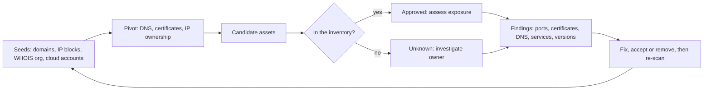

# Cloud attack surface management (CASM)

## Summary

Cloud attack surface management continuously discovers everything an organization exposes to the internet from its cloud accounts, domains and SaaS services, as an outsider would see it, and flags what should not be there: forgotten test environments, storage with public access, management ports open to the world, DNS records pointing at resources nobody owns, certificates that leak internal names. The cloud makes this necessary because anyone with the right permission can create an internet-facing resource in minutes, so the inventory in the configuration database drifts out of date daily. CASM starts from a few known seeds (domains, IP blocks, cloud accounts), follows the connections it can observe and treats every unexpected result as a finding. It is the outside-in counterpart to the inside-out view of [CSPM](../../../security-architecture-and-engineering/cloud-and-infrastructure-security/cloud-security-posture-management.md) and an input to [vulnerability remediation](../../vulnerability-management/vulnerability-remediation/README.md).

## Prerequisites

- [Attack vectors](../../threats-and-attacks/attack-vectors/README.md): the surface is the set of reachable vectors.
- [Asset management](../../../asset-security/asset-management/README.md), because CASM compares what it discovers with what is registered.
- [CSPM](../../../security-architecture-and-engineering/cloud-and-infrastructure-security/cloud-security-posture-management.md) and [multicloud CSPM](../../../security-architecture-and-engineering/cloud-and-infrastructure-security/multicloud-cspm.md).
- [PKI](../../../security-architecture-and-engineering/cryptography/public-key-infrastructure.md), since certificate data is a discovery source.
- Basic DNS and TCP/IP knowledge.

## Core concepts

### Definition

The *attack surface* is the sum of the points where an unauthorized party can try to enter or extract data. *Attack surface management* (ASM) is the continuous discovery, inventory, classification and monitoring of those points. Three related names are used, and they are not standard terms:

| Name | View | Typical sources |
| --- | --- | --- |
| External attack surface management (EASM) | From the internet, outside in | DNS, WHOIS, certificates, internet scans, web crawling |
| Cyber asset attack surface management (CAASM) | From inside, by aggregating internal tools | CMDB, EDR, cloud APIs, identity |
| Cloud attack surface management (CASM, used in this note) | Cloud-focused, both views combined | Cloud account APIs for the inside, external probing for the outside |

I did not find a standards body definition of CASM. The definitions come from vendor documentation and common usage. Microsoft describes Defender External Attack Surface Management as continuously discovering and mapping the digital attack surface to give an external view of online infrastructure, so teams can identify unknowns, prioritize risk and eliminate threats (vendor documentation, checked 2026-10).

### Analogy

A city planner who walks around the city boundary to count every gate, side door and hole in the fence, then compares the count with the official map. The official map lists the gates the city built. The walk finds the gate a contractor left open and the road someone built without permission. The analogy breaks because a cloud boundary is created by configuration, so new gates can appear between two walks.

### Why the cloud changes the problem

1. **Elasticity.** Resources, IP addresses and hostnames are created and destroyed continuously. A fixed inventory is wrong within days.
2. **Self-service.** Any engineer with permissions can expose a service with one setting, outside the central network team's view.
3. **Many accounts and providers.** Subscriptions, projects and tenants multiply, and some are unknown to the security team (acquisitions, shadow IT).
4. **Name-based wiring.** DNS records, certificates and load balancer rules refer to cloud resources by name. When the resource is deleted but the record remains, the name can be claimed by someone else.
5. **Third-party services.** SaaS, CDNs and managed platforms are part of the surface without being in your accounts.

### Discovery model

The mechanism used by EASM products, in Microsoft's description, is to start from *discovery seeds*, which are known legitimate assets, find strong connections to them and recurse to compile the surface. The asset kinds in that product are domains, IP address blocks, hosts, email contacts, autonomous system numbers and WHOIS organizations, and assets are marked recent (active) or historic.



Typical pivots:

- **DNS.** Subdomains from passive DNS and zone data, and records pointing to cloud resources.
- **Certificate transparency logs.** Public logs of issued certificates (see RFC 6962 and RFC 9162, listed in the [CIA triad note](../../../security-and-risk-management/foundations/cia-triad/README.md) as examples of append-only public logs). A certificate lists hostnames in its subject alternative names, so one certificate can reveal related and internal-sounding names.
- **IP ownership.** Registered blocks and cloud provider address ranges.
- **Internet-wide scan data and active probing.** Open ports, service banners, TLS settings, HTTP responses.
- **Cloud account APIs.** For accounts you control, the inside view gives the ground truth: public IPs, load balancers, storage policies. Joining this with the outside view finds the gap.

### What CASM finds in the cloud

| Finding | Why it matters |
| --- | --- |
| Unregistered internet-facing asset | Unpatched, unmonitored, no owner |
| Exposed management interface (SSH, RDP, database or search APIs, container APIs) | Direct administrative access or data access |
| Public storage or snapshot | Data disclosure, see [DSPM](../../../asset-security/data-protection/data-security-posture-management/README.md) |
| Dangling DNS record | Subdomain takeover: an attacker claims the unclaimed cloud name and serves content under your domain, including phishing and cookie theft |
| Expired or mismatched certificate | Outages, user warnings, sign of a forgotten host |
| Internal hostname in a public certificate | Information leak for reconnaissance |
| Outdated software banner | Candidate for [vulnerability remediation](../../vulnerability-management/vulnerability-remediation/README.md) |
| Third-party scripts and dependencies on public pages | Supply chain exposure, see [supply-chain attacks](../../../software-development-security/application-security/supply-chain/supply-chain-attacks/README.md) |
| Look-alike domains and brand abuse | Phishing and [BEC](../../threats-and-attacks/business-email-compromise/README.md) infrastructure |

### Regulation and guidance

CISA published a binding operational directive on internet-exposed management interfaces (BOD 23-02), which shows how seriously regulators treat the exposure of administrative interfaces. I could not retrieve its text for this note, so I do not state its requirements. See the further reading list.

TODO: read CISA BOD 23-02 and record its definition of management interfaces and its required actions.

## Worked example

The script `scripts/discover-surface.py` runs a seed-based discovery on a synthetic internet: DNS records, three certificates and open ports. Names use reserved domains and addresses (`example.com`, `*.cloud.example`, the documentation ranges `203.0.113.0/24` and `198.51.100.0/24`). Python 3.10, standard library only. The output is real.

The seeds are the domain `www.example.com` and the owned IP block `203.0.113.0/24`. The organization's inventory lists three hosts: `www`, `shop` and `mail`.

```bash
python3 scripts/discover-surface.py
```

Output:

```text
discovered from the seeds: ['api.example.com', 'internal-admin.example.com', 'mail.example.com', 'old-demo.example.com', 'shop.example.com', 'staging.example.com', 'www.example.com']
candidate assets (not in inventory): ['api.example.com', 'internal-admin.example.com', 'old-demo.example.com', 'staging.example.com']
  api.example.com              exposes Elasticsearch API on 198.51.100.20:9200
  internal-admin.example.com   no public DNS record (internal name leaked through a certificate)
  old-demo.example.com         DANGLING CNAME -> demo-app-42.cloud.example: anyone who registers that name controls this host
  staging.example.com          exposes RDP on 198.51.100.21:3389
  cert-2 expired 2026-09-01 for ['api.example.com', 'internal-admin.example.com', 'shop.example.com']
```

How the discovery went: the owned IP block gave `mail` and `shop` (pivot 1). The certificate `cert-2` lists `shop` together with `api` and `internal-admin`, so those were found next. `cert-3` lists `api` with `staging` and `old-demo`, which added the last two. This is the transitive property of discovery: four assets were found that no seed pointed to directly.

The findings, in the order an analyst would handle them:

1. `api.example.com` exposes an Elasticsearch API on port 9200 to the internet. Search clusters without authentication on public addresses are a classic data exposure. This is the highest-risk item and needs an owner at once.
2. `staging.example.com` exposes RDP on 3389. Remote desktop on the public internet is a frequent ransomware entry (see [attack vectors](../../threats-and-attacks/attack-vectors/README.md)). Close it or place it behind a gateway with MFA.
3. `old-demo.example.com` is a CNAME to `demo-app-42.cloud.example`, which is not claimed by any tenant in the model. In a real cloud, whoever creates a resource with that name receives requests for the old domain. Remove the DNS record.
4. `internal-admin.example.com` appears only in a certificate. The name has no public DNS record, but it tells an attacker that an admin host exists. Do not put internal names in public certificates.
5. `cert-2` expired on 2026-09-01 and it covers three names, including the production shop. That is an availability and trust problem, and a sign of a neglected host.

Three assets were not in the inventory and one was in it but had an expired certificate. The workflow after discovery: assign each candidate to an owner, register or remove it, fix the exposure and re-scan. The re-scan is the evidence that the fix worked.

What the script does not do: real discovery needs internet-scale data sources and active probing under authorization. Scan only assets you own or are permitted to test, and respect provider acceptable-use policies.

## Trade offs and when to use it

**Benefits.** It finds what the inventory does not know, gives the attacker's view and shortens the time between creation of an exposure and its discovery. It also supports mergers and acquisitions reviews and third-party risk checks on suppliers' internet-facing assets.

**Costs and limits.**

- Attribution is probabilistic. Pivoting on certificates, IP neighbors or WHOIS creates false positives (assets of other organizations) and false negatives (assets with no visible link). Seeds and rules need review.
- External scans see only what answers. Internal-only exposure needs the inside view from [CSPM](../../../security-architecture-and-engineering/cloud-and-infrastructure-security/cloud-security-posture-management.md).
- Scan frequency versus cost and noise. Cloud assets can live less than a scan interval.
- Legal limits: scanning third-party assets without permission can violate laws or terms.
- Findings need an owner and a workflow, otherwise the list grows.
- Vendor claims about coverage are marketing until you test them against assets you know exist. Seed a few test assets and check that the tool finds them. The [CSPM PoC scorecard](../../../_assets/security-architecture-and-engineering/cloud-and-infrastructure-security/cspm-poc-scorecard.csv) shows the structure of such a test.

**Alternatives.** A bug bounty or penetration test finds exposures with human creativity but only at a point in time. Network flow and DNS monitoring detect usage but not unused exposures. CASM is complementary to both.

## Common mistakes

| Mistake | Effect | Fix |
| --- | --- | --- |
| Starting with one seed | Narrow view | Use domains, IP blocks, accounts and organization names |
| Treating discovery output as the inventory | Includes assets of other organizations | Review candidates, confirm ownership |
| Deleting cloud resources without removing DNS | Dangling records and takeover risk | Make DNS cleanup part of decommissioning |
| Putting internal hostnames in public certificates | Reconnaissance gift | Use private CA or wildcard carefully |
| No owner assigned to findings | Nothing is fixed | Route to owners from the inventory |
| Scanning once | Stale view | Continuous or daily discovery |
| Ignoring SaaS and third-party sites | Surface outside your accounts | Include suppliers and subdomains used for SaaS |
| Counting open ports as the only risk | Misses takeover, certificate and leak issues | Use the full finding list |

Detection and mitigation: the mitigations are the fixes in the worked example plus the preventive controls: guardrails that block public exposure by default, DNS cleanup automation, certificate lifecycle management and registration of every new cloud account. Detect new exposures through cloud audit events (a security group opened to the internet) and alerts from the external scan, and feed both to the [SIEM](../../defensive-operations/operations/siem.md).

## Practice

1. Explain the difference between EASM and CAASM, and say which view CASM combines.
2. Why can a certificate reveal an asset that has no DNS record?
3. In the worked example, what is the sequence of pivots that finds `staging.example.com`?
4. What is a subdomain takeover, and what single operational step prevents most of them?
5. A tool reports 120 candidate assets. How do you decide which belong to you?
6. Which CISSP sections relate to this topic?

**Answers and hints**

1. EASM discovers from the internet outside in. CAASM aggregates internal sources into an asset view. CASM, as used here, combines cloud account data with external discovery.
2. A certificate's subject alternative names list hostnames that were requested, whether or not they appear in public DNS. Certificate transparency logs make issued certificates public.
3. Owned IP block gives `shop`, certificate `cert-2` lists `shop` and `api`, certificate `cert-3` lists `api` and `staging`.
4. An attacker registers a cloud resource with the name that a dangling DNS record points to and gains control of the subdomain. Remove DNS records when you delete the resource.
5. Compare against registered cloud accounts, WHOIS and certificate issuance records, check naming conventions and ask the likely owners. Unclaimed assets that still link to your domains are suspect.
6. 1.9 (threat and vulnerability identification), 3.5 (cloud-based systems), 4.1 (edge networks and monitoring), 7.2 (continuous monitoring) and 7.8 (vulnerability management). See [CISSP security domains](../../../security-and-risk-management/reference/certifications/cissp-security-domains.md).

## Further reading

- Microsoft Learn, [Defender EASM overview](https://learn.microsoft.com/en-us/azure/external-attack-surface-management/overview): discovery seeds, asset kinds and the outside-in view. Vendor documentation, read in full.
- CISA, BOD 23-02, *Mitigating the Risk from Internet-Exposed Management Interfaces*. The page could not be retrieved during this check.
- IETF, RFC 6962 and RFC 9162 on certificate transparency, as listed in the [CIA triad note](../../../security-and-risk-management/foundations/cia-triad/README.md). Not re-read here.
- MITRE ATT&CK, [Initial Access (TA0001)](https://attack.mitre.org/tactics/TA0001/): the techniques that exposed assets enable.
- [CSPM tools](../../../security-architecture-and-engineering/cloud-and-infrastructure-security/cspm-tools.md): commercial platforms and the comparison method used for vendor claims.
