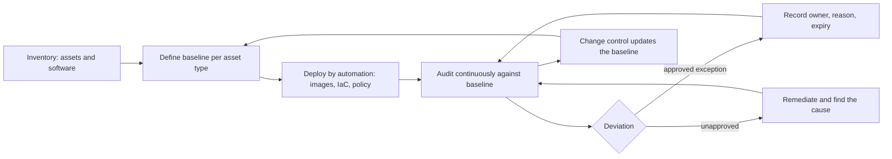

# Secure configuration

## Summary

Secure configuration is the practice of setting every system to a known, hardened state, recording that state as a baseline, checking systems against it and controlling how it changes. Most systems ship for ease of use: unneeded services on, default accounts present, permissive defaults. An attacker does not need an exploit if a setting already allows what they want. Secure configuration removes that class of weakness and gives vulnerability management something to stand on, because a patched system with a weak configuration remains exposed. This note covers baselines and benchmarks, the standards that define them (CIS, NIST SP 800-53 CM family, SCAP, vendor hardening guides), the cycle of baseline, audit, remediation and drift control, a tested checker and the limits of benchmark compliance.

## Prerequisites

- [Security controls](../../../security-and-risk-management/governance-and-compliance/frameworks/security-controls.md) and [CIS Controls](../../../security-and-risk-management/governance-and-compliance/frameworks/cis-controls.md), because Control 4 is "Secure Configuration of Enterprise Assets and Software".
- [NIST SP 800-53](../../../security-and-risk-management/governance-and-compliance/frameworks/nist-sp-800-53/README.md) for the configuration management (CM) control family.
- [Defense in depth](../../../security-architecture-and-engineering/design-principles/defense-in-depth.md) and the principle of least functionality.
- [Asset management](../../../asset-security/asset-management/README.md): you can only configure what you know exists.

## Core concepts

### Definition

*Secure configuration* (also *hardening*) means setting the parameters of hardware, operating systems, applications and cloud services to values that reduce attack surface and risk while keeping the system fit for its purpose. A *baseline* is the approved, documented set of configuration items and values for a type of system. *Configuration drift* is the difference between the actual state and the baseline.

CIS describes Control 4 as establishing and maintaining the secure configuration of enterprise assets, covering end-user devices (portable and mobile), network devices, non-computing and IoT devices and servers, and software including operating systems and applications (CIS Controls page, checked 2026-10). In NIST SP 800-53 Rev. 5 the main controls are in the CM family. From the Rev. 5 index kept in this repository:

| Control | Title | Baseline membership |
| --- | --- | --- |
| CM-2 | Baseline Configuration | low, moderate, high |
| CM-3 | Configuration Change Control | moderate, high |
| CM-6 | Configuration Settings | low, moderate, high |
| CM-7 | Least Functionality | low, moderate, high |
| CM-8 | System Component Inventory | low, moderate, high |
| CM-9 | Configuration Management Plan | moderate, high |

In the CISSP outline the topic is section 7.3, "Perform configuration management (CM) (e.g., provisioning, baselining, automation)".

### Analogy

A hospital sterilizes instruments to a written procedure, labels the tray, checks it before surgery and logs any deviation. A "secure configuration" program does the same for systems: a defined clean state, a check, a record of change. The analogy breaks because a computer system changes continuously through updates and operators, while an instrument tray stays as it was packed. Continuous checking is part of the discipline.

### Why defaults are not safe

Vendors choose defaults for compatibility and first-run success. Typical gaps: default accounts and passwords, services listening on all interfaces, broad permissions, verbose banners, weak protocol versions enabled for old clients, no audit logging. Cloud services add public exposure settings. Each one is a decision a human did not take. The principle behind the fix is *least functionality* (SP 800-53 CM-7): provide only the capabilities required.

### Sources of baselines

| Source | What it gives | Notes |
| --- | --- | --- |
| CIS Benchmarks | Consensus configuration guides per product, with profiles | Free PDF for non-commercial use, some artifacts for members. The Kubernetes benchmark list (checked 2026-10) shows separate benchmarks for EKS, GKE, AKS, OKE and OpenShift, see [KSPM](../../../security-architecture-and-engineering/cloud-and-infrastructure-security/kubernetes-security-posture-management/README.md). I recall two profile levels (a practical baseline and a stricter one) but did not verify the definition for this note |
| Vendor hardening guides | Product-specific recommendations from the vendor | Most accurate for features, may favor compatibility |
| DISA STIGs | Configuration guidance for U.S. Department of Defense systems | From my knowledge of the program, not re-read here |
| NIST National Checklist Program and SCAP | Standardized checklists and machine-readable content | See below |
| Government guidance such as NSA/CISA hardening guides | Threat-informed recommendations | Example: Kubernetes hardening guidance |
| Your own baseline | Organization-specific choices, derived from the above | The one that auditors and operations actually use |

*SCAP*, the Security Content Automation Protocol, is described by NIST as a suite of interoperable specifications for the standardized expression, exchange and processing of security information. The NIST SCAP page (checked 2026-10) lists XCCDF (checklist format), OVAL (assessment language), CPE (platform naming), CCE (configuration enumeration), OCIL, ARF (reporting format), AID and TMSAD, and says the specification is maintained through SCAP 1.4. XCCDF and OVAL are what let a scanner evaluate a benchmark without custom code.

### The configuration management cycle



The diagram shows the loop. The key idea is that the baseline is code or data under change control, and deployment, audit and remediation are automated against it.

1. **Inventory.** Without an inventory, coverage is unknown (CM-8, CIS Control 1).
2. **Baseline.** Choose a benchmark, tailor it (turn off rules that break required functions and record why) and version it.
3. **Deploy.** Build hardened images, use infrastructure as code, configuration management tools or policy engines, so new systems start compliant.
4. **Audit.** Scan on a schedule and on change. Authenticated checks see the real configuration.
5. **Exceptions.** A deviation that is needed gets an owner, a reason, compensating controls and an expiry date.
6. **Drift control.** Compare the current state with the approved state and alert on unrecorded changes. Prevent drift where possible (immutable infrastructure, read-only configuration, admission control).
7. **Change.** Baseline changes go through change control (CM-3), including security review, then the cycle repeats.

### Where it applies

- **Operating systems and servers**: services, accounts, permissions, kernel parameters, logging.
- **Network devices**: management plane access, protocols, SNMP, remote access.
- **Cloud**: storage exposure, identity policies, logging. See [CSPM](../../../security-architecture-and-engineering/cloud-and-infrastructure-security/cloud-security-posture-management.md).
- **Containers and Kubernetes**: pod security, RBAC, network policy, see [KSPM](../../../security-architecture-and-engineering/cloud-and-infrastructure-security/kubernetes-security-posture-management/README.md).
- **Applications and databases**: default accounts, debug modes, headers, TLS settings.
- **Endpoints and mobile**: encryption, screen lock, application control.
- **Data and SaaS**: sharing defaults and tenant settings, see [DSPM](../../../asset-security/data-protection/data-security-posture-management/README.md).

## Worked example

The script `scripts/check-baseline.py` models a miniature checker with six rules, two synthetic hosts, an exception with an expiry and a drift check. Rule ids are local (`SYN-...`) and do not reproduce any published benchmark. Python 3.10, standard library only. The output is real.

```bash
python3 scripts/check-baseline.py
```

Output:

```text
web-01: 6/6 compliant
build-02: 3/6 compliant
   SYN-SSH-01 FAIL exception expired 2026-09-30; want no, have yes
   SYN-SSH-02 FAIL want no, have yes
   SYN-NET-01 excepted until 2026-12-31
   SYN-FS-01 FAIL want 0640, have 0644
drift: {'web-01': 'DRIFTED', 'build-02': 'same as approved'}
```

What it shows:

1. `web-01` meets the baseline at audit time (6 of 6).
2. `build-02` has three failures and one exception. The IP forwarding exception is valid until 2026-12-31, so it counts as compliant with a note. The root login exception expired on 2026-09-30, so the rule fails again. Expiry is what keeps exceptions from becoming permanent policy.
3. The drift line is a separate signal. `web-01` was compliant when audited, then somebody enabled X11 forwarding by hand. The fingerprint of its effective configuration no longer matches the one recorded at approval, so it is reported as drifted, even though a check of the rules alone might still pass if X11 forwarding were not in the baseline. Drift detection catches changes that rules do not cover.
4. The compliance ratio hides what matters. `build-02` fails password authentication and a readable password-hash file, which are worse than the passed items. Weight rules by risk when reporting.

## Trade offs and when to use it

**Benefits.** Fewer exploitable defaults, repeatable builds, faster incident scoping ("which hosts deviate?"), evidence for audits (CM-2, CM-6, CIS Control 4) and a cheaper patch cycle on a smaller attack surface.

**Costs and limits.**

- Hardening can break functions. Test baselines on a representative system, tailor rules and keep a rollback path.
- Benchmarks lag new versions and do not know your business. Applying one without tailoring either breaks systems or gets switched off in frustration.
- Compliance is not security. A host can pass all rules and still run a vulnerable application or have a weak password. Benchmarks reduce the number of ways in, not the number of flaws.
- Agent and scanner access is itself privileged. The credentials used for authenticated scans must be protected.
- Cloud and SaaS settings change by API, so checking must be continuous, not periodic.
- Legacy and OT systems may not tolerate hardening. Compensate with segmentation and monitoring and record the exception.

**Alternatives and companions.** Immutable infrastructure replaces drifted hosts instead of repairing them. Policy as code blocks non-compliant resources before creation. [Vulnerability remediation](../../vulnerability-management/vulnerability-remediation/README.md) handles flaws that configuration cannot fix.

## Common mistakes

| Mistake | Effect | Fix |
| --- | --- | --- |
| Applying a benchmark without testing | Outages, then rules disabled wholesale | Test, tailor, record deviations |
| Hardening only at build time | Drift undoes it | Continuous audit and drift alerts |
| No inventory | Unknown systems are unhardened | Inventory first, see [asset management](../../../asset-security/asset-management/README.md) |
| Permanent exceptions | Baseline becomes fiction | Owner, reason, expiry |
| Reporting a percentage only | High-risk failures hidden by many passes | Weight by risk, list critical failures |
| Fixing by hand on each host | Drift and inconsistency | Fix the code or image, redeploy |
| Treating the benchmark as the baseline | Not tailored to your environment | Own baseline under change control |
| Skipping cloud and SaaS settings | Biggest exposure is there | Include them in scope |
| Scanning unauthenticated only | Misses the real settings | Authenticated or agent-based checks |

Detection and mitigation: configuration changes should produce logs (audit of file changes, cloud configuration change events, admission and policy decisions). Alert on changes to security-relevant settings outside change windows. Mitigation is the cycle above, plus reducing the number of unique configurations.

## Practice

1. Name the NIST SP 800-53 controls that correspond to baseline configuration, configuration settings and least functionality.
2. Why does the checker report drift even for a host that passes all rules?
3. What three fields must every exception carry?
4. A benchmark rule disables a service that your application needs. List the steps you take.
5. How would you add risk weights to the script's scoring?
6. Which CISSP section covers this topic, and which neighboring sections are affected?

**Answers and hints**

1. CM-2, CM-6 and CM-7.
2. The fingerprint covers the whole effective configuration. A change outside the rule list changes it, so it detects unrecorded change even when each rule passes.
3. Owner, reason (with compensating controls), expiry date.
4. Confirm the dependency, test alternatives, document the deviation as a tailored baseline entry with compensating controls and review date, and update the baseline through change control.
5. Add a weight column to `RULES` and compute the sum of weights of failed rules divided by the total, reporting critical failures separately.
6. Section 7.3 (configuration management). Related: 7.8 (patch and vulnerability management), 7.9 (change management) and 3.3 (selecting controls). See [CISSP security domains](../../../security-and-risk-management/reference/certifications/cissp-security-domains.md).

## Further reading

- CIS, [Control 4: Secure Configuration of Enterprise Assets and Software](https://www.cisecurity.org/controls/secure-configuration-of-enterprise-assets-and-software). The safeguard list was not available on the page I read.
- NIST, [Security Content Automation Protocol](https://csrc.nist.gov/projects/security-content-automation-protocol): the specifications and the current version.
- NIST, SP 800-53 Rev. 5, CM family: see the [SP 800-53 note](../../../security-and-risk-management/governance-and-compliance/frameworks/nist-sp-800-53/README.md) and the control index in `_assets`.
- NIST, [SP 800-128, Guide for Security-Focused Configuration Management of Information Systems](https://csrc.nist.gov/pubs/sp/800/128/final) (August 2011). The CSRC page marks this edition as withdrawn on October 10, 2019 and superseded; I did not identify the current revision.
- CIS, [Benchmarks](https://www.cisecurity.org/benchmark/kubernetes) (Kubernetes list checked 2026-10).
