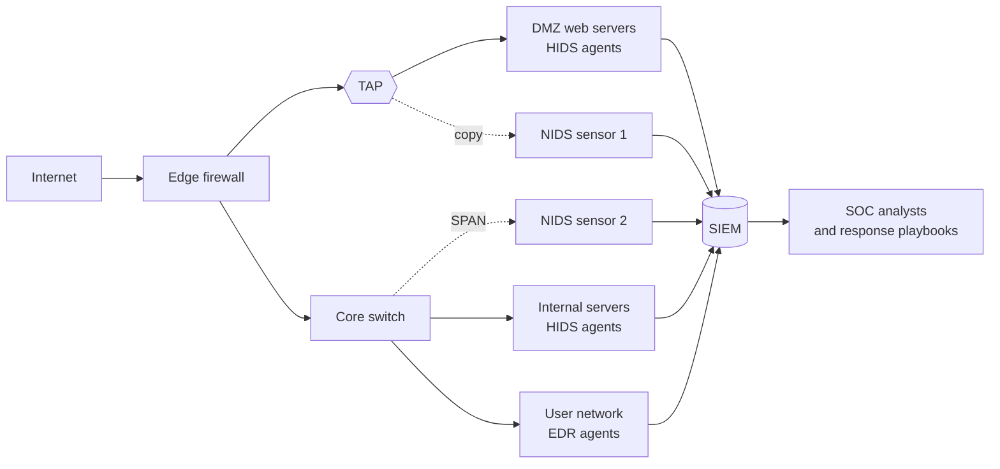
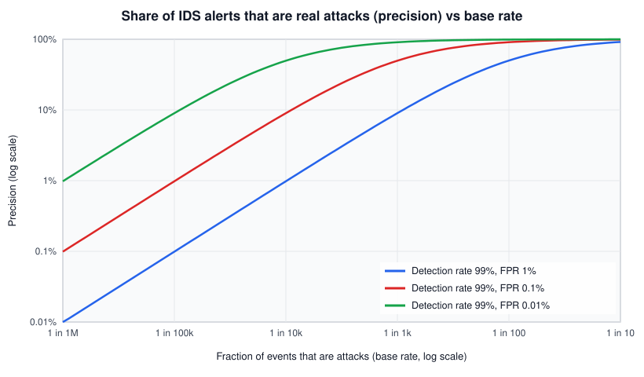

# Intrusion detection system (IDS)

## Summary

An intrusion detection system (IDS) watches network traffic or host activity, compares what it sees with known attack patterns or with a model of normal behavior, and raises alerts when something looks like an attack or a policy violation. It is a detective control: it does not block (that is an [intrusion prevention system](../ips.md)), so its value depends on someone or something acting on its alerts. IDS exists because prevention always fails eventually, and every hour an intruder goes unnoticed gives them more time to spread. Its main limits are blind spots (encrypted traffic, unmonitored segments, attacks no rule describes) and false positives, which grow into alert fatigue if the system is not tuned.

## Prerequisites

- [Defense in depth](../../../../security-architecture-and-engineering/design-principles/defense-in-depth.md): detection as one of the layers.
- [True positive and true negative](../true-positive-true-negative.md) and [false positive and false negative](../false-positive-false-negative.md): the vocabulary of detection outcomes.
- Basic TCP/IP and HTTP, and how logs are produced on a host.
- Helpful: [Suricata and Snort](../../../../communication-and-network-security/network-security/monitoring-and-detection/suricata-and-snort.md) for rule syntax, and [SIEM](../../operations/siem.md) for where alerts go.

## Core concepts

### Definition

NIST SP 800-94 (Guide to Intrusion Detection and Prevention Systems, February 2007) defines *intrusion detection* as "the process of monitoring the events occurring in a computer system or network and analyzing them for signs of possible incidents, which are violations or imminent threats of violation of computer security policies, acceptable use policies, or standard security practices", and an IDS as "software that automates the intrusion detection process". An IPS "has all the capabilities of an intrusion detection system and can also attempt to stop possible incidents". NIST uses *IDPS* for the combined product category. A revision (SP 800-94 Rev. 1) was published as a draft in 2012 and, as far as I know, never finalized, so the 2007 version is still the reference.

The ISC2 CISSP outline (April 2024) covers IDS in section 7.2 (logging and monitoring, "Intrusion detection and prevention (IDPS)") and 7.7 (operate and maintain detection and preventative measures).

### Analogy

An IDS is a burglar alarm with motion sensors and cameras in a shop. It does not lock any door; it notices someone moving in the storeroom at 3 a.m. and calls the security company. If nobody answers the call, the alarm is worthless. If it triggers every time a delivery van passes, the guards stop responding.

The analogy maps well to the detective role, to the dependency on response, and to false alarms. It breaks in one way: a shop alarm sees everything in the room, while a network IDS sees only the traffic copied to it, and nothing inside encrypted connections unless they are decrypted.

### Types

NIST SP 800-94 distinguishes four technology types:

| Type | Monitors | Typical sensor placement | Strong at | Blind to |
| --- | --- | --- | --- | --- |
| Network-based (NIDS) | Packets and application protocols on network segments | SPAN port or network TAP at the perimeter, data center core, cloud traffic mirroring | Exploits and scans crossing the segment, protocol anomalies | Encrypted payloads, traffic that never crosses the sensor, host-internal activity |
| Host-based (HIDS) | Events on one host: logs, file integrity, processes, system calls | Agent on servers and endpoints | What actually happened on the host, after decryption | Network-wide patterns, hosts without agents |
| Wireless | Wireless protocol activity | Wireless sensors in the area | Rogue access points, wireless attacks | Wired traffic |
| Network behavior analysis (NBA) | Flow data (NetFlow, IPFIX) | Flow exporters on routers and switches | Scans, DDoS, unusual traffic volumes and peers | Content of traffic |

Modern equivalents: HIDS functions are now mostly part of EDR agents and tools such as Wazuh or OSSEC, NIDS engines include Suricata, Snort and Zeek (Zeek is more of a network security monitor that produces logs than a signature engine), and NBA overlaps with network detection and response (NDR).

### Placement



The diagram shows passive copies of traffic (dotted lines) going to network sensors, host agents reporting directly, and all alerts converging in a SIEM, where the SOC acts on them. A TAP copies traffic at the physical layer and does not drop packets under load; a SPAN port is a switch feature that is cheaper but can drop packets when the switch is busy.

### Detection methods

NIST SP 800-94 describes three methods:

| Method | How it works (NIST SP 800-94) | Strength | Weakness |
| --- | --- | --- | --- |
| Signature-based | "comparing signatures against observed events" | "very effective at detecting known threats", precise alerts | "largely ineffective at detecting previously unknown threats, threats disguised by the use of evasion techniques, and many variants of known threats" |
| Anomaly-based | "comparing definitions of what activity is considered normal against observed events to identify significant deviations" | Can detect unknown threats | Many false positives when benign activity deviates from the profile, profiles go stale, attackers can blend in slowly |
| Stateful protocol analysis | Compares observed activity with vendor-defined profiles of accepted protocol behavior, tracking state | Finds unexpected command sequences and protocol abuse | Resource intensive, misses attacks that follow the protocol |

NIST's own example of signature brittleness: a signature for an attachment named `freepics.exe` does not match `freepics2.exe`. Rules that match on normalized protocol fields rather than raw bytes, as in the worked example below, reduce that brittleness.

### Detection outcomes and the base rate problem

| | Attack happened | No attack |
| --- | --- | --- |
| Alert | True positive | False positive |
| No alert | False negative | True negative |

NIST: "It is not possible to eliminate all false positives and negatives; in most cases, reducing the occurrences of one increases the occurrences of the other."

The less obvious problem is the *base rate*. Attacks are rare compared with normal events. Precision, the share of alerts that are real, is `TPR x b / (TPR x b + FPR x (1 - b))` for base rate `b`, true positive rate `TPR` and false positive rate `FPR`. Even an excellent detector produces mostly false alarms when attacks are rare:



Computed values (detection rate 99 percent):

| Base rate | FPR 1% | FPR 0.1% | FPR 0.01% |
| --- | --- | --- | --- |
| 1 in 100,000 | 0.1% | 1.0% | 9.0% |
| 1 in 1,000 | 9.0% | 49.8% | 90.8% |
| 1 in 100 | 50.0% | 90.9% | 99.0% |

The practical consequence: lowering the false positive rate by tuning, and raising the base rate by pointing detection at places where attacks are more likely (internet-facing services, privileged accounts), matters more than adding detection rules.

### Evasion

Attackers work around IDS with encryption (most traffic is TLS), fragmentation and segmentation tricks that the IDS reassembles differently from the target, encoding (URL, Unicode, Base64) that the IDS does not normalize, low and slow activity below anomaly thresholds, and living off the land with legitimate tools. Good engines normalize protocols (the worked example matches a decoded URI), reassemble streams the way the protected hosts do, and are combined with host telemetry that sees decrypted activity.

## Worked example

A small, reproducible network IDS test with Suricata 7.0.11 (Docker image `jasonish/suricata:7.0.11`) on a synthetic packet capture. All addresses come from the RFC 5737 documentation ranges.

**Step 1, create the traffic.** [scripts/make-ids-lab-pcap.py](scripts/make-ids-lab-pcap.py) (Python 3.10, standard library only) writes `lab.pcap` with three complete HTTP sessions to the web server 203.0.113.5:

| Session | Client | Request |
| --- | --- | --- |
| 1 | 198.51.100.20 | `GET /index.html`, normal browser |
| 2 | 198.51.100.66 | `GET /search?q=%3Cscript%3Ealert(1)%3C%2Fscript%3E` (URL-encoded XSS probe) |
| 3 | 198.51.100.66 | `GET /admin/config.php` with User-Agent `sqlmap/1.8` |

```bash
python3 make-ids-lab-pcap.py lab.pcap      # wrote 24 packets
tcpdump -nr lab.pcap | head -4
```

```text
01:00:00.000000 IP 198.51.100.20.40001 > 203.0.113.5.80: Flags [S], seq 1000, win 64240, length 0
01:00:00.001000 IP 203.0.113.5.80 > 198.51.100.20.40001: Flags [S.], seq 5000, ack 1001, win 64240, length 0
01:00:00.002000 IP 198.51.100.20.40001 > 203.0.113.5.80: Flags [.], ack 1, win 64240, length 0
01:00:00.003000 IP 198.51.100.20.40001 > 203.0.113.5.80: Flags [P.], seq 1:91, ack 1, win 64240, length 90: HTTP: GET /index.html HTTP/1.1
```

**Step 2, write rules.** [scripts/ids-lab.rules](scripts/ids-lab.rules) contains three local rules (SIDs from 1,000,000 are reserved for local use):

```text
alert http any any -> $HOME_NET any (msg:"LAB XSS attempt: script tag in URI"; flow:established,to_server; http.uri; content:"<script"; nocase; classtype:web-application-attack; sid:1000001; rev:1;)
alert http any any -> $HOME_NET any (msg:"LAB SQLMap user agent"; flow:established,to_server; http.user_agent; content:"sqlmap"; nocase; startswith; classtype:web-application-attack; sid:1000002; rev:1;)
alert http any any -> $HOME_NET any (msg:"LAB request to /admin from outside"; flow:established,to_server; http.uri; content:"/admin"; startswith; classtype:policy-violation; sid:1000003; rev:1;)
```

**Step 3, run the IDS offline on the capture.**

```bash
mkdir ids-out
docker run --rm -v "$PWD":/lab jasonish/suricata:7.0.11 -r /lab/lab.pcap -S /lab/ids-lab.rules \
  -l /lab/ids-out --set vars.address-groups.HOME_NET="[203.0.113.0/24]" -k none
cat ids-out/fast.log
```

Output (`fast.log`, November 2026):

```text
11/11/2026-00:00:02.005000  [**] [1:1000002:1] LAB SQLMap user agent [**] [Classification: Web Application Attack] [Priority: 1] {TCP} 198.51.100.66:40003 -> 203.0.113.5:80
11/11/2026-00:00:02.005000  [**] [1:1000003:1] LAB request to /admin from outside [**] [Classification: Potential Corporate Privacy Violation] [Priority: 1] {TCP} 198.51.100.66:40003 -> 203.0.113.5:80
11/11/2026-00:00:01.005000  [**] [1:1000001:1] LAB XSS attempt: script tag in URI [**] [Classification: Web Application Attack] [Priority: 1] {TCP} 198.51.100.66:40002 -> 203.0.113.5:80
```

What the result shows:

- The normal session produced no alert, and each malicious session produced the expected ones: three true positives, one true negative.
- Rule 1000001 matched `<script` although the request contained `%3Cscript%3E`. Suricata matched against the normalized (decoded) `http.uri` buffer. A naive byte match on the raw packet would have missed it, which is the evasion-by-encoding problem in practice.
- Both alerts for session 3 point to the same source, so an analyst would group them into one case: one external IP running an SQL injection tool against an admin path, plus an XSS probe a second earlier. The source is the case, not the individual alert.
- The lines are not in time order because Suricata processes flows in parallel worker threads. Sort by timestamp in the SIEM.
- `-k none` turns off checksum validation, which is common when replaying captures from sensors with checksum offloading. The synthetic packets have valid checksums, so the run does not depend on it.

The same alerts in `eve.json` (Suricata's JSON log) carry the full URL, and that file is what normally goes to a SIEM. For rule language details, see [Suricata and Snort](../../../../communication-and-network-security/network-security/monitoring-and-detection/suricata-and-snort.md). For the attacks behind the alerts, see [cross-site scripting](../../../../software-development-security/application-security/vulnerabilities/cross-site-scripting/README.md).

## Trade offs and when to use it

| Choice | Benefit | Cost and limits |
| --- | --- | --- |
| NIDS at the perimeter | Sees inbound attacks and scanning early | Much of the traffic is TLS, a lot of internet noise |
| NIDS at internal choke points (east-west) | Catches lateral movement, often higher base rate | Needs sensors in data centers and cloud (traffic mirroring cost) |
| HIDS or EDR | Sees decrypted activity and host changes | Agent deployment and maintenance, can be tampered with by privileged attackers |
| NBA and flow analysis | Cheap, scales, works on encrypted traffic | No content, coarse alerts |
| IDS (alert) versus IPS (block) | IDS cannot break production traffic | IDS only helps if someone responds. See [IPS](../ips.md) |
| Managed detection service | 24/7 analysts | Cost, needs good context sharing |

IDS is the wrong investment when no one will read the alerts, when nearly all traffic is encrypted end to end and no host telemetry exists, or when basic controls (patching, MFA, asset inventory) are missing: detection then reports the same preventable incidents over and over.

## Common mistakes

- **Deploying with default rules and no tuning.** Fix: tune per environment, suppress known benign patterns, review the top alerting rules weekly.
- **No owner for alerts.** Fix: route alerts to a SIEM with triage playbooks and response times.
- **Sensors that miss traffic.** SPAN drops under load, asymmetric routing, unmonitored cloud segments. Fix: check sensor statistics for drops, use TAPs at critical points, mirror cloud traffic.
- **Ignoring encryption.** Fix: combine NIDS with host telemetry, TLS metadata (JA4, SNI, certificates) and decryption where legally and technically appropriate.
- **Rules that never fire are assumed to work.** Fix: test rules with captured or synthetic traffic, as in the worked example, and run regular detection validation.
- **Measuring rule count instead of outcomes.** Fix: measure precision, time to triage and missed detections found in exercises.

## Practice

1. How does NIST SP 800-94 define intrusion detection, and how does an IPS differ from an IDS?
2. Name NIST's four IDPS technology types and one blind spot of each.
3. With a detection rate of 99 percent, a false positive rate of 0.1 percent and 1 attack per 1,000 events, roughly what share of alerts are real?
4. In the worked example, why did the XSS rule match although the request was URL-encoded?
5. Give two reasons a network IDS might miss an attack that crossed its segment.

Answers:

1. Monitoring events in a system or network and analyzing them for signs of possible incidents. An IPS has all IDS capabilities and can also attempt to stop possible incidents.
2. Network-based: encrypted payloads. Host-based: hosts without agents. Wireless: wired traffic. NBA: content of traffic.
3. About 50 percent (49.8 percent from the formula).
4. Suricata decodes and normalizes the URI before matching `http.uri` content.
5. Any two of: encryption, packet drops on the sensor or SPAN port, evasion through fragmentation or encoding the engine does not normalize, no rule for the technique.

## Further reading

- [NIST SP 800-94, Guide to Intrusion Detection and Prevention Systems (IDPS), February 2007](https://doi.org/10.6028/NIST.SP.800-94): definitions, types, detection methods and deployment guidance quoted above. Checked 2026-11.
- [Suricata documentation](https://docs.suricata.io/): rule keywords such as `http.uri` and `http.user_agent`, EVE JSON output and offline pcap mode.
- [NIST SP 800-53 Rev. 5, SI-4 System Monitoring](https://csrc.nist.gov/pubs/sp/800/53/r5/upd1/final): the control that names intrusion detection and prevention systems among monitoring tools.
- [RFC 5737, IPv4 Address Blocks Reserved for Documentation](https://www.rfc-editor.org/rfc/rfc5737): the address ranges used in the lab.
- Stefan Axelsson, "The Base-Rate Fallacy and the Difficulty of Intrusion Detection", ACM TISSEC, 2000: the classic analysis of why false alarms dominate.
- Related notes: [IPS](../ips.md), [Suricata and Snort](../../../../communication-and-network-security/network-security/monitoring-and-detection/suricata-and-snort.md), [Zeek](../../../../communication-and-network-security/network-security/monitoring-and-detection/zeek.md), [SIEM](../../operations/siem.md), [defense in depth](../../../../security-architecture-and-engineering/design-principles/defense-in-depth.md).
