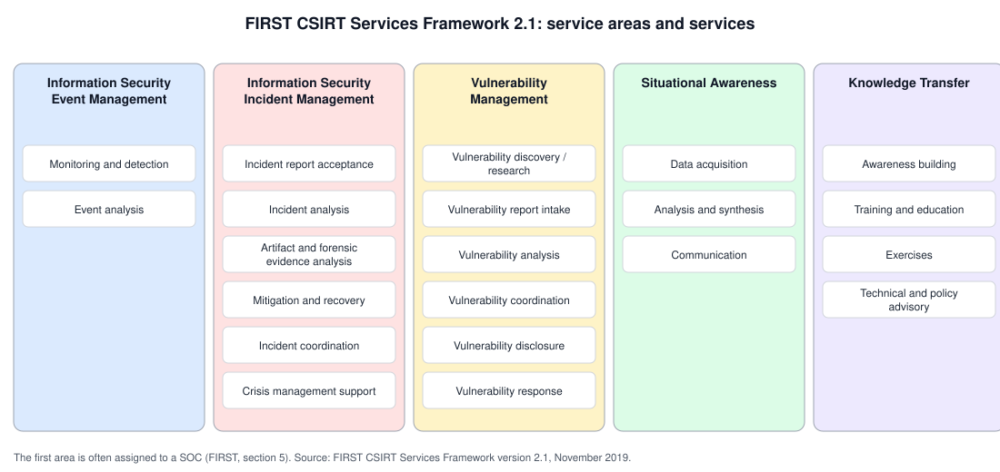
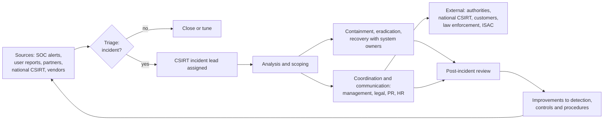
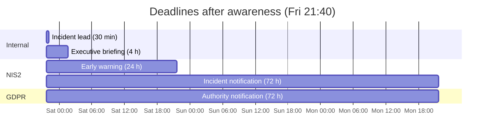

# Computer security incident response team (CSIRT)

## Summary

A computer security incident response team (CSIRT) is the team, or the organizational capability, that handles security incidents for a defined group of users and systems, called its constituency. When something goes wrong, it receives the report, analyzes what happened, coordinates containment and recovery with the people who own the affected systems, communicates with management, partners and authorities, and makes sure lessons are learned. CSIRTs exist at every level: inside a company (enterprise CSIRT), for a product vendor's products (PSIRT), for a sector, and for a whole country (national CSIRT, often still called a CERT). What makes a CSIRT work is not tooling but a clear mandate, a known constituency, authority, trusted contacts and practiced procedures prepared before the incident.

## Prerequisites

- [NIST incident response lifecycle (SP 800-61)](nist-incident-response/README.md): the process a CSIRT runs.
- [Security operations center (SOC)](security-operations-center.md): the monitoring function that usually feeds the CSIRT.
- The difference between an event and an incident, and basic incident severity concepts.

## Core concepts

### Definition

The FIRST CSIRT Services Framework (version 2.1, November 2019) defines a CSIRT as "an organizational unit (which may be virtual) or a capability that provides services and support to a defined constituency for preventing, detecting, handling, and responding to computer security incidents, in accordance with its mission." It adds that "a properly deployed CSIRT has a clear mandate, a governance model, a tailored services framework, technologies, and processes to provide, measure, and continuously improve defined services."

Three words in the definition carry the meaning:

- **Constituency**: the people and systems the team serves. Without a defined constituency, nobody knows whom the team may help or must help.
- **Mandate**: the authority the team has, from advising to directing actions such as disconnecting systems.
- **Capability**: a CSIRT can be a virtual team of people from different departments, activated when needed.

Naming: *CERT* (computer emergency response team) is the historical name, from the CERT Coordination Center created at Carnegie Mellon University after the Morris worm in 1988; "CERT" is a registered mark of Carnegie Mellon, which is one reason the generic term CSIRT is used. *CIRT* and *IRT* are other variants. (History from memory, not re-checked for this note.)

### Types of CSIRTs

| Type | Constituency | Example role |
| --- | --- | --- |
| Enterprise (internal) CSIRT | One organization's systems and staff | Handles incidents on company infrastructure |
| PSIRT (product security incident response team) | Users of a vendor's products | Receives vulnerability reports, publishes fixes and advisories |
| Coordinating CSIRT | Other CSIRTs, a sector or a research network | Single point of contact, coordination across teams |
| National CSIRT | A country, often government and critical sectors | Coordinates national incidents, international contact point |
| Sector CSIRT or ISAC-related team | Organizations in one sector | Sector-specific warnings and coordination |
| Commercial incident response provider | Paying customers | Retained or on-demand incident response |

FIRST distinguishes the CSIRT and the PSIRT by focus: an enterprise CSIRT "is focused on the security of computer systems and networks that make up the infrastructure of an organization", while "the focus on products is the key differentiator between the PSIRT and any other security team". In a large organization with several teams, one "might serve as coordinator and single point of contact to the external parties". In the EU, the NIS2 Directive (Directive (EU) 2022/2555) requires each Member State to designate one or more CSIRTs, and the EU CSIRTs Network, with ENISA as its secretariat, connects the national CSIRTs and CERT-EU for information exchange and coordination of cross-border incidents (ENISA, checked 2026-11).

### Analogy

A CSIRT is a hospital's trauma team. It is not the ambulance service that brings patients (the SOC and other detection sources), and it is not every doctor in the building. When a severe case arrives, the team assembles, a team lead takes charge, specialists are called in (surgery, radiology, the patient's family doctor), and every step is documented. The team trains for situations it hopes never to see, and after a difficult case it reviews what could be done better.

The analogy fits the activation, the incident lead, the specialists and the documentation. It breaks because patients do not fight back. In a security incident the attacker may still be present, watching the response and changing tactics, so the team must think about operational security (using out-of-band communication, not tipping off the attacker) in a way a trauma team never does.

### Services

FIRST's framework organizes CSIRT services into five service areas:



Incident management is the core: report acceptance, incident analysis, artifact and forensic evidence analysis, mitigation and recovery, incident coordination and crisis management support. The other areas are optional and depend on the mandate. FIRST notes that the first area, event management, "is sometimes fully or partially assigned to a Security Operations Center (SOC)". NIST SP 800-61 Rev. 2 (2012) similarly says that "it is fairly rare for a team to perform incident response only" and lists services such as intrusion detection, advisory distribution, education and awareness, and information sharing.

### Team models and staffing

NIST SP 800-61 Rev. 2 describes three team models:

- **Central incident response team**: one team for the whole organization.
- **Distributed incident response teams**: several teams, for example per region or business unit, which must act as one coordinated entity.
- **Coordinating team**: a team that advises other teams without authority over them.

and three staffing models: employees, partially outsourced ("the most prevalent arrangement is for the organization to outsource 24-hours-a-day, 7-days-a-week (24/7) monitoring" to an MSSP that reports incidents to the internal team) and fully outsourced. NIST SP 800-61 Rev. 3 (April 2025) broadens the picture: incident handlers may be on staff, on contract (including an outsourced SOC or a cloud provider's response team) or available when needed (a parent organization, a partner, law enforcement), and response involves leadership, legal, public affairs, human resources and asset owners as well as technical staff.

### How the SOC and CSIRT fit together



The diagram shows the CSIRT as the coordinator of an incident. Many inputs arrive, one incident lead owns the case, technical work and communication run in parallel, and the review feeds back into detection and controls. The arrows to legal, public relations and authorities are often where incidents go wrong, which is why they are planned in advance.

### Describing a CSIRT: RFC 2350

RFC 2350 (BCP 21, "Expectations for Computer Security Incident Response", Brownlee and Guttman, June 1998) says that "CSIRT constituents have a legitimate need and right to fully understand the policies and procedures of 'their' Computer Security Incident Response Team" and provides a template. Its main sections: 1 About this document, 2 Contact information (including public keys for encrypted reports and points of customer contact), 3 Charter (mission statement, constituency, sponsorship and affiliation, authority), 4 Policies (types of incidents and level of support, cooperation and disclosure of information, communication and authentication), 5 Services (incident response and proactive activities), 6 Incident reporting forms and 7 Disclaimers. Many national and sector CSIRTs publish such a profile, and FIRST membership and the Trusted Introducer listing of European teams use similar information.

## Worked example

**Step 1, publish a profile.** A fictional company, Example Corp, sets up its enterprise CSIRT and writes a short RFC 2350-style profile (abbreviated; the domain and addresses are documentation placeholders):

```text
1. About this document
   1.1 Date of last update: 2026-11-01
   1.3 Location: https://example.com/security/csirt-rfc2350.txt
   1.4 Authentication: signed with the team PGP key below
2. Contact information
   2.1 Name: Example Corp CSIRT (EXC-CSIRT)
   2.3 Time zone: Europe/Warsaw (CET/CEST)
   2.7 E-mail: csirt@example.com
   2.8 Public key: <PGP_KEY_FINGERPRINT>
   2.11 Points of contact: e-mail 24/7 monitored by the SOC, phone escalation for incidents in progress
3. Charter
   3.1 Mission: coordinate the handling of security incidents affecting Example Corp systems and data
   3.2 Constituency: all Example Corp employees, systems and cloud tenants
   3.4 Authority: delegated by the CISO; may isolate systems and disable accounts without prior approval
4. Policies
   4.1 Incident types: all; priority by impact on customer data and critical services
   4.2 Disclosure: TLP 2.0 for shared information; authorities informed as required by law
5. Services
   5.1 Incident response: triage, coordination, resolution support
   5.2 Proactive: advisories to IT teams, exercises twice a year
```

The authority line (3.4) is the most important one in practice. It is written and approved before an incident, so nobody has to find an executive at 3 a.m. to approve isolating a server.

**Step 2, track the clock during an incident.** On Friday at 21:40 the SOC escalates suspicious data access, and the CSIRT confirms a significant incident with personal data involved. Example Corp is an essential entity under its national NIS2 law, so several deadlines start at once. A small script (Python 3.10, standard library only) computes them from the moment of awareness and checks the ticket:

```python
from datetime import datetime, timedelta

DEADLINES = {  # obligation -> time allowed after becoming aware (confirm against current law)
    "NIS2 early warning (Art. 23(4)(a))": timedelta(hours=24),
    "NIS2 incident notification (Art. 23(4)(b))": timedelta(hours=72),
    "GDPR breach notification to authority (Art. 33(1))": timedelta(hours=72),
    "Internal: incident lead assigned": timedelta(minutes=30),
    "Internal: executive briefing": timedelta(hours=4),
}
aware = datetime(2026, 11, 6, 21, 40)      # Friday evening
done = {                                   # what the ticket shows
    "Internal: incident lead assigned": datetime(2026, 11, 6, 21, 55),
    "Internal: executive briefing": datetime(2026, 11, 7, 2, 10),
    "NIS2 early warning (Art. 23(4)(a))": datetime(2026, 11, 7, 23, 5),
    "GDPR breach notification to authority (Art. 33(1))": datetime(2026, 11, 9, 16, 0),
}
print(f"aware at {aware:%a %Y-%m-%d %H:%M}")
for name, delta in sorted(DEADLINES.items(), key=lambda kv: kv[1]):
    due = aware + delta
    if name in done:
        late = done[name] - due
        status = "LATE by " + str(late) if late > timedelta(0) else "on time"
        print(f"{name:<52} due {due:%a %m-%d %H:%M}  done {done[name]:%a %m-%d %H:%M}  {status}")
    else:
        print(f"{name:<52} due {due:%a %m-%d %H:%M}  open")
# The NIS2 final report runs from the incident notification, not from awareness.
notif = done.get("NIS2 incident notification (Art. 23(4)(b))", aware + DEADLINES["NIS2 incident notification (Art. 23(4)(b))"])
print(f"{'NIS2 final report (Art. 23(4)(d))':<52} due {notif + timedelta(days=30):%a %m-%d %H:%M}  open (one month after the notification, 30 days used here)")
```

Output:

```text
aware at Fri 2026-11-06 21:40
Internal: incident lead assigned                     due Fri 11-06 22:10  done Fri 11-06 21:55  on time
Internal: executive briefing                         due Sat 11-07 01:40  done Sat 11-07 02:10  LATE by 0:30:00
NIS2 early warning (Art. 23(4)(a))                   due Sat 11-07 21:40  done Sat 11-07 23:05  LATE by 1:25:00
NIS2 incident notification (Art. 23(4)(b))           due Mon 11-09 21:40  open
GDPR breach notification to authority (Art. 33(1))   due Mon 11-09 21:40  done Mon 11-09 16:00  on time
NIS2 final report (Art. 23(4)(d))                    due Wed 12-09 21:40  open (one month after the notification, 30 days used here)
```

The early warning was 85 minutes late because the incident started on a Friday night and the person authorized to file regulatory reports was not on the on-call rota. The fix is procedural, not technical: name a deputy for regulatory reporting and add the filing to the weekend runbook.

The timeline as a chart:



The NIS2 and GDPR deadlines in this example are from memory of the texts (NIS2 Article 23(4): early warning within 24 hours, incident notification within 72 hours of becoming aware of a significant incident, final report within one month of the notification; GDPR Article 33(1): 72 hours after becoming aware of a personal data breach). I could not retrieve the official EUR-Lex text automatically for this note, and national transpositions add detail, so check them before relying on the numbers.

## Trade offs and when to use it

| Decision | Benefit | Cost and limits |
| --- | --- | --- |
| Dedicated enterprise CSIRT | Ownership of every incident, institutional memory | Staff cost, idle capacity between major incidents |
| Virtual CSIRT (people from IT, security, legal, activated as needed) | Cheap, involves system owners | Slow assembly, members' day jobs compete, needs regular exercises |
| Retainer with an incident response provider | Expert surge capacity and forensics | Provider lacks context, onboarding during a crisis is slow unless prepared |
| Broad mandate (may isolate and disable without approval) | Fast containment | Risk of business disruption, needs clear criteria and trust |
| Narrow mandate (advisory only) | Low disruption risk | Slow response, decisions wait for owners |

For small organizations a full CSIRT is usually the wrong first investment. A written incident response plan with named roles, a retainer with an external provider, an MDR service for monitoring and a short list of regulatory contacts deliver most of the value.

## Common mistakes

- **No defined constituency or authority.** Fix: write both down (RFC 2350 sections 3.2 and 3.4) and get them approved.
- **Treating the CSIRT as purely technical.** Legal, communications and HR decisions dominate large incidents. Fix: include them in the plan and in exercises.
- **Contacts collected during the incident.** Fix: keep a maintained list of internal owners, providers, authorities, the national CSIRT and law enforcement, with out-of-band channels.
- **Communicating on compromised systems.** Fix: an out-of-band channel (separate chat tenant, phones) for major incidents.
- **Skipping the post-incident review.** Fix: schedule it when the incident is opened, track resulting actions to closure.
- **Unclear handoff from the SOC.** Fix: written criteria for declaring an incident and assigning an incident lead.
- **Never exercising.** Fix: tabletop exercises at least twice a year, including weekend and regulatory reporting scenarios.

## Practice

1. What are the three key elements of the FIRST definition of a CSIRT?
2. How does a PSIRT differ from an enterprise CSIRT?
3. Name NIST SP 800-61 Rev. 2's three team models.
4. Which RFC 2350 section would you check to learn whether a CSIRT may disconnect your server without asking?
5. In the worked example, from which moment does the NIS2 final report deadline run?

Answers:

1. An organizational unit or capability, a defined constituency, and services for preventing, detecting, handling and responding to incidents in line with its mission (with a mandate and governance).
2. A PSIRT focuses on the security of the vendor's products and their users, an enterprise CSIRT on the organization's own systems and networks.
3. Central incident response team, distributed incident response teams, coordinating team.
4. Section 3.4, Authority (with 3.2 Constituency and 4.1 types of incidents and level of support).
5. From the submission of the incident notification, not from awareness.

## Further reading

- [FIRST, CSIRT Services Framework, version 2.1, November 2019](https://www.first.org/standards/frameworks/csirts/FIRST_CSIRT_Services_Framework_v2.1.0.pdf): definition, CSIRT and PSIRT difference, five service areas. Checked 2026-11.
- [RFC 2350, Expectations for Computer Security Incident Response (BCP 21), 1998](https://www.rfc-editor.org/rfc/rfc2350): the CSIRT profile template. Checked 2026-11.
- [NIST SP 800-61 Rev. 2, Computer Security Incident Handling Guide, 2012](https://doi.org/10.6028/NIST.SP.800-61r2): team models, staffing and services. Checked 2026-11.
- [NIST SP 800-61 Rev. 3, April 2025](https://doi.org/10.6028/NIST.SP.800-61r3): roles and responsibilities in the CSF 2.0 based model. Checked 2026-11.
- [ENISA, CSIRTs Network](https://www.enisa.europa.eu/topics/eu-incident-response-and-cyber-crisis-management/csirts-network): the EU network of national CSIRTs and CERT-EU. Checked 2026-11.
- [Directive (EU) 2022/2555 (NIS2)](https://eur-lex.europa.eu/eli/dir/2022/2555/oj): CSIRT designation and incident reporting obligations. Not re-read for this note.
- Related notes: [SOC](security-operations-center.md), [NIST incident response](nist-incident-response/README.md), [SOAR](soar.md), [chain of custody](../../digital-forensics/chain-of-custody/README.md), [threat intelligence](../../threat-intelligence/threat-intelligence.md).
