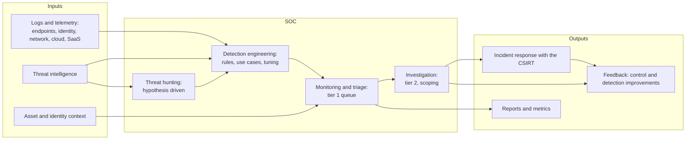
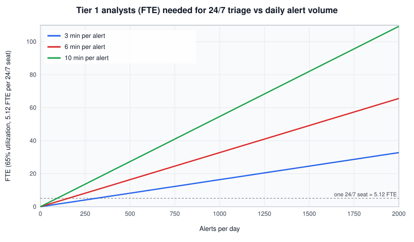
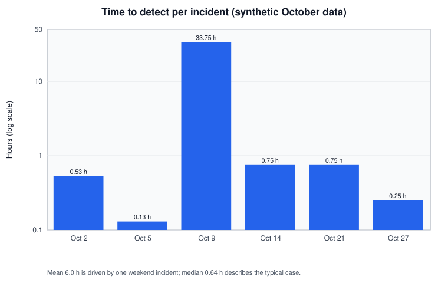

# Security operations center (SOC)

## Summary

A security operations center (SOC) is the team, together with its processes and tools, that continuously monitors an organization's systems for attacks, decides which signals are real incidents, and starts or carries out the response. It turns raw telemetry from logs, endpoints, networks and cloud services into decisions, usually around the clock. A SOC is not a room full of screens or a SIEM license: its value comes from authority to act, knowing what it protects, good data, tuned detections and clear handoffs to incident response. Its two chronic problems are alert overload and staff burnout, and the numbers behind both can be planned, as the worked example shows.

## Prerequisites

- [Intrusion detection system (IDS)](../detection/ids/README.md) and [SIEM](siem.md): the main detection and correlation tools a SOC operates.
- [NIST incident response lifecycle (SP 800-61)](nist-incident-response/README.md): what happens after the SOC declares an incident.
- [Computer security incident response team (CSIRT)](computer-security-incident-response-team.md): the team the SOC hands incidents to, or is part of.
- Helpful: [SOAR](soar.md), [SOP](sop.md), [threat intelligence](../../threat-intelligence/threat-intelligence.md).

## Core concepts

### Definition

The NIST SP 800-61 Rev. 3 glossary (April 2025) lists the term only as an acronym, but the publication describes the SOC as a common way of staffing incident handling, including "outsourcing a security operations center [SOC] to a managed security services provider [MSSP]". The FIRST CSIRT Services Framework (version 2.1, November 2019) gives a functional view: its *Information Security Event Management* service area, which covers monitoring and detection and event analysis (correlation and qualification of events), "is sometimes fully or partially assigned to a Security Operations Center (SOC), which might additionally also perform first- or even second-level Information Security Incident Management such as initiating mitigations or adjustments of security controls". FIRST adds that "the interface between a SOC and the assigned CSIRT is crucial".

A practical definition for this repository: a SOC is the organizational capability that **monitors, detects, triages and initiates response** to cybersecurity events for a defined set of assets, continuously and with the authority to act.

It differs from neighboring functions:

| Function | Main question | Time horizon |
| --- | --- | --- |
| SOC | Is something bad happening right now, and what do we do first? | Minutes to hours, continuous |
| [CSIRT](computer-security-incident-response-team.md) | How do we handle, coordinate and recover from this incident? | Hours to weeks, per incident |
| NOC (network operations center) | Is the network available and performing? | Continuous, availability focus |
| Threat intelligence | Who targets us, and how? | Weeks to months |
| Vulnerability management | What weaknesses do we have, and in what order do we fix them? | Days to months |
| Red team | Can a realistic attacker get past our defenses? | Engagements |

In smaller organizations one team does several of these. The distinction still matters, because each needs different skills, metrics and authority.

### Analogy

A SOC is the dispatch center of a fire and rescue service. Sensors (smoke detectors, emergency calls) feed it constantly. Dispatchers decide within minutes whether a call is a real fire, a false alarm or a cat in a tree, send the right crew, and hand over to the incident commander on site. They do not fight every fire themselves, but nothing starts without them.

The analogy fits continuous monitoring, triage, escalation and the handoff to responders (the CSIRT). It breaks in two places. Fire alarms are rarely caused by an intelligent adversary who studies the dispatch center and avoids its sensors, and a fire service's false alarm rate is far lower than a typical SOC's, where most alerts are benign (see the base rate problem in [IDS](../detection/ids/README.md#detection-outcomes-and-the-base-rate-problem)).

### Functions



The diagram shows the SOC as a pipeline from data to decisions, with two feedback loops: hunting and investigations improve detection rules, and incidents improve controls. A SOC without those loops keeps triaging the same alerts forever.

Typical functions and where they come from:

| Function | Purpose | Typical inputs and tools |
| --- | --- | --- |
| Log and sensor management | Make sure the right data arrives, parsed and on time | Log pipelines, [SIEM](siem.md), EDR, NDR, cloud logs |
| Detection engineering | Write, test and tune detections | Sigma, Suricata, KQL or SPL rules, ATT&CK mapping |
| Monitoring and triage | Decide quickly: benign, suspicious or incident | Alert queue, playbooks ([SOP](sop.md)), enrichment |
| Investigation and scoping | Establish what happened and how far it spread | EDR, SIEM search, forensics |
| Response actions | Contain within the SOC's authority | Isolate host, disable account, block indicator, [SOAR](soar.md) |
| Threat hunting | Find what no rule detects | Hypotheses from intelligence, [network threat hunting](../../../communication-and-network-security/network-security/monitoring-and-detection/network-threat-hunting.md) |
| Reporting and metrics | Show coverage, speed and trends | Dashboards, monthly reports |

### Structure and staffing models

**Tiered model.** Tier 1 triages the alert queue, tier 2 investigates escalations, tier 3 handles complex incidents, hunting, malware analysis and detection engineering. It scales well and gives clear career steps. Its weakness is that tier 1 can turn into a ticket factory with high turnover, and escalation adds delay.

**Non-tiered or pod model.** Small teams own a set of use cases or a business area end to end, from detection to investigation. It improves learning and ownership, and needs more experienced staff.

**Sourcing models:**

| Model | Description | Fits |
| --- | --- | --- |
| Internal SOC | Own staff, tools and processes | Large organizations, sensitive environments, regulatory needs |
| Outsourced (MSSP or MDR) | A provider monitors and often responds | Small and mid-size organizations, 24/7 coverage without night shifts |
| Hybrid or co-managed | Provider covers nights and tier 1, internal team owns tier 2 and 3 and context | Most mid-size and many large organizations |
| Virtual SOC | Distributed staff, no dedicated room | Organizations with remote teams |
| Fusion center | SOC combined with fraud, physical security, threat intelligence | Banks, large enterprises |

NIST SP 800-61 Rev. 2 (2012) already noted that outsourcing 24/7 monitoring of security devices to an MSSP is "the most prevalent arrangement" for partial outsourcing, with the MSSP reporting detected incidents to the organization's own incident response team.

### What makes a SOC effective

MITRE's *11 Strategies of a World-Class Cybersecurity Operations Center* (Knerler, Parker and Zimmerman, second edition, March 2022) lists these strategies, according to MITRE's announcement:

1. Know what you are protecting and why.
2. Give the SOC the authority to do its job.
3. Build a SOC structure to match your organizational needs.
4. Hire and grow quality staff.
5. Prioritize incident response.
6. Illuminate adversaries with cyber threat intelligence.
7. Select and collect the right data.
8. Leverage tools to support analyst workflow.
9. Communicate clearly, collaborate often, and share generously.
10. Measure performance to improve performance.
11. Turn up the volume by expanding SOC functionality.

I could not download the book itself (the server refused automated access), so the list comes from MITRE's announcement and the book description, not from the full text. Two of the strategies come before any technology: knowing the assets and having authority. A SOC that must ask three managers before it may isolate a laptop cannot contain ransomware.

### Metrics

| Metric | Meaning | Pitfall |
| --- | --- | --- |
| Time to detect (TTD, often reported as MTTD) | From first malicious activity to detection | First activity is often known only after investigation |
| Time to respond or contain (MTTR) | From detection to containment | "Respond" is defined differently by every team |
| Alert volume and true positive rate per rule | Detection quality and tuning needs | Optimizing only for fewer alerts can hide attacks |
| ATT&CK technique coverage, validated | Which behaviors are detected and tested | Coverage on paper without tests means little |
| Dwell time in confirmed incidents | How long attackers stayed | Small numbers per period, noisy |
| Analyst workload and turnover | Sustainability | Ignored until people leave |

Use medians and percentiles, not only means: one weekend incident can dominate a mean, as the worked example shows.

## Worked example

A mid-size company plans a 24/7 SOC. The numbers below are assumptions to show the method; change them for your environment. The script is Python 3.10 with the standard library only.

```python
import statistics
from datetime import datetime as dt

# 1. Seats and FTE for 24/7 coverage
HOURS_PER_YEAR = 24 * 365                                  # 8,760 hours one seat must be covered
FTE_PRODUCTIVE_HOURS = 40 * 52 - 8 * (26 + 10 + 10)        # minus vacation, holidays, training/sick days
fte_per_seat = HOURS_PER_YEAR / FTE_PRODUCTIVE_HOURS
print(f"productive hours per FTE: {FTE_PRODUCTIVE_HOURS}, FTE per 24/7 seat: {fte_per_seat:.2f}")

# 2. Triage workload for tier 1
alerts_per_day = 1200
minutes_per_alert = 6
utilization = 0.65                                         # share of a shift spent on queue work
workload_h = alerts_per_day * minutes_per_alert / 60
seats = workload_h / (24 * utilization)
print(f"triage workload: {workload_h:.0f} analyst-hours/day -> {seats:.1f} seats on average -> {seats * fte_per_seat:.1f} FTE")
tuned = alerts_per_day * 0.4                               # after removing the 60% of alerts that are known benign
print(f"after tuning to {tuned:.0f} alerts/day: {tuned * minutes_per_alert / 60 / (24 * utilization) * fte_per_seat:.1f} FTE")

# 3. Detection and response metrics from incident timestamps (synthetic)
incidents = [  # (first malicious activity, detected, contained)
    ("2026-10-02 01:10", "2026-10-02 01:42", "2026-10-02 03:05"),
    ("2026-10-05 13:00", "2026-10-05 13:08", "2026-10-05 13:50"),
    ("2026-10-09 22:30", "2026-10-11 08:15", "2026-10-11 12:40"),
    ("2026-10-14 09:20", "2026-10-14 10:05", "2026-10-14 16:30"),
    ("2026-10-21 04:45", "2026-10-21 05:30", "2026-10-21 07:00"),
    ("2026-10-27 15:10", "2026-10-27 15:25", "2026-10-27 18:10"),
]
f = "%Y-%m-%d %H:%M"
ttd = [(dt.strptime(d, f) - dt.strptime(s, f)).total_seconds() / 3600 for s, d, c in incidents]
ttc = [(dt.strptime(c, f) - dt.strptime(d, f)).total_seconds() / 3600 for s, d, c in incidents]
print(f"time to detect  (h): mean {statistics.mean(ttd):.1f}, median {statistics.median(ttd):.2f}, max {max(ttd):.1f}")
print(f"time to contain (h): mean {statistics.mean(ttc):.1f}, median {statistics.median(ttc):.2f}, max {max(ttc):.1f}")
```

Output:

```text
productive hours per FTE: 1712, FTE per 24/7 seat: 5.12
triage workload: 120 analyst-hours/day -> 7.7 seats on average -> 39.4 FTE
after tuning to 480 alerts/day: 15.7 FTE
time to detect  (h): mean 6.0, median 0.64, max 33.8
time to contain (h): mean 2.9, median 2.12, max 6.4
```

Three lessons follow.

**One seat is five people.** A position that must be staffed every hour of the year needs about 5.1 full-time employees once vacation, holidays and training are subtracted. A "24/7 SOC with two analysts" is a SOC that is empty most of the time. This is why many organizations buy night and weekend coverage from an MSSP or MDR provider.

**Tuning is cheaper than hiring.** At 1,200 alerts a day and six minutes each, tier 1 needs about 39 FTE. Removing the 60 percent of alerts that are known benign cuts that to about 16 FTE. The chart shows the linear relationship: the cost of a noisy rule is analyst salaries.



**Report medians.** The mean time to detect is 6.0 hours, but five of six incidents were detected in under an hour. One incident that started on a Friday night was found on Sunday morning after 33.8 hours. The median (0.64 hours) describes the typical case, and the maximum points at the real problem: weekend coverage.



The planning assumptions (six minutes per alert, 65 percent utilization, 46 days of absence) are illustrative, not industry benchmarks. Measure your own triage times from ticket data before using such numbers in a budget.

## Trade offs and when to use it

| Decision | Benefit | Cost and limits |
| --- | --- | --- |
| Build an internal 24/7 SOC | Deep context, full control, fast authority | At least five FTE per seat, tooling, hiring and retention |
| Outsource to MSSP or MDR | 24/7 at lower cost, experience across many clients | Less context, handoffs, contract limits on response actions |
| Hybrid | Coverage plus internal context | Two teams to coordinate, clear runbooks needed |
| Tiered structure | Scalable, clear escalation | Tier 1 burnout, slower complex cases |
| Heavy automation (SOAR) | Removes repetitive enrichment and simple response | Automation of bad processes repeats mistakes faster |

A dedicated SOC is the wrong first step when the organization has no asset inventory, little central logging and no authority model. Then the SOC watches incomplete data and cannot act. Start with logging, an inventory, an incident response plan and an MDR contract, and grow an internal function later.

## Common mistakes

- **Buying a SIEM and calling it a SOC.** Fix: start with use cases, data sources and response authority, then tools.
- **No authority to contain.** Fix: pre-approved actions (isolate a host, disable an account) in the incident response plan.
- **Measuring analyst productivity by tickets closed.** It rewards closing alerts unread. Fix: measure quality (true positive rate, missed detections found in exercises) and outcomes.
- **Never tuning.** Fix: weekly review of the noisiest rules, each with an owner.
- **Ignoring burnout.** Fix: rotation between queue work, hunting and engineering, realistic staffing, automation of repetitive steps.
- **Unclear SOC and CSIRT handoff.** FIRST calls this interface "crucial". Fix: written criteria for declaring an incident and a named incident lead.

## Practice

1. How does the FIRST CSIRT Services Framework relate the SOC to the CSIRT?
2. Why does a 24/7 seat need about five full-time employees?
3. A SOC receives 900 alerts a day at 8 minutes each with 65 percent utilization. Roughly how many FTE are needed for tier 1?
4. Why report the median time to detect rather than only the mean?
5. Name the first two of MITRE's 11 strategies, and why they come before technology.

Answers:

1. The SOC often takes the Information Security Event Management service area (monitoring, detection, event analysis) and may do first- or second-level incident management. It hands qualified incidents to the CSIRT, and that interface is crucial.
2. 8,760 hours per year divided by about 1,700 productive hours per employee is about 5.1.
3. 900 x 8 / 60 = 120 analyst-hours a day, divided by (24 x 0.65) = 7.7 seats, times 5.12 = about 39 FTE.
4. Detection times are skewed. One long incident inflates the mean, while the median shows the typical case. Report the maximum or 90th percentile too.
5. Know what you are protecting and why, and give the SOC the authority to do its job. Without asset context and authority, tools produce alerts that nobody can prioritize or act on.

## Further reading

- [FIRST, CSIRT Services Framework, version 2.1, November 2019](https://www.first.org/standards/frameworks/csirts/FIRST_CSIRT_Services_Framework_v2.1.0.pdf): service areas and the SOC to CSIRT relationship quoted above. Checked 2026-11.
- [NIST SP 800-61 Rev. 3, Incident Response Recommendations and Considerations for Cybersecurity Risk Management, April 2025](https://doi.org/10.6028/NIST.SP.800-61r3) and [Rev. 2, 2012](https://doi.org/10.6028/NIST.SP.800-61r2): staffing models, including SOC outsourcing to an MSSP. Checked 2026-11.
- [MITRE, 11 Strategies of a World-Class Cybersecurity Operations Center (announcement, March 2022)](https://www.mitre.org/news-insights/news-release/mitre-publishes-11-strategies-world-class-cybersecurity-operations): the strategy list and the free download link. Full text not read for this note.
- [MITRE ATT&CK](https://attack.mitre.org/) and [MITRE D3FEND](https://d3fend.mitre.org/): technique coverage for detection engineering.
- Related notes: [CSIRT](computer-security-incident-response-team.md), [SIEM](siem.md), [SOAR](soar.md), [SecOps](secops.md), [NIST incident response](nist-incident-response/README.md), [IDS](../detection/ids/README.md), [red, blue and purple teams](../../../security-assessment-and-testing/red-blue-purple-teams.md).
