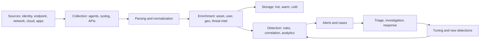

# Security information and event management (SIEM)

## Summary

A SIEM collects log and event data from across an environment, normalizes it into a common shape, stores it, correlates events from different sources and raises alerts for analysts to investigate. It exists because no single log shows an attack: a failed login in one system, a successful login in another and an unusual download in a third only mean something together. A SIEM is a data platform plus a detection layer plus a workflow. Its value is capped by what it receives (logging coverage and quality), by the rules and models that run on the data (detection engineering) and by the people and process that handle alerts ([SOC](security-operations-center.md)). Most failed SIEM projects fail on those three, not on the product.

## Prerequisites

- [Security operations center (SOC)](security-operations-center.md) and [SecOps](secops.md), the teams that use a SIEM.
- [IDS](../detection/ids.md), [IPS](../detection/ips.md) and [true and false positives](../detection/false-positive-false-negative.md), because alert quality is the main operating problem.
- [SOAR](soar.md), which automates responses to SIEM alerts, and [SOPs](sop.md).
- Basic knowledge of logs, syslog, time zones and regular expressions.

## Core concepts

### Definition

*SIEM* (security information and event management) combines two older disciplines. *Security information management* (SIM) is the long-term collection, storage and reporting of log data. *Security event management* (SEM) is real-time monitoring, correlation and alerting. Current products merge both and add analytics, case management and integration with response tools. I did not find a single normative definition; NIST SP 800-92 (*Guide to Computer Security Log Management*, September 2006, final, no revision listed on the CSRC page, checked 2026-10) is the standing NIST guide for the log management infrastructure that a SIEM sits on. It says it is not a step-by-step guide to implementing logging technologies. It is old, so its tool descriptions are dated while its process guidance on log sources, storage and review remains relevant.

In the CISSP outline the topic belongs to section 7.2 (logging and monitoring), which lists SIEM, log management, continuous monitoring and tuning, UEBA, egress monitoring and threat intelligence.

### Analogy

A SIEM is the control room of a power grid. Meters on every substation send readings, the control room puts them in one format, compares them with each other and with the expected pattern, and calls an engineer when a combination looks wrong. A single meter spiking means little. Three neighboring meters spiking together means a fault. The analogy breaks because grid meters are designed to be read, while most log sources were designed for debugging by their own authors, in their own formats and with their own clocks.

### Data pipeline



1. **Sources.** Identity providers, endpoints (EDR), firewalls and proxies, DNS, cloud audit logs, SaaS, databases, applications. The CISA, FBI, NSA and ACSC joint guide *Best Practices for Event Logging and Threat Detection* (August 21, 2024) is a public reference for what to log and how to detect living-off-the-land activity. A secondary summary lists its four key factors as enterprise-approved logging policies, centralized collection, secure storage and integrity, and detection strategies. I did not read the guide's body text.
2. **Collection.** Agents, syslog forwarding, API pulls from cloud and SaaS, streaming. Reliable delivery and a record of what was received are as important as the content.
3. **Parsing and normalization.** Each source has its own format and field names. Normalization maps them to a common schema so one rule can work across sources. Examples of schemas in use are the Elastic Common Schema, the Open Cybersecurity Schema Framework and the vendor schemas of commercial products. I did not verify these names against their specifications for this note.
4. **Enrichment.** Add context: which asset, who owns it, how critical it is, which user, geolocation, threat intelligence matches (see [threat intelligence](../../threat-intelligence/threat-intelligence.md)). Enrichment turns "10.0.4.7 failed a login" into "the domain controller failed a login for a privileged account".
5. **Storage.** Tiers by cost: hot (fast search, recent), warm and cold (cheap, slow, long retention). Retention is driven by investigations (dwell times of months, see [APTs](../../threats-and-attacks/advanced-persistent-threats/README.md)) and by laws.
6. **Detection.** Rules, correlation, statistical baselines and machine learning (UEBA).
7. **Alerting and case management.** Alerts become cases with an owner, evidence and a disposition (true positive, false positive, benign).
8. **Tuning.** Every disposition feeds back into rules and sources.

### Related NIST SP 800-53 controls

From the Rev. 5 control index kept in this repository:

| Control | Title | Baselines |
| --- | --- | --- |
| AU-2 | Event Logging | low, moderate, high, privacy |
| AU-3 | Content of Audit Records | low, moderate, high |
| AU-4 | Audit Log Storage Capacity | low, moderate, high |
| AU-6 | Audit Record Review, Analysis, and Reporting | low, moderate, high |
| AU-8 | Time Stamps | low, moderate, high |
| AU-9 | Protection of Audit Information | low, moderate, high |
| AU-11 | Audit Record Retention | low, moderate, high, privacy |
| AU-12 | Audit Record Generation | low, moderate, high |
| SI-4 | System Monitoring | low, moderate, high |

AU-8 matters in practice: if clocks are not synchronized, correlation across sources fails or lies.

### Detection approaches

| Approach | How it works | Strength | Weakness |
| --- | --- | --- | --- |
| Signature or rule | Match fields or patterns | Transparent, easy to explain | Only known behavior |
| Correlation | Combine events across sources and time | Finds multi-step behavior | Needs clean normalization and time sync |
| Threshold and statistical | Counts and rates against a baseline | Finds volume anomalies | Baselines drift |
| Behavioral analytics (UEBA) | Models normal for users and entities | Finds unknown behavior | Opaque, noisy at first |
| Threat intelligence matching | Compare with known bad indicators | Cheap | Indicators age quickly |
| Detection as code | Rules in version control, tested like software (portable rule formats such as Sigma are used for this) | Review, testing, reuse | Needs engineering skill |

Coverage should be measured against attacker behavior. Map rules to [MITRE ATT&CK](../../threat-intelligence/mitre/mitre-attack.md) techniques and look for gaps, then test the rules with a purple team exercise ([red, blue and purple teams](../../../security-assessment-and-testing/red-blue-purple-teams.md)).

### Operating metrics

| Metric | Meaning |
| --- | --- |
| Log source coverage (sources reporting / sources expected) | Blind spots |
| Ingestion latency | How late detection can be |
| Alert volume per analyst per shift | Capacity |
| True positive rate per rule | Rule quality |
| Mean time to detect and to acknowledge | Speed |
| ATT&CK coverage | Detection gaps |
| Cost per GB and per detection | Economics |

### Leading products

Commonly named SIEM platforms include Splunk Enterprise Security, Microsoft Sentinel, IBM QRadar, Elastic Security and Google's security operations platform. This list is carried over from the original notes. I did not evaluate any product and I make no ranking claim. Choose by log volume and sources, data residency, the team's skills, integration with existing tools and total cost, and run a proof of concept with your own data. The [CSPM tools](../../../security-architecture-and-engineering/cloud-and-infrastructure-security/cspm-tools.md) note shows a method for comparing vendor claims that applies here too.

## Worked example

Three log formats from three systems are normalized to one schema, and one correlation rule runs over the result: three failed logins for a user from an address, followed within 10 minutes by a successful login from that address, from a country the user does not normally use. Python 3.10, standard library only. The addresses are documentation addresses and the geolocation table is invented. The output is real.

```python
# Python 3.10, standard library only.
# Normalization of three log formats and one correlation rule: repeated failures, then a success from a new country.
import json
import re
from datetime import datetime, timedelta

raw = [
    "2026-10-27T09:00:01Z host=vpn-1 sshd[411]: Failed password for jdoe from 203.0.113.50 port 51122",
    "2026-10-27T09:00:09Z host=vpn-1 sshd[411]: Failed password for jdoe from 203.0.113.50 port 51130",
    "2026-10-27T09:00:15Z host=vpn-1 sshd[411]: Failed password for jdoe from 203.0.113.50 port 51141",
    json.dumps({"eventTime": "2026-10-27T09:02:30Z", "eventName": "ConsoleLogin", "userIdentity": {"userName": "jdoe"},
                "sourceIPAddress": "203.0.113.50", "responseElements": {"ConsoleLogin": "Success"}}),
    "EventID=4624 Time=2026-10-27T09:03:00Z TargetUserName=asmith IpAddress=198.51.100.9 LogonType=10",
]
GEO = {"203.0.113.50": "XX", "198.51.100.9": "PL"}          # documentation addresses with an invented geo table
USUAL = {"jdoe": {"PL"}, "asmith": {"PL"}}

def parse(line):
    if line.startswith("{"):
        d = json.loads(line)
        ok = d["responseElements"]["ConsoleLogin"] == "Success"
        return {"ts": d["eventTime"], "user": d["userIdentity"]["userName"], "src_ip": d["sourceIPAddress"],
                "action": "login", "outcome": "success" if ok else "failure", "source": "cloud-audit"}
    m = re.match(r"(\S+) host=(\S+) sshd\[\d+\]: Failed password for (\S+) from (\S+)", line)
    if m:
        return {"ts": m[1], "user": m[3], "src_ip": m[4], "action": "login", "outcome": "failure", "source": "linux-auth"}
    m = re.match(r"EventID=4624 Time=(\S+) TargetUserName=(\S+) IpAddress=(\S+)", line)
    if m:
        return {"ts": m[1], "user": m[2], "src_ip": m[3], "action": "login", "outcome": "success", "source": "windows-security"}
    raise ValueError("unparsed: " + line[:40])

events = sorted((parse(l) for l in raw), key=lambda e: e["ts"])
for e in events:
    print(e)

def t(e): return datetime.strptime(e["ts"], "%Y-%m-%dT%H:%M:%SZ")
def correlate(events, fails=3, window=timedelta(minutes=10)):
    alerts = []
    for e in events:
        if e["action"] == "login" and e["outcome"] == "success":
            recent = [f for f in events if f["user"] == e["user"] and f["outcome"] == "failure"
                      and f["src_ip"] == e["src_ip"] and timedelta(0) <= t(e) - t(f) <= window]
            new_country = GEO.get(e["src_ip"]) not in USUAL.get(e["user"], set())
            if len(recent) >= fails and new_country:
                alerts.append((e["user"], e["src_ip"], len(recent), "failures then success from a new country"))
    return alerts
print("alerts:", correlate(events))
```

Output:

```text
{'ts': '2026-10-27T09:00:01Z', 'user': 'jdoe', 'src_ip': '203.0.113.50', 'action': 'login', 'outcome': 'failure', 'source': 'linux-auth'}
{'ts': '2026-10-27T09:00:09Z', 'user': 'jdoe', 'src_ip': '203.0.113.50', 'action': 'login', 'outcome': 'failure', 'source': 'linux-auth'}
{'ts': '2026-10-27T09:00:15Z', 'user': 'jdoe', 'src_ip': '203.0.113.50', 'action': 'login', 'outcome': 'failure', 'source': 'linux-auth'}
{'ts': '2026-10-27T09:02:30Z', 'user': 'jdoe', 'src_ip': '203.0.113.50', 'action': 'login', 'outcome': 'success', 'source': 'cloud-audit'}
{'ts': '2026-10-27T09:03:00Z', 'user': 'asmith', 'src_ip': '198.51.100.9', 'action': 'login', 'outcome': 'success', 'source': 'windows-security'}
alerts: [('jdoe', '203.0.113.50', 3, 'failures then success from a new country')]
```

What happens:

1. **Normalization.** A Linux `sshd` line, a cloud audit JSON event and a Windows event record are parsed into the same fields (`ts`, `user`, `src_ip`, `action`, `outcome`, `source`). Without that step the rule would need three versions.
2. **Correlation.** The rule needs events from two sources: the failures come from `linux-auth` and the success from `cloud-audit`. No single log would have produced the alert, which is the reason a SIEM exists.
3. **Context.** `203.0.113.50` maps to a country that is not in the user's usual set, so the alert fires for `jdoe`. The Windows logon of `asmith` comes from the usual country with no preceding failures and produces no alert.
4. **Failure modes.** The rule depends on the correct clock in all three sources (a skew above 10 minutes breaks it), on a geolocation source (errors cause false positives with VPNs and mobile networks) and on complete collection (if the Linux log is not collected, no alert fires). It also misses a slow attack that spreads failures over hours. Each limitation is a tuning or coverage decision.

## Trade offs and when to use it

**Benefits.** One place to search across sources, correlation across domains, retention for investigations, compliance evidence and a base for [SOAR](soar.md) automation.

**Costs and limits.**

- Cost grows with ingestion volume in many products. Teams drop sources to save money, which creates blind spots. Decide by detection value per source, not by volume.
- Alert fatigue. A SIEM tuned badly produces thousands of alerts and analysts stop reading them. Measure the true positive rate per rule, retire noisy rules and write fewer, better detections.
- Data quality. Missing fields, wrong clocks and parsing errors silently break rules. Monitor source health as a detection of its own.
- Skills. Detection engineering and query languages need training.
- Latency and scale. Real-time correlation at high volume needs architecture and money.
- A SIEM is not prevention. It detects, so a response process must exist.
- Privacy and legal. Logs contain personal data. Access, retention and purpose limits apply, see [privacy regulations](../../../security-and-risk-management/privacy-regulations/privacy-regulations-overview.md).

**When it is the wrong first step.** A small organization with few systems and no one to watch alerts may get more from a managed detection service, strong endpoint detection and cloud-native alerting than from running its own SIEM.

**Alternatives and companions.** EDR/XDR platforms correlate within their own telemetry. Cloud-native monitoring covers one provider. A data lake with detection engineering gives flexibility at higher build effort. SOAR automates the response. Threat hunting finds what rules miss. All of these feed the [incident response lifecycle](nist-incident-response/README.md).

## Common mistakes

| Mistake | Effect | Fix |
| --- | --- | --- |
| Ingest everything, detect nothing | Cost and noise | Start from use cases and the ATT&CK techniques you must detect |
| Ingest too little to save cost | Blind spots | Rank sources by detection value, keep identity, endpoint and cloud audit |
| Unsynchronized clocks | Correlation fails, evidence weakened | NTP everywhere (AU-8), record clock offset |
| No source health monitoring | A silent source looks like a quiet network | Alert on missing logs |
| Rules never retired | Alert fatigue | Review rules by true positive rate |
| Treating vendor content as finished | Generic detections for another environment | Tune to your assets and users |
| No owner for alerts | Alerts expire | Assign queues, SLAs and escalation in the [SOP](sop.md) |
| Logs writable by the monitored admins | Evidence can be erased (AU-9) | Separate duties, immutable or remote storage |
| Retention shorter than dwell time | Cannot investigate old intrusions | Longer retention for identity and critical systems |

Detection and mitigation for the SIEM itself: alert on log source silence, on parsing failures, on deletion or changes to rules, and on administrative access to the platform. The SIEM is a high-value target because it holds credentials in logs and the means to blind the defenders.

## Practice

1. Name the eight stages of the SIEM data pipeline in this note.
2. Why does the worked example's rule need normalization, and what would break if the Linux server's clock were 15 minutes slow?
3. Which SP 800-53 control covers time stamps, and which covers protection of audit information?
4. A SIEM shows 10,000 alerts a day and analysts handle 300. Describe three changes, in order.
5. Extend the example so that a success from a usual country after three failures yields a lower-severity alert. What does this do to the false positive rate?
6. Which CISSP section covers SIEM?

**Answers and hints**

1. Sources, collection, parsing and normalization, enrichment, storage, detection, alerting and case management, tuning.
2. One rule across three formats needs one schema. With a clock 15 minutes slow, the failures would appear 15 minutes before their real time and fall outside the 10-minute window (or after the success), so the rule would not fire.
3. AU-8 (Time Stamps) and AU-9 (Protection of Audit Information).
4. Measure the true positive rate per rule, disable or tune the noisiest, then add context enrichment to suppress benign cases, then automate low-risk triage with SOAR.
5. Add a second severity branch based on `new_country`. It reduces analyst load on benign cases but can hide credential stuffing from usual countries, so keep a count-based detection too.
6. Section 7.2 (logging and monitoring), with related sections 7.6 (incident management) and 7.7 (detective and preventive measures). See [CISSP security domains](../../../security-and-risk-management/reference/certifications/cissp-security-domains.md).

## Further reading

- NIST, [SP 800-92, Guide to Computer Security Log Management](https://csrc.nist.gov/pubs/sp/800/92/final) (September 2006). Only the abstract and status were read.
- CISA, FBI, NSA, ASD's ACSC and partners, [Best Practices for Event Logging and Threat Detection](https://cisa.gov/resources-tools/resources/best-practices-event-logging-and-threat-detection) (August 21, 2024). Existence, date and section titles confirmed through search results. The body was not read.
- NIST SP 800-53 Rev. 5, AU and SI-4 controls: see the [SP 800-53 note](../../../security-and-risk-management/governance-and-compliance/frameworks/nist-sp-800-53/README.md).
- MITRE ATT&CK data sources and techniques: see [MITRE ATT&CK](../../threat-intelligence/mitre/mitre-attack.md).
- [SOC](security-operations-center.md), [SOAR](soar.md), [SOP](sop.md) and the [NIST incident response lifecycle](nist-incident-response/README.md) in this repository.
