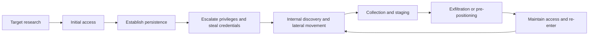

# Advanced persistent threats (APTs)

## Summary

An advanced persistent threat is an adversary with significant skill and resources who pursues a goal against a specific target over a long period, adapts when defenders react and uses several attack vectors to get in and stay in. The word describes the adversary and its behavior, not a tool or a vulnerability. The goal is usually espionage, sabotage preparation or long-term access, and the defining difficulty for defenders is time: access that lasts months or years, built from legitimate credentials and built-in tools, leaves few alerts. This note defines the term, shows how a campaign is structured, uses two documented cases (APT29 and Volt Typhoon), runs two hunting analytics and explains what changes in defense when you assume the attacker may already be inside.

## Prerequisites

- [Threats and attacks overview](../threats-and-attacks-overview.md) and [attack categorization](../attack-categorization.md).
- [Attack lifecycle](../attack-lifecycle/README.md), [reconnaissance](../attack-lifecycle/reconnaissance.md) and [privilege escalation](../attack-lifecycle/privilege-escalation.md).
- [Threat intelligence](../../threat-intelligence/threat-intelligence.md) and [MITRE ATT&CK](../../threat-intelligence/mitre/mitre-attack.md).
- [Attack vectors](../attack-vectors/README.md), because an APT uses several.

## Core concepts

### Definition

NIST defines an advanced persistent threat (NIST SP 800-39, repeated in SP 800-30 Rev. 1, SP 800-53 Rev. 5 and others, checked on the NIST CSRC glossary 2026-10) as an adversary with sophisticated levels of expertise and significant resources that uses multiple attack vectors, such as cyber, physical and deception, to establish and extend a foothold in an organization's information technology infrastructure. The goals are to exfiltrate information, undermine or impede critical aspects of a mission, or position itself to do so in the future. The adversary pursues these goals repeatedly over an extended period, adapts to defenders' efforts to resist it and is determined to maintain the level of interaction needed to execute its goals. SP 800-160 Vol. 2 Rev. 1 adds that the term can describe collections of adversaries that collaborate, overlap opportunistically or converge inadvertently.

The three words matter separately:

| Word | Meaning | Consequence for defense |
| --- | --- | --- |
| Advanced | Skill, resources, custom tools, access to zero days, the ability to combine cyber with physical or deception methods | Signature-only detection is not enough |
| Persistent | Long-term objective, repeated attempts, re-entry after eviction | A single cleanup is not an answer |
| Threat | A human organization with intent and capability, not just software | Understand motives, pick controls by adversary behavior |

An APT is not automatically a nation state. Criminal groups can also show persistence and skill, and states sometimes use contractors and criminals. Attribution is a separate, difficult judgment and is normally made by governments and vendors on the basis of intelligence that defenders do not see.

### Analogy

A burglar who casts the house for months, copies a key, comes back when the family is away, takes a few things at a time and puts the lock back as it was. A smash-and-grab thief is the opposite: fast, loud and gone. The analogy breaks because an APT may not take anything at all for years: pre-positioning for later use is a goal in the NIST definition.

### How campaigns are structured

APT operations follow the phases of the general [attack lifecycle](../attack-lifecycle/README.md), but at slower speed and with more care for staying hidden.



The loop from maintenance back to discovery is the persistent part: the actor returns, widens access and rebuilds footholds. Defenders map observed behavior to ATT&CK techniques to see which stages they can already detect.

Typical technique families, with ATT&CK examples from the APT29 group page (checked 2026-10):

| Stage | Technique | ATT&CK ID |
| --- | --- | --- |
| Initial access | Software supply chain compromise (a trojanized SolarWinds Orion update) | T1195.002 |
| Initial access | Spearphishing attachment | T1566.001 |
| Execution | PowerShell | T1059.001 |
| Persistence, credential access | Additional cloud credentials added to OAuth applications and service principals | T1098.001 |
| Valid accounts | Cloud accounts, including a global administrator in the cloud directory | T1078.004 |
| Credential access | DCSync, replicating directory data from domain controllers | T1003.006 |
| Collection | Remote email collection from compromised tenants | T1114.002 |
| Defense evasion | Web session cookie, including a forged cookie to bypass MFA on an email account | T1550.004 |

### Case 1: APT29

ATT&CK describes APT29 (group G0016) as a threat group linked to Russia's Foreign Intelligence Service (SVR), active since at least 2008, often targeting government networks in Europe and NATO members, research institutes and think tanks. In April 2021 the US and UK governments attributed the SolarWinds compromise to the SVR. The page lists many names that vendors use for the same or overlapping activity, among them Cozy Bear, The Dukes, NOBELIUM, UNC2452 and Midnight Blizzard. Names differ by vendor and by clustering method, so a mapping between them is a judgment, not a fact.

The technique list above shows a pattern: supply chain compromise for access, then identity as the main tool (cloud accounts, OAuth credentials, session cookies) and email as the main target of collection. See [supply-chain attacks](../../../software-development-security/application-security/supply-chain/supply-chain-attacks/README.md) for the SolarWinds response.

### Case 2: Volt Typhoon

CISA, NSA and FBI, with partners in Australia, Canada, the UK and New Zealand, published advisory AA24-038A on February 7, 2024. They assessed with high confidence that PRC state-sponsored actors known as Volt Typhoon were pre-positioning on IT networks to enable disruption of operational technology functions, and said the activity was not consistent with traditional espionage. The targeted sectors were communications, energy, transportation systems, and water and wastewater, including smaller organizations that serve larger ones.

Key facts for defenders, from the advisory:

- *Living off the land* (LOTL), the use of built-in tools, was "a hallmark" of the activity: PowerShell, `vssadmin`, `ntdsutil`, `wmic`, `netsh` and `certutil` are named. The actors extracted the Active Directory database from domain controllers, often through volume shadow copies, to obtain credentials.
- They used valid accounts for persistence and cleared logs.
- The agencies observed actors maintaining footholds in some victim environments for at least five years, and re-targeting organizations over several years by repeatedly stealing domain credentials.
- Priority actions: patch internet-facing systems, deploy phishing-resistant MFA, enable and centralize application, access and security logging, and replace end-of-life technology. Further advice: remove credentials from edge devices, least privilege for administrators, limit RDP, segment OT from IT, and, in incident response, assume full domain compromise and reset the `krbtgt` account twice.

The case shows why APT defense differs from malware defense. There is little malware to find. The behavior consists of legitimate tools and valid accounts used for the wrong purpose.

### Detection principles

1. **Hunt, do not wait for alerts.** Assume breach: a hypothesis-driven search in telemetry, based on ATT&CK techniques and threat intelligence.
2. **Baseline normal.** LOTL detection relies on knowing which admin tools are used by which accounts on which hosts.
3. **Log what matters and keep it long.** The advisory recommends centralized logging, and dwell times of years mean short retention hides the start.
4. **Focus on identity.** Impossible travel, new OAuth credentials, new service principals, directory replication from unusual hosts, and cookie or token theft.
5. **Watch egress.** Beaconing, slow exfiltration and new destinations (see the worked example).
6. **Correlate across sources.** Weak signals in endpoint, identity and network data are the only ones available early.

### Response differences

Eviction of an APT is a project. Partial cleanup warns the actor and encourages them to dig deeper or switch access. Sound practice (also reflected in the CISA directive for SolarWinds) is to scope fully, plan the eviction, act in one coordinated step (reset credentials, remove persistence, block infrastructure) and then monitor for return. Credentials that touched compromised systems are treated as compromised, including the directory trust (`krbtgt` reset twice in the Volt Typhoon advice). See the [NIST incident response lifecycle](../../defensive-operations/operations/nist-incident-response/README.md).

## Worked example

The script `scripts/apt-hunting-signals.py` shows two analytics on synthetic telemetry that uses documentation addresses only. Python 3.10, standard library only, fixed random seed. The output is real.

```bash
python3 scripts/apt-hunting-signals.py
```

Output:

```text
1 beacon analysis (cv = stdev/mean of the interval)
   198.51.100.10 (updates.example)    n= 24 mean gap=   3659s cv= 0.21 -> REVIEW
   203.0.113.77 (cdn-a.example)       n=300 mean gap=    288s cv= 0.96 -> ok
   203.0.113.200 (c2.example)         n=288 mean gap=    299s cv= 0.05 -> REVIEW
   192.0.2.50 (slow.example)          n= 24 mean gap=   3567s cv= 0.03 -> REVIEW
2 living-off-the-land rules
   srv-it-01  admin.jdoe   ALERT: credential database access via shadow copy or ntdsutil
   srv-dc-02  svc-backup   ALERT: credential database access via shadow copy or ntdsutil
   wks-114    mlee         ALERT: certutil used as a downloader or decoder
   srv-app-07 svc-app      ALERT: event log cleared
   wks-020    pkim         no rule matched
```

1. **Beaconing.** A command-and-control implant that checks in on a timer produces regular intervals. The coefficient of variation (standard deviation divided by mean of the gaps) is low for timers and high for human browsing (0.96 for the bursty CDN traffic). The 5-minute implant with 10% jitter scores 0.05. The low-and-slow hourly beacon scores 0.03, and shows why checking only high-volume flows misses it. The first row is the lesson in false positives: a legitimate update checker with 40% jitter scores 0.21 and falls under the 0.25 threshold. A real hunt adds context: destination age and reputation, process that opened the connection, whether the destination is known, and the byte counts. The score only selects what to look at.
2. **Living off the land.** Each rule matches a documented pattern: `vssadmin create shadow` and `ntdsutil ... ifm` for credential database access, `certutil -urlcache` for download, `wevtutil cl` for log clearing. The `svc-backup` case shows the cost: a backup service account may legitimately run `vssadmin`, so the rule fires on normal activity too. Tune by account and host baseline instead of disabling the rule. `ipconfig /all` is ordinary and matches nothing.

Both analytics are deliberately simple. Their value is in showing what an APT hunt is made of: a hypothesis from a technique (T1071 command and control, T1003 credential dumping), a data source, a rule and a decision about false positives.

## Trade offs and when to use it

**Defend against APTs when** the organization holds what such actors want: government and defense data, critical infrastructure, intellectual property, a position in a supply chain, or access to others (managed service providers). Organizations far from these roles face lower APT risk, but can be reached as a stepping stone, as the advisory notes about smaller organizations serving larger ones.

**Costs of the APT-grade program:** logging at scale with long retention, a hunting capability or a service for it, threat intelligence, identity hardening and segmentation, and practiced eviction. Smaller organizations get most of the value from a short list: phishing-resistant MFA, patching of internet-facing systems, centralized logs, least privilege for administrators and segmentation of the most critical systems.

**Limits.** Nothing prevents a determined actor with a zero day or a trusted supplier. The goal is to raise cost, shorten dwell time and limit what can be reached. Threat intelligence reports (including the vendor names) are inputs of mixed quality and need to be cross-checked.

**Alternatives and companions.** Threat modeling places likely adversaries in the design ([threat modeling](../../../security-and-risk-management/threat-modeling/threat-modeling.md)). Deception (honeytokens, honeypots) catches lateral movement early. Purple team exercises test whether the hunts work, see [red, blue and purple teams](../../../security-assessment-and-testing/red-blue-purple-teams.md).

## Common mistakes

| Mistake | Effect | Fix |
| --- | --- | --- |
| Treating APT as a product category | Buying a tool does not provide hunting | Fund people, data and process |
| Detecting only malware | LOTL and valid accounts pass | Add behavior and identity analytics |
| Short log retention | Dwell time exceeds retention | Retain longer for identity and critical systems |
| Cleaning only the infected host | The actor returns via other footholds | Scope fully, evict in one step |
| Resetting passwords but not tokens, keys, service principals | Persistence remains | Reset all credential types and review OAuth and directory objects |
| Over-trusting attribution | Wrong priorities | Use behavior and techniques, not names |
| Ignoring end-of-life edge devices | Common entry point in the advisory | Inventory and replace, see [asset management](../../../asset-security/asset-management/README.md) |
| Running hunts once | The actor adapts | Repeat and automate the useful ones as detections |

Detection and mitigation are the substance of this note, summarized in the detection principles and the Volt Typhoon priority actions above.

## Practice

1. Which words of the NIST definition justify long retention and a hunting program?
2. Why is attribution to a state a weak basis for choosing controls?
3. In the beacon analysis, the update checker is flagged. Name three data points you would add to avoid wasting time on it.
4. The advisory says to reset `krbtgt` twice. Why twice, and what does it do?
5. Map each of these behaviors to ATT&CK: DCSync, forged session cookie, trojanized update.
6. The script already has a rule for `netsh ... portproxy`, but no test event. Add an event that triggers it. Which adversary objective does it serve?

**Answers and hints**

1. "Repeatedly over an extended period" and "maintain the level of interaction". Long dwell time and re-entry mean old data matters and one detection is not enough.
2. Names differ by vendor, attribution is slow and uncertain, and the same techniques are reused by many actors. Controls should address techniques.
3. Destination reputation and age, the process and user that made the connection, and the payload sizes and direction. Also whether the destination appears in other hosts' software inventory.
4. The `krbtgt` account's password hash signs Kerberos tickets. Resetting it invalidates forged tickets, and a second reset is needed because the previous password is kept as a valid prior value. I describe this from general Kerberos knowledge and did not verify it in the advisory text I read.
5. T1003.006, T1550.004 and T1195.002.
6. Add an event such as `netsh interface portproxy add v4tov4 listenport=8080 connectaddress=192.0.2.9 connectport=80`. The rule serves lateral movement or tunnel setup: it forwards traffic through a compromised host to an internal system.

## Further reading

- NIST CSRC glossary, [advanced persistent threat](https://csrc.nist.gov/glossary/term/advanced_persistent_threat): the definition and its sources (SP 800-39 and later publications).
- MITRE ATT&CK, [APT29 (G0016)](https://attack.mitre.org/groups/G0016/): attribution statement, associated names and technique list. Read in part.
- CISA, NSA, FBI and partners, [AA24-038A, PRC State-Sponsored Actors Compromise and Maintain Persistent Access to U.S. Critical Infrastructure](https://www.cisa.gov/news-events/cybersecurity-advisories/aa24-038a) (February 7, 2024): the Volt Typhoon case and its mitigations. Read in part.
- Mandiant, *APT1: Exposing One of China's Cyber Espionage Units* (February 2013): the report that made the APT naming convention public. The report page redirected during this check, so none of its figures are quoted here. See the [Mandiant](../../../security-and-risk-management/reference/organizations/mandiant.md) note.
- [Supply-chain attacks](../../../software-development-security/application-security/supply-chain/supply-chain-attacks/README.md) and [CISA ED 21-01](https://www.cisa.gov/news-events/directives/ed-21-01-mitigate-solarwinds-orion-code-compromise) for the SolarWinds response requirements.
