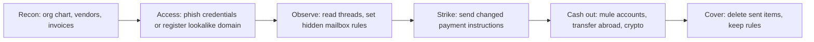

# Business email compromise (BEC)

## Summary

Business email compromise is a fraud in which an attacker uses email, either from a real hijacked account or from a convincing fake one, to make an employee send money or sensitive data to the wrong place. It carries no malware in its classic form, so antivirus and sandboxes do not see it. The weapon is a believable request in the right thread at the right moment, usually about an invoice, a change of bank details, payroll or a gift card purchase. In the FBI IC3 report for 2024, BEC produced 21,442 complaints and $2.77 billion in reported losses, the second highest loss of any crime type in the report. Defense is mostly process: verify payment changes out of band, authenticate mail properly, watch mailboxes for hidden rules and make recovery fast.

## Prerequisites

- [Social engineering](../../../security-and-risk-management/security-awareness/social-engineering/social-engineering.md), [phishing](../../../security-and-risk-management/security-awareness/social-engineering/phishing.md) and [impersonation](../../../security-and-risk-management/security-awareness/social-engineering/impersonation.md).
- [Authentication methods](../../../identity-and-access-management/identity-and-access/authentication/authentication-methods.md), because account takeover is a common first step.
- The [NIST incident response lifecycle](../../defensive-operations/operations/nist-incident-response/README.md) for handling a confirmed case.

## Core concepts

### Definition

The FBI Internet Crime Complaint Center (IC3) defines business email compromise as "a scam targeting businesses or individuals working with suppliers and/or businesses regularly performing wire transfer payments. These sophisticated scams are carried out by fraudsters by compromising email accounts and other forms of communication such as phone numbers and virtual meeting applications, through social engineering or computer intrusion techniques to conduct unauthorized transfer of funds." (2024 IC3 Annual Report, Appendix B, checked 2026-10.) The definition names four things worth keeping: it is a fraud with a financial goal, it targets payment processes, the channel is not only email, and the means range from social engineering to intrusion.

BEC differs from related terms:

| Term | Difference |
| --- | --- |
| Phishing | Phishing steals credentials or delivers malware, usually in bulk. BEC may start with phishing, but the loss comes from a payment or data transfer. |
| Account takeover | An attacker controls a real mailbox. BEC can use a takeover or a lookalike domain without any takeover. |
| Ransomware | Extorts through encryption or leak threats. BEC needs no malware. |
| Invoice fraud | A forged invoice without an email compromise. A BEC variant uses a hijacked thread to make the invoice believable. |

### Analogy

A forger who learns how an office signs and approves payments, then slips a changed note into the real approval stack at the moment the clerk is busy. The forger does not break the safe. They change the instruction the clerk already trusts. The analogy breaks because in BEC the attacker often reads the real conversation for weeks first, so the forged note matches the style, timing and people.

### Why it works

1. **Payments are routine.** Accounts payable handles many invoices, and a change of bank details is a legitimate event.
2. **Authority and urgency.** Impersonating an executive or a supplier uses the social cues that make staff skip checks.
3. **Email is trusted by default.** A message in an existing thread looks like part of the conversation.
4. **Money moves fast and is hard to recover.** Wire transfers are irreversible after a short window.
5. **No technical indicator.** There may be no malicious link, attachment or exploit to block.

### Common scenarios

The IC3 report does not list a taxonomy in the part I read. The following are the patterns described across public guidance, summarized here and not verified against one source:

| Scenario | Mechanism |
| --- | --- |
| Vendor invoice or bank-detail change | Attacker impersonates a supplier, or hijacks the supplier's mailbox, and sends new payment details |
| CEO or executive fraud | Attacker poses as an executive and asks finance for an urgent transfer or for gift cards |
| Payroll diversion | Attacker poses as an employee and asks HR to change direct deposit details |
| Real estate and legal closings | Attacker intercepts a closing thread and sends new wire instructions (the IC3 report describes one such case with a loss of $6,661,650 that the Recovery Asset Team worked on) |
| Data theft | Attacker poses as an executive and requests tax forms or employee records |
| Multi-channel variants | Phone, messaging or video meeting used for the request or for confirmation |

### Attack chain



The diagram shows that the loss event (D and E) is the last step of a longer chain. Detection is easier earlier. In MITRE ATT&CK terms the chain includes phishing for credentials (Initial Access), valid accounts, and Email Forwarding Rule (T1114.003, tactic Collection). ATT&CK states that forwarding rules can persist after administrators reset compromised credentials, and that some attackers hide rules by changing their properties through MAPI so they do not appear in Outlook, OWA or most Exchange admin tools. Its listed observed groups for that technique include Scattered Spider and LAPSUS$ (checked 2026-10).

### Scale (IC3, 2024)

Figures from the *2024 IC3 Annual Report* (FBI), read from the PDF:

| Year | BEC complaints | BEC reported losses |
| --- | --- | --- |
| 2022 | 21,832 | $2,742,354,049 |
| 2023 | 21,489 | $2,946,830,270 |
| 2024 | 21,442 | $2,770,151,146 |

The numbers show a stable volume of about 21,500 complaints a year and losses near $2.7 to $2.9 billion. They count complaints that victims reported, so the real figures are larger. Do not compare the total with ransomware losses without noting that the IC3 reports each crime type by its own definitions.

IC3 also runs a Recovery Asset Team that uses the Financial Fraud Kill Chain to freeze fraudulent transfers. In 2024 it handled 3,020 complaints with $848.4 million in attempted theft: 2,651 domestic complaints with $469.1 million frozen and 369 international complaints with $92.5 million frozen, a 66% success rate. The report says most incidents initiated by the team are BEC. The lesson for victims: report within hours, because recovery depends on speed.

### Controls

Controls fall into four layers.

**1. Process (the most effective).**
- Verify any change of bank details, and any unusual payment request, through a second channel, using a contact detail you already hold and not one in the message. The IC3 educational flyer in the report says "Check - Call - Wait".
- Two-person approval above a threshold, and a hold period for first payments to a new account.
- Separate the person who requests a vendor change from the one who approves it.
- Pre-agreed code words or procedures for executive requests.

**2. Email authentication and filtering.**
- SPF, DKIM and DMARC on your own domains. DMARC lets a domain owner publish a policy (`none`, `quarantine` or `reject`) for mail that fails alignment of the From domain with SPF or DKIM. RFC 7489 (March 2015, Informational) specified DMARC; the RFC Editor page now marks it obsolete and replaced by RFCs 9989, 9990 and 9991, which I did not read.
- Rules for lookalike domains, display name matching with internal executives, external sender banners and newly registered domains.
- Register obvious lookalikes of your own domain defensively where practical.

**3. Identity.**
- Multi-factor authentication that resists phishing (see [authentication methods](../../../identity-and-access-management/identity-and-access/authentication/authentication-methods.md)), conditional access and alerts for impossible travel or new devices.
- Disable external auto-forwarding by default. ATT&CK mitigations for T1114.003 are to audit inbox and transport rules regularly, consider disabling external forwarding and verify critical email-initiated requests out of band.

**4. Detection and response.**
- Alert on new inbox rules, forwarding to external domains and rules that move mail with payment words to unusual folders.
- Playbook for a suspected BEC: stop the payment, call the bank immediately, report to IC3 and the national equivalent, preserve mailbox audit logs, revoke sessions, remove rules, reset credentials and inform the counterparty over a trusted channel. Evidence handling follows [chain of custody](../../digital-forensics/chain-of-custody/README.md).

## Worked example

The script `scripts/bec-signals.py` implements three signals on synthetic data with reserved example domains. Python 3.10, standard library only. The output is real.

```bash
python3 scripts/bec-signals.py
```

Output:

```text
1 sender domain supplier-co.example        -> known partner
1 sender domain supp1ier-co.example        -> edit distance <=2 from supplier-co.example
1 sender domain supplier-c0.example        -> edit distance <=2 from supplier-co.example
1 sender domain supplier-co.example.net    -> no match
1 sender domain newvendor.example          -> no match
2 rule by cfo@acme-corp.example    -> forwards to an external address
2 rule by ap@acme-corp.example     -> hides payment mail in a rarely read folder
2 rule by hr@acme-corp.example     -> looks normal
3 change, no callback            -> held: no out-of-band confirmation
3 callback to number in email    -> held: callback used a number from the email, not the number on file
3 callback to number on file     -> applied after callback to the number on file
```

1. **Lookalike domain.** Replacing `i` by `1` or `o` by `0` is within edit distance 2 of a known partner and is flagged. The fourth case, `supplier-co.example.net`, is not flagged. That is a blind spot of edit distance: appending a suffix keeps the partner name but changes the registered domain. A production check must compare the registered domain (using the public suffix list) and look for the partner string inside other domains, which this script does not do. `newvendor.example` is simply unknown and needs a new-vendor process, not a similarity score.
2. **Mailbox rules.** A rule forwarding the CFO's mail to an external address and a rule that moves mail with `invoice`, `wire` or `payment` to the `RSS Subscriptions` folder are the two patterns attackers use to read replies and to hide the victim's view of the conversation. A normal newsletter rule is not flagged. In Exchange Online the data comes from the audit log (`New-InboxRule`, `Set-InboxRule`), which ATT&CK lists as the data source (analytics AN1589 and AN1591).
3. **Payment gate.** The system applies a bank-detail change only after a callback to the phone number already on file. A callback to the number in the email reaches the attacker, so the control fails if the number is taken from the request. This is the most important rule of the whole note, and it is the one most often broken under time pressure.

## Trade offs and when to use it

**Process controls cost time.** Callbacks and two-person approvals slow payments. Apply them by risk: new vendors, changes of bank details, high amounts, first payments, and requests marked urgent. Routine payments to unchanged details need no extra step.

**Technical controls are partial.** DMARC protects your own domain from direct spoofing, but not lookalike domains and not a real hijacked mailbox of a supplier. Filtering lookalikes produces false positives. Identity controls reduce takeover, not the fraud that uses a fake domain.

**Insurance and recovery.** Cyber insurance may cover some losses and often requires specific controls. Recovery through banks depends on speed, as the IC3 Financial Fraud Kill Chain statistics show. Treat both as a backstop, not a control.

**When this effort is not the priority.** An organization that makes no wire transfers and has no vendor payments has a smaller BEC exposure, though payroll and data-theft variants remain.

## Common mistakes

| Mistake | Effect | Fix |
| --- | --- | --- |
| Verifying a change by replying to the same email | The attacker confirms their own request | Call a number from your records |
| Using the phone number in the email signature | Same as above | Use the vendor master record |
| Training users to spot bad grammar | Messages are well written, sometimes AI-assisted | Train on process triggers (payment change, urgency, secrecy) |
| Resetting the password but not removing rules and sessions | Forwarding rules persist, as ATT&CK notes | Remove rules, revoke tokens, check OAuth consents |
| Treating a clean malware scan as proof of safety | BEC has no malware | Investigate mailbox audit logs |
| Waiting for confirmation before calling the bank | Funds move out | Call the bank and report within hours |
| One approver for both vendor changes and payments | Single point of failure | Separation of duties, see CISSP section 7.4 |
| No logging of mailbox rule creation | No detection | Enable and alert on audit events |

## Practice

1. Which of the four BEC definition elements from IC3 explains why antivirus does not detect it?
2. A supplier emails "our bank has changed, please use these details" from the real supplier address. Name two reasons the address can be real and the request still false, and the one control that handles both.
3. Why does the script's lookalike check miss `supplier-co.example.net`, and how would you fix it?
4. After removing a compromised mailbox's access, what two things must you still check?
5. Using the IC3 figures, compute the average reported loss per BEC complaint in 2024.
6. A finance team is asked to wire money "urgently and confidentially" by the CEO who is traveling. List the checks, in order.

**Answers and hints**

1. The definition says "social engineering or computer intrusion techniques" and a "fraud" aimed at fund transfer. There need be no malicious file or link.
2. The supplier's mailbox may be compromised, or the supplier's own systems abused. The control is out-of-band verification using contact details on file.
3. Edit distance compares the whole string. Extract the registered domain with the public suffix list and flag any domain that contains a partner name but differs from the partner's registered domain.
4. Mailbox rules (including hidden ones) and OAuth consents or tokens. Also check delegated access and connected apps.
5. $2,770,151,146 divided by 21,442 is about $129,200 per complaint. The mean is pulled up by a few very large cases, so the median would be lower; the report does not give a median in the part read.
6. Stop, do not reply to the email, call the CEO on a number from the directory, apply the two-person approval, check the account against the vendor master, and report if it is fraud.

## Further reading

- FBI IC3, [2024 Internet Crime Report](https://www.ic3.gov/AnnualReport/Reports/2024_IC3Report.pdf): BEC definition, counts, losses and the Financial Fraud Kill Chain. The PDF was downloaded and read for this note.
- MITRE ATT&CK, [T1114.003 Email Collection: Email Forwarding Rule](https://attack.mitre.org/techniques/T1114/003/): the rule technique, mitigations and detection data.
- IETF, [RFC 7489 (DMARC)](https://www.rfc-editor.org/rfc/rfc7489): the original DMARC specification. The page lists it as obsolete; check the replacement RFCs for the current text.
- FBI IC3, PSA "Business Email Compromise: The $55 Billion Scam" (September 11, 2024), listed in the report appendix. Not read.
- CISSP section 7.4 (segregation of duties) and 1.12 (awareness): see [CISSP security domains](../../../security-and-risk-management/reference/certifications/cissp-security-domains.md).
