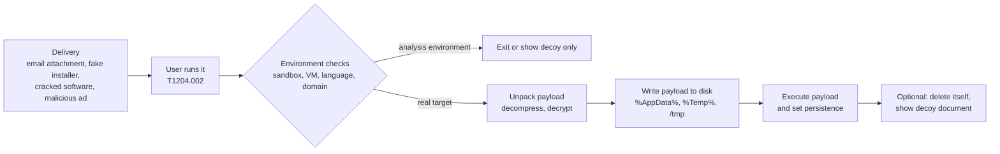

# Dropper

## Summary

A dropper is malware whose job is to install other malware: it carries one or more payloads inside itself, writes ("drops") them onto the system and starts them. It is usually the first stage that reaches the victim, disguised as a document, an installer, a cracked program or an update, and it is built to look harmless to scanners, so its payload is compressed, encrypted or hidden inside another file format. Microsoft's definition separates it from a *downloader*, which fetches the payload from the internet instead of carrying it. Droppers matter to defenders because they mark the moment an intrusion turns into installed malware: catching the dropper, or the file it writes and runs, stops everything that follows. Offensive aspects in this note are for defensive analysis only.

## Prerequisites

- [Malware](malware.md) and [malware definition and purpose](malware-definition-and-purpose.md).
- [Phishing](../../../security-and-risk-management/security-awareness/social-engineering/phishing.md) and [drive-by attacks](../web-attacks/drive-by-attack.md), the usual delivery routes.
- File formats at a basic level: executables start with a recognizable header (`MZ` and `PE` on Windows, `\x7fELF` on Linux).

## Core concepts

### Definition

Microsoft's malware classification (Microsoft Defender XDR documentation, "How Microsoft identifies malware and potentially unwanted applications", checked 2026-11):

- **Dropper**: "A type of malware that installs other malware files onto your device. Unlike a downloader, a dropper doesn't need to connect to the internet to drop malicious files. The dropped files are typically embedded in the dropper itself."
- **Downloader**: "A type of malware that downloads other malware onto your device. It must connect to the internet to download files."

In practice, many first-stage programs do both, and analysts also use *loader* for code that loads a payload into memory (often without writing it to disk) and *stager* for a small first stage that pulls a larger one. Naming is not standardized across vendors.

MITRE ATT&CK (Enterprise v20.1) has no "dropper" technique; the behavior maps to:

| Technique | Dropper aspect |
| --- | --- |
| T1204.002 User Execution: Malicious File | The user opens the dropper, often after phishing |
| T1027.009 Embedded Payloads | Payloads embedded "within other files to conceal malicious content from defenses" |
| T1027 Obfuscated Files or Information | Compressed, encrypted or encoded payloads |
| T1036 Masquerading | Names and icons that imitate documents or installers |
| T1105 Ingress Tool Transfer | The downloader variant, fetching tools from outside |
| T1497 Virtualization/Sandbox Evasion | Checking for analysis environments "before dropping secondary or additional payloads" |

| Term | Carries payload | Needs network | Writes payload to disk |
| --- | --- | --- | --- |
| Dropper | Yes | No | Yes, usually |
| Downloader | No | Yes | Usually |
| Loader | Sometimes | Sometimes | Often not, loads into memory (see [fileless malware](fileless-malware/README.md)) |
| Installer (legitimate) | Yes | Sometimes | Yes, with consent and a clear uninstaller |

### Analogy

A dropper is a parcel delivered to an office reception. The box looks like an ordinary delivery of printer paper, passes the front desk, and once inside the building someone opens it and finds a smaller box that sets itself up in a corner. The reception checked the outside of the box, which was harmless.

The analogy fits the two-stage nature and the disguise. It breaks because a parcel cannot inspect the room before opening. Real droppers often check whether they are in a sandbox or analysis virtual machine and stay dormant there, so the "parcel" behaves differently in the mail room than in the target office.

### Lifecycle



The diagram shows where defenders can intervene: at delivery (mail and web filtering), at user execution (application control, Mark of the Web), at unpacking (static and emulation-based scanning), at the file write and execution (EDR, file creation in user-writable paths followed by execution) and at persistence.

### How payloads are hidden

- **Embedded resources and overlays.** The payload is stored as a resource section or appended after the end of the executable (an *overlay*).
- **Compression and encryption.** The payload has near-random bytes, so signatures do not match. High *Shannon entropy* (close to 8 bits per byte) is a weak but useful hint.
- **Container files.** ISO, IMG and VHD disk images, archives with passwords, HTML files that assemble a file in the browser (HTML smuggling).
- **Document carriers.** Office macros or document exploits that write and run a file.
- **Installer packaging.** Real installer frameworks (NSIS, Inno Setup, MSI) wrap a malicious program next to or instead of the advertised software.

## Worked example

A static triage script looks for two signs of an embedded payload: executable headers at non-zero offsets inside a file, and windows of high entropy. It is read-only and uses Python 3.10's standard library:

```python
import math, sys

def entropy(b: bytes) -> float:
    if not b:
        return 0.0
    counts = [0] * 256
    for x in b:
        counts[x] += 1
    return -sum(c / len(b) * math.log2(c / len(b)) for c in counts if c)

def embedded_headers(data: bytes):
    hits = []
    i = data.find(b"\x7fELF", 1)
    while i != -1:
        hits.append((i, "ELF header"))
        i = data.find(b"\x7fELF", i + 1)
    i = data.find(b"MZ", 1)
    while i != -1:
        pe = int.from_bytes(data[i + 0x3C:i + 0x40], "little") if i + 0x40 <= len(data) else 0
        if pe and data[i + pe:i + pe + 4] == b"PE\0\0":   # MZ followed by a valid PE signature
            hits.append((i, "PE (Windows executable) header"))
        i = data.find(b"MZ", i + 1)
    return hits

def report(path, window=4096):
    data = open(path, "rb").read()
    print(f"{path}: {len(data)} bytes, whole-file entropy {entropy(data):.2f} bits/byte")
    for off, kind in embedded_headers(data):
        print(f"  embedded {kind} at offset {off}")
    high = [o for o in range(0, len(data), window) if entropy(data[o:o + window]) > 7.2]
    if high:
        print(f"  {len(high)} window(s) of {window} bytes with entropy > 7.2 (compressed or encrypted), first at {high[0]}")

for p in sys.argv[1:]:
    report(p)
```

Test files built only from harmless parts on Ubuntu 22.04:

- `installer-sample.bin`: a three-line shell script ("Setup wizard 1.0"), followed by a copy of `/bin/true`, followed by 20,000 random bytes standing in for an encrypted payload section. Nothing in it extracts or runs anything; it only has the shape of a dropper.
- `container-pe.bin`: 30 bytes of padding followed by a copy of a Windows .NET executable from the Mono package (`chktrust.exe`).
- Two reference files: `/bin/true` itself and a plain text license file.

```bash
python3 scan_embedded.py installer-sample.bin container-pe.bin /bin/true /usr/share/common-licenses/GPL-3
```

Output:

```text
installer-sample.bin: 46977 bytes, whole-file entropy 6.48 bits/byte
  embedded ELF header at offset 41
  5 window(s) of 4096 bytes with entropy > 7.2 (compressed or encrypted), first at 28672
container-pe.bin: 15390 bytes, whole-file entropy 4.41 bits/byte
  embedded PE (Windows executable) header at offset 30
/bin/true: 26936 bytes, whole-file entropy 4.60 bits/byte
/usr/share/common-licenses/GPL-3: 35147 bytes, whole-file entropy 4.57 bits/byte
```

Reading the result:

- An executable inside a script at offset 41, and an executable inside a container at offset 30, are exactly what the script is built to flag. A normal executable has its header at offset 0, so `/bin/true` produces no hit.
- The random section shows up as high-entropy windows, while executables and text stay around 4.4 to 4.6 bits per byte.
- This is triage, not a verdict. Legitimate installers, self-extracting archives and compressed media also embed executables and have high entropy. Real droppers often encrypt the whole payload, so no header is visible at all, and only entropy or unpacking (emulation, sandbox detonation) reveals it. Production tools for this job include YARA rules, PE parsers that list resources and overlays, and sandboxes.

On the endpoint side, the stronger signal is behavioral: a newly downloaded file (marked with Mark of the Web on Windows) that writes an executable into a user-writable folder and starts it within seconds.

## Trade offs and when to use it

| Defense | Benefit | Cost and limits |
| --- | --- | --- |
| Email and web filtering with sandbox detonation | Stops many droppers before delivery | Sandbox evasion, encrypted archives with passwords in the email body |
| Blocking risky container types (ISO, IMG, VHD, HTML attachments, password-protected archives from outside) | Removes popular carriers | Some business workflows need them, exceptions required |
| Application control (allow-listing) | Dropped payloads cannot run from user-writable paths | Policy design and maintenance |
| Mark of the Web and macro blocking for internet files | Breaks document-based droppers | Bypasses through containers that do not propagate MotW (patched in many cases) |
| EDR behavioral rules | Detects "write executable then run" chains | Needs tuning, attackers use legitimate installers |
| Static triage (headers, entropy, YARA) | Cheap, scales to many files | High false positive rate on installers, misses fully encrypted payloads |
| User training on fake installers and cracked software | Reduces the chance of execution | Never complete |

## Common mistakes

- **Treating a dropper detection as resolved once the file is deleted.** The payload may already have run. Fix: check for files written and processes started after the dropper ran, and for persistence.
- **Trusting hash-based blocking.** Droppers are rebuilt constantly, so hashes rarely repeat. Fix: behavioral detection and application control.
- **Allowing execution from `%AppData%`, `%Temp%` and `Downloads`.** Fix: application control or attack surface reduction rules for these paths.
- **Ignoring the decoy.** A dropper often opens a real-looking document so the user notices nothing. Fix: train users to report documents that "did nothing" or opened slowly.
- **Assuming signed means safe.** Droppers are sometimes signed with stolen or fraudulently obtained certificates. Fix: combine signature checks with reputation and behavior.

## Detection and mitigation

**Detection.**

- Process chains: email client, browser or archive tool starting an unknown executable, which writes another executable and starts it.
- File creation of executables or scripts in user-writable paths, followed by execution (Sysmon event IDs 11 and 1, EDR telemetry).
- Static triage of attachments and downloads: embedded executables at non-zero offsets, overlays, high entropy, unusual resources (YARA).
- Sandbox results, accepting that evasive droppers may show nothing.

**Mitigation.**

- Mail and web filtering with detonation, blocking of risky container formats from outside.
- Application control, attack surface reduction rules, Mark of the Web handling, macro blocking.
- Least privilege, so dropped payloads cannot install drivers or services.
- Software only from trusted sources and an internal software catalog, so users have no reason to fetch installers from search results.
- Incident response: identify every payload the dropper wrote, scope other hosts with the same file or behavior, rebuild if a [rootkit](rootkit/README.md) or unknown payload ran.

## Practice

1. How does Microsoft distinguish a dropper from a downloader?
2. Why does a normal executable not trigger the "embedded header" check?
3. Why is high entropy alone not proof of a malicious payload?
4. Which ATT&CK technique describes payloads hidden inside other files?
5. A dropper exits immediately in the sandbox but runs on a user's laptop. What behavior is this, and which ATT&CK technique covers it?

Answers:

1. A dropper carries the payload inside itself and needs no internet connection. A downloader must connect to the internet to fetch the payload.
2. Its own header is at offset 0. The check looks for headers at non-zero offsets, which indicate a file inside a file.
3. Compressed files, media, legitimate installers and encrypted archives also have high entropy.
4. T1027.009 Embedded Payloads.
5. Sandbox or virtualization evasion, T1497.

## Further reading

- [Microsoft, How Microsoft identifies malware and potentially unwanted applications](https://learn.microsoft.com/en-us/defender-xdr/criteria): dropper and downloader definitions. Vendor source. Checked 2026-11.
- [MITRE ATT&CK T1027.009 Embedded Payloads](https://attack.mitre.org/techniques/T1027/009/), [T1204.002 Malicious File](https://attack.mitre.org/techniques/T1204/002/), [T1105 Ingress Tool Transfer](https://attack.mitre.org/techniques/T1105/), [T1497 Virtualization/Sandbox Evasion](https://attack.mitre.org/techniques/T1497/): technique descriptions (Enterprise v20.1 STIX data, checked 2026-11).
- [NIST SP 800-83 Rev. 1](https://doi.org/10.6028/NIST.SP.800-83r1): malware incident prevention and handling, including the role of Trojan horses that install attacker tools.
- [YARA documentation](https://yara.readthedocs.io/): the rule language used for static detection of embedded payloads.
- Related notes: [fileless malware](fileless-malware/README.md), [rootkit](rootkit/README.md), [potentially unwanted application](potentially-unwanted-application.md), [quid pro quo](../../../security-and-risk-management/security-awareness/social-engineering/quid-pro-quo.md).
