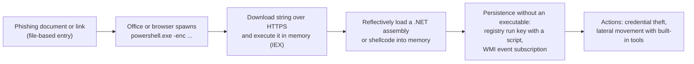

# Fileless malware

## Summary

Fileless malware is malicious code that runs without a traditional malicious executable on disk. It lives in memory, in places that are not ordinary files (the Windows registry, the WMI repository, event logs, RAM-backed directories), or inside trusted programs that are already installed, such as PowerShell, `mshta.exe` or `rundll32.exe` (often called *living off the land*). The term is loose: Microsoft notes there is "no one definition for fileless malware", and most real attacks are fileless only in some stages. The point of the technique is to defeat defenses that scan files: there is no file to hash, sign-check or upload to a sandbox. Detection therefore moves to behavior: script and command line logging, AMSI, memory scanning, and the parent-child relationships of trusted processes. All offensive aspects here are for defensive study.

## Prerequisites

- [Malware](../malware.md) and [malware definition and purpose](../malware-definition-and-purpose.md).
- [Dropper](../dropper.md): the classic, file-based way of installing payloads that fileless techniques try to avoid.
- Basic Windows and Linux internals: processes, memory, the registry, PowerShell, `/proc`.

## Core concepts

### Definition

Microsoft's Defender documentation ("Fileless threats", checked 2026-11) says: "The term 'fileless' suggests that a threat doesn't come in a file, such as a backdoor that lives only in the memory of a machine. However, there's no one definition for fileless malware. The term is used broadly, and sometimes to describe malware families that do rely on files to operate." It groups fileless threats into three types by the footprint they leave:

| Type | Description (Microsoft) | Example given by Microsoft |
| --- | --- | --- |
| Type I: no file activity performed | Never writes a file to disk | DoublePulsar backdoor installed through the EternalBlue SMB exploit, living in kernel memory. Firmware implants |
| Type II: indirect file activity | Does not write files directly, but uses multi-purpose containers that are files | Poshspy: a PowerShell command stored in the WMI repository and triggered by a WMI filter |
| Type III: files required to operate | Uses files, but they hold no inspectable malicious code | Kovter: a registry open-verb handler for a random extension runs a script through `mshta.exe` and loads the payload from the registry |

MITRE ATT&CK (Enterprise v20.1) has no single "fileless malware" technique. The behavior is spread across several, most importantly:

| Technique | What it covers |
| --- | --- |
| T1027.011 Fileless Storage | Storing data in "any format other than a file": registry, event logs, WMI repository, and on Linux shared memory directories such as `/dev/shm` that are "mapped directly to RAM" |
| T1620 Reflective Code Loading | "allocating then executing payloads directly within the memory of the process", for example `Assembly.Load()` from PowerShell |
| T1059.001 PowerShell | PowerShell "may also be used to download and run executables from the Internet, which can be executed from disk or in memory without touching disk" |
| T1546.003 WMI Event Subscription | Persistence through WMI filters and consumers, as in Poshspy |
| T1218 System Binary Proxy Execution | Running code through signed system binaries such as `mshta.exe` and `rundll32.exe` |

### Analogy

A burglar who wants to leave no fingerprints does not bring tools. He uses the kitchen knife to open the drawer, the house's own ladder to reach the window, and writes his notes on the family's whiteboard, which gets wiped every evening. Searching the house for "burglar's tools" finds nothing, because every tool belongs to the house.

The analogy captures living off the land and the failure of tool-based (file-based) searching. It breaks in two ways. First, the burglar's actions still leave traces in behavior (a ladder at an unusual window at 3 a.m.), just as fileless malware leaves traces in process trees and script logs. Second, "the whiteboard is wiped every evening" is only true for pure in-memory code; most fileless malware needs persistence and therefore writes somewhere, usually the registry or WMI.

### A typical chain



The chain shows why "fileless" is a property of stages, not of the whole attack. The entry was a document, which is a file, and persistence uses the registry or WMI, which are stored in files. Only the payload and the tooling avoid disk. Microsoft's classification puts this kind of script-based execution in Type II and macro or document entry in Type III.

### Why attackers use it

- **No file to scan.** File hashes, signatures and sandbox detonation of downloaded executables find nothing.
- **Trusted processes.** PowerShell and signed Windows binaries are allowed by many application control policies.
- **Little forensic residue.** Memory is lost at reboot, unless captured.
- **Speed.** Commodity frameworks provide in-memory loaders, so the technique is cheap for attackers.

### What defenders can still see

| Signal | Source | Covers |
| --- | --- | --- |
| Script content after deobfuscation | PowerShell Script Block Logging (event ID 4104), AMSI | PowerShell, VBScript, JScript, Office VBA through AMSI |
| Command lines and process trees | Process creation logging (Windows event 4688 with command line, Sysmon event 1), EDR | `winword.exe` starting `powershell.exe`, encoded commands |
| Memory | EDR memory scanning, memory forensics | Reflectively loaded modules, injected code |
| WMI persistence | Sysmon events 19, 20, 21 (WMI filter, consumer, binding), `Get-WmiObject` on `root\subscription` | Poshspy-style persistence |
| Registry | Registry auditing, Sysmon events 12 to 14 | Scripts stored in run keys |
| Linux | `/proc/<pid>/exe` pointing to `memfd:` or a deleted file, executables in `/dev/shm`, auditd `execve` and `memfd_create` | Anonymous memory execution |
| Network | Proxy and DNS logs | Download of the next stage |

## Worked example

The script [scripts/hunt-fileless-indicators.py](scripts/hunt-fileless-indicators.py) (Python 3.10, standard library only, read-only) has two hunts.

**Hunt 1, Linux processes.** It flags processes whose executable link in `/proc/<pid>/exe` points to an anonymous memory file (`/memfd:...`) or to a file deleted from disk, and executables in RAM-backed directories. Run as a normal user on an Ubuntu 22.04 workstation, November 2026:

```bash
python3 hunt-fileless-indicators.py proc
```

Output (shortened; three lines for a program started from a home directory removed):

```text
2900  gvfsd  /usr/libexec/gvfsd (deleted)  executable deleted from disk while running
2941  gnome-shell  /usr/bin/gnome-shell (deleted)  executable deleted from disk while running
3073  gnome-shell-cal  /usr/libexec/gnome-shell-calendar-server (deleted)  executable deleted from disk while running
...
820088  gvfsd-http  /usr/libexec/gvfsd-http (deleted)  executable deleted from disk while running
17 indicator(s)
```

No `memfd:` executables and nothing executable in `/dev/shm`. The 17 "deleted" hits are a classic false positive: a package upgrade replaced `/usr/bin/gnome-shell` and other binaries while the old versions were still running, so the kernel marks the old inode as deleted. Triage: the paths belong to installed packages (`dpkg -S /usr/bin/gnome-shell`), the package manager log shows a recent upgrade, and a reboot or service restart clears them. A suspicious hit looks different: a `memfd:` name, or a deleted executable that was in `/tmp`, `/dev/shm` or a hidden directory, with no package owning the path. Running as root gives a full view of other users' processes.

**Hunt 2, PowerShell script block logs.** Event ID 4104 records the text of script blocks as PowerShell compiles them, after the layers of obfuscation that PowerShell itself removes. The script scores exported events (JSON lines, synthetic sample in [fileless-malware-sample-4104-events.jsonl](../../../../_assets/security-operations/threats-and-attacks/fileless-malware-sample-4104-events.jsonl)) and decodes `-EncodedCommand` arguments, which are Base64 of UTF-16LE text. The sample contains no working payload, only the strings defenders look for, with a reserved documentation IP address:

```bash
python3 hunt-fileless-indicators.py ps4104 ../../../../../_assets/security-operations/threats-and-attacks/fileless-malware-sample-4104-events.jsonl
```

```text
 0  2026-11-10T08:00:02Z  SRV-01   -
 2  2026-11-10T08:00:05Z  SRV-01   encoded command line
 8  2026-11-10T14:06:41Z  LT-0388  executes a string as code; downloads content; encoded command line
 7  2026-11-10T14:06:43Z  LT-0388  downloads content; loads a .NET assembly from memory
```

The `SRV-01` encoded command decodes to `Write-Output 'backup finished'`, a benign scheduled task that happens to use `-EncodedCommand` (score 2, review the baseline). The `LT-0388` events decode to a download-and-execute pattern followed by `[Reflection.Assembly]::Load` on downloaded bytes: the T1059.001 and T1620 pattern, scored 8 and 7. In a real investigation the next steps are the process tree (what started PowerShell), the network connection to 198.51.100.7, a memory capture of the PowerShell process and a check of WMI subscriptions and run keys for persistence. Host `LT-0388` is the laptop from the [quid pro quo](../../../../security-and-risk-management/security-awareness/social-engineering/quid-pro-quo.md#worked-example) example, which shows how social engineering and fileless execution meet in one incident.

Hunt 2 depends on logging being enabled. PowerShell Script Block Logging is a Group Policy setting (Administrative Templates, Windows Components, Windows PowerShell, Turn on PowerShell Script Block Logging). I did not re-check the exact policy path for this note.

## Trade offs and when to use it

| Defense | Benefit | Cost and limits |
| --- | --- | --- |
| Script Block Logging and AMSI | See deobfuscated script content | Log volume, sensitive data can appear in logs, AMSI can be tampered with |
| Process creation logging with command lines | Process trees and encoded commands | Volume, needs central collection and retention |
| EDR with memory scanning | Detects reflective loading and injection | License cost, may be evaded or disabled |
| Application control (WDAC, AppLocker) with PowerShell Constrained Language Mode | Blocks many in-memory loader techniques | Effort to build and maintain policies, legitimate admin scripts must be signed |
| Attack surface reduction rules (for example blocking Office from creating child processes) | Breaks the common document-to-script chain | Compatibility testing per business application |
| Removing old PowerShell 2.0 | Removes a version without modern logging | Legacy scripts may break |
| Memory forensics | Highest visibility into in-memory payloads | Expensive per host, only during incidents |

The usual mistake is to see fileless malware as a reason for despair. It is a reason to invest in telemetry. File-based antivirus alone is the wrong tool for this threat.

## Common mistakes

- **Equating "fileless" with "undetectable".** Fix: behavior, script and memory telemetry detect it, often more reliably than file signatures.
- **Logging only process names, not command lines.** `powershell.exe` alone tells nothing. Fix: collect full command lines and script blocks.
- **Blocking PowerShell completely.** Administrators then use other interpreters, and attackers bring their own. Fix: Constrained Language Mode, signed scripts, logging.
- **Ignoring persistence stores.** Fix: hunt in WMI subscriptions, run keys and scheduled tasks, which hold the "fileless" persistence.
- **Rebooting a suspect host first.** Memory evidence is lost. Fix: capture memory before remediation.
- **Alerting on every encoded command.** Many management tools use them. Fix: baseline per host and parent process, score combinations as in the worked example.

## Detection and mitigation

**Detection.**

- PowerShell event 4104 content and AMSI detections; patterns such as `IEX`, `DownloadString`, `FromBase64String`, `Assembly.Load`, AMSI tampering strings.
- Unusual parents: Office applications, browsers or `mshta.exe` starting script interpreters.
- WMI event subscription creation (Sysmon 19 to 21), new run keys holding script text.
- Linux: `memfd:` executables, executables in `/dev/shm`, deleted executables outside package paths.
- Memory scanning alerts for unbacked executable memory regions.

**Mitigation.**

- Application control with script enforcement and Constrained Language Mode.
- Attack surface reduction rules, macro restrictions for documents from the internet.
- Remove PowerShell 2.0, keep script logging and AMSI on, protect EDR from tampering.
- Least privilege, so that in-memory code runs without administrator rights.
- Incident response: capture memory, then rebuild hosts where in-memory implants or persistence were found.

## Practice

1. Why does Microsoft say there is no single definition of fileless malware?
2. Which Microsoft type does a WMI-stored PowerShell command belong to, and why is it still called fileless?
3. What does PowerShell event 4104 record that a process creation event does not?
4. In hunt 1, why were the "deleted" executables judged benign?
5. Name two ATT&CK techniques that describe in-memory execution or storage.

Answers:

1. The term is used broadly, including for families that rely on files, and most attacks are fileless only in some stages.
2. Type II, indirect file activity. The WMI repository is a file, but it is a multi-purpose container that cannot simply be detected and deleted like a malicious executable.
3. The script block text as compiled, after PowerShell has removed layers of encoding.
4. They belonged to installed packages that had been upgraded while the old binaries were running; a restart clears them.
5. T1620 Reflective Code Loading and T1027.011 Fileless Storage (also T1059.001 PowerShell and T1546.003 WMI Event Subscription).

## Further reading

- [Microsoft, Fileless threats (Defender for Endpoint documentation)](https://learn.microsoft.com/en-us/defender-endpoint/malware/fileless-threats): the three types and the classification by entry point and host. Vendor source. Checked 2026-11.
- [MITRE ATT&CK T1027.011 Fileless Storage](https://attack.mitre.org/techniques/T1027/011/), [T1620 Reflective Code Loading](https://attack.mitre.org/techniques/T1620/), [T1059.001 PowerShell](https://attack.mitre.org/techniques/T1059/001/), [T1546.003 WMI Event Subscription](https://attack.mitre.org/techniques/T1546/003/): technique descriptions (Enterprise v20.1 STIX data, checked 2026-11).
- [NIST SP 800-53 Rev. 5, SI-4 System Monitoring](https://csrc.nist.gov/pubs/sp/800/53/r5/upd1/final): the monitoring control that behavior-based detection implements.
- Related notes: [rootkit](../rootkit/README.md), [dropper](../dropper.md), [malware](../malware.md), [intrusion detection systems](../../../defensive-operations/detection/ids/README.md).
