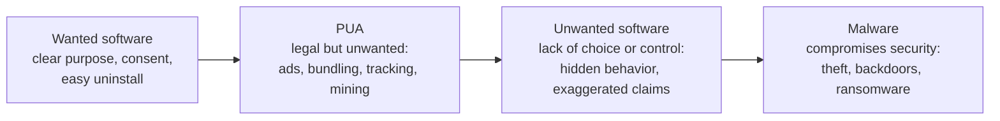

# Potentially unwanted application (PUA)

## Summary

A potentially unwanted application (PUA), also called a potentially unwanted program (PUP), is software that is not clearly malicious but behaves in ways most users and organizations do not want: it shows ads, bundles other programs, tracks browsing for marketing, mines cryptocurrency, evades security tools or makes exaggerated claims to sell a "fix". PUAs often arrive legally, with a click-through license, inside free software installers. They matter for security because they slow devices, weaken browser security, collect data, clutter investigations and are a common bridge to real malware. Security products handle them as a separate category with its own policy, usually audited first and then blocked, because what is "unwanted" depends on the organization.

## Prerequisites

- [Malware](malware.md) and [malware definition and purpose](malware-definition-and-purpose.md): PUA is defined by contrast with malware.
- [Scareware](scareware.md): misleading "health" claims overlap with PUA and unwanted software.
- Basic endpoint management: software inventory, endpoint protection policies.

## Core concepts

### Definition

Microsoft's Defender documentation (checked 2026-11) describes PUA as "a category of software that can cause your machine to run slowly, display unexpected ads, or at worst, install other software that might be unexpected or unwanted. PUA isn't considered a virus, malware, or other type of threat, but it might perform actions on endpoints that adversely affect endpoint performance or use." The criteria page states plainly: "PUAs aren't considered malware."

Microsoft's PUA categories, from "How Microsoft identifies malware and potentially unwanted applications":

| Category | Microsoft description (summarized) | Scope |
| --- | --- | --- |
| Advertising software | Displays ads or promotions, or prompts for surveys, in software other than itself, including inserting ads into web pages | All |
| Torrent software | Creates or downloads torrents or other peer-to-peer files | Enterprise only |
| Cryptomining software | Uses device resources to mine cryptocurrencies | Enterprise only |
| Bundling software | Offers to install software not developed by the same entity or not required, or that itself qualifies as PUA | All |
| Marketing software | Monitors and transmits user activity to other applications or services for marketing research | All |
| Evasion software | Actively tries to evade detection by security products, or behaves differently when they are present | All |
| Poor industry reputation | Detected by trusted security providers | All |

"Enterprise only" means the category applies when PUA protection is configured for organizations; a home user may legitimately want a torrent client.

PUA sits on a spectrum:



The arrow shows increasing harm and decreasing consent. Vendors place the boundaries differently, which is why the same program can be "clean" in one product and "PUA" in another.

### Analogy

PUA is the "free gift" that comes with a magazine subscription: a newsletter you did not ask for, a partner offer pre-checked on the order form, a loyalty card that records what you buy. None of it is theft, and you technically agreed, but you would not have chosen it, and it fills your mailbox.

The analogy fits the consent problem (agreement hidden in fine print) and the gradual nature (annoying rather than criminal). It breaks because a PUA runs code on your device with your privileges. A newsletter cannot change your browser settings, read your history or install the next program.

### Why organizations care

- **Security weakening.** Ad injectors and toolbars change browser settings, add root certificates or proxies in some cases, and open paths to malicious ads.
- **Data protection.** Marketing software sends browsing data to third parties, which can be a data protection issue (GDPR) for company devices.
- **Cost.** Cryptominers consume power and hardware, and slow devices create help desk tickets.
- **Bridge to malware.** Bundlers and download managers have delivered real malware through partner offers.
- **Noise.** Unmanaged software complicates incident response and asset inventory.
- **Licensing and legal risk.** Torrent clients raise copyright and data leakage questions.

## Worked example

**Step 1, classify an inventory.** An endpoint management tool exports installed software. A short script maps entries to Microsoft's PUA categories with reviewable keyword rules. Product names are fictional.

```python
# Python 3.10, standard library only. Synthetic software inventory, fictional product names.
import csv, io

INVENTORY = """host,product,publisher,signed,notes
LT-0101,PDF Converter Free,QuickTools Ltd,yes,installer offered 3 extra programs
LT-0101,SearchBoost Toolbar,AdNet Media,yes,changes browser start page and inserts ads
LT-0230,TorrentFlux,Unknown,no,peer-to-peer client
LT-0230,CryptoIdle Miner,Unknown,no,uses GPU when idle
LT-0311,ShopInsight Helper,Insight Analytics,yes,sends browsing history for market research
LT-0311,Corporate VPN Client,Example Corp IT,yes,approved software
LT-0420,PC Speed Doctor,Optimize Inc,yes,scan reports 200 registry errors and asks for payment
"""

RULES = [
    ("Bundling software", ["extra programs", "offers to install"]),
    ("Advertising software", ["inserts ads", "advertis"]),
    ("Torrent software (enterprise only)", ["peer-to-peer", "torrent"]),
    ("Cryptomining software (enterprise only)", ["miner", "mining"]),
    ("Marketing software", ["market research", "browsing history"]),
    ("Unwanted software: exaggerated health claims", ["registry errors", "asks for payment"]),
]

for row in csv.DictReader(io.StringIO(INVENTORY)):
    text = (row["product"] + " " + row["notes"]).lower()
    cats = [c for c, kws in RULES if any(k in text for k in kws)]
    flag = "unsigned" if row["signed"] == "no" else ""
    print(f"{row['host']}  {row['product']:<22} {', '.join(cats) or 'no PUA category'} {flag}".rstrip())
```

Output:

```text
LT-0101  PDF Converter Free     Bundling software
LT-0101  SearchBoost Toolbar    Advertising software
LT-0230  TorrentFlux            Torrent software (enterprise only) unsigned
LT-0230  CryptoIdle Miner       Cryptomining software (enterprise only) unsigned
LT-0311  ShopInsight Helper     Marketing software
LT-0311  Corporate VPN Client   no PUA category
LT-0420  PC Speed Doctor        Unwanted software: exaggerated health claims
```

The keyword approach is only a first pass; real classification uses the security product's verdicts. Notice that `PDF Converter Free` is flagged because of its installer behavior, not because the converter itself is harmful, and that `LT-0101` gained the toolbar through that bundle.

**Step 2, enable protection in audit mode, then block.** On Windows with Microsoft Defender Antivirus, the documented PowerShell commands are (from Microsoft Learn, not run for this note because the lab machine is Linux):

```powershell
Set-MpPreference -PUAProtection AuditMode   # log only, value 2
Get-MpPreference | Format-Table PUAProtection
Set-MpPreference -PUAProtection Enabled     # block, value 1
```

Microsoft documents the values as 0 off, 1 block and 2 audit, recommends starting in audit mode, records PUA events under event ID **1160**, and prefixes threat names with `PUA:` (for example `PUA:Win32/InstallCore` in its sample output). Default settings depend on onboarding and security intelligence version: devices not onboarded to Defender for Endpoint default to audit mode from security intelligence version 1.329.495.0, while some onboarded Windows 10 and Server versions default to block mode.

**Step 3, hunt across the fleet.** Microsoft's documented advanced hunting query for Defender for Endpoint (not run for this note):

```text
DeviceEvents
| where ActionType == "AntivirusDetection"
| extend x = parse_json(AdditionalFields)
| project Timestamp, DeviceName, FolderPath, FileName, SHA256, ThreatName = tostring(x.ThreatName), WasExecutingWhileDetected = tostring(x.WasExecutingWhileDetected), WasRemediated = tostring(x.WasRemediated)
| where ThreatName startswith_cs 'PUA:'
```

The audit period shows which detections are business tools (to exclude or replace) and which are true PUA (to remove), before block mode is switched on.

## Trade offs and when to use it

| Decision | Benefit | Cost and limits |
| --- | --- | --- |
| Audit mode first | Shows impact without disrupting users | PUA keeps running during the audit |
| Block mode | Prevents installation and execution | False positives on niche tools, exception handling needed |
| Browser PUA blocking (Microsoft Edge "Block potentially unwanted apps", SmartScreen) | Stops downloads before they reach disk | Browser specific, users may use another browser |
| Application control and an approved software catalog | Removes the need to judge each program | Effort to build and maintain |
| Local administrator rights removed | Users cannot install most PUAs | Help desk load for legitimate installs |
| Exclusions | Keep required tools working | Every exclusion is a blind spot, review them |

When it is the wrong tool: PUA protection is not a replacement for malware protection or for an approved software policy. In development or research environments, some PUA categories (torrent clients for distributing open source images, mining software in research) may be legitimate and need scoped exceptions rather than a global block.

## Common mistakes

- **Treating PUA detections as noise.** Fix: review them, they often reveal unmanaged software sources and bundlers that also deliver malware.
- **Switching straight to block mode.** Fix: audit, review, add justified exclusions, then block.
- **Broad exclusions** for whole folders such as `Downloads`. Fix: exclude specific, verified files or publishers.
- **Cleaning the PUA but not its bundle.** Fix: check what else the installer added (toolbars, browser extensions, scheduled tasks, browser settings).
- **Letting users keep administrator rights.** Fix: remove local admin and offer a self-service software catalog.

## Detection and mitigation

**Detection.**

- Endpoint protection events (Defender event ID 1160, threat names starting with `PUA:`), audit mode reports.
- Software inventory reviews against PUA categories, as in the worked example.
- Browser extension and setting changes (start page, search provider, proxy, new root certificates).
- Resource anomalies: sustained GPU or CPU use when idle (miners), unusual outbound connections to ad and tracking networks.

**Mitigation.**

- PUA protection in endpoint security and the browser, rolled out audit first.
- Application control or an approved software catalog, and no local administrator rights.
- Remove PUA with its bundled components, reset browser settings, review extensions.
- User guidance: download software only from the vendor or the internal catalog, and choose "custom install" to decline offers.

## Practice

1. Why does Microsoft not classify PUA as malware?
2. Which two Microsoft PUA categories apply only in enterprise settings, and why?
3. What do the `PUAProtection` values 0, 1 and 2 mean?
4. In the worked example, why is the PDF converter flagged even though converting PDFs is harmless?
5. Why should PUA protection start in audit mode?

Answers:

1. Because PUAs do not compromise security in the way malware does; they adversely affect performance, privacy or user control, often with some form of user consent.
2. Torrent software and cryptomining software, because they can be legitimate personal choices but are unwanted on managed business devices.
3. 0 off, 1 block, 2 audit (detect and log only).
4. Its installer bundles other programs, which is the "bundling software" category.
5. To find false positives and business-required tools before users are disrupted, then add justified exclusions.

## Further reading

- [Microsoft, Block potentially unwanted applications with Microsoft Defender Antivirus](https://learn.microsoft.com/en-us/defender-endpoint/detect-block-potentially-unwanted-apps-microsoft-defender-antivirus): definition, configuration, values, event ID 1160 and the hunting query. Vendor source. Checked 2026-11.
- [Microsoft, How Microsoft identifies malware and potentially unwanted applications](https://learn.microsoft.com/en-us/defender-xdr/criteria): PUA categories, unwanted software criteria and malware categories. Vendor source. Checked 2026-11.
- [NIST SP 800-53 Rev. 5, CM-11 User-Installed Software and CM-7 Least Functionality](https://csrc.nist.gov/pubs/sp/800/53/r5/upd1/final): the control basis for restricting software installation.
- Related notes: [scareware](scareware.md), [dropper](dropper.md), [malware](malware.md).
